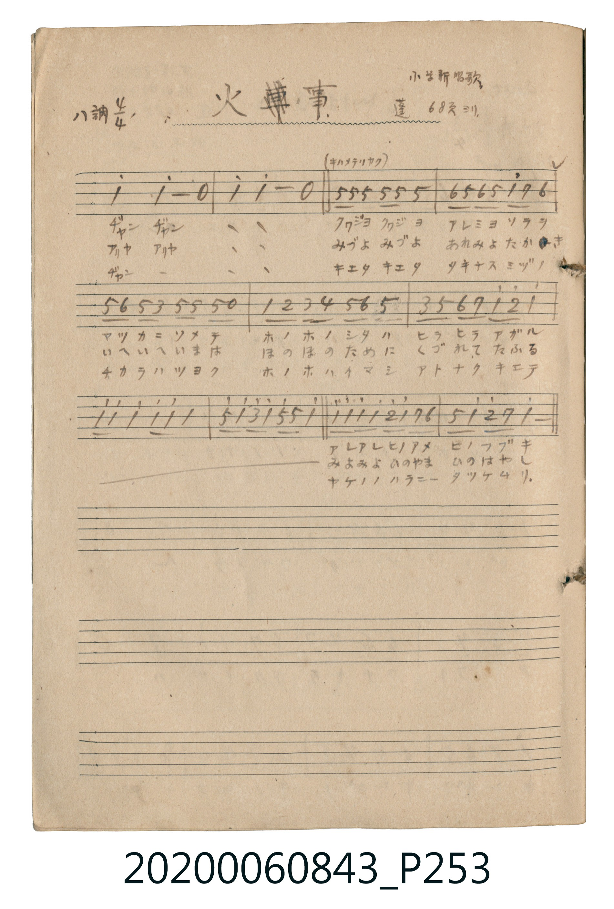

# 火事 (火災)

> Re:Shōka 使用 AI 協助辨識與重建樂譜，可能會有錯誤。歡迎回報。

- **鋼琴伴奏版**：<br><audio controls src="kaji.mp3"></audio>
- **NEUTRINO 歌聲合成版**：<br><audio controls src="kaji_neutrino.mp3"></audio>

- 公學校唱歌帳 補遺 — 小学新唱歌・蓬 68頁ヨリ

## 說明


- 出處：公學校唱歌帳 補遺 — 小学新唱歌- 蓬 68頁ヨリ
- 調性與拍號：調號 ?= C，拍號 <4/4>，速度 != 132


## 歌詞

```text
（TMD 檔案未包含歌詞註解）
```

## ABC

<div class="abc-score" data-abc-src="kaji.abc" aria-label="五線譜載入中"></div>

[下載 ABC 原始檔](kaji.abc)

## TMD 檔案連結

- [主旋律 TMD 檔案](kaji.tmd) [[在 TMD Studio 編輯](https://tmdlang.github.io/Tmd-TS/#tmd=s7IKdvYPcrWy4qpTUCpJTLdSSM7PyUlNLsnMz7MqzsjPTkzOyFeCS5bl55TmploBqXgDc4RwcX5pUXJqfEFieqpVgJGpMboM3KT4vPyS1KT8_GwMFRn5RYmZ8WB1xRmlCOmCovyy1LzEPKCS3MS80uLkosyCkvjk_IJKhJrUssyUVJCK1JTMkvyizMQcJBenFhWD_QJxYklRYh7EDKAgQlVJRirQW-X5RUgOAxqUnplnVZKYCXQVyGXlifG5iZl5OYl5KUpcWloKzxtXP9nVraABpJ837tVU0NLiUrRVMDQ24rK3VXDmsjHRN7EDmfa0dc3TtTueLVj4dMrGZ2t7nu7YrPBi8ZyXjbsUHjVMUXi6of_p2mXPpm2AyD5u3v1i8hoFM4uXCxofN6943LxKiYvLOzEr0yosPzkxx6HGoKaaSwEIbCy07MCMGgXDOAVdCAGCBkCMXcwUDHXhdI2CGZAGYaBCcyADKAQ20sewRuFxM9D-xY-bNwNFkdkgGA_WTISKpvWPm9cDqR1ABStAytAFQGoWAdlrgHg-WOxx014gvRKINyHcYwRWBwyMx81LwMYg2Mi2EVTRuB-IlwJlO0BqUHgg2SYguwciDhR73Ah0UWM3EPciXGIMsmcHwt9IbGSXEFaxFohBvt0PVoPMA8mCXAAUa-4C0juhYdMKxH1gl0DjHRJ3xtD4NADFuoIRkG8ClQEZBZI1A0YuMIaN4iAJAjmO5wFxM9CO1UAa6FNw2C8E4jZoDM8G2wmnm7ZD3NbcD5WfBI0rKA2KyyZQXK5GjbvGFiAGxjkKvQ-I10NDfjcQr0Oigf5tagTSYHOAdD80pkCxswwaM1uB_G7UmGkG6gH7BeQmoJ5moD3gNAW1B8U_QPmmJZAwAPoLkRaBMQ8Od1A6hcYLJDxg4Q4MRQgC5zAYExQfQIYxmAuKEIzAhmURbCzkLIRdHjlZUcLCnqmwsZCzEXZ5qrsJJXthV0nQJCq6CT3C4bkIVFpCIxwoAM5ekOyNFN-wgg1ewIEyCSgTgfgL4dkHlBynAvE0cHJDMQWcdWCFEYzeBMkiTZAsBFIBFQFmJojodFRTwBkDFG8bobaBMChzgDIJOAMB5UCZGqgXrGYBEK-Cm1HLxaVrpwCqghSAtDIXAA)]
- [鋼琴伴奏 TMD 檔案](kaji_piano.tmd) [[在 TMD Studio 編輯](https://tmdlang.github.io/Tmd-TS/#tmd=s7IKdvYPcrWy4tLSUnjeuPrJrm4FDSD9vHGvpoJGQGZiXr6CY3Jyfm5BYl5mbmpeiaaClhaXoq2CobERl72tgjOXjYm-iR1XnYLS09Y1T9fueLZg4dMpG5-t7Xm6Y7PCi8VzXjbuUnjUMEXh6Yb-p2uXPZu2ASL7uHn3i8lrFMwsXi5ofNy84nHzKiUuLu_ErEwrsJ0ONQY11VwKQGBjoWUHZtQoGMYp6EIIEDQAYuxipmCoC6drFMyANAgDFZoDGUAhsJE-hjUKj5uB9i9-3LwZKIrMBsF4sGYiVDStf9y8HkjtACpYAVKGLgBSswjIXgPE88Fij5v2AumVQLwJ4R4jsDpgYDxuXgI2BsFGto2gisb9QLwUKNsBUoPCA8k2Adk9EHGg2ONGoIsau4G4F-ESY5A9OxD-RmIju4SwirVADPLtfrAaZB5IFuQCoFhzF5DeCQ2bViDuA7sEGu-QuDOGxqcBKNYVjIB8E6gMyCiQrBkwcoExbBQHSRDIcTwPiJuBdqwG0kCfgsN-IRC3QWN4NthOON20HeK25n6o_CRoXEFpUFw2geJyNWrcNbYAMTDOUeh9QLweGvK7gXgdEg30b1MjkAabA6T7oTEFip1l0JjZCuR3o8ZMM1AP2C8gNwH1NAPtAacpqD0o_gHKNy2BhAHQX4i0CIx5cLiD0ik0XiDhAQt3YChCEDiHwZig-AAyjMFcUIRgBDYsi2BjIWch7PLIyYoSFvZMhY2FnI2wy1PdTSjZC7tKgiZR0U3oEQ7PRaDSEhrhQAFw9oJkb6T4hhVs8AIOlElAmQjEXwjPPqDkOBWIp4GTG4op4KwDK4xg9CZIFmmCZCGQCqgIMDNBRKejmgLOGKB42wi1DYRBmQOUScAZCCgHytRAvWA1C4B4FdyMWuT6J8gDaw1krG2qDQ4COANR6xCQw8BghWBZE20zMBtGG4O0m2qbgwVg3oMYAlNiqG2sYASkYRhUKJrGaxsqmMdrG0FlTVB0gCtLoDhMDGQ-1CJgzIJZKFah-QWTAfMV2AhgaQBmITwIVwMWRSFM4DYaAR1hCHQMxCyQ4TBpkAyUjxE5PsiRY4JoHsSDkGk8pIZA4wBZEBIY3PEIBPMwXDlYBZBpFK9gDBYD84AqIQYgqUcyEUgDFUNVQE0GGgAyHySKpBvoD8-8kqJ8LKkM4ZHqtFqFaMNYCDaF4BqFaBMgC4RhImiGEQoVJL9DeSADXPNSMvPSCTgH5B6YzVAa6B6g65DyDrJBOJwCsRlCgh2GpF3XTgHsFwUgAxTT0T4g42FsIyS2MZgNsQ7EUuYCAA)]

## 分析

```text
================================================================================
📊 TMD Song Profile: [ 火事 火災 ]
================================================================================
⏱  Duration:       0:20 (20.0s), 11 measures total
🎼 Key & Tempo:    首調基準 C, != 132.0 BPM, <4/4>
   - 分析範圍：      由實際發聲的音符與和弦推測調性；播放脈絡另行呈現
🎤 人聲音域:    C4 (MIDI 60) – E5 (MIDI 76) [跨度: 16 個半音 / 1.3 個八度, 難度: moderate]
   - 最低音:  C4 in [Kaji #1 @ m.6, 0:09]
   - 最高音: E5 in [Kaji #1 @ m.9, 0:15]
   - 適合: soprano, mezzo-soprano, contralto, tenor, baritone, bass
🏛  結構:      Kaji (20.0s)
⚡ 編曲密度:        Peak 1 軌道同時演奏
🗝  調性診斷：       C 大調（純淨自然大調，未偵測到可信轉調）
   - 風格氣質:    純淨自然大調（陽光明朗、易唱易記，無明顯調外色彩）
   - 轉調歷程:    全曲維持單一推測調性（未偵測到可信轉調）
   - 核心骨幹音:  C, G, A, D, E
   - 調性數值:    C 大調 [相關度: 0.88, 穩定度: High, 自然音純度: 100.0%]
   - 候選調性 (K-S): C 大調 (0.88), C 小調 (0.69), G 大調 (0.57)
   - 五度圈歷程:   +0
   - 各段落調性細節:
     • [Kaji #1]: C 大調 (r: 0.88, 自然音純度: 100.0%)

  [ 五度圈游移軌跡 ]
              [C ]*
         F            G  
      Bb               D  
      Eb               A  
         Ab           E  
            Db       B  
               F# 
     (* = active key center)

  [ 十二半音累積音高分佈 ]
     C  : ████████████████████████  47.0%
     C# :                            0.0%
     D  : ██                         4.8%
     D# :                            0.0%
     E  : ██                         4.8%
     F  : █                          1.2%
     F# :                            0.0%
     G  : ██████████████            27.7%
     G# :                            0.0%
     A  : █████                      9.6%
     A# :                            0.0%
     B  : ██                         4.8%
--------------------------------------------------------------------------------
Assignment 軌道音域：
  - Vocal         : C4 – E5 (16 個半音 / 1.3 個八度, 64 個音符)
================================================================================
```


## 原書掃描頁




