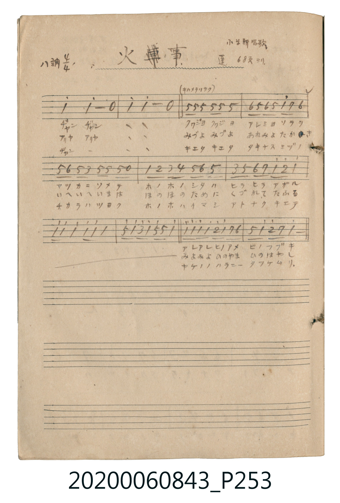

# 火事 (火災)

> Re:Shōka 使用 AI 協助辨識與重建樂譜，可能會有錯誤。歡迎回報。

- **鋼琴伴奏版**：<br><audio controls src="kaji.mp3"></audio>
- **NEUTRINO 歌聲合成版**：<br><audio controls src="kaji_neutrino.mp3"></audio>

- 公學校唱歌帳 補遺 — 小学新唱歌・蓬 68頁ヨリ

## 說明


- 出處：公學校唱歌帳 補遺 — 小学新唱歌- 蓬 68頁ヨリ
- 調性與拍號：調號 ?= C，拍號 <4/4>，速度 != 132


## 歌詞

```text
（TMD 檔案未包含歌詞註解）
```

## ABC

<div class="abc-score" data-abc-src="kaji.abc" aria-label="五線譜載入中"></div>

[下載 ABC 原始檔](kaji.abc)

## TMD 檔案連結

- [主旋律 TMD 檔案](kaji.tmd) [[在 TMD Studio 編輯](https://tmdlang.github.io/Tmd-TS/#tmd=s7IKdvYPcrWy4qpTUCpJTLdSSM7PyUlNLsnMz7MqzsjPTkzOyFeCS5bl55TmploBqXgDc4RwcX5pUXJqfEFieqpVgJGpMboM3KT4vPyS1KT8_GwMFRn5RYmZ8WB1xRmlCOmCovyy1LzEPKCS3MS80uLkosyCkvjk_IJKhJrUssyUVJCK1JTMkvyizMQcJBenFhWD_QJxYklRYh7EDKAgQlVJRirQW-X5RUgOAxqUnplnVZKYCXQVyGXlifG5iZl5OYl5KciqSjLy04sSCzIqrTIyi0HWJyfmxGcn5iUqcWlpKTxvXP1kV7eCBpB-3rhXU0FLi0vRVsHQ2IjL3lbBmcvGRN_EDmTY09Y1T9fueLZg4dMpG5-t7Xm6Y7PCi8VzXjbuUnjUMEXh6Yb-p2uXPZu2ASL7uHn3i8lrFMwsXi5ofNy84nHzKiUuLu_ErEyrsHyg7Q41BjXVXApAYGOhZQdm1CgYxinoQggQNABi7GKmYKgLp2sUzIA0CAMVmgMZQCGwkT6GNQqPm4H2L37cvBkoiswGwXiwZiJUNK1_3LweSO0AKlgBUoYuAFKzCMheA8TzwWKPm_YC6ZVAvAnhHiOwOmBgPG5eAjYGwUa2jaCKxv1AvBQo2wFSg8IDyTYB2T0QcaDY40agixq7gbgX4RJjkD07EP5GYiO7hLCKtUAM8u1-sBpkHkgW5AKgWHMXkN4JDZtWIO4DuwQa75C4M4bGpwEo1hWMgHwTqAzIKJCsGTBygTFsFAdJEMhxPA-Im4F2rAbSQJ-Cw34hELdBY3g22E443bQd4rbmfqj8JGhcQWlQXDaB4nI1atw1tgAxMM5R6H1AvB4a8ruBeB0SDfRvUyOQBpsDpPuhMQWKnWXQmNkK5HejxkwzUA_YLyA3AfU0A-0BpymoPSj-Aco3LYGEAdBfiLQIjHlwuIPSKTReIOEBC3dgKEIQOIfBmKD4ADKMwVxQhGAENiyLYGMhZyHs8sjJihIW9kyFjYWcjbDLU91NKNkLu0qCJlHRTegRDs9FoNISGuFAAXD2gmRvpPiGFWzwAg6USUCZCMRfCM8-oOQ4FYingZMbiingrAMrjGD0JkgWaYJkIZAKqAgwM0FEp6OaAs4YoHjbCLUNhEGZA5RJwBkIKAfK1EC9YDULgHgV3IxaLi5dOwVQFaQApJW5AA)]
- [鋼琴伴奏 TMD 檔案](kaji_piano.tmd) [[在 TMD Studio 編輯](https://tmdlang.github.io/Tmd-TS/#tmd=s7IKdvYPcrWy4qpTUCpJTLdSyC8qychPL0osyKi0ysgsLskvykxOzInPTsxLVIIrKs4vLUpOjS9ITE-1CjAyNUbIlGSk5qZapaaUJieWZObnKXFpaSk8b1z9ZFe3ggaQft64V1NBIyAzMS9fwTE5OT-3IDEvMzc1r0RTQUuLS9FWwdDYiMveVsGZy8ZE38QOZOzT1jVP1-54tmDh0ykbn63tebpjs8KLxXNeNu5SeNQwReHphv6na5c9m7YBIvu4efeLyWsUzCxeLmh83LzicfMqJS4u78SsTCuwnQ41BjXVXApAYGOhZQdm1CgYxinoQggQNABi7GKmYKgLp2sUzIA0CAMVmgMZQCGwkT6GNQqPm4H2L37cvBkoiswGwXiwZiJUNK1_3LweSO0AKlgBUoYuAFKzCMheA8TzwWKPm_YC6ZVAvAnhHiOwOmBgPG5eAjYGwUa2jaCKxv1AvBQo2wFSg8IDyTYB2T0QcaDY40agixq7gbgX4RJjkD07EP5GYiO7hLCKtUAM8u1-sBpkHkgW5AKgWHMXkN4JDZtWIO4DuwQa75C4M4bGpwEo1hWMgHwTqAzIKJCsGTBygTFsFAdJEMhxPA-Im4F2rAbSQJ-Cw34hELdBY3g22E443bQd4rbmfqj8JGhcQWlQXDaB4nI1atw1tgAxMM5R6H1AvB4a8ruBeB0SDfRvUyOQBpsDpPuhMQWKnWXQmNkK5HejxkwzUA_YLyA3AfU0A-0BpymoPSj-Aco3LYGEAdBfiLQIjHlwuIPSKTReIOEBC3dgKEIQOIfBmKD4ADKMwVxQhGAENiyLYGMhZyHs8sjJihIW9kyFjYWcjbDLU91NKNkLu0qCJlHRTegRDs9FoNISGuFAAXD2gmRvpPiGFWzwAg6USUCZCMRfCM8-oOQ4FYingZMbiingrAMrjGD0JkgWaYJkIZAKqAgwM0FEp6OaAs4YoHjbCLUNhEGZA5RJwBkIKAfK1EC9YDULgHgV3Ixa5PonyANrDWSsbaoNDgI4A1HrEJDDwGCFYFkTbTMwG0Ybg7SbapuDBWDegxgCU2KobaxgBKRhGFQomsZrGyqYx2sbQWVNUHSAK0ugOEwMZD7UImDMglkoVqH5BZMB8xXYCGBpAGYhPAhXAxZFIUzgNhoBHWEIdAzELJDhMGmQDJSPETk-yJFjgmgexIOQaTykhkDjAFkQEhjc8QgE8zBcOVgFkGkUr2AMFgPzgCohBiCpRzIRSAMVQ1VATQYaADIfJIqkG-gPz7ySonwsqQzhkeq0WoVow1gINoXgGoVoEyALhGEiaIYRChUkv0N5IANc81Iy89IJOAfkHpjNUBroHqDrkPIOskE4nAKxGUKCHYakXddOAewXBSADFNPRPiDjYWwjJLYxmA2xDsRS5gIA)]

## 分析

```text
================================================================================
📊 TMD Song Profile: [ 火事 火災 ]
================================================================================
⏱  Duration:       0:20 (20.0s), 11 measures total
🎼 Key & Tempo:    首調基準 C, != 132.0 BPM, <4/4>
   - 分析範圍：      由實際發聲的音符與和弦推測調性；播放脈絡另行呈現
🎤 人聲音域:    C4 (MIDI 60) – E5 (MIDI 76) [跨度: 16 個半音 / 1.3 個八度, 難度: moderate]
   - 最低音:  C4 in [Kaji #1 @ m.6, 0:09]
   - 最高音: E5 in [Kaji #1 @ m.9, 0:15]
   - 適合: soprano, mezzo-soprano, contralto, tenor, baritone, bass
🏛  結構:      Kaji (20.0s)
⚡ 編曲密度:        Peak 1 軌道同時演奏
🗝  調性診斷：       C 大調（純淨自然大調，未偵測到可信轉調）
   - 風格氣質:    純淨自然大調（陽光明朗、易唱易記，無明顯調外色彩）
   - 轉調歷程:    全曲維持單一推測調性（未偵測到可信轉調）
   - 核心骨幹音:  C, G, A, D, E
   - 調性數值:    C 大調 [相關度: 0.88, 穩定度: High, 自然音純度: 100.0%]
   - 候選調性 (K-S): C 大調 (0.88), C 小調 (0.69), G 大調 (0.57)
   - 五度圈歷程:   +0
   - 各段落調性細節:
     • [Kaji #1]: C 大調 (r: 0.88, 自然音純度: 100.0%)

  [ 五度圈游移軌跡 ]
              [C ]*
         F            G  
      Bb               D  
      Eb               A  
         Ab           E  
            Db       B  
               F# 
     (* = active key center)

  [ 十二半音累積音高分佈 ]
     C  : ████████████████████████  47.0%
     C# :                            0.0%
     D  : ██                         4.8%
     D# :                            0.0%
     E  : ██                         4.8%
     F  : █                          1.2%
     F# :                            0.0%
     G  : ██████████████            27.7%
     G# :                            0.0%
     A  : █████                      9.6%
     A# :                            0.0%
     B  : ██                         4.8%
--------------------------------------------------------------------------------
Assignment 軌道音域：
  - Vocal         : C4 – E5 (16 個半音 / 1.3 個八度, 64 個音符)
================================================================================
```


## 原書掃描頁




