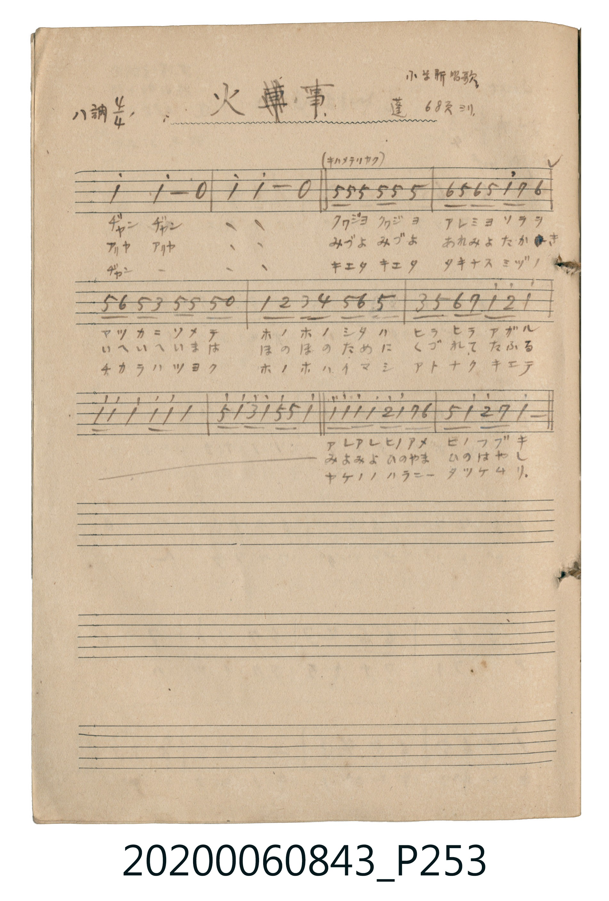

# 火事 (火災)

> Re:Shoka 使用 AI 協助辨識與重建樂譜，可能會有錯誤。歡迎回報。

<audio controls src="kaji.mp3"></audio>

- 公學校唱歌帳 補遺 — 小学新唱歌・蓬 68頁ヨリ

## 說明

・出處：公學校唱歌帳 補遺 — 小学新唱歌・蓬 68頁ヨリ
・調性與拍號：調號 ?= C，拍號 <4/4>，速度 != 132

## 歌詞

```text
（TMD 檔案未包含歌詞註解）
```

## ABC

```abc
X:1
T:火事 火災
M:4/4
L:1/16
Q:1/4=132
K:C
V:V1 name="Vocal" snm="Voc"
[V:V1]
c4 c8 z4 | c4 c8 z4 | G2 G2 G2 G2 G4 G4 | A2 G2 A2 G2 c2 B2 A4 |
G2 A2 G2 E2 G2 G2 G2 z2 | C2 D2 E2 F2 G2 A2 G4 | E2 G2 A2 B2 c2 d2 c4 | c4 c4 c4 c4 |
G2 c2 e2 c2 G2 G2 c4 | c2 c2 c2 c2 d2 c2 B2 A2 | G4 c2 d2 B4 c4 |
```

## TMD 檔案連結

- [主旋律 TMD 檔案](kaji.tmd) [[在 TMD Studio 編輯](https://tmdlang.github.io/Tmd-TS/#tmd=s7IKdvYPcrWy4qpTUCpJTLdSSM7PyUlNLsnMz7MqzsjPTkzOyFeCS5bl55TmploBqXgDc4RwcX5pUXJqfEFieqpVgJGpMboM3KT4vPyS1KT8_GwMFRn5RYmZ8WB1xRmlCOmCovyy1LzEPKCS3MS80uLkosyCkvjk_IJKhJrUssyUVJCK1JTMkvyizMQcJBenFhWD_QJxYklRYh7EDKAgQlVJRirQW-X5RUCHaWkpPG9c_WRXt4IGkH7euFdTQUuLS9FWwdDYiMveVsGZy8ZE38QOpPdp65qna3c8W7Dw6ZSNz9b2PN2xWeHF4jkvG3cpPGqYovB0Q__TtcueTdsAkX3cvPvF5DUKZhYvFzQ-bl7xuHmVEheXd2JWplVYfnJijkONQY1CNZcCENhYaNmBGTUKhnEKuhACBA2AGLuYKRzqgnGNghmQBmGgQnMgAygENlJfS6HcSuFxM9AJix83bybEalr_uHk9kNoBFFyByV0EpNcA8Xwofy-QXgnEmxS09JGta1oE9O7j5iWEWI37gXgpUKQDjd0EpHsgYmA-0MLGbiDuRbdoB9zl-FlrgRjkYpCByGwov7kLSO-E-qwViPtgFoHCGhSuxtDwNgDFiIIRkG8ClQGFPkjWDBjwwNA3ioNEFmr4zwPiZqAdq4E00CPgkFsIxG1APBtsH5xu2g5xV3M_EE-ChjCUBsVAEygGVqMFRGMLEAOjCYXeB8TA6GvcDcTrkGigJ5sagTTQMY1AS8ChDgrtZdCQ3grkd6NZ0AzUAHY9yDUglwEtgCQRNB8A5ZqAUQvyMdgnoDQDjEJwCIPSEjT0gT6HhzAihSMIULgDGcbg0AQFPFQUSMERJKhByR2kGqwRKGQON4KsHEBcitICQ3iOgOcMUDyB4hDEB8UvlN88FYingX1PXk4hzVnwfAOjN0FivgmWKqB8UOoAi00nN1-R5CywRzZCQwSEQekIlJ6AiQ2a5oGOAatYAMSrQI6q5eLStVMAlZsKQFqZCwA)]
- [鋼琴伴奏 TMD 檔案](kaji_piano.tmd) [[在 TMD Studio 編輯](https://tmdlang.github.io/Tmd-TS/#tmd=s7IKdvYPcrWy4tLSUnjeuPrJrm4FDSD9vHGvpoJGQGZiXr6CY3Jyfm5BYl5mbmpeiaaClhaXoq2CobERl72tgjOXjYm-iR1XnYLS09Y1T9fueLZg4dMpG5-t7Xm6Y7PCi8VzXjbuUnjUMEXh6Yb-p2uXPZu2ASL7uHn3i8lrFMwsXi5ofNy84nHzKiUuLu_ErEyrsPzkxByHGoMahWouBSCwsdCyAzNqFAzjFHQhBAgaADF2MVM41AXjGgUzIA3CQIXmQAZQCGykvpZCuZXC42agExY_bt5MiNW0_nHzeiC1Ayi4ApO7CEivAeL5UP5eIL0SiDcpaOkjW9e0COjdx81LCLEa9wPxUqBIBxq7CUj3QMTAfKCFjd1A3Itu0Q64y_Gz1gIxyMUgA5HZUH5zF5DeCfVZKxD3wSwChTUoXI2h4W0AihEFIyDfBCoDCn2QrBkw4IGhbxQHiSzU8J8HxM1AO1YDaaBHwCG3EIjbgHg22D443bQd4q7mfiCeBA1hKA2KgSZQDKxGC4jGFiAGRhMKvQ-IgdHXuBuI1yHRQE82NQJpoGMagZaAQx0U2sugIb0VyO9Gs6AZqAHsepBrQC4DWgBJImg-AMo1AaMW5GOwT0BpBhiF4BAGpSVo6AN9Dg9hRApHEKBwBzKMwaEJCnioKJCCI0hQg5I7SDVYI1DIHG4EWTmAuBSlBYbwHAHPGaB4AsUhiA-KXyi_eSoQTwP7nrycQpqz4PkGRm-CxHwTLFVA-aDUARabTm6-IslZYI9shIYICIPSESg9ARMbNM0DHQNWsQCIV4EcVQstNMEFdZAH9mLTWNtUGxzlcAaiqCQgh4HBCsGyJtpmYDaMNgZpN9U2BwvAkhfEEJgSQ21jBSMgDcOg0sI0XttQwTxe2wgqa4KiA5ymgeIwMZD5UIuAaRnMQrEKzS-YDJivwEYAsw-YhfAgXA1YFIUwgdtoBHSEIdAxELNAhsOkQTJQPshZKLHjgxI7JohKLR6ETOMhZScaB8iCkMDwjkcgmI_hysEqgEyjeAVjsBiYB1QJMQBJPZKJQBqoGKoCajLQAJD5IFEk3UCPeOaVFOVjS2cIn1Sn1SpEG8ZCsCkE1yhEmwBZIAwTQTONYLgg-R7KA5ngmpeSmZdOyEEgF8HshtJAFwHdB0nnGCbhcgzEbggJdhqSfl07BbB3FIAMUHSDaIiZIJYyFwA)]

## 分析

```text
================================================================================
📊 TMD Song Profile: [ 火事 火災 ]
================================================================================
⏱  Duration:       0:20 (20.0s), 11 measures total
🎼 Key & Tempo:    首調基準 C, != 132.0 BPM, <4/4>
   - 分析範圍：      由實際發聲的音符與和弦推測調性；播放脈絡另行呈現
🎤 人聲音域:    C4 (MIDI 60) – E5 (MIDI 76) [跨度: 16 個半音 / 1.3 個八度, 難度: moderate]
   - 最低音:  C4 in [Kaji #1 @ m.6, 0:09]
   - 最高音: E5 in [Kaji #1 @ m.9, 0:15]
   - 適合: soprano, mezzo-soprano, contralto, tenor, baritone, bass
🏛  結構:      Kaji (20.0s)
⚡ 編曲密度:        Peak 1 軌道同時演奏
🗝  調性診斷：       C 大調（純淨自然大調，未偵測到可信轉調）
   - 風格氣質:    純淨自然大調（陽光明朗、易唱易記，無明顯調外色彩）
   - 轉調歷程:    全曲維持單一推測調性（未偵測到可信轉調）
   - 核心骨幹音:  C, G, A, B, D
   - 調性數值:    C 大調 [相關度: 0.89, 穩定度: High, 自然音純度: 100.0%]
   - 候選調性 (K-S): C 大調 (0.89), C 小調 (0.68), G 大調 (0.60)
   - 五度圈歷程:   +0
   - 各段落調性細節:
     • [Kaji #1]: C 大調 (r: 0.89, 自然音純度: 100.0%)

  [ 五度圈游移軌跡 ]
              [C ]*
         F            G  
      Bb               D  
      Eb               A  
         Ab           E  
            Db       B  
               F# 
     (* = active key center)

  [ 十二半音累積音高分佈 ]
     C  : ████████████████████████  44.6%
     C# :                            0.0%
     D  : ███                        4.8%
     D# :                            0.0%
     E  : ███                        4.8%
     F  : █                          1.2%
     F# :                            0.0%
     G  : ████████████████          28.9%
     G# :                            0.0%
     A  : █████                      9.6%
     A# :                            0.0%
     B  : ███                        6.0%
--------------------------------------------------------------------------------
Assignment 軌道音域：
  - Vocal         : C4 – E5 (16 個半音 / 1.3 個八度, 62 個音符)
================================================================================
```


## 原書掃描頁




