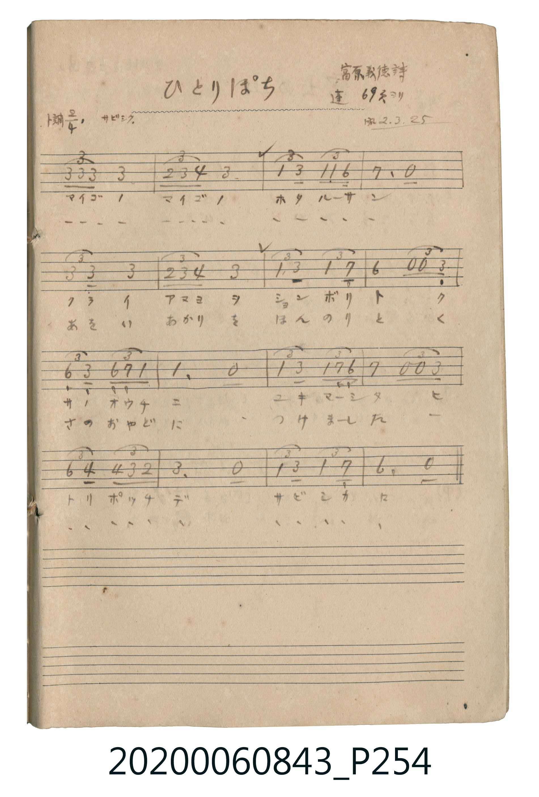

# ひとりぼっち (孤零零)

> Re:Shōka 使用 AI 協助辨識與重建樂譜，可能會有錯誤。歡迎[回報](https://github.com/TMDLang/reshoka/issues)。

- **鋼琴伴奏版**：<br><audio controls src="hitoribocchi.mp3"></audio>
- **NEUTRINO 歌聲合成版**：<br><audio controls src="hitoribocchi_neutrino.mp3"></audio>

- 詞：富原義徳
- 曲：佐々木すぐる
- 公學校唱歌帳 補遺 — 蓬 69頁ヨリ

## 說明


- 出處：公學校唱歌帳 補遺 — 蓬 69頁ヨリ
- 調性與拍號：調號 ?= G，拍號 <2/4>，速度 != 76


## 歌詞

```text
（TMD 檔案未包含歌詞註解）
```

## ABC

<div class="abc-score" data-abc-src="hitoribocchi.abc" aria-label="五線譜載入中"></div>

[下載 ABC 原始檔](hitoribocchi.abc)

## TMD 檔案連結

- [主旋律 TMD 檔案](hitoribocchi.tmd) [[在 TMD Studio 編輯](https://tmdlang.github.io/Tmd-TS/#tmd=s7IKdvYPcrWy4qpTUCpJTLdSSM7PyUlNLsnMz7MqzsjPTkzOyFeCS5bl55TmploBqXgDc4RwcX5pUXJqfEFieqpVgJGpCboM3KT4vPyS1KT8_GwMFRn5RYmZ8WB1xRmlCOmCovyy1LzEPKCS3MS80uLkosyCkvjk_IJKhJrUssyUVJCK1JTMkvyizMQcJBenFhWD_QJxYklRYh7EDKAgQhVQU3pmnlVJYibQBSBXlCfG5yZm5uUk5qUgqyrJyE8vSizIqLTKyCwGWZWcmBOfnZiXiFBUkpEKDKGkzKKUYiUuLS2Fx42bHjeueNzU9bhxz-PGxY8bFypoPF275OXsbUCkqaClxaVoq2BuxmVvq-DOZWOkb2IHMurFynnv98x6ur7nad_85_tWPt23GWzDs9mbgMJP9k543ND6bM6Kx40zHzdOeNzUDZZ82rrm6dodzxYsfDpl47O1PU93bFZ4sXjOy8ZdCo8apii8mLxGwczy5YLGx80rHjevUuLi8gAHVlJ-cnJGplVAZmJevkONQU01lwIQ2Jho2YEZNQoaxgpAqKmqoasJZAD5RkDKBIlvCKR0IXwg21DBLB7CqVEwj1cwUKgBm-NjCFT5uHmewuOmJUC8RVPhcXMfSDd2sdlA_n6gqSD2agVdIG8ryMDHzZsV4mEmGlHTRIRndRWMoR7A4VugArhvdYF-hPnWLF5BwwDoYZh2ZI83rQdZ2bwS6CCgy8Aii4B8oEObV4AcuQkitv1x83Kwws1gd84Bs1dB3NmhoBEPdCrQKLjR4BBobAL7ZhLQmMYWsDFAkceN3UCxLpB1kyBiu8GqJoPMbVwHZgNlgeY2roCa29gPMhcWDkDPIAICxAPGpSHMp4agaEUPCqAClJiHhAWWoNgK9lUfyCVNq4DuWAbkNUL82A2KC5DPl4FduBYcCvPA7O1gFcAohLi2GehflFCYClLVuA7svy6gwhYgDxjcIB-uhprauASsZiJYzT4wezpExXwUU-FhAFQCjXoNE2DsG8F8Z4zN_2hJAS3hd8CiEsieC2Q1IzzdDnUeNGDAUdS0HTmJgoMFOdFTwbRaLi5dOwXkMkAByFfmAgA)]
- [鋼琴伴奏 TMD 檔案](hitoribocchi_piano.tmd) [[在 TMD Studio 編輯](https://tmdlang.github.io/Tmd-TS/#tmd=s7IKdvYPcrWy4qpTUCpJTLdSyC8qychPL0osyKi0ysgsLskvykxOzInPTsxLVIIrKs4vLUpOjS9ITE-1CjAyNUHIlGSk5qZaJWUWpRQrcWlpKTxu3PS4ccXjpq7HjXseNy5-3LhQQePp2iUvZ28DIk0FjYDMxLx8Bcfk5PzcgsS8zNzUvBJNBS0tLkVbBXMzLntbBXcuGyN9EzuQBS9Wznu_Z9bT9T1P--Y_37fy6b7NYHufzd4EFH6yd8LjhtZnc1Y8bpz5uHHC46ZusOTT1jVP1-54tmDh0ykbn63tebpjs8KLxXNeNu5SeNQwReHF5DUKZpYvFzQ-bl7xuHmVEheXRybIx0n5yckZmVZgxznUGNRUcykAgY2Jlh2YUaOgYawAhJqqGrqaQAaQbwSkTJD4hkBKF8IHsg0VzOIhnBoF83gFA4UasDk-hkCVj5vnKTxuWgLEWzQVHjf3gXRjF5sN5O8Hmgpir1bQBfK2ggx83LxZIR5mohE1TUR4VlfBGOoBHL4FKoD7VhfoR5hvzeIVNAyAHoZpR_Z403qQlc0rgQ4CugwssgjIBzq0eQXIkZsgYtsfNy8HK9wMduccMHsVxJ0dChrxQKcCjYIbDQ6BxiawbyYBjWlsARsDFHnc2A0U6wJZNwkithusajLI3MZ1YDZQFmhu4wqouY39IHNh4QD0DCIgQDxgXBrCfGoIilb0oAAqQIl5SFhgCYqtYF_1gVzStArojmVAXiPEj92guAD5fBnYhWvBoTAPzN4OVgGMQohrm4H-RQmFqSBVjevA_usCKmwB8oDBDfLhaqipjUvAaiaC1ewDs6dDVMxHMRUeBkAl0KjXMAHGvhHMd8bY_I-WFNASfgcsKoHsuUBWM8LT7VDnQQMGHEVN25GTKDhYkBM9FUyrxVYABHkgFQEWiCLAUNtYAYpBXgT6EcTTBUmZx2sbgXlG2uCwQpYzi9cGFg7AlASVgAhACagYMDTjtYHJRRcYYkBNyDbCEiBJ1ukiORImArYB2T5w6kbKrPAkipryEUkfZBDcAKipYPfitNUU7CsTkF0YPkVkDWSLjbRBCQ7hL6CACdhzID_DzQByQN7FbzkuL0OCGGvU-yBHPaL0N4sHeR6UpIzhLFQxEIb5AZdqsBqELIZqVJYRNqOBgqjiaAaD8hvQY555JUX5WBIzwkfVBbUK0Yax4PCLNsuNVYg2icXQiyM0DEGBCM7eJtA85JqXkpmXjt_CXJCNRiCbTIE2wSxH143DSqCnTUF-hFgN0qRrpwB2qQKQgRyP0T4gg9HFjMBiEItALGUuAA)]

## 分析

```text
================================================================================
📊 TMD Song Profile: [ ひとりぼっち 孤零零 ]
================================================================================
⏱  Duration:       0:25 (25.3s), 16 measures total
🎼 Key & Tempo:    首調基準 G, != 76.0 BPM, <2/4>
   - 分析範圍：      由實際發聲的音符與和弦推測調性；播放脈絡另行呈現
🎤 人聲音域:    B3 (MIDI 59) – E5 (MIDI 76) [跨度: 17 個半音 / 1.4 個八度, 難度: challenging]
   - 最低音:  B3 in [Hitoribocchi #1 @ m.5, 0:06]
   - 最高音: E5 in [Hitoribocchi #1 @ m.13, 0:18]
   - 適合: soprano, mezzo-soprano, contralto, tenor, baritone, bass
🏛  結構:      Hitoribocchi (25.3s)
⚡ 編曲密度:        Peak 1 軌道同時演奏
🗝  調性診斷：       E 小調（純淨自然小調，未偵測到可信轉調）
   - 風格氣質:    純淨自然小調（陰鬱抒情、旋律集中，無明顯調外色彩）
   - 轉調歷程:    全曲維持單一推測調性（未偵測到可信轉調）
   - 核心骨幹音:  B, G, E, F#, C
   - 調性數值:    E 小調 [相關度: 0.72, 穩定度: Moderate, 自然音純度: 100.0%]
   - 候選調性 (K-S): E 小調 (0.72), B 小調 (0.69), B 大調 (0.61)
   - 五度圈歷程:   +4
   - 各段落調性細節:
     • [Hitoribocchi #1]: E 小調 (r: 0.72, 自然音純度: 100.0%)

  [ 五度圈游移軌跡 ]
               C  
         F            G  
      Bb               D  
      Eb               A  
         Ab          [E ]*
            Db       B  
               F# 
     (* = active key center)

  [ 十二半音累積音高分佈 ]
     C  : ███                        5.0%
     C# :                            0.0%
     D  :                            0.0%
     D# :                            0.0%
     E  : ██████████                16.2%
     F  :                            0.0%
     F# : ████████                  12.5%
     G  : █████████████             22.5%
     G# :                            0.0%
     A  : ██                         3.7%
     A# :                            0.0%
     B  : ████████████████████████  40.0%
--------------------------------------------------------------------------------
Assignment 軌道音域：
  - Piano         : B3 – E5 (17 個半音 / 1.4 個八度, 51 個音符)
================================================================================
```


## 原書掃描頁




