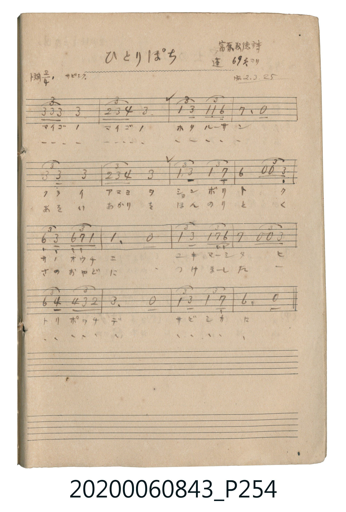

# ひとりぼっち (孤零零)

> Re:Shōka 使用 AI 協助辨識與重建樂譜，可能會有錯誤。歡迎回報。

- **鋼琴伴奏版**：<br><audio controls src="hitoribocchi.mp3"></audio>

- 詞：富原義徳
- 公學校唱歌帳 補遺 — 蓬 69頁ヨリ

## 說明


- 出處：公學校唱歌帳 補遺 — 蓬 69頁ヨリ
- 調性與拍號：調號 ?= G，拍號 <2/4>，速度 != 76


## 歌詞

```text
（TMD 檔案未包含歌詞註解）
```

## ABC

<div class="abc-score" data-abc-src="hitoribocchi.abc" aria-label="五線譜載入中"></div>

[下載 ABC 原始檔](hitoribocchi.abc)

## TMD 檔案連結

- [主旋律 TMD 檔案](hitoribocchi.tmd) [[在 TMD Studio 編輯](https://tmdlang.github.io/Tmd-TS/#tmd=s7IKdvYPcrWy4qpTUCpJTLdSSM7PyUlNLsnMz7MqzsjPTkzOyFeCS5bl55TmploBqXgDc4RwcX5pUXJqfEFieqpVgJGpCboM3KT4vPyS1KT8_GwMFRn5RYmZ8WB1xRmlCOmCovyy1LzEPKCS3MS80uLkosyCkvjk_IJKhJrUssyUVJCK1JTMkvyizMQcJBenFhWD_QJxYklRYh7EDKAgQhVQU3pmnlVJYibQBSBXlCfG5yZm5uUk5qUocWlpKTxu3PS4ccXjpq7HjXseNy5-3LhQQePp2iUvZ28DIk0FLS0uRVsFczMue1sFdy4bI30TO5DZT1vXPF2749mChU-nbHy2tufpjs0KLxbPedm4S-FRwxSFF5PXKJhZvlzQ-Lh5xePmVWDXvFg57_2eWU_X9zztm_9838qn-zYrcXF5gH2VlJ-cnJFpFZafnJjjUGNQU82lAAQ2Jlp2YEaNgoaxAhBqqmroagIZQL4RkDJB4hsqGMcr6EIEgBxDBbN4CKdGwTxewUChBmyQvpZCuZXC4-Z5Co-blgDxFiC7Dwt_NpC9H0ivVgAGT9NWIGuzgpY-tYwAe0cX6GC8_gEqgHtHF-gJmHfM4hU0DIA-gmlH8VnTeqBFK6FOWQRxVvMKIN4E5G9_3Lwc7I7HzXOAeBUQd4C1oHqtsQkoOAlIt0DYjd1AfhdUbDeQngyk10HEGoFmN_YjeQzoOoTPQDxg6BvCnG4Iigh0vwEVoMQVxHPY_AYKRGDQNgEd3rQMyG4EYqDbmoHsprVgv4KCejs04Cehe2sqxNmNIK-AvAYMpsbVQAwMqsaJQLwPpL1xOhDPR9YO8hTQwdDI0TABxo8RzLnG2DyEFlnoaQ8Y5OCgn_u4uRnqiXao54ABC3Y-iN2NnuBI0VfLxaVrp4CctxSAfGUuAA)]
- [鋼琴伴奏 TMD 檔案](hitoribocchi_piano.tmd) [[在 TMD Studio 編輯](https://tmdlang.github.io/Tmd-TS/#tmd=s7IKdvYPcrWy4tLSUnjcuOlx44rHTV2PG_c8blz8uHGhgsbTtUtezt4GRJoKGgGZiXn5Co7Jyfm5BYl5mbmpeSWaClpaXIq2CuZmXPa2Cu5cNkb6JnZcdQpKT1vXPF2749mChU-nbHy2tufpjs0KLxbPedm4S-FRwxSFF5PXKJhZvlzQ-Lh5xePmVUogHS9Wznu_Z9bT9T1P--Y_37fy6b7NSlxcHpkl-UWZSfnJyRmZVmH5yYk5DjUGNdVcCkBgY6JlB2bUKGgYKwChpqqGriaQAeQbASkTJL6hgnG8gi5EAMgxVDCLh3BqFMzjFQwUasAG6WsplFspPG6ep_C4aQkQbwGy-7DwZwPZ-4H0agVgoDVtBbI2K2jpU8sIsHd0gQ7G6x-gArh3dIGegHnHLF5BwwDoI5h2FJ81rQdatBLqlEUQZzWvAOJNQP72x83Lwe543DwHiFcBcQdYC6rXGpuAgpOAdAuE3dgN5HdBxXYD6clAeh1ErBFodmM_kseArkP4DMQDhr4hzOmGoIhA9xtQAUpcQTyHzW-gQAQGbRPQ4U3LgOxGIAa6rRnIbloL9isoqLdDA34SuremQpzdCPIKyGvAYGpcDcTAoGqcCMT7QNobpwPxfGTtIE8BHQyNHA0TYPwYwZxrjM1DaJGFnvaAQQ4O-rmPm5uhnmiHeg4YsGDng9jd6AmOFH21aBkLnLGDPJCylgUiaxlqGytAMcjZQHeDeLogKfN4bSMwz0gb7H9kObN4bUSmg0Q2UABKQMWAIRSvDYxTXWAoADUh2whLJSRZp4vkSJgI2AZk-8BJECmLwNMRavJEpE-QQXADoKaC3YvTVlOwr0xAdmH4FJF-kS020gYlIoS_gAImYM-B_Aw3A8gBeRe_5bi8DAlirFHvgxz1iFLVLB7k-XiwGTAWqhgIw_yASzVYDUIWQzUqywib0UBBVHE0g0F5COgxz7ySonwsiRnho-qCWoVow1hw-EWb5cYqRJvEYujFERqGoEAEZ1kTkMuAelzzUjLz0vFbmAuy0QhkkynQJpjl6LpxWAn0tCnIjxCrQZp07RTALlUAMpDjEcSHGAhiKXMBAA)]

## 分析

```text
================================================================================
📊 TMD Song Profile: [ ひとりぼっち 孤零零 ]
================================================================================
⏱  Duration:       0:25 (25.3s), 16 measures total
🎼 Key & Tempo:    首調基準 G, != 76.0 BPM, <2/4>
   - 分析範圍：      由實際發聲的音符與和弦推測調性；播放脈絡另行呈現
🎤 人聲音域:    B3 (MIDI 59) – E5 (MIDI 76) [跨度: 17 個半音 / 1.4 個八度, 難度: challenging]
   - 最低音:  B3 in [Hitoribocchi #1 @ m.3, 0:03]
   - 最高音: E5 in [Hitoribocchi #1 @ m.13, 0:18]
   - 適合: soprano, mezzo-soprano, contralto, tenor, baritone, bass
🏛  結構:      Hitoribocchi (25.3s)
⚡ 編曲密度:        Peak 1 軌道同時演奏
🗝  調性診斷：       E 小調（純淨自然小調，未偵測到可信轉調）
   - 風格氣質:    純淨自然小調（陰鬱抒情、旋律集中，無明顯調外色彩）
   - 轉調歷程:    全曲維持單一推測調性（未偵測到可信轉調）
   - 核心骨幹音:  B, G, E, F#, C
   - 調性數值:    E 小調 [相關度: 0.72, 穩定度: Moderate, 自然音純度: 100.0%]
   - 候選調性 (K-S): E 小調 (0.72), B 小調 (0.69), B 大調 (0.61)
   - 五度圈歷程:   +4
   - 各段落調性細節:
     • [Hitoribocchi #1]: E 小調 (r: 0.72, 自然音純度: 100.0%)

  [ 五度圈游移軌跡 ]
               C  
         F            G  
      Bb               D  
      Eb               A  
         Ab          [E ]*
            Db       B  
               F# 
     (* = active key center)

  [ 十二半音累積音高分佈 ]
     C  : ███                        5.0%
     C# :                            0.0%
     D  :                            0.0%
     D# :                            0.0%
     E  : ██████████                16.2%
     F  :                            0.0%
     F# : ████████                  12.5%
     G  : █████████████             22.5%
     G# :                            0.0%
     A  : ██                         3.7%
     A# :                            0.0%
     B  : ████████████████████████  40.0%
--------------------------------------------------------------------------------
Assignment 軌道音域：
  - Vocal         : B3 – E5 (17 個半音 / 1.4 個八度, 51 個音符)
================================================================================
```


## 原書掃描頁




