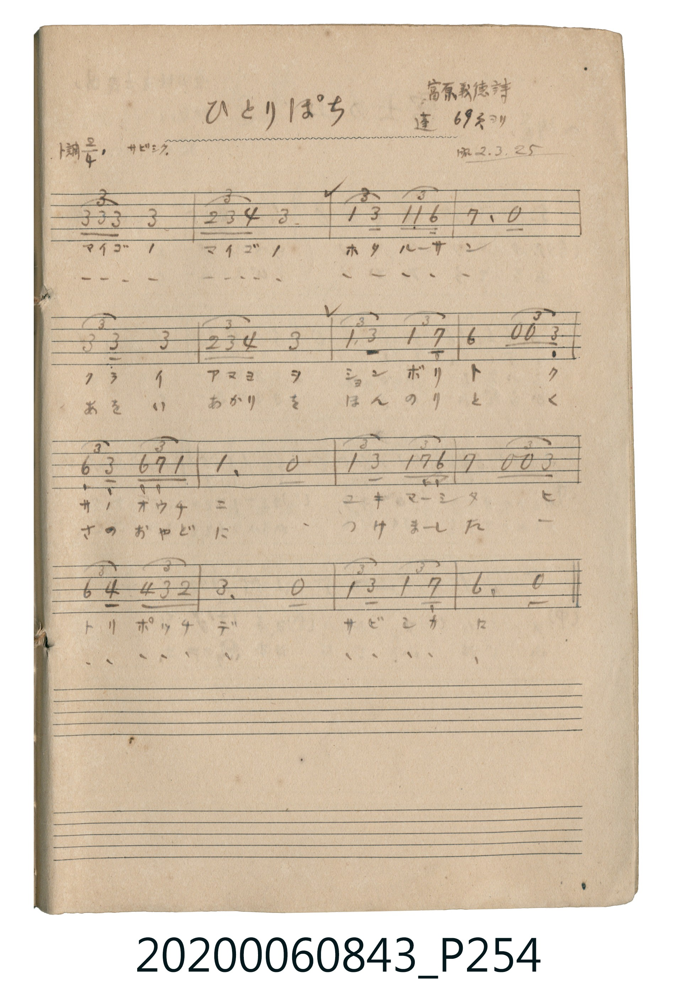

# ひとりぼっち (孤零零)

<audio controls src="hitoribocchi.mp3"></audio>

- 詞：富原義徳
- 公學校唱歌帳 補遺 — 蓬 69頁ヨリ

## 說明

・出處：公學校唱歌帳 補遺 — 蓬 69頁ヨリ
・調性與拍號：調號 ?= G，拍號 <2/4>，速度 != 76

## 歌詞

```text
（TMD 檔案未包含歌詞註解）
```

## ABC

```abc
X:1
T:ひとりぼっち 孤零零
M:2/4
L:1/16
Q:1/4=76
K:G
V:V1 name="Vocal" snm="Voc"
[V:V1]
B4/3 B4/3 B4/3 B4 | A4/3 B4/3 c4/3 B4 | G4/3 B,8/3 G4/3 G4/3 E4/3 | F4 z4 |
B8/3 B,4/3 B4 | A4/3 B4/3 c4/3 B4 | G8/3 B4/3 G8/3 F4/3 | E4 z4/3 z4/3 B,4/3 |
E8/3 B,4/3 E4/3 F4/3 G4/3 | G4 z4 | G8/3 B4/3 G4/3 F4/3 E4/3 | F4 z4/3 z4/3 B4/3 |
e8/3 c4/3 c4/3 B4/3 A4/3 | B4 z4 | G8/3 B4/3 G8/3 F4/3 | E4 z4 |
```

## TMD 檔案連結

- [主旋律 TMD 檔案](hitoribocchi.tmd) [[在 TMD Studio 編輯](https://tmdlang.github.io/Tmd-TS/#tmd=s7IKdvYPcrWy4qpTUCpJTLdSSM7PyUlNLsnMz7MqzsjPTkzOyFeCS5bl55TmploBqXgDc4RwcX5pUXJqfEFieqpVgJGpCboM3KT4vPyS1KT8_GwMFRn5RYmZ8WB1xRmlCOmCovyy1LzEPKCS3MS80uLkosyCkvjk_IJKhJrUssyUVJCK1JTMkvyizMQcJBenFhWD_QJxYklRYh7EDKCgEpeWlsLjxk2PG1c8bup63LjncePix40LFTSerl3ycvY2INJU0NLiUrRVMDfjsrdVcOeyMdI3sQOZ_bR1zdO1O54tWPh0ysZna3ue7tis8GLxnJeNuxQeNUxReDF5jYKZ5csFjY-bVzxuXgV2zYuV897vmfV0fc_TvvnP9618um-zEheXB9i9SfnJyRmZVmH5yYk5DjUGNQrVXApAYGOhZQdm1ChoGCsAoaaqhq6uJpClCxIyAjJMUIUMFYzjFXShYkCeoYJZPJRXo2AOlFIwACkEG6qvpVBupfC4eZ7C46YlQLwFyO7Dwp8NZO8H0qsVgGHVtBXI2qygpU8tI8Be0wU6mwi_AZUhvKYL9A_ca2Ygr2kYAH0HNwjFk03rgXauhLpqEcSFzSuAeBOQv_1x83Kwkx43zwHiVUDcAdaC6svGJqDgJCDdAmE3dgP5XVCx3UB6MpBeBxFrBJrd2I_kR7AD4W4DcYGxYQh3P8g74JjB8CZQGXoUQvyJ1ZugoAUGeBPQD03LgOxGIAY6sxnIbloL9jYoArZDo2MSug-nQnzQCPIVyJfAEGtcDcTAUGucCMT7QNobpwPxfGTtIP8B3QWLLw0TYJQZwd0Mij7sfsOMQszUCYwJcIzMfdzcDPVQO9SjwPAGewXE7kZPkqToq-Xi0rVTQM6KCkC-MhcA)]
- [鋼琴伴奏 TMD 檔案](hitoribocchi_piano.tmd) [[在 TMD Studio 編輯](https://tmdlang.github.io/Tmd-TS/#tmd=s7IKdvYPcrWy4tLSUnjcuOlx44rHTV2PG_c8blz8uHGhgsbTtUtezt4GRJoKGgGZiXn5Co7Jyfm5BYl5mbmpeSWaClpaXIq2CuZmXPa2Cu5cNkb6JnZcdQpKT1vXPF2749mChU-nbHy2tufpjs0KLxbPedm4S-FRwxSFF5PXKJhZvlzQ-Lh5xePmVUogHS9Wznu_Z9bT9T1P--Y_37fy6b7NSlxcHpkl-UWZSfnJyRmZVmH5yYk5DjUGNQrVXApAYGOhZQdm1ChoGCsAoaaqhq6uJpClCxIyAjJMUIUMFYzjFXShYkCeoYJZPJRXo2AOlFIwACkEG6qvpVBupfC4eZ7C46YlQLwFyO7Dwp8NZO8H0qsVgCHYtBXI2qygpU8tI8Be0wU6mwi_AZUhvKYL9A_ca2Ygr2kYAH0HNwjFk03rgXauhLpqEcSFzSuAeBOQv_1x83Kwkx43zwHiVUDcAdaC6svGJqDgJCDdAmE3dgP5XVCx3UB6MpBeBxFrBJrd2I_kR7AD4W4DcYGxYQh3P8g74JjB8CZQGXoUQvyJ1ZugoAUGeBPQD03LgOxGIAY6sxnIbloL9jYoArZDo2MSug-nQnzQCPIVyJfAEGtcDcTAUGucCMT7QNobpwPxfGTtIP8B3QWLLw0TYJQZwd0Mij7sfsOMQszUCYwJcIzMfdzcDPVQO9SjwPAGewXE7kZPkqToq0XLh-ByIMgDR0401DZWgGKo40E8sP_M47WNwDwjbVhgwOXM4rVRcydYAEogAiteGy2bQm1ESj3EW6eL5EiYCNgGZPtw5h1cyRZkEFK0gU2FRjAOW03BvjIB2YXhUyypGZT_tUEpCuEvoIAJ2HMgPyNlB7B38VuOy8uQIMYa9z4ocW8Cj3uzeJDv48GGwFioYiAM8wQu1WA1CFkM1agsI2xGAwVRxdEMNoD4zDOvpCgfW3JGeKm6oFYh2jAWHILRZrmxCtEmsRiacYWHISgcwVnXBOQ2oCbXvJTMvHQCVuaC7DQC2WUKtAtmPbp2XJYCPW4K8ifEcpAuXTsFsGMVgAzkyATxISaCWMpcAA)]

## 分析

```text
================================================================================
📊 TMD Song Profile: [ ひとりぼっち 孤零零 ]
================================================================================
⏱  Duration:       0:25 (25.3s), 16 measures total
🎼 Key & Tempo:    首調基準 G, != 76.0 BPM, <2/4>
   - 分析範圍：      由實際發聲的音符與和弦推測調性；播放脈絡另行呈現
🎤 人聲音域:    B3 (MIDI 59) – E5 (MIDI 76) [跨度: 17 個半音 / 1.4 個八度, 難度: challenging]
   - 最低音:  B3 in [Hitoribocchi #1 @ m.3, 0:03]
   - 最高音: E5 in [Hitoribocchi #1 @ m.13, 0:18]
   - 適合: soprano, mezzo-soprano, contralto, tenor, baritone, bass
🏛  結構:      Hitoribocchi (25.3s)
⚡ 編曲密度:        Peak 1 軌道同時演奏
🗝  調性診斷：       E 小調（純淨自然小調，未偵測到可信轉調）
   - 風格氣質:    純淨自然小調（陰鬱抒情、旋律集中，無明顯調外色彩）
   - 轉調歷程:    全曲維持單一推測調性（未偵測到可信轉調）
   - 核心骨幹音:  B, G, E, F#, C
   - 調性數值:    E 小調 [相關度: 0.72, 穩定度: Moderate, 自然音純度: 100.0%]
   - 候選調性 (K-S): E 小調 (0.72), B 小調 (0.69), B 大調 (0.61)
   - 五度圈歷程:   +4
   - 各段落調性細節:
     • [Hitoribocchi #1]: E 小調 (r: 0.72, 自然音純度: 100.0%)

  [ 五度圈游移軌跡 ]
               C  
         F            G  
      Bb               D  
      Eb               A  
         Ab          [E ]*
            Db       B  
               F# 
     (* = active key center)

  [ 十二半音累積音高分佈 ]
     C  : ███                        5.0%
     C# :                            0.0%
     D  :                            0.0%
     D# :                            0.0%
     E  : ██████████                16.2%
     F  :                            0.0%
     F# : ████████                  12.5%
     G  : █████████████             22.5%
     G# :                            0.0%
     A  : ██                         3.7%
     A# :                            0.0%
     B  : ████████████████████████  40.0%
--------------------------------------------------------------------------------
Assignment 軌道音域：
  - Vocal         : B3 – E5 (17 個半音 / 1.4 個八度, 51 個音符)
================================================================================
```


## 原書掃描頁




