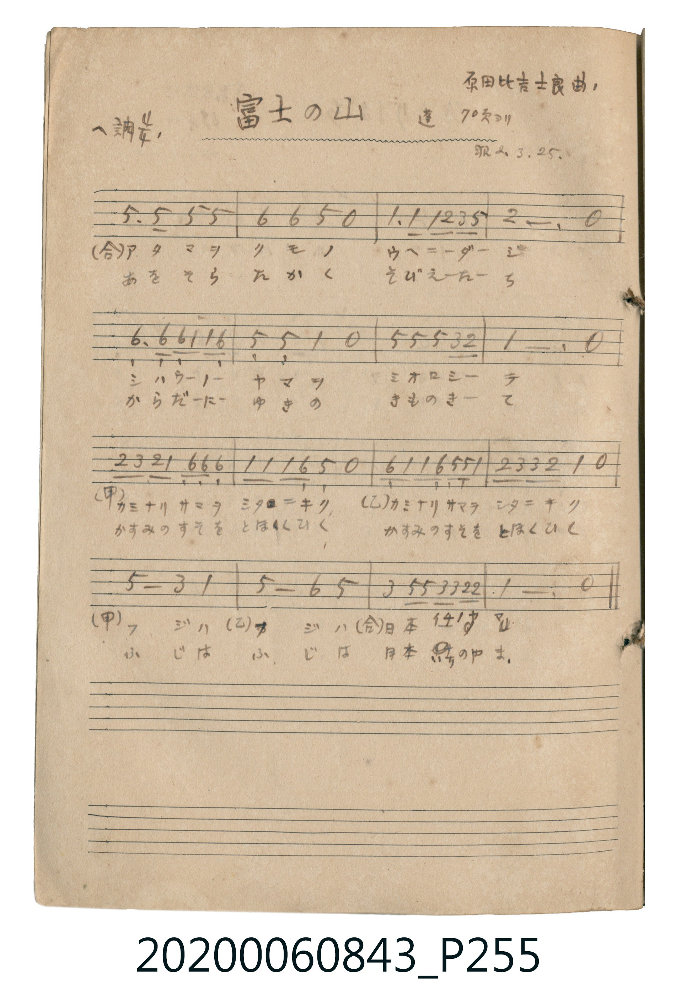

# 富士の山 (富士山)

> Re:Shōka 使用 AI 協助辨識與重建樂譜，可能會有錯誤。歡迎回報。

- **鋼琴伴奏版**：<br><audio controls src="fuji_no_yama.mp3"></audio>

- 曲：原田比古士良
- 公學校唱歌帳 補遺 — 蓬 70頁ヨリ

## 說明


- 出處：公學校唱歌帳 補遺 — 蓬 70頁ヨリ
- 調性與拍號：調號 ?= F，拍號 <4/4>，速度 != 108


## 歌詞

```text
（TMD 檔案未包含歌詞註解）
```

## ABC

<div class="abc-score" data-abc-src="fuji_no_yama.abc" aria-label="五線譜載入中"></div>

[下載 ABC 原始檔](fuji_no_yama.abc)

## TMD 檔案連結

- [主旋律 TMD 檔案](fuji_no_yama.tmd) [[在 TMD Studio 編輯](https://tmdlang.github.io/Tmd-TS/#tmd=s7IKdvYPcrWy4qpTUCpJTLdSSM7PyUlNLsnMz7MqzsjPTkzOyFeCS5bl55TmploBqXgDc4RwcX5pUXJqfEFieqpVgJGpKboM3KT4vPyS1KT8_GwMFRn5RYmZ8WB1xRmlCOmCovyy1LzEPKCS3MS80uLkosyCkvjk_IJKhJrUssyUVJCK1JTMkvyizMQcJBenFhWD_QJxYklRYh7EDKAgQlVJRirQW3mJJaVFqQhRoFHpmXlWJYmZQHeB3FaeGJ-bmJmXk5iXosSlpaXwdH3P08WrHzeue7pxo4IGhAdkaipoaXEp2ioYGlhw2dsquHHZmOib2IGMfdq65unaHc8WLHw6ZeOztT1Pd2xWeLF4zsvGXQqPGqYovJi8RsHc4OWCxsfNKx43rwI75NnsTe_3zHraN__5lA3P1k952r8EaMeLzvVKXFxupVmZfvmRibmJVmH5yYk5DjUGNdVcCkBgY6FlB2bUKJgq6AKhKZgG4RoFMyAJwiCeAVjEMA6sCEgBkVGcgnEcULJGwQgsCoFghWAj9bUUyq0UHjctAuL9Co-b5wHxJiB7PZAGijX3AdnLgPQMIO5W0AKSDUCR7Qpa-sjaG5uAgpOA9Fwg3Qmk5wNxNxD3Q8QaNwNxB0g7WGYhTDvE-SAPmEHdawb1JAgbwr0E8jBM1BjoE6An8fpmO9CdQKuBLge5uA9MLkH4rhnoiKZVQHotVG0bun-Abgf7YwHYzatBZFMbkNULxOsgdBPQzzB2I9AimI-MwC40VDCLhyJwnIAhkGMK4kM8BeQhBIEI5CWIdogB2Dy2GuL45i4gBnqgaStSlAE9Ao5CkNtBHgNGIYnqMQOhcSYQAxWBPQpigyIYFNErgHg3NIKBhoFp0tTDAwySpkERC4lyhAgsXdeA5UBJABI2BBNA81SgtTsgiQCFDXRi82wgBqbHJlCCaIQk8eYloGBB8z4wrBqByb4RGI7IbGxmgLzb1PK4cR_IjFouLl07BUR2VgDylLkA)]
- [鋼琴伴奏 TMD 檔案](fuji_no_yama_piano.tmd) [[在 TMD Studio 編輯](https://tmdlang.github.io/Tmd-TS/#tmd=s7IKdvYPcrWy4tLSUni6vufp4tWPG9c93bhRQQPCAzI1FTQCMhPz8hUck5PzcwsS8zJzU_NKNBW0tLgUbRUMDSy47G0V3LhsTPRN7LjqFJSetq55unbHswULn07Z-Gxtz9MdmxVeLJ7zsnGXwqOGKQovJq9RMDd4uaDxcfOKx82rlEA6ns3e9H7PrKd9859P2fBs_ZSn_UuANr_oXK_ExeVWmpXplx-ZmJtoFZafnJjjUGNQU82lAAQ2Flp2YEaNgqmCLhCagmkQrlEwA5IgDOIZgEUM48CKgBQQGcUpGMcBJWsUjMCiEAhWCDZSX0uh3ErhcdMiIN6v8Lh5HhBvArLXA2mgWHMfkL0MSM8A4m4FLSDZABTZrqClj6y9sQkoOAlIzwXSnUB6PhB3A3E_RKxxMxB3gLSDZRbCtEOcD_KAGdS9ZlBPgrAh3EsgD8NEjYE-AXoSr2-2A90JtBrocpCL-8DkEoTvmoGOaFoFpNdC1bah-wfodrA_FoDdvBpENrUBWb1AvA5CNwH9DGM3Ai2C-cgI7EJDBbN4KALHCRgCOaYgPsRTQB5CEIhAXoJohxiAzWOrIY5v7gJioAeatiJFGdAj4CgEuR3kMWAUkqgeMxAaZwIxUBHYoyA2KIJBEb0CiHdDIxhoGJgmTT08wCBpGhSxkChHiMDSdQ1YDpQEIGFDMAE0TwVauwOSCFDYQCc2zwZiYHpsAiWIRkgSb14CChY07wPDqhGY7BuB4YjMxmYGyLtNLY8b94HMqEXJy-ACJcgDa2421ob4FERD2BCyRsFEG-R3CAkRg6QZY21o7gYzwISpNjCPm2oDczlIYY2Cebw29qwOMxViLgibgfSDCRAP5h4IaRqvjch_MAciKzDUNobYBYwviFpsVoJVwJWagRSiZAyoCIJAyyHoUmAEtg3JbLj5yI5GC2OIg-H-QpZADmZgwgIrg_kWxXh83sUS6z7IsW4Cj3VDSG4Hk8A4iQchGA8uZwzimcaDuUYgEsiHxSJYAUQfumkQGqIPRdYArh0maQbFIAMhLLBimAAIAwWACKEFxRxsFkOcBuZBDUNyBkgMYgAwrDzzSorysWQORDBV56bVKkQbxipEmwAxiDaNBQpHm-VChYBcaMAjGYY7zJFCGZiUgDxwQgPrd81LycxLx-8akGOgtkKcAHEN0F2QVIBhEA6XQCyGJGawu5C069opgL2iAGQgEhOIBzEYxFLmAgA)]

## 分析

```text
================================================================================
📊 TMD Song Profile: [ 富士の山 富士山 ]
================================================================================
⏱  Duration:       0:35 (35.6s), 16 measures total
🎼 Key & Tempo:    首調基準 F, != 108.0 BPM, <4/4>
   - 分析範圍：      由實際發聲的音符與和弦推測調性；播放脈絡另行呈現
🎤 人聲音域:    C4 (MIDI 60) – A5 (MIDI 81) [跨度: 21 個半音 / 1.8 個八度, 難度: difficult]
   - 最低音:  C4 in [FujiNoYama #1 @ m.10, 0:21]
   - 最高音: A5 in [FujiNoYama #1 @ m.3, 0:06]
   - 適合: soprano, mezzo-soprano, tenor, baritone
🏛  結構:      FujiNoYama (35.6s)
⚡ 編曲密度:        Peak 1 軌道同時演奏
🗝  調性診斷：       F 大調（純淨自然大調，未偵測到可信轉調）
   - 風格氣質:    純淨自然大調（陽光明朗、易唱易記，無明顯調外色彩）
   - 轉調歷程:    全曲維持單一推測調性（未偵測到可信轉調）
   - 核心骨幹音:  C, F, D, G, A
   - 調性數值:    F 大調 [相關度: 0.86, 穩定度: Moderate, 自然音純度: 100.0%]
   - 候選調性 (K-S): F 大調 (0.86), C 大調 (0.77), D 小調 (0.55)
   - 五度圈歷程:   -1
   - 各段落調性細節:
     • [FujiNoYama #1]: F 大調 (r: 0.86, 自然音純度: 100.0%)

  [ 五度圈游移軌跡 ]
               C  
        [F ]*          G  
      Bb               D  
      Eb               A  
         Ab           E  
            Db       B  
               F# 
     (* = active key center)

  [ 十二半音累積音高分佈 ]
     C  : ████████████████████████  32.5%
     C# :                            0.0%
     D  : ████████████              16.7%
     D# :                            0.0%
     E  :                            0.0%
     F  : █████████████████████     28.9%
     F# :                            0.0%
     G  : █████████                 12.3%
     G# :                            0.0%
     A  : ███████                    9.6%
     A# :                            0.0%
     B  :                            0.0%
--------------------------------------------------------------------------------
Assignment 軌道音域：
  - Vocal         : C4 – A5 (21 個半音 / 1.8 個八度, 68 個音符)
================================================================================
```


## 原書掃描頁




