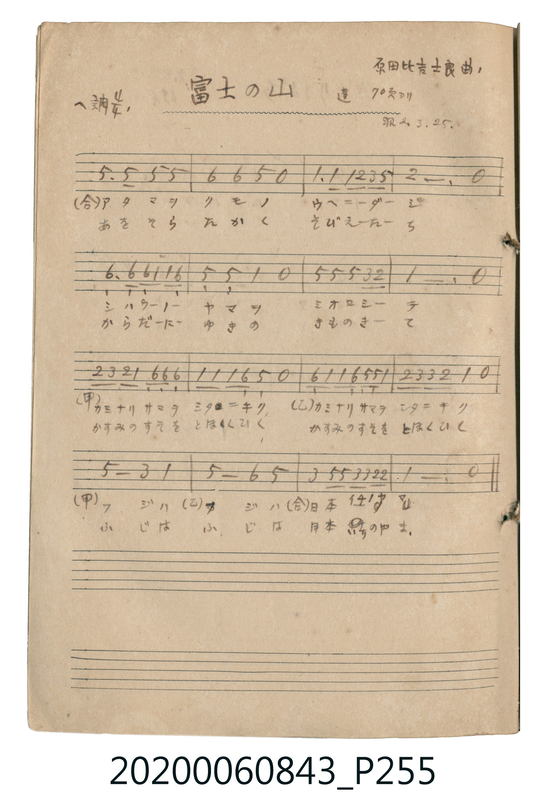

# 富士の山 (富士山)

> Re:Shōka 使用 AI 協助辨識與重建樂譜，可能會有錯誤。歡迎回報。

- **鋼琴伴奏版**：<br><audio controls src="fuji_no_yama.mp3"></audio>
- **NEUTRINO 歌聲合成版**：<br><audio controls src="fuji_no_yama_neutrino.mp3"></audio>

- 曲：原田比古士良
- 公學校唱歌帳 補遺 — 蓬 70頁ヨリ

## 說明


- 出處：公學校唱歌帳 補遺 — 蓬 70頁ヨリ
- 調性與拍號：調號 ?= F，拍號 <4/4>，速度 != 108


## 歌詞

```text
（TMD 檔案未包含歌詞註解）
```

## ABC

<div class="abc-score" data-abc-src="fuji_no_yama.abc" aria-label="五線譜載入中"></div>

[下載 ABC 原始檔](fuji_no_yama.abc)

## TMD 檔案連結

- [主旋律 TMD 檔案](fuji_no_yama.tmd) [[在 TMD Studio 編輯](https://tmdlang.github.io/Tmd-TS/#tmd=s7IKdvYPcrWy4qpTUCpJTLdSSM7PyUlNLsnMz7MqzsjPTkzOyFeCS5bl55TmploBqXgDc4RwcX5pUXJqfEFieqpVgJGpKboM3KT4vPyS1KT8_GwMFRn5RYmZ8WB1xRmlCOmCovyy1LzEPKCS3MS80uLkosyCkvjk_IJKhJrUssyUVJCK1JTMkvyizMQcJBenFhWD_QJxYklRYh7EDKAgQlVJRirQW3mJJaVFqQhRoFHpmXlWJYmZQHeB3FaeGJ-bmJmXk5iXgqyqJCM_vSixIKPSKiOzGOSA5MSc-OzEvEQlLi0thafre54uXv24cd3TjRsVNCA8IFNTQUuLS9FWwdDAgsveVsGNy8ZE38QOZOrT1jVP1-54tmDh0ykbn63tebpjs8KLxXNeNu5SeNQwReHF5DUK5gYvFzQ-bl7xuHkV2B3PZm96v2fW0775z6dseLZ-ytP-JUA7XnSuV-LicivNyvTLj0zMTbQKyEzMy3eoMaip5lIAAhsLLTswo0bBVEEXCE3BNAjXKJgBSRAG8QzAIoZgNYZAaKRgDBSvAdIgEQgEqwGb5mNYo_C4aRFY9HHTfoXHzfNArOZNYFMeN60H80Dyj5v7gGQ8VHwZREfzDCDuBrMaoDLbkewBq4bYYwSUa2yC2jMJyJ4LZnVCdDXOB_EawSY19iPsAasCiW0G4g4wC6QSJLMQwx5o8JiBeMDwiAchUAgAKWCggUTBBChoIIEEC0AQNgYGECzYsAcSxGOPm_uh3ocECFCmeQmYhwg4qOObwZ5qWgUWXwtmg8wAybThCSRQIECC5nHjArCXV0ODFqTrcWMvmFyHFEhgkSZQ4ELEISIgGUg0YQkkUKowgoQNBEESDTS4wOEECSNEGAIFgQgUQhDtEAMww2k12OePm7uAeBWQvxUcNogktR2a0LqB9FpoEoMlK7L1ooTf48aZQAxUBwwNCHsuONFBwmQFEO8GJ7PHjZvQkhvZemHhCsmboOQESWgIEVj-rAHLgXIvJAgJJLvmqVDxx007QCQw-UGSEC5xSG6cDcTAPNO0BEg3IidVSDrFlfa2wgxtnAEmQeGLRxy7ZeA0CIqtlseN-zAsq-Xi0rVTQBR0CkCeMhcA)]
- [鋼琴伴奏 TMD 檔案](fuji_no_yama_piano.tmd) [[在 TMD Studio 編輯](https://tmdlang.github.io/Tmd-TS/#tmd=s7IKdvYPcrWy4qpTUCpJTLdSyC8qychPL0osyKi0ysgsLskvykxOzInPTsxLVIIrKs4vLUpOjS9ITE-1CjAyNUXIlGSk5qZapaaUJieWZObnKXFpaSk8Xd_zdPHqx43rnm7cqKAB4QGZmgoaAZmJefkKjsnJ-bkFiXmZual5JZoKWlpcirYKhgYWXPa2Cm5cNib6JnYg85-2rnm6dsezBQufTtn4bG3P0x2bFV4snvOycZfCo4YpCi8mr1EwN3i5oPFx84rHzavALno2e9P7PbOe9s1_PmXDs_VTnvYvAdr8onO9EheXW2lWpl9-ZGJuohXYEQ41BjXVXApAYGOhZQdm1CiYKugCoSmYBuEaBTMgCcIgngFYxBCsxhAIjRSMgeI1QBokAoFgNWDTfAxrFB43LQKLPm7ar_C4eR6I1bwJbMrjpvVgHkj-cXMfkIyHii-D6GieAcTdYFYDVGY7kj1g1RB7jIByjU1QeyYB2XPBrE6Irsb5IF4j2KTGfoQ9YFUgsc1A3AFmgVSCZBZi2AMNHjMQDxge8SAECgEgBQw0kCiYAAUNJJBgAQjCxsAAggUb9kCCeOxxcz_U-5AAAco0LwHzEAEHdXwz2FNNq8Dia8FskBkgmTY8gQQKBEjQPG5cAPbyamjQgnQ9buwFk-uQAgks0gQKXIg4RAQkA4kmLIEEShVGkLCBIEiigQYXOJwgYYQIQ6AgEIFCCKIdYgBmOK0G-_xxcxcQrwLyt4LDBpGktkMTWjeQXgtNYrBkRbZelPB73DgTiIHqgKEBYc8FJzpImKwA4t3gZPa4cRNaciNbLyxcIXkTlJwgCQ0hAsufNWA5UO6FBCGBZNc8FSr-uGkHiAQmP0gSwiUOyY2zgRiYZ5qWAOlG5KQKSae40t5WmKGNM8AkKHzxiGO3DJwGQbHV8rhxH4ZltZilXJAH1nLOWBsSdiAawoaQNQom2qDQhJAQMUhiNdaGhCSIBmFTbSMgBoYzUE2Ngnk8kIstoGEGQowEYTNtwzgIAeLBnAIhTePBtsBshLgNWYEh0EawXaBSB-oiTCvBKuBKzUAKUTIjVARBoOVKdCkwAtuGZDbcfGRHowUvxMFwfyFLIIcwMJWClcF8i2I8Pu9iiXAf5Ag3gUe4IaSEAZPAOIkHIRgPLmcMKc3BXCMQCeTDYhGsAKIP3TQIDdGHImsA1w6TNINikIEQFlgxTACEgQJAhNCCYg42iyFOA_OghiE5AyQGMQAYVp55JUX5WPIFIpiqc9NqFaINYxWiTYAYRJvGAoWjzXKhQkAuNOCRDMMd5kihDExKQB44oYH1u-alZOal43cNyDFQWyFOgLgG6C5IKsAwCIdLIBZDEjPYXUjade0UwF5RADIQiSnaB2QJqogRWARiHYilzAUA)]

## 分析

```text
================================================================================
📊 TMD Song Profile: [ 富士の山 富士山 ]
================================================================================
⏱  Duration:       0:35 (35.6s), 16 measures total
🎼 Key & Tempo:    首調基準 F, != 108.0 BPM, <4/4>
   - 分析範圍：      由實際發聲的音符與和弦推測調性；播放脈絡另行呈現
🎤 人聲音域:    C4 (MIDI 60) – D5 (MIDI 74) [跨度: 14 個半音 / 1.2 個八度, 難度: moderate]
   - 最低音:  C4 in [FujiNoYama #1 @ m.6, 0:11]
   - 最高音: D5 in [FujiNoYama #1 @ m.2, 0:02]
   - 適合: soprano, mezzo-soprano, contralto, tenor, baritone, bass
🏛  結構:      FujiNoYama (35.6s)
⚡ 編曲密度:        Peak 1 軌道同時演奏
🗝  調性診斷：       F 大調（純淨自然大調，未偵測到可信轉調）
   - 風格氣質:    純淨自然大調（陽光明朗、易唱易記，無明顯調外色彩）
   - 轉調歷程:    全曲維持單一推測調性（未偵測到可信轉調）
   - 核心骨幹音:  C, F, D, G, A
   - 調性數值:    F 大調 [相關度: 0.86, 穩定度: Moderate, 自然音純度: 100.0%]
   - 候選調性 (K-S): F 大調 (0.86), C 大調 (0.77), D 小調 (0.55)
   - 五度圈歷程:   -1
   - 各段落調性細節:
     • [FujiNoYama #1]: F 大調 (r: 0.86, 自然音純度: 100.0%)

  [ 五度圈游移軌跡 ]
               C  
        [F ]*          G  
      Bb               D  
      Eb               A  
         Ab           E  
            Db       B  
               F# 
     (* = active key center)

  [ 十二半音累積音高分佈 ]
     C  : ████████████████████████  32.5%
     C# :                            0.0%
     D  : ████████████              16.7%
     D# :                            0.0%
     E  :                            0.0%
     F  : █████████████████████     28.9%
     F# :                            0.0%
     G  : █████████                 12.3%
     G# :                            0.0%
     A  : ███████                    9.6%
     A# :                            0.0%
     B  :                            0.0%
--------------------------------------------------------------------------------
Assignment 軌道音域：
  - Piano         : C4 – D5 (14 個半音 / 1.2 個八度, 67 個音符)
================================================================================
```


## 原書掃描頁




