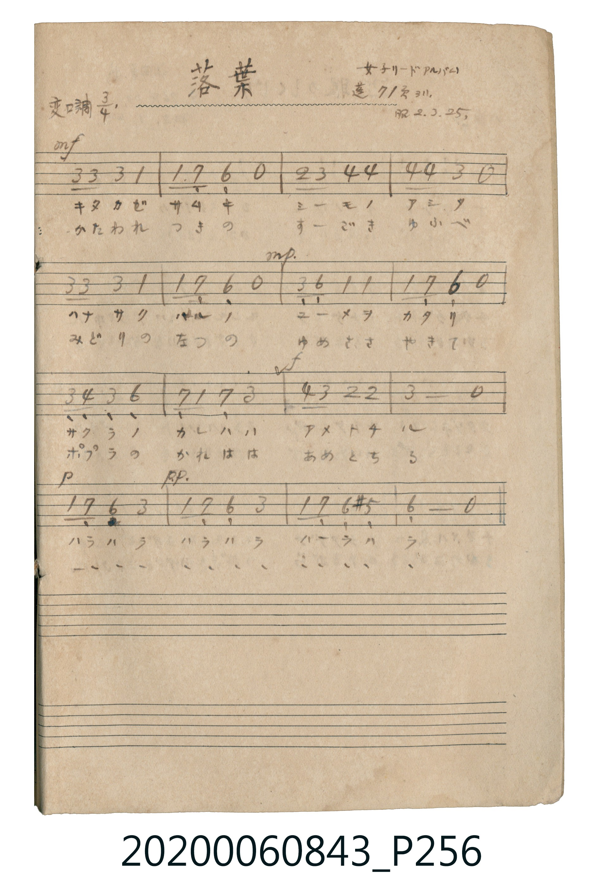

# 落葉 (落葉)

> Re:Shoka 使用 AI 辨識樂譜，可能會有錯誤。歡迎回報。

<audio controls src="ochiba.mp3"></audio>

- 公學校唱歌帳 補遺 — 女子リードアルバム・蓬 71頁ヨリ

## 說明

・出處：公學校唱歌帳 補遺 — 女子リードアルバム・蓬 71頁ヨリ
・調性與拍號：調號 ?= B,，拍號 <3/4>，速度 != 88

## 歌詞

```text
（TMD 檔案未包含歌詞註解）
```

## ABC

```abc
X:1
T:落葉 落葉
M:3/4
L:1/16
Q:1/4=88
K:Bb
V:V1 name="Vocal" snm="Voc"
[V:V1]
!mf! d2 d2 d4 B4 | B6 A2 G2 z2 | c2 d2 e4 e4 | e4 e4 d2 z2 |
d2 d2 d4 B4 | B4 A4 G2 z2 | !mp! D2 G2 B4 B4 | B4 A4 G2 z2 |
d2 e2 d4 g4 | A4 B2 A2 d4 | !f! e2 d2 c4 c4 | d8 z4 |
!p! B2 A2 G4 d4 | !pp! B2 A2 G4 d4 | B2 A2 G4 ^F4 | G8 z4 |
```

## TMD 檔案連結

- [主旋律 TMD 檔案](ochiba.tmd) [[在 TMD Studio 編輯](https://tmdlang.github.io/Tmd-TS/#tmd=s7IKdvYPcrWy4qpTUCpJTLdSSM7PyUlNLsnMz7MqzsjPTkzOyFeCS5bl55TmploBqXgDc4RwcX5pUXJqfEFieqpVgJGpGboM3KT4vPyS1KT8_GwMFRn5RYmZ8WB1xRmlCOmCovyy1LzEPKCS3MS80uLkosyCkvjk_IJKhJrUssyUVJCK1JTMkvyizMQcJBenFhWD_QJxYklRYh7EDKCgEpeWlsKLCXtfTOxU0IDQmgpaWlyKtgoWFlz2tgpOOlw2xvomdiDTnrauebp2x7MFC59O2fhsbc_THZsVXiye87Jxl8KjhikKT5dufrp2wuPmVY-b9zxu7nzctOhx8-rHzUCRBY-bd7-YvEbB3PDlgsbHzSuAapS4uPyTMzKTEq3C8pMTcxxqDGoUqrkUgMDGQssOzAAK5KbVKhiDoa6CIRDXgEldBfN4BbN4BQMg3wgoZwIUAeEaOMsYJAc2RF9LodxK4XHTWiDeD8SrgXgPEG9VADoLKr5dQQvIWwTEfUAekAaKgFRr6SMb0dgNxPOBEv1A3ANkLwHiXiBeB8QzQUY0ToGINLUBaaAFjTthRtRg8QXQD7owX1TnFgA9CvYUSAqrImS3NAPd0NwF8UbTeigf6DWQB5qXgb2zEIg3QT0M9HjzKnTvAAUbVwIlgcaAvbAK6iUgG-SBpkYgeyoEN7VAvQo0GuEhE7CHzMBuBbvTEESBxIAeAkYcSN4IyANhkHpQxOkCfQLkoUQNzA9Ax4AjAOSPNVA_gcIaFDEg33QAMdBRQH-i-qR5LhBPhxgA9gkwosARBDQUjJugvlkBxECDmroRvqgGhjvY2cAwBiUbsNsLsAgi-KbqILIGwsHqI7DLQb7BTYNiCCGC5h8ytNdycenaKUBylAKQpcwFAA)]
- [鋼琴伴奏 TMD 檔案](ochiba_piano.tmd) [[在 TMD Studio 編輯](https://tmdlang.github.io/Tmd-TS/#tmd=s7IKdvYPcrWy4tLSUngxYe-LiZ0KGhBaU0EjIDMxL1_BMTk5P7cgMS8zNzWvRFNBS4tL0VbBwoLL3lbBSYfLxljfxI6rTkHpaeuap2t3PFuw8OmUjc_W9jzdsVnhxeI5Lxt3KTxqmKLwdOnmp2snPG5e9bh5z-PmzsdNix43r37cDBRZ8Lh594vJaxTMDV8uaHzcvAKoRomLyz85IzMp0SosPzkxx6HGoEahmksBCGwstOzADKBAblqtgjEY6ioYAnENmNRVMI9XMItXMADyjYByJkAREK6Bs4xBcmBD9LUUyq0UHjetBeL9QLwaiPcA8VYFoLOg4tsVtIC8RUDcB-QBaaAISLWWPrIRjd1APB8o0Q_EPUD2EiDuBeJ1QDwTZETjFIhIUxuQBlrQuBNmRA0WXwD9oAvzRXVuAdCjYE-BpLAqQnZLM9ANzV0QbzSth_KBXgN5oHkZ2DsLgXgT1MNAjzevQvcOULBxJVASaAzYC6ugXgKyQR5oagSyp0JwUwvUq0CjER4yAXvIDOxWsDsNQRRIDOghYMSB5I2APBAGqQdFnC7QJ0AeStTA_AB0DDgCQP5YA_UTKKxBEQPyTQcQAx0F9CeqT5rnAvF0iAFgnwAjChxBQEPBuAnqmxVADDSoqRvhi2pguIOdDQxjULIBu70AiyCCb6oOImsgHKw-Arsc5BvcNCiGECJo_iFDey08O4EzdJAHngxlqG0Mx6DEpQ1JblAG2IPaoIiM14amTvN4bSOwaiNtUOaCkMCsh8QDKkHkOWBo4bUCagEwaOFWIGUAqCLCmpDsAjkCYpexNiRBwpWDtUN5YFfCkidMD1ABKIVCKYhOzMQKSSoQw5CCB5joYUaCUg0eeSQpE6gUUAksMcFUIyxFi1EflBg1gceoWTzIKjAF48B4RhAGkAKzgQioEOYbPPpwS2HTC5KEYZg9YCuBKuDiSBphGJ1nBCRN4OaAxEAhAQ4Hz7ySonxsCRsRDKDIiTaMBeqJNsuNBQpEm4A5pkA2mhG4QtIQWtQCaxFwNgc5G6jTNS8lMy-dgO2g1BttBLQYZCHIaqADwK6BxiSyIbjsBwYa0E6g3VCnQLXq2imAHa8AZEASBIgFMRDEUuYCAA)]

## 分析

```text
================================================================================
📊 TMD Song Profile: [ 落葉 落葉 ]
================================================================================
⏱  Duration:       0:32 (32.7s), 16 measures total
🎼 Key & Tempo:    首調基準 B,, != 88.0 BPM, <3/4>
   - 分析範圍：      由實際發聲的音符與和弦推測調性；播放脈絡另行呈現
🎤 人聲音域:    D4 (MIDI 62) – G5 (MIDI 79) [跨度: 17 個半音 / 1.4 個八度, 難度: challenging]
   - 最低音:  D4 in [Ochiba #1 @ m.7, 0:12]
   - 最高音: G5 in [Ochiba #1 @ m.9, 0:17]
   - 適合: soprano, mezzo-soprano, tenor, baritone
🏛  結構:      Ochiba (32.7s)
⚡ 編曲密度:        Peak 1 軌道同時演奏
🗝  調性診斷：       G 小調（純淨自然小調，未偵測到可信轉調）
   - 風格氣質:    純淨自然小調（陰鬱抒情、旋律集中，無明顯調外色彩）
   - 轉調歷程:    全曲維持單一推測調性（未偵測到可信轉調）
   - 核心骨幹音:  D, A#, G, A, D#
   - 調性數值:    G 小調 [相關度: 0.84, 穩定度: High, 自然音純度: 97.7%]
   - 候選調性 (K-S): G 小調 (0.84), A# 大調 (0.60), D 小調 (0.56)
   - 五度圈歷程:   +1
   - 各段落調性細節:
     • [Ochiba #1]: G 小調 (r: 0.84, 自然音純度: 97.7%, 調外音: F#)

  [ 五度圈游移軌跡 ]
               C  
         F           [G ]*
      Bb               D  
      Eb               A  
         Ab           E  
            Db       B  
               F# 
     (* = active key center)

  [ 十二半音累積音高分佈 ]
     C  : █████                      5.7%
     C# :                            0.0%
     D  : ████████████████████████  28.4%
     D# : ██████████                11.4%
     E  :                            0.0%
     F  :                            0.0%
     F# : ██                         2.3%
     G  : ███████████████           18.2%
     G# :                            0.0%
     A  : ███████████               12.5%
     A# : ██████████████████        21.6%
     B  :                            0.0%
--------------------------------------------------------------------------------
Assignment 軌道音域：
  - Vocal         : D4 – G5 (17 個半音 / 1.4 個八度, 54 個音符)
================================================================================
```


## 原書掃描頁




