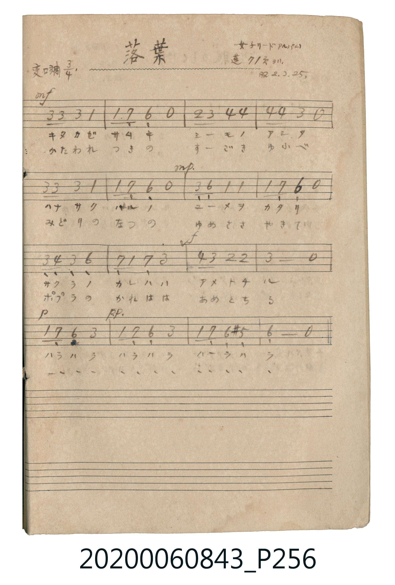

# 落葉（落葉）

> Re:Shōka 使用 AI 協助辨識與重建樂譜，可能會有錯誤。歡迎回報。

- **鋼琴伴奏版**：<br><audio controls src="ochiba.mp3"></audio>
- **NEUTRINO 歌聲合成版**：<br><audio controls src="ochiba_neutrino.mp3"></audio>

- 詞：島崎青峡
- 曲：佐々木すぐる
- 唱歌帖 P256 (女子リードアルバム・蓬 71頁ヨリ・昭 2. 3. 25)

## 說明

> [!NOTE]
> **原頁資訊與歌詞全文**（對應 `P256.jpg`）：
> - **出處與抄寫日期**：頁頂記曲名「`落葉`」，右上角記「`女子リードアルバム`」「`蓬 71頁ヨリ.`」「`昭 2. 3. 25,`」（昭和 2 年 3 月 25 日抄自《蓬萊唱歌集》第 71 頁，原標選自《女子リードアルバム》）。
> - **調性與拍號**：左上角記「`変ロ調 3/4,`」，實際主音為 `6_`（`G4`）並於第 15 小節使用導音 `#5_`（`F#4`），屬 **ト短調（G 小調，`?= B,`, `key= Gm`）** `<3/4>` 拍；附力度記號 `mf`（第 1 小節）、`mp.`（第 7 小節）、`f`（第 11 小節）、`p`（第 13 小節）、`pp.`（第 14 小節）。
> - **校訂與手抄原貌說明（依 Editorial Policy A 校訂）**：
>   1. **第 2、4、6、8 小節時值修正**：原抄本第 2 小節明確記作 `1._ 7=_ 6_ 0`（附點八分音符 + 十六分音符 + 四分音符 + 四分休止符），第 4 小節為 `4_ 4_ 3 0`、第 6 與第 8 小節為 `1_ 7__ 6_ 0`（均為二八分音符 + 四分音符 + 四分休止符；第 6 小節首段歌詞「ハル」另有重描痕跡）；舊轉錄誤將末音與休止符縮短為八分音符，今以 `<16*>` 精確還原。
>   2. **第 9、10 小節低音點漏記**：第 9 小節 `3_ 4_ 3 6` 末音 `6` 與第 10 小節 `7__ 1_ 7 3` 第三音 `7` 原抄本漏標下方低音點（第 9 小節底線下方四枚斜點為重音／斷奏記號，第 11 小節首音 `4` 另有起筆勾痕）；若照字面作高音 `G5` 將造成十度突兀大跳，依 G 小調主和弦與導音級進線條校訂補回為 `6_`（`G4`）與 `7_`（`A4`）。第 13–14 小節尾音 `3` 原譜連續兩次均未標低音點（與標有低音點之 `7_ 6_` 形成明確對比），保留屬音 `D5` 之回響線條。
>   3. **第 7 小節一、二段字音差異與第 13–16 小節同文省略**：第 7 小節首段作長音「`ユ ー メ ヲ`」，次段作四音節「`ゆ め さ さ`」（「夢ささやきて」）；第 13–16 小節次段以點號「`、、、、`」省略與首段相同之疊句「ハラハラ」。
>
> **1.**
> キタカゼ　サムキ　シーモノ　アシタ
> ハナサク　ハルノ　ユーメヲ　カタリ
> サクラノ　カレハハ　アメトチ　ル
> ハラハラ　ハラハラ　ハーラハ　ラ
>
> **2.**
> かたわれ　つきの　すーごき　ゆふべ
> みどりの　なつの　ゆめささ　やきて
> ポプラの　かれはは　あめとち　る
> （はらはら　はらはら　はーらは　ら）
考證資訊：作詞：島崎青峡／作曲：佐々木すぐる。收錄於佐々木すぐる編《女子リードアルバム》（大正12年）第 71 頁。


## 歌詞

```text
（TMD 檔案未包含歌詞註解）
```

## ABC

<div class="abc-score" data-abc-src="ochiba.abc" aria-label="五線譜載入中"></div>

[下載 ABC 原始檔](ochiba.abc)

## TMD 檔案連結

- [主旋律 TMD 檔案](ochiba.tmd) [[在 TMD Studio 編輯](https://tmdlang.github.io/Tmd-TS/#tmd=s7IKdvYPcrWy4qpTUCpJTLdSSM7PyUlNLsnMz7MqzsjPTkzOyFeCS5bl55TmploBqXgDc4RwcX5pUXJqfEFieqpVgJGpGboM3KT4vPyS1KT8_GwMFRn5RYmZ8WB1xRmlCOmCovyy1LzEPKCS3MS80uLkosyCkvjk_IJKhJrUssyUVJCK4uTEvPiy1KLMtMzUFCRXpxYVg_0DcWZJUWIexBygIEJVflFJRn56UWJBRqVVRmZxSX5RZnJiTnx2Yl4iQlFJRirQ_3mJJaVFqeiixamJxfl5xcgmZqZn5lmVJGYC_QXyW3lifG5iZl5OYh7QdVpaCi8m7H0xsfP9ng4Yo1NBS4tL0VbBwoLL3lbBSYcrO7XSVsE9l8vGWN_EDmTw0ykbn63tebpjmgIooBU0ni7d_HTthMfNqx4373nc3Pm4adHj5tWPm4EiCx43734xeY2CueHLBY2Pm1eA1ex-NmOtgpGegrGegpGpJtipL1bOe79n1tPN255u6Xs5d9LTzQvBws9mbwIKP9k74XFD67M5Kx43znzcOOFxU7cSF5e-loIttQCXgoKCnUK0op9_iGsshKOl9bRvPtDNLza3v1jR9aKjHehhoCOftq54Nq1dSwsYXE839D5r71RIAAWBXlZBegIw5ICOhWjXBRnQvuvFzKkgrV0tT9evfjZ96bM580FaZwHNfbmg6cWKGUD_PZ3Q-7ihJwES-AmPG3rf7-l52r_5yY6uF8snAZWAJPGEL0gHWD9qIOvBxJGDWgdifAdQ7OmkHgUjhac7tygYKzyb0wGUVAC5r6vlRfuqxw1dQNNeTOiCRPPL2W2PG7qfrwGZrwC0AOS-vvnPVsx82bgDohpf9Dd0A4PlcUMTIlherNr_rGE5KFi6e1_MhATI0-3LUD28pPNx81qgSgVgkoM6u-fp-mUvZ81-smP3y_mbnzftUkgwiweGeUeCuwko6J_sWPZs2h6QMw1NFZ5u6H--vuHJ3v3Pp6x4uqEPqEEhQdkUotxNGaweZODGNUD3PG7ueD4fZBdQ0h2kE8zsSQCn_QQdhQRo8gdpAmaXBHAuSFAAuv79ntkvZ7Y87Zr9dNcyoMOBnlFIyE0DWQJ2BtQVYP83JuQW6MFkzFFlEDrQtBTAJYzRJBBmGZogSyEF87MFC1-saAIFc2c3KAH2zX-xqefFqlXPZvQBtT7ZN1fBNSUTVL4k5igE5OdkJlcqOCpANIE9Ck_KCgqGekDzQJYZAS03AWIzILaA2vtsZtPThj1P9q97tnYxJC6BiaOr5dmcNWAdMFUz-p4v2gUMpCd75ygkGOrFK5jbxiuYxSsYgDwCDMWXu4F5a_XTjjZQ5K5ZpqCt8LS38WnrWhSR2bMxuU_2THy2dhFQBBKnIEthQQJOJCbxCkBkDLQI6GiQrJkCMFBADJgPwMoMgS6KR7jo6dx2oPCTXT3ojiLghNkQGyAGv1w27dm6rZCCA5iqHzf3g_JFQ-_T_mXP5nS-bO991t__fPrUF9sXgt0--0VH14u9nS97Wl6sWvJ0Q_uzOauBFgEdCzf_-Y51wKQKdBiyq4CefrK768nupcCkaWimBUyazzftAwb2yyZQpMPThAKoGIBEoyUwJAwN4JkElD2Awf9sTz8wfsBRCFYElVdIMIaGoBkw0YOdBMx5CbBAhJujkAAKP1AwKhgDnbBmzZMdnWC15gkK8CQBtANYcDzZ0f1s2k64xdCUDLPw6a6pz7fPgqgBhu-zebOeTZsDVAb0NjDIgFreAw2Ztv3pUpBzgXkOGunwzAMMdbC9JkB7wQH9Yuv252vbnnbvA4Y1NKC7lz5vXf507fSXcxcBE-TL1TPAOtxNgVo2tL9sWPCsYwIo-e1a9nwVMBE2PF2y_MV2oL09oGwDKyOABRGwFH26ZxkwJCBlzPMts142bAI6_tmiudDst3jO09kgl6MVVkAtoPACiziCRYDxBMnpjxomw_P00w37wA4DBigo_66d87Jh8XNQmlz5bM1CYBJ9NmcVKDiRAhKU31fMBHoaLvhkZzfIKmDKBhqydxHQZ5C8CKq-1k-BZJon--c-nzoTWByCbXMBBgNQF9DhL-fvh_gGKRUBaxJIKoKVYk92NADTEzCrANM6KEjnb366fd3zqRtgCQTsI1iWeDqhB1h_Pp_T-HzqUnhSg5kEyS-gCJm6HWgMqCJ43LxMAVirAPFCIN4ErQmAvocoBKYPULivB7oAqLapTeFxU6PC48apIAyt7IAyT5csAvJBqKnlcWPv48ZlYClQSsB0IdTs3UuBYQdMXWCDGxrhCGQqxPlA_0Ec_Hz2DqC3gCH2fFrX0_6lsJy-EkqC6mFI6MFaFoZ6wAYWmP24ae3jpv2Pm1Y_btrzuKHhcdNWUJ0JFASxt4OrU2Bd2gfmLgKJNO2HagSZ3QVS37QeJAspWiAqm5eBNS4EhhdYI9Dw_cDKGWYjWAvIdRBjgbrWgLX3Q20Baex43Az0LNCo1UjWwT0EsQ6NC7QRLALirkTxrhHCu43djxvnP27qf9zUA1LYuAQcHevA7JkgMxqngERADml73Lj1ceNOmMb9jxtXPm7qgileBdYLZgNVNjVC4xfEhUYxzOFzHzdPBzkNqrEbZHXjehACcZvAeoENy4Vgvd0QXaBkA1TQ1AklQSoxuEDXQkRAGkHNZpDeFw3NL9Z2QhqN4JbrHMyWLbD8AorjatoCE8uzKduAlQCwNYMp-3z7CiIaXB3AAgtYHRsaARt4QIch2m7QlEh5ixkKFLT0ubj8kzMykxKtwvKBPRWHGoOaapAVCuC6CMyqUajOTasFViC6cAyChlC6BsoCl1FQMQO4nBFUhwlUBEbXgFkgDDMPrgdsqY9hDSh3AfnA1A8mV0PlgVkNbgYwN0DEmhdAVaPaDsxyMF3Ni-CsPiR5kChEFcQeLC4xAqpr7AapaJwPVtcPd0kPwqTGJRCxxl4gXofpksaZMF2NU-CsXiSXtIFFQP4BZhsMl0BjAn8kAKNAF1skVOcWAOMPLgnTRJRmRGw0g_wNLLXAPoeEO4i1HuEHqApQTCFCGSkMgJUBLA4WwlmbEPLgOIbGd_Mq7C4BxwZYReNKsGqQeyChCQt1kAqQbkicYI0NSGgDKxuQ_FS4CTAWSEULWAQUQ8DSCMMtSPGBnIjh4VcDCU94wIIgTBEwQoD5CaYNlENAEEZDDEWG2HIGOJ2Awx5YOMLcj5KyIbGwBkzCUyycBU_74JgA1hhwFaAwgcUXLM_hcAkoLprngnVNR3UJSlyA8w44rwCLW7gKpHTT2ARWAYmNFXAVsDQCcivIDOwugZVRwCSOmYyRgryAgAJMOVN1RGzCBfFECjT5g5MlUpDDAoV4FaiiKJEGF8UTJeCgBdZpIBIR4GA-LMCJU4EqihJlcFFMd9RycenaKUBqlWgfw1gFJJ4RmKfMBQA)]
- [鋼琴伴奏 TMD 檔案](ochiba_piano.tmd) [[在 TMD Studio 編輯](https://tmdlang.github.io/Tmd-TS/#tmd=s7IKdvYPcrWy4qpTUCpJTLdSSM7PyUlNLsnMz7MqzsjPTkzOyFeCS5bl55TmploBqXgDc4RwcX5pUXJqfEFieqpVgJGpGboM3KT4vPyS1KT8_GwMFRn5RYmZ8WB1xRmlCOmCovyy1LzEPKCS3MS80uLkosyCkvjk_IJKhJrUssyUVJCK4uTEvPiy1KLMtMzUFCRXpxYVg_0DcWZJUWIexBygIEJVflFJRn56UWJBRqVVRmZxSX5RZnJiTnx2Yl4iQlFiEVBzempual6JVUFmYl5-fGJycn5uQWJeJkgMobAkA6jIKi-xpLQoFV20ODWxOD-vGNnqzPTMPKuSxExgAIACoTwxPjcxMy8nMQ_oDS0thRcT9r6Y2Pl-TweM0amgpcWlaKtgYcFlb6vgpMOVnVppq-Cey2VjrG9iBzL46ZSNz9b2PN0xTQEUIwoaT5dufrp2wuPmVY-b9zxu7nzctOhx8-rHzUCRBY-bd7-YvEbB3PDlgsbHzSvAanY_m7FWwUhPwVhPwchUE-zUFyvnvd8z6-nmbU-39L2cO-np5oVg4WezNwGFn-yd8Lih9dmcFY8bZz5unPC4qVuJi8szr6Qo3yoAFE5BHg41BjXVXApAYGOiZQdm1ChUF9QqGMdrm8VrGyroKpiAWUZAcVP1eG3zeG1joCBMuoarFsVEH-wmmsXHAzUZAckaoFYQGyQC1uyfnJGZlAjRjaTX0AzhnNw0oHtAlkIxCIJcBoI1UJZ5PNBIqJgBXM4IqsMEKgKja8AsEIaZB9cDttTHsEbhcdNaIP9x034wuRoq_7hpD9yMx01bIWLNC6CqUW1_3LQdpqt5EZzVhyQPEoWogtiDxSVGQHWN3SAVjfPB6vrhLulBmNS4BCLW2AvE6zBd0jgTpqtxCpzVi-SSNrAIyD-PG3diuAQaE_gjARgFoHjFsLw6F5yeYJIwTURpRsRGM8jfj5u7wD6HhDuItR7hB6gKUEwhQhkpDJqXwXQ1L4SzNiHkwXEMje_mVdhdAo4NsIrGlWDVIPdAQhMW6iAVIN2QOMEaG5DQbmoEy0-FmwBjgVS0gEVAMfS4EeZurPGBnIjh4VcDCU94wIIgTBEwQoD5CaYNlENAEEZDDEWG2HIGOJ2Aw_5xMygcIGGJnLIhsbAGTMJTLJwFT_vgmHjc3AFXAQoTWHzB8hwOl4DionkuWNd0VJegxAU474DzyuNGWGpBsEAqmsAqILGxAq4ClkZAbgWZgd0lSEUmZjJGCvICAgow5YClLVwWLognUqDJH5wskYIcFijEq0AVRYk0uCieKAEH7eOmThCJCHAwHxbgxKlAFUWJMrgopjvQqhSUKg69UgFWYaAYQKXA8QKp-iC2wTmQ-g9S96HbC9INykOGMKNgVQ0SE6wIxIFSIPOw1z9glcQ7DeowaLWM4TS0AhjJBNINw3Ae1D9IzkMqheBmQdsScD4sOFELJVTjgA0PWKmExIQYCtOHYiC6I6HtGLDFWPyE5GpoBiVWMdA5IHVGWNQB2cgZF1kKBnGmVTyNJ1CjCdxkgrMMQM0bCDse2rICkSBpoBRBrThlcOqEYYg9MAyRMwc5AiyJVTsqD-ZMiGGQpiHIYmBouOalZOalE2icAiMK1iaFhDY8U4IapEgtV2gQIxuKI4hhTkI4F65b104B3L5VADIgkRXtYxiLzDMC8yC2gFjKXAA)]

## 分析

```text
================================================================================
📊 TMD Song Profile: [ 落葉（落葉） ]
================================================================================
⏱  Duration:       1:05 (65.5s), 32 measures total
🎼 Key & Tempo:    首調基準 B,, != 88.0 BPM, <3/4>
   - 分析範圍：      由實際發聲的音符與和弦推測調性；播放脈絡另行呈現
🎤 人聲音域:    D4 (MIDI 62) – D#5 (MIDI 75) [跨度: 13 個半音 / 1.1 個八度, 難度: moderate]
   - 最低音:  D4 in [Ochiba[L1] #1 @ m.7, 0:12]
   - 最高音: D#5 in [Ochiba[L1] #1 @ m.3, 0:04]
   - 適合: soprano, mezzo-soprano, contralto, tenor, baritone, bass
🏛  結構:      Ochiba[L1] (32.7s) -> Ochiba[L2] (32.7s)
⚡ 編曲密度:        Peak 1 軌道同時演奏
🗝  調性診斷：       G 小調（純淨自然小調，未偵測到可信轉調）
   - 風格氣質:    純淨自然小調（陰鬱抒情、旋律集中，無明顯調外色彩）
   - 轉調歷程:    全曲維持單一推測調性（未偵測到可信轉調）
   - 核心骨幹音:  D, G, A#, A, D#
   - 調性數值:    G 小調 [相關度: 0.87, 穩定度: High, 自然音純度: 97.6%]
   - 候選調性 (K-S): G 小調 (0.87), G 大調 (0.58), D 小調 (0.56)
   - 五度圈歷程:   +1 -> +1
   - 各段落調性細節:
     • [Ochiba[L1] #1]: G 小調 (r: 0.87, 自然音純度: 97.6%, 調外音: F#)
     • [Ochiba[L2] #1]: G 小調 (r: 0.87, 自然音純度: 97.6%, 調外音: F#)

  [ 五度圈游移軌跡 ]
               C  
         F           [G ]*
      Bb               D  
      Eb               A  
         Ab           E  
            Db       B  
               F# 
     (* = active key center)

  [ 十二半音累積音高分佈 ]
     C  : █████                      6.0%
     C# :                            0.0%
     D  : ████████████████████████  31.0%
     D# : ███████                    9.5%
     E  :                            0.0%
     F  :                            0.0%
     F# : ██                         2.4%
     G  : ██████████████████        22.6%
     G# :                            0.0%
     A  : ████████                  10.1%
     A# : ██████████████            18.5%
     B  :                            0.0%
--------------------------------------------------------------------------------
Assignment 軌道音域：
  - Vocal         : D4 – D#5 (13 個半音 / 1.1 個八度, 108 個音符)
================================================================================
```


## 原書掃描頁




