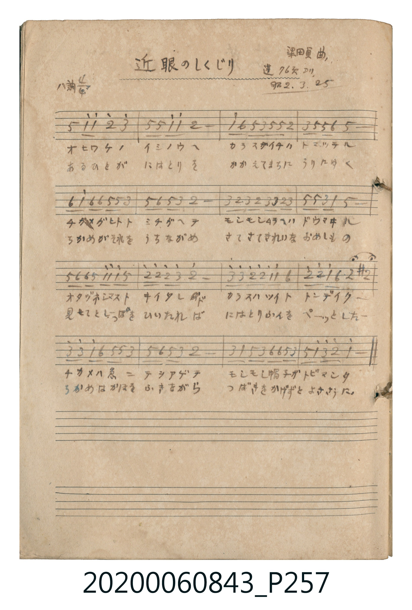

# 近眼のしくじり (近視眼的失誤)

<audio controls src="chikame_no_shikujiri.mp3"></audio>

- 曲：梁田貞
- 公學校唱歌帳 補遺 — 蓬 76頁ヨリ

## 說明

・出處：公學校唱歌帳 補遺 — 蓬 76頁ヨリ
・調性與拍號：調號 ?= C，拍號 <4/4>，速度 != 108

## 跨冊／重複收錄參照

> 同曲（滑稽唱歌〈近眼のしくじり〉；《唱歌帖》P080 與 P257）

- **[同曲]** 楊金土手抄《唱歌帖》第 2 冊・II（2020.006.0843）：[**〈近眼のしくじり〉**](../../vol_02/p080_kingan_no_shikujiri/index.md)（`A` / `4/4` — [原始 TMD](../../vol_02/p080_kingan_no_shikujiri/kingan_no_shikujiri.tmd)）
- 總表：[跨冊重複與同名歌曲總索引](../../../duplicate_songs.md)

## 歌詞

```text
（TMD 檔案未包含歌詞註解）
```

## ABC

```abc
X:1
T:近眼のしくじり 近視眼的失誤
C:曲：梁田貞
M:4/4
L:1/16
Q:1/4=108
K:C
V:V1 name="Vocal" snm="Voc"
[V:V1]
G2 c2 c4 d4 e4 | G2 G2 c2 c2 d8 | c2 A2 G2 E2 G2 G2 D4 | E2 G2 G2 A2 G8 |
A2 c2 A2 A2 G2 G2 E4 | G2 A2 G2 E2 D8 | E2 D2 E2 D2 E2 E2 D2 E2 | G2 G2 E2 C2 G8 |
G2 A2 A2 G2 c2 c2 c2 G2 | d2 d2 d2 e2 d8 | e2 e2 d2 d2 c2 c2 A4 | d2 d2 c2 A2 ^D4 ^d4 |
e2 e2 c2 A2 G2 G2 E4 | G2 A2 G2 E2 D8 | E2 C2 G2 E2 A2 A2 G2 E2 | G2 c2 e2 d2 c8 |
```

## TMD 檔案連結

- [主旋律 TMD 檔案](chikame_no_shikujiri.tmd) [[在 TMD Studio 編輯](https://tmdlang.github.io/Tmd-TS/#tmd=s7IKdvYPcrWy4tLSUnixf-LzOXseN6573Dj9cWP_48YZj5u6FDSAwi-WTQPKPJ_V8nTJxherlmgqaGlxKdoqGBpYcNnbKjhz2Zjom9hx1SkoPW1d83TtjmcLFj6dsvHZ2p6nOzYrvFg852XjLoVHDVMUXkxeo2Bu9nJB4-PmFY-bVymBdDybven9nlnPFjU-n7LhxaZ5SlxczhmZ2Ym5qX75wUBGaVZmUaZVWH5yYo5DjUGNQjWXAhDYWGjZgRk1CqYKhnEgpKtgBCKMQQRIFCYOFgXBGhDPDChuDJY1AgtB2CBRqCKwqfpaCuVWCo-bVik8bp4ExOuB7I1Aug9ILwHi7VD2MiA9A0ivBtIrgfROIF4DUdPcCMT9QNwBxPMeNzcDqTYgXq2gpY9sR2MTUH03kN4ExCuAuAeIgeY1Au0E8YER8LgJ6IZGkBoQBprXCLS3cR8QL4SqBRoMUgdiNwHZjf0wS2qAXgP7GuRDkM8hYQMJBVAIQAIGxIZgCAkJP2MFQ-zhAvIb2M9A-0H-BYcRyJ8gPB8qDxIHhg3Y04ugYQajF0DCCxSGzZ3QcJwHpNeCwwwtgECeBHq8CWgoOHDmAtlAGhwoIM-C5IERBZIDq5kKDSAY3QtR39gCVQcKUJC66UAaGPiN6xCBBQoZUNhAUg4QmQIFgQkIgoBJCykxAXkQASCCKDYDi8NFzBSM1EGpUh2cItHTVdN-oF9bgRjkPFCYgPwPTD-gMASnMRAGqQGF4wTUNAZOV0DvgNMZLNw3A3E7VN96BS30UAQa1TgbGiKgZAbM4IuB1F5oQIJSHyiAgLEHDqwNmKmwcSuQngxR3zzrcfMecKKGGAbWCbcTFjjQ_IYv3YFSmDE01CHpDqgJEq7gPI037YHCoWnt4-alkBQETCTg1Ab0SxMopQFprKlvDiTFgdjgVAoKPaC_wDEAEtuPLwWCAgSUDXdDAw4YKKAUBk-BwOTcCIwCcACCohaWdScC8SxoYIKyMCh1ToUkYHCRUMvFpWungFn0KQBFlbkA)]
- [鋼琴伴奏 TMD 檔案](chikame_no_shikujiri_piano.tmd) [[在 TMD Studio 編輯](https://tmdlang.github.io/Tmd-TS/#tmd=s7IKdvYPcrWy4tLSUnixf-LzOXseN6573Dj9cWP_48YZj5u6FDSAwi-WTQPKPJ_V8nTJxherlmgqaARkJublKzgmJ-fnFiTmZeam5pVoKmhpcSnaKhgaWHDZ2yo4c9mY6JvYcdUpKD1tXfN07Y5nCxY-nbLx2dqepzs2K7xYPOdl4y6FRw1TFF5MXqNgbvZyQePj5hWPm1cpgXQ8m73p_Z5ZzxY1Pp-y4cWmeUpcXM4ZmdmJual--cFARmlWZlGmVVh-cmKOQ41BjUI1lwIQ2Fho2YEZNQqmCoZxIKSrYAQijEEESBQmDhYFwRoQzwwobgyWNQILQdggUagisKn6WgrlVgqPm1YpPG6eBMTrgeyNQLoPSC8B4u1Q9jIgPQNIrwbSK4H0TiBeA1HT3AjE_UDcAcTzHjc3A6k2IF6toKWPbEdjE1B9N5DeBMQrgLgHiIHmNQLtBPGB0fK4CeiGRpAaEAaa1wi0t3EfEC-EqgUaDFIHYjcB2Y39MEtqgF4D-xrkQ5DPIWEDCQVQCEACBsSGYAgJCT9jBUPs4QLyG9jPQPtB_gWHEcifIDwfKg8SB4YN2NOLoGEGoxdAwgsUhs2d0HCcB6TXgsMMLYBAngR6vAloKDhw5gLZQBocKCDPguSBEQWSA6uZCg0gGN0LUd_YAlUHClCQuulAGhj4jesQgQUKGVDYQFIOEJkCBYEJCIKASQspMQF5EAEggig2A4vDRcwUjNRBqVIdnCLR01XTfqBfW4EY5DxQmID8D0w_oDAEpzEQBqkBheME1DQGTldA74DTGSzcNwNxO1TfegUt9FAEGtU4GxoioGQGzPaLgdReaECCUh8ogICxBw6sDZipsHErkJ4MUd8863HzHnCihhgG1gm3ExY40PyGL92BUpgxNNQh6Q6oCRKu4DyNN-2BwqFp7ePmpZAUBEwk4NQG9EsTKKUBaaypbw4kxYHY4FQKCj2gv8AxABLbjy8FggIElA13QwMOGCigFAZPgcDk3AiMAnAAgqIWlnUnAvEsaGCCsjAodU6FJGBwkVCLtdwDl71BHthLPmNtYJhpg8ILROgqmGqDk6epNrQMhMgjq4GqgAY-SMRE2wysxlAbmPeh6s3jtSGFI7IgTCFylNSARc1g5sCUwMyDuQHZDqjZ0PIYJoDCQOEgfAHimcZrGyoYYbgCZgnCATAPQwlQNgb7HZkAhhJKeEBFYMJgAmEIyGyQKjOQMJgwUQeLqwMlwBkdKIiU1ZHNQwlpkkIH7GGYLLIXkcMGHLEwZ0PTAiR48CQqH5REZQJPVIbxQEtBCMgA84xhAmAeXBqJB1IJSw_xIASRwaIeohjTLITdSLohcqi6zcAqgIVsPAgBeUASu25sboVIw0wGMg0gYaRrp4AZTApAUWUuAA)]

## 分析

```text
================================================================================
📊 TMD Song Profile: [ 近眼のしくじり 近視眼的失誤 ]
================================================================================
⏱  Duration:       0:35 (35.6s), 16 measures total
🎼 Key & Tempo:    首調基準 C, != 108.0 BPM, <4/4>
   - 分析範圍：      由實際發聲的音符與和弦推測調性；播放脈絡另行呈現
🎤 人聲音域:    C4 (MIDI 60) – E5 (MIDI 76) [跨度: 16 個半音 / 1.3 個八度, 難度: moderate]
   - 最低音:  C4 in [ChikameNoShikujiri #1 @ m.8, 0:16]
   - 最高音: E5 in [ChikameNoShikujiri #1 @ m.1, 0:01]
   - 適合: soprano, mezzo-soprano, contralto, tenor, baritone, bass
🏛  結構:      ChikameNoShikujiri (35.6s)
⚡ 編曲密度:        Peak 1 軌道同時演奏
🗝  調性診斷：       G 大調（純淨自然大調，未偵測到可信轉調）
   - 風格氣質:    純淨自然大調（陽光明朗、易唱易記，無明顯調外色彩）
   - 轉調歷程:    全曲維持單一推測調性（未偵測到可信轉調）
   - 核心骨幹音:  G, D, E, C, A
   - 調性數值:    G 大調 [相關度: 0.82, 穩定度: Moderate, 自然音純度: 96.9%]
   - 候選調性 (K-S): G 大調 (0.82), C 大調 (0.70), E 小調 (0.62)
   - 五度圈歷程:   +1
   - 各段落調性細節:
     • [ChikameNoShikujiri #1]: G 大調 (r: 0.82, 自然音純度: 96.9%, 調外音: D#)

  [ 五度圈游移軌跡 ]
               C  
         F           [G ]*
      Bb               D  
      Eb               A  
         Ab           E  
            Db       B  
               F# 
     (* = active key center)

  [ 十二半音累積音高分佈 ]
     C  : ████████████████          16.4%
     C# :                            0.0%
     D  : ███████████████████████   24.2%
     D# : ███                        3.1%
     E  : ███████████████████       19.5%
     F  :                            0.0%
     F# :                            0.0%
     G  : ████████████████████████  25.0%
     G# :                            0.0%
     A  : ███████████               11.7%
     A# :                            0.0%
     B  :                            0.0%
--------------------------------------------------------------------------------
Assignment 軌道音域：
  - Vocal         : C4 – E5 (16 個半音 / 1.3 個八度, 98 個音符)
================================================================================
```


## 原書掃描頁




