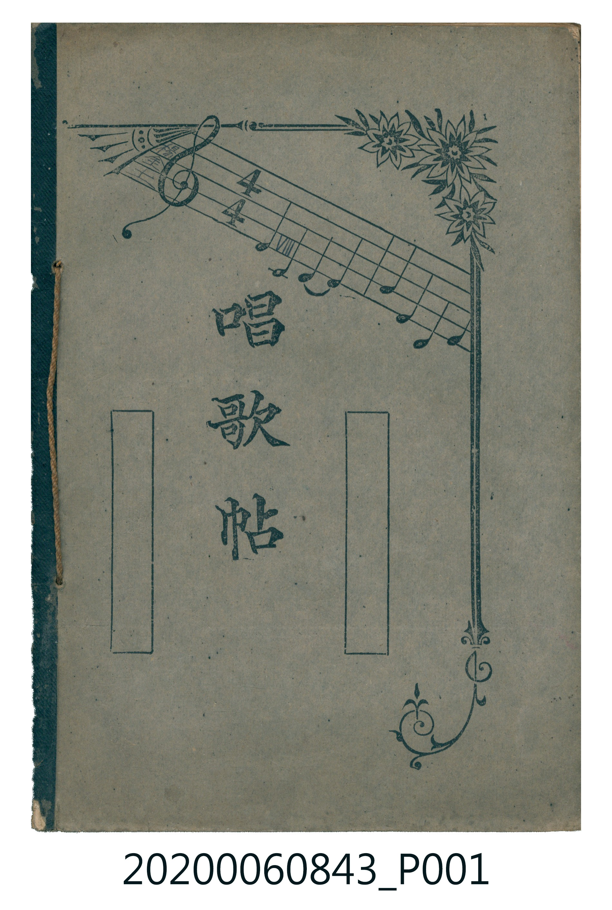
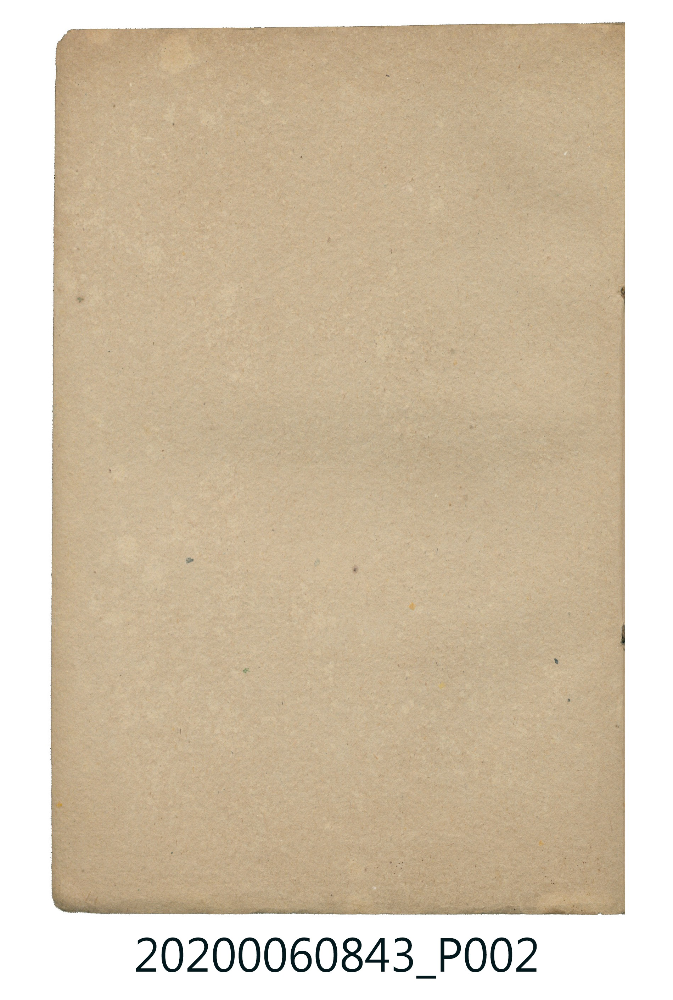
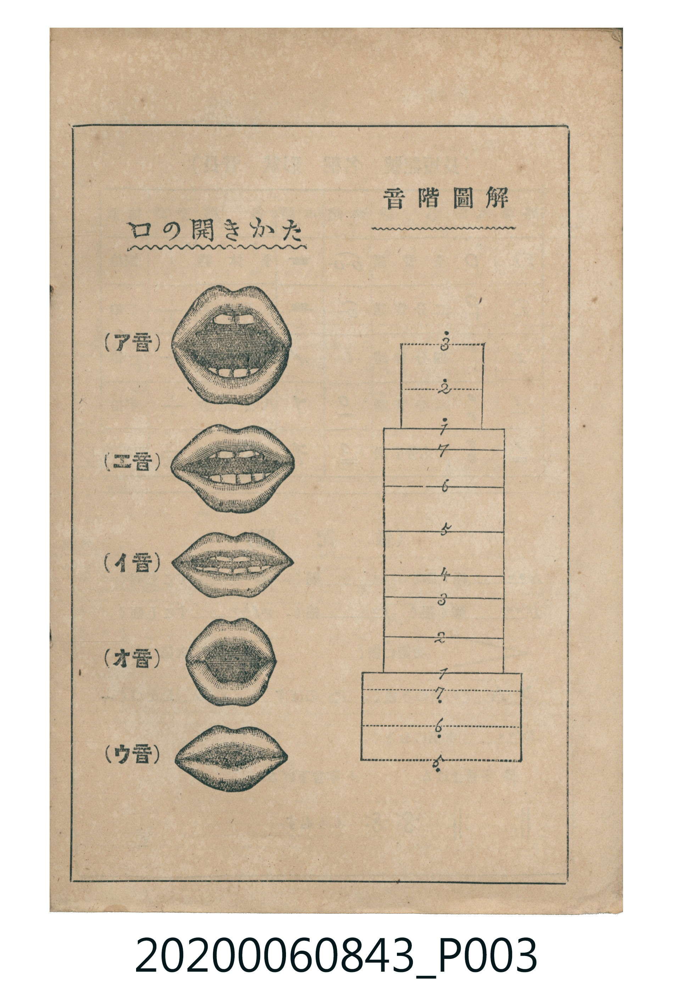
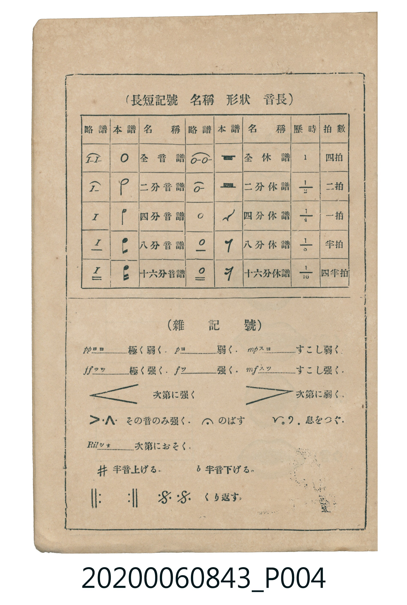
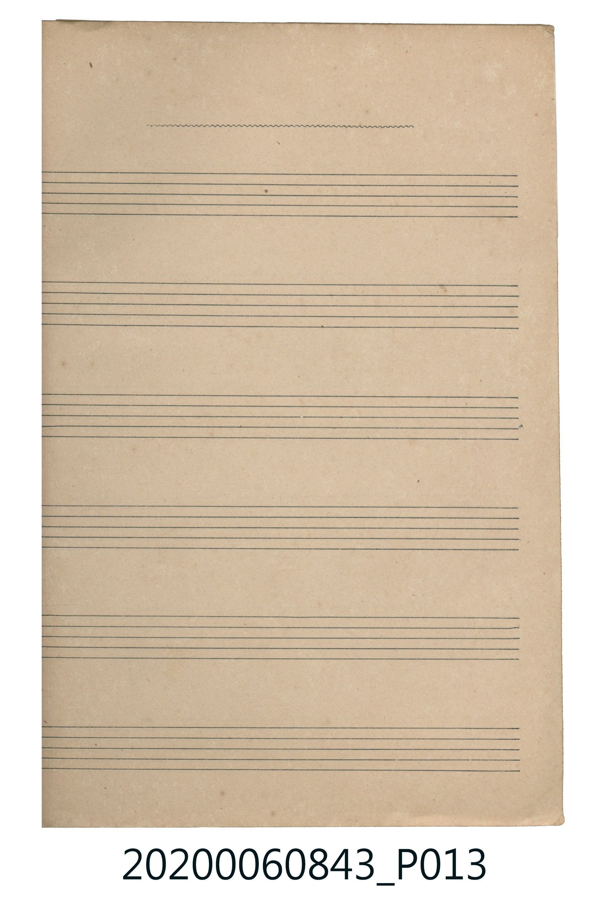
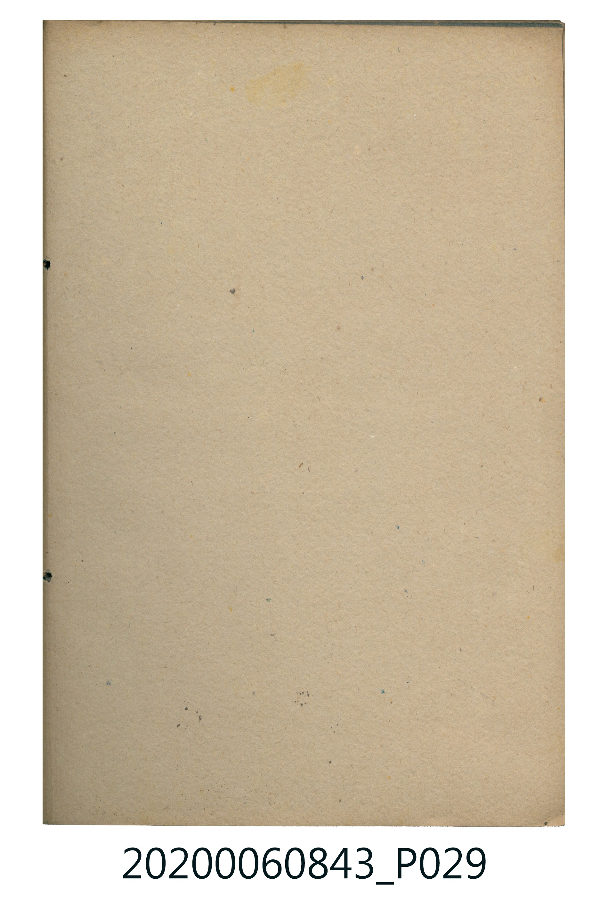
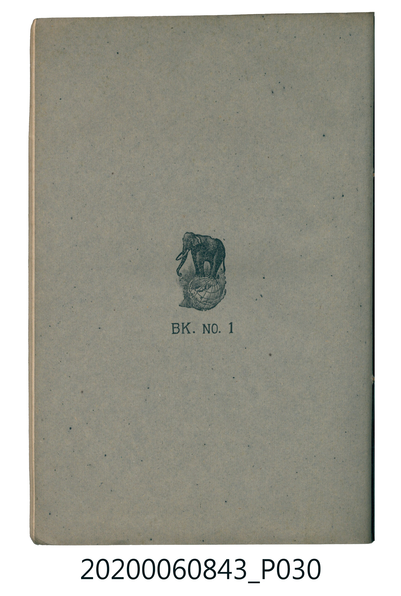

# 書訊與卷首／卷末掃描頁 — 《楊金土手抄唱歌帖》 原編第 8 冊・VIII — 蓬萊唱歌集・下（2020.006.0843，P001–P030）

本頁收錄本冊之封面、扉頁、目次（もくろく）、樂典大要、版權頁與封底等原書掃描圖檔（共 7 頁）。

### P001.jpg

本冊封面，可辨識出中央的「唱歌帖」題字與五線譜、花卉裝飾圖案；右下方可見冊次標記的一部分。

### P002.jpg

空白內頁，未見手寫歌名或樂譜內容。

### P003.jpg

樂典／發聲說明頁，標題為「音階圖解」與「口の開きかた」，以口形圖示說明ア、エ、イ、オ、ウ等母音的發音方式，並附音階位置圖。

### P004.jpg

樂譜記號對照表，說明全音符、二分音符、四分音符、八分音符與十六分音符，以及休止符、強弱記號、漸強漸弱、延長、換氣、升降記號與反覆記號等基本符號。

### P013.jpg

空白五線譜頁，應作為抄寫或補錄樂譜之用；本頁未見可辨識的歌名或手寫內容。

### P029.jpg

空白內頁，未見可辨識的歌名或樂譜內容。

### P030.jpg

封底，中央印有大象站在地球儀上的圖案及「BK. NO. 1」字樣，未見歌曲或目錄資訊。

