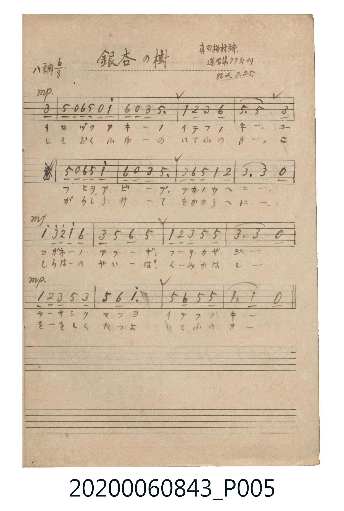

# 銀杏の樹（銀杏樹）

> Re:Shōka 使用 AI 協助辨識與重建樂譜，可能會有錯誤。歡迎回報。

- **鋼琴伴奏版**：<br><audio controls src="icho_no_ki.mp3"></audio>

- 詞：真田梅村
- 出處：蓬唱集 77頁ヨリ（昭2.3.25）
- 《唱歌帖》（2020.006.0843）P005.jpg

## 說明

原書資訊與歌詞全文（對應 P005.jpg）：
調性與拍號：ハ調 6/8 拍（C 大調 6/8 拍）
註記：真田梅村詩 / 蓬唱集77頁ヨリ / 昭2.3.25


## 歌詞

```text
一、
イロヅク アキノ イテフノ キ、
ユフヒヲ アビテ ヲカノウヘニ、
コガネノ アフギ フリカザシ、
ヤサシク マフヨ イテフノキ。

二、
しもおく ふゆの いてふの き、
こがらし うけて をかのうへに、
しらはの やいば くみかはし、
ををしく たつよ いてふのき。
```

## ABC

<div class="abc-score" data-abc-src="icho_no_ki.abc" aria-label="五線譜載入中"></div>

[下載 ABC 原始檔](icho_no_ki.abc)

## TMD 檔案連結

- [主旋律 TMD 檔案](icho_no_ki.tmd) [[在 TMD Studio 編輯](https://tmdlang.github.io/Tmd-TS/#tmd=s7IKdvYPcrWy4qpTUCpJTLdSSM7PyUlNLsnMz7MqzsjPTkzOyFeCS5bl55TmploBqXgDC4RwcX5pUXJqfEFieqpVgIGBKboM3KT4vPyS1KT8_GwMFRn5RYmZ8WB1xRmlCOmCovyy1LzEPKCS3MS80uLkosyCkvjk_IJKhJrUssyUVJCK1JTMkvyizMQcJBenFhWD_QJxYklRYh7EDKAgQlVJRirQWwU5iXklCEGgSemZeVYliZlAZ4GcVp4Yn5uYmQdUlaLEpaWl8LKr4dnc_seN656t2Pl-TweEC2Z3KmhpcSnaKpgZcNnbKjhz2ZjpW9iBDH6xct77PbOez5n_fMqGZ4tan82dCLbvafuuFzOnAmVeTF7zdMrGl7PbFMzNXy5ofNy84nHzKqDZz2asNdIz1jMyBZoN1vG4oQuo8Nnanqc7pj1u6AYqMTIwMtAzMDDTM7AwMQYqA0WEXlZBuhIXl76Wgi21AJeCgsLTvvnPZu94sbn9xYquFx3tQFcA_fW0dcWzae1Ahzzd0PusvVMBZj_QKUCPgbS9WLX_WcNykIbu3hcz5wNFHzf3AwUVgKGjABQD6nVWeLpkOYpQJ1jnit0vVsxAC7kXK1cq6CvAQwwpwIDC8ADjAul_sqPhcUMjiPW4acnj5rWPm1sfN60HchY9bgJy-iDCbY-bp0I4a2Gqm5eBxSY9bt4EVt08GagMKLzpcdNqoNLHTUD5GY-bu-Gmb37ctOZxcy_EGKD6qY-b1gHVA81YBdLStO1x03a44UseN20F8UFOaZ4HVrUCxSlglzRBvLCrB6avcfrjpqbHjV2PG_uBHKAJbcA0CGS1PG5cBuKDOb1w1ZMfN_Y8buoEagNygEonApUBbZn0uLEbqBQstONx42pk04GK14ONaQKaCUQbgMLAhL4frAUoMx3u30lgg6ZDnDL_cSPQSx0oTgG7pAmkmPK0BwUKWvpcXJ7A4sQv3zvTKiAzMS_focagphpkiYKNhZYdmFGdW1ALZtQoGMChMZBnCqTNwKRhHJBrBhY2VdAFwhoFQwUjIM8MyoOIgkigRqhheLWDtJqCDYHwQKIg0gCqvTo3DeYooG7jOAWjOBADZB9IuSlYO7JLQDxTHEbB_YdQCvEfyDigqTA_mMUDCYSxIBpEggyq5eLStVOAhaUCkK3MBQA)]
- [鋼琴伴奏 TMD 檔案](icho_no_ki_piano.tmd) [[在 TMD Studio 編輯](https://tmdlang.github.io/Tmd-TS/#tmd=s7IKdvYPcrWy4tLSUnjZ1fBsbv_jxnXPVux8v6cDwgWyHzfvftm95_mELU_2bHm6tP95Z8f7PZ0KWlpcirYKZgZc9rYKzlw2ZvoWdlx1CkovVs57v2fW8znzn0_Z8GxR67O5E5VAwk_bd72YORUo82LymqdTNr6c3aZgbv5yQePj5hWPm1cBbXs2Y62RnrGekSnQbLCOxw1dQIXP1vY83THtcUM3UImRgZGBnoGBmZ6BhYkxUFmAgYGpXlZBuhIXl2dyRr5fvnemVUBmYl5-kIdDjUFNNZcCENhYaNmBGdW5BbVgRo2CARwaA3mmQNoMTBrGAblmYGFTBV0grFEwVDAC8sygPIgoiARqhBqGVztIqynYEAgPJAoiDaDaq3PTYI4C6jaOUzCKAzFA9oGUm4K1I7sExDPFYRTcfwilEP-BjAOaCvODWTyQgBurbawNYcNYIANr0YPUB2uQYglRoG4FQ6AF8QrG8QhGjYIJkAeyGUkIzoTJAR0XD3S6OVgcTMMCmUgTzeIRioAmxAONQLEIyMAaYDCjEA7BZiGcSYzhiMjA43RsHscwGkjCjQbGi66dAixqFNDYylwA)]

## 分析

```text
================================================================================
📊 TMD Song Profile: [ 銀杏の樹（銀杏樹） ]
================================================================================
⏱  Duration:       0:51 (51.0s), 17 measures total
🎼 Key & Tempo:    首調基準 C, != 60.0 BPM, <6/8>
   - 分析範圍：      由實際發聲的音符與和弦推測調性；播放脈絡另行呈現
🎤 人聲音域:    A3 (MIDI 57) – E5 (MIDI 76) [跨度: 19 個半音 / 1.6 個八度, 難度: challenging]
   - 最低音:  A3 in [IchoNoKi #1 @ m.16, 0:45]
   - 最高音: E5 in [IchoNoKi #1 @ m.10, 0:27]
   - 適合: soprano, mezzo-soprano, contralto, tenor, baritone, bass
🏛  結構:      IchoNoKi (51.0s)
⚡ 編曲密度:        Peak 1 軌道同時演奏
🗝  調性診斷：       C 調性不明確（純淨自然大調，未偵測到可信轉調）
   - 風格氣質:    純淨自然大調（陽光明朗、易唱易記，無明顯調外色彩）
   - 轉調歷程:    全曲維持單一推測調性（未偵測到可信轉調）
   - 核心骨幹音:  G, E, C, A, D
   - 調性數值:    C 調性不明確 [相關度: 0.78, 穩定度: Ambiguous, 自然音純度: 100.0%]
   - 候選調性 (K-S): C 大調 (0.78), E 小調 (0.75), G 大調 (0.73)
   - 五度圈歷程:   +0
   - 各段落調性細節:
     • [IchoNoKi #1]: C 調性不明確 (r: 0.78, 自然音純度: 100.0%)

  [ 五度圈游移軌跡 ]
              [C ]*
         F            G  
      Bb               D  
      Eb               A  
         Ab           E  
            Db       B  
               F# 
     (* = active key center)

  [ 十二半音累積音高分佈 ]
     C  : ████████████              18.2%
     C# :                            0.0%
     D  : █████                      6.8%
     D# :                            0.0%
     E  : ████████████████          23.9%
     F  :                            0.0%
     F# :                            0.0%
     G  : ████████████████████████  35.2%
     G# :                            0.0%
     A  : ███████████               15.9%
     A# :                            0.0%
     B  :                            0.0%
--------------------------------------------------------------------------------
Assignment 軌道音域：
  - Piano         : A3 – E5 (19 個半音 / 1.6 個八度, 59 個音符)
================================================================================
```


## 原書掃描頁




