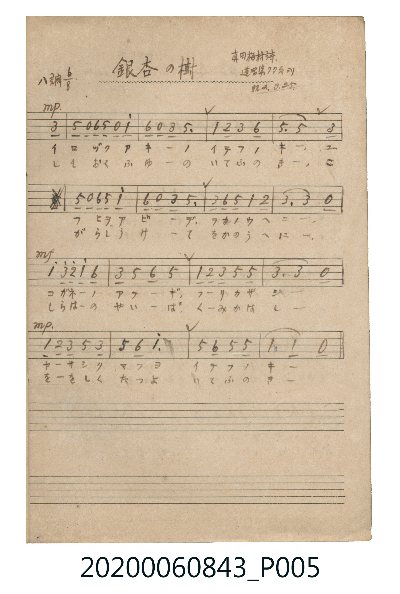

# 銀杏の樹（銀杏樹）

<audio controls src="icho_no_ki.mp3"></audio>

- 詞：真田梅村
- 出處：蓬唱集 77頁ヨリ（昭2.3.25）
- 《唱歌帖》（2020.006.0843）P005.jpg

## 說明

原書資訊與歌詞全文（對應 P005.jpg）：
調性與拍號：ハ調 6/8 拍（C 大調 6/8 拍）
註記：真田梅村詩 / 蓬唱集77頁ヨリ / 昭2.3.25

## 歌詞

```text
一、
イロヅク アキノ イテフノ キ、
ユフヒヲ アビテ ヲカノウヘニ、
コガネノ アフギ フリカザシ、
ヤサシク マフヨ イテフノキ。

二、
しもおく ふゆの いてふの き、
こがらし うけて をかのうへに、
しらはの やいば くみかはし、
ををしく たつよ いてふのき。
```

## ABC

```abc
X:1
T:銀杏の樹（銀杏樹）
M:6/8
L:1/16
Q:3/8=40
K:C
V:V1 name="Piano" snm="Pia"
[V:V1]
!mp! z2 z2 z2 z2 z2 E2 | G2 z2 A2 G2 z2 c2 | A2 z2 E2 G6 | C2 D2 E2 A6 |
G6 G4 E2 | G2 z2 A2 G2 z2 c2 | A2 z2 E2 G6 | E2 A2 G2 C2 D4 |
E6 E4 z2 | !mf! c2 e2 d2 c2 A4 | E2 G2 A2 G6 | C2 D2 E2 G4 G2 |
E6 E4 z2 | !mp! C2 D2 E2 G4 E2 | G2 A4 c6 | G2 A,2 G2 G6 |
C6 C4 z2 | !mp! z2 z2 z2 z2 z2 E2 | G2 z2 A2 G2 z2 c2 | A2 z2 E2 G6 |
C2 D2 E2 A6 | G6 G4 E2 | G2 z2 A2 G2 z2 c2 | A2 z2 E2 G6 |
E2 A2 G2 C2 D4 | E6 E4 z2 | !mf! c2 e2 d2 c2 A4 | E2 G2 A2 G6 |
C2 D2 E2 G4 G2 | E6 E4 z2 | !mp! C2 D2 E2 G4 E2 | G2 A4 c6 |
G2 A,2 G2 G6 | C6 C4 z2 |
```

## TMD 檔案連結

- [主旋律 TMD 檔案](icho_no_ki.tmd) [[在 TMD Studio 編輯](https://tmdlang.github.io/Tmd-TS/#tmd=s7IKdvYPcrWy4tLSUnjZ1fBsbv_jxnXPVux8v6cDwgWzOxW0tLgUbRXMDLjsbRWcuWzM9C3suOoUlF6snPd-z6znc-Y_n7Lh2aLWZ3MnKoGEn7bvejFzKlDmxeQ1T6dsfDm7TcHc_OWCxsfNKx43rwKa_WzGWiM9Yz0jU6DZYB2PG7qACp-t7Xm6Y9rjhm6gEiMDIwM9AwMzPQMLE2OgsgADA1O9rIJ0JS4ufS0FW2oBLgUFhad985_N3vFic_uLFV0vOtqBrgD662nrimfT2oEOebqh91l7pwLMfqBTgB4DaXuxav-zhuUgDd29L2bOB4o-bu4HCioAQ0cBKAbU66zwdMlyFKFOsM4Vu1-smIEWci9WrlTQV4CHGFKAAYXhAcYF0v9kR8PjhkYQ63HTksfNax83tz5uWg_kLHrcBOT0QYTbHjdPhXDWwlQ3LwOLTXrcvAmsunkyUBlQeNPjptVApY-bgPIzHjd3w03f_LhpzePmXogxQPVTHzetA6oHmrEKpKVp2-Om7XDDlzxu2grig5zSPA-sagWKU8AuaYJ4YVcPTF_j9MdNTY8bux439gM5QBPagGkQyGp53LgMxAdzeuGqJz9u7Hnc1AnUBuQAlU4EKgPaMulxYzdQKVhox-PG1cimAxWvBxvTBDQTiDYAhYEJfT9YC1BmOty_k8AGTYc4Zf7jRqCXOlCcAnZJE0gx5WkPChS09Lm4PJMz8v3yvTOtAjIT8_IdagxqFKpBtijYWGjZgRnVuQW1YEaNggEcGgN5pkDaDEwaxgG5ZmBhUwVdIKxRMFQwAvLMoDyIKIgEaoQahlc7SKsp2BAIDyQKIg2g2qtz02COAuo2jlMwigMxQPaBlJuCtSO7BMQzxWEU3H8IpRD_gYwDmgrzg1k8kEAYC6JBJMigWi4uXTsFWGAqoLGVuQA)]
- [鋼琴伴奏 TMD 檔案](icho_no_ki_piano.tmd) [[在 TMD Studio 編輯](https://tmdlang.github.io/Tmd-TS/#tmd=s7IKdvYPcrWy4tLSUnjZ1fBsbv_jxnXPVux8v6cDwgWyHzfvftm95_mELU_2bHm6tP95Z8f7PZ0KWlpcirYKZgZc9rYKzlw2ZvoWdlx1CkovVs57v2fW8znzn0_Z8GxR67O5E5VAwk_bd72YORUo82LymqdTNr6c3aZgbv5yQePj5hWPm1cBbXs2Y62RnrGekSnQbLCOxw1dQIXP1vY83THtcUM3UImRgZGBnoGBmZ6BhYkxUFmAgYGpXlZBuhIXl2dyRr5fvnemVUBmYl5-kIdDjUGNQjWXAhDYWGjZgRnVuQW1YEaNggEcGgN5pkDaDEwaxgG5ZmBhUwVdIKxRMFQwAvLMoDyIKIgEaoQahlc7SKsp2BAIDyQKIg2g2qtz02COAuo2jlMwigMxQPaBlJuCtSO7BMQzxWEU3H8IpRD_gYwDmgrzg1k8kIAbq22sDWHDWCADa9HD1Ad7mGIJUqB2BUOgDfEKxvEIRo2CCZAHshpJCM6EyQFdFw90uzlYHEzDQplIE83iEYqAJsQDjUCxCMjAGmIwoxAOwWYhnEmM4YjYwON0bB7HMBpIwo0GRoyunQIsbhTQ2MpcAA)]

## 分析

```text
================================================================================
📊 TMD Song Profile: [ 銀杏の樹（銀杏樹） ]
================================================================================
⏱  Duration:       1:42 (102.0s), 34 measures total
🎼 Key & Tempo:    首調基準 C, != 60.0 BPM, <6/8>
   - 分析範圍：      由實際發聲的音符與和弦推測調性；播放脈絡另行呈現
🎤 人聲音域:    A3 (MIDI 57) – E5 (MIDI 76) [跨度: 19 個半音 / 1.6 個八度, 難度: challenging]
   - 最低音:  A3 in [IchoNoKi #1 @ m.16, 0:45]
   - 最高音: E5 in [IchoNoKi #1 @ m.10, 0:27]
   - 適合: soprano, mezzo-soprano, contralto, tenor, baritone, bass
🏛  結構:      IchoNoKi (51.0s) -> IchoNoKi (51.0s)
⚡ 編曲密度:        Peak 1 軌道同時演奏
🗝  調性診斷：       C 調性不明確（純淨自然大調，未偵測到可信轉調）
   - 風格氣質:    純淨自然大調（陽光明朗、易唱易記，無明顯調外色彩）
   - 轉調歷程:    全曲維持單一推測調性（未偵測到可信轉調）
   - 核心骨幹音:  G, E, C, A, D
   - 調性數值:    C 調性不明確 [相關度: 0.78, 穩定度: Ambiguous, 自然音純度: 100.0%]
   - 候選調性 (K-S): C 大調 (0.78), E 小調 (0.75), G 大調 (0.73)
   - 五度圈歷程:   +0 -> +0
   - 各段落調性細節:
     • [IchoNoKi #1]: C 調性不明確 (r: 0.78, 自然音純度: 100.0%)
     • [IchoNoKi #2]: C 調性不明確 (r: 0.78, 自然音純度: 100.0%)

  [ 五度圈游移軌跡 ]
              [C ]*
         F            G  
      Bb               D  
      Eb               A  
         Ab           E  
            Db       B  
               F# 
     (* = active key center)

  [ 十二半音累積音高分佈 ]
     C  : ████████████              18.2%
     C# :                            0.0%
     D  : █████                      6.8%
     D# :                            0.0%
     E  : ████████████████          23.9%
     F  :                            0.0%
     F# :                            0.0%
     G  : ████████████████████████  35.2%
     G# :                            0.0%
     A  : ███████████               15.9%
     A# :                            0.0%
     B  :                            0.0%
--------------------------------------------------------------------------------
Assignment 軌道音域：
  - Piano         : A3 – E5 (19 個半音 / 1.6 個八度, 118 個音符)
================================================================================
```


## 原書掃描頁




