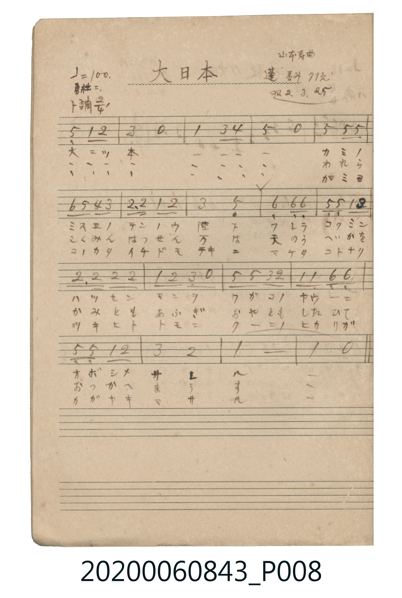

# 大日本（日本）

<audio controls src="dainippon.mp3"></audio>

- 曲：山本壽
- 出處：蓬唱ヨリ 79頁（昭2.3.25）
- 《唱歌帖》（2020.006.0843）P008.jpg

## 說明

原書資訊與歌詞全文（對應 P008.jpg）：
調性與拍號：ト調 2/4 拍（G 大調 2/4 拍），♩=100，「勇壯ニ」
註記：山本壽曲 / 蓬唱ヨリ 79頁 / 昭2.3.25

## 跨冊／重複收錄參照

> 同曲（山本壽作曲；《公學校唱歌》第三學年、《新定兒童唱歌》第三學年與楊金土《唱歌帖》P008 皆收錄同曲）

- **[同曲]** 《公學校唱歌》第三學年（昭和10年／1935）：[**〈大日本〉**](../../../kogakko_shoka/grade_3/12_dainippon/index.md)（`G` / `2/4` — [原始 TMD](../../../kogakko_shoka/grade_3/12_dainippon/dainippon.tmd)）
- **[同曲]** 《新定兒童唱歌》尋常科第三學年用（2020.006.0847.0003）：[**〈大日本〉**](../../../shintei_jido_shoka/grade_3_2020.006.0847.0003/3_01_dainippon/index.md)（`G` / `2/4` — [原始 TMD](../../../shintei_jido_shoka/grade_3_2020.006.0847.0003/3_01_dainippon/dainippon.tmd)）
- 總表：[跨冊重複與同名歌曲總索引](../../../duplicate_songs.md)

## 歌詞

```text
一、
大ニッ本 カミノ ミスエノ
テンノウ 陛下 ワレラ コクミン
ハッセン マンヲ ワガコノ ヤウニ
オボシメ サル

二、
大ニッ本 われら こくみん
はっせん 万は 天のう へいかを
かみとも あふぎ おやとも したひて
おつかへ まうす

三、
大ニッ本 ミヨ コノカタ
イチドモ テキニ マケタ コトナク
ツキヒト トモニ クニノ ヒカリガ
カガヤキ マサル
```

## ABC

```abc
X:1
T:大日本（日本）
C:曲：山本壽
M:2/4
L:1/16
Q:1/4=100
K:G
V:V1 name="Piano" snm="Pia"
[V:V1]
!f! D4 G2 A2 | B4 z4 | G4 B2 c2 | d4 z4 |
d4 d2 d2 | e2 d2 c2 B2 | A3 A G2 A2 | B4 D4 |
E4 E2 E2 | D2 D2 G2 A2 | A3 A A2 A2 | G2 A2 B2 z2 |
d2 d2 B2 A2 | G2 G2 E2 E2 | D2 D2 G2 A2 | B4 A4 |
G8 | G4 z4 | !f! D4 G2 A2 | B4 z4 |
G4 B2 c2 | d4 z4 | d4 d2 d2 | e2 d2 c2 B2 |
A3 A G2 A2 | B4 D4 | E4 E2 E2 | D2 D2 G2 A2 |
A3 A A2 A2 | G2 A2 B2 z2 | d2 d2 B2 A2 | G2 G2 E2 E2 |
D2 D2 G2 A2 | B4 A4 | G8 | G4 z4 |
```

## TMD 檔案連結

- [主旋律 TMD 檔案](dainippon.tmd) [[在 TMD Studio 編輯](https://tmdlang.github.io/Tmd-TS/#tmd=s7IKdvYPcrWy4qpTUCpJTLdSSM7PyUlNLsnMz7MqzsjPTkzOyFeCS5bl55TmploBqXgDC4RwcX5pUXJqfEFieqpVgAGmDNyk-Lz8ktSk_PxsDBUZ-UWJmfFgdcUZpQjpgqL8stS8xDygktzEvNLi5KLMgpL45PyCSoSa1LLMlFSQitSUzJL8oszEHCQXpxYVg_0CcWJJUWIexAygIEJVSUYq0FuZuQWpEN1aWgpPlyx_Nn3pszlr3u_pgDE6FbS0uBRtFQwNDLjsbRXcuWyM9E3sQKY8m73p_Z5ZTzduBKp7ungv2OSn7btezJwKFH4xec3TKRsfN6943LxKwdzy5YJGkJkz1hrpGesZmQKNBSt_3NAFVPVsbc_THdMeN3QDlRgZGBnoGRiY6RlYmBgDlYGCVi-rIF2Ji0tfS8GWWoBLQUHhad_8Z7N3vNjc_mJF14uOdqArXqyc97R1xbNp7UCHPN3Q-6y9UwFmP9ApQF-BtL1Ytf9Zw3KQhu7eFzPnA0UfN3cABRWA4aIAFAPqdQeFJIoQUHPPo5krbYGhCGQ9buh52t3-dPH6x83djxt6waau2P1ixQzk8AQGr4K-AmY4AgXh4cgF0vpkR8Pjhkawj5YsB5nY3Aw0QeFx0-rHzfMfN_cpgKimnY-bgGb0gZQ9bm573LwZyHnctEzh5czZT3Z0A8WAjlnzuHklUN_mx01ADlDrZojqfqCJj5t2A_lAzjyw1k1gDU1rQIrBNiwBmgW0G6yhadXj5jmPm7Y_bl4I5Gx93Lwa4s5dQI9jc2f_46aex02dCo8bJz9u7H_cuP9x02SwQY3rHzcuftw4G8gH-rIdyAdqXfm4cd3jxjag7I7HjS2PG7sfN02CqO4GaW1c8bipCchpety49XEj0GmNXY-bgMqgwtMfN85_3LjpceMyiJ6ux41LwDp3ADn7gOY-bpwJDdVOrK4FhcsKcCCBwm_146b9ED8vedzc-Li583HzInD4Nq0F6gEHV9NGoBqIho7HzUDHrIeEagtYzSSgKJADlFkE1gAKeaBdoCCdBI7BVcBQhtgAtAsYQcCAXgsxFxywQBnKcwMUKGjpc3G5JGbmZRYUAIuPgMzEvHyHGoMahWqQNQo2hmZadmBWdVotmK5RMI1X0AVDQyA2AuIaBWOoiAGUrgHLgSBIxgQsYoqhBiYCokG4BmqBGZQP0gfSXwO2BWQXpo1wxwC1wZhgBpiAOhZMwPVCbYGZCaIhZsJUgMwGuRLiQhAGiSDUgDCSHcjBgmoT3JUQu5DDBQYRIvBw4arl4tK1U4BHigI6R5kLAA)]
- [鋼琴伴奏 TMD 檔案](dainippon_piano.tmd) [[在 TMD Studio 編輯](https://tmdlang.github.io/Tmd-TS/#tmd=s7IKdvYPcrWy4tLSUni6ZPmz6UufzVnzfk8HhPG4effL7j3PJ2x5smfL06X9zzs73u_pVNDS4lK0VTA0MOCyt1Vw57Ix0jex46pTUHo2e9P7PbOebtwI1Pl08V4lkNjT9l0vZk4FCr-YvObplI2Pm1c8bl6lYG75ckEjyJYZa430jPWMTIHGgpU_bugCqnq2tufpjmmPG7qBSowMjAz0DAzM9AwsTIyBygIMDCz0sgrSlbi4XBIz8zILCvLzrAIyE_PygzwcagxqFKq5FIDAxtBMyw7Mqk6rBdM1CqbxCrpgaAjERkBco2CobQwVM43XBgmDIFAYygJJmoBFjLVNYZrhWpBFISwIWQO1z0TbDC5mpA0yB6K3RsE8XhtkP8gV2N0Ct8EkXtsMxoOxYTTQ_nhtsFowATcJaj2SJVAm1B4oC2KfAZJHoCRcJTRMQBhmJ8Ri5ABFtRs1ROFOgJkGl4RBNGGQa8DCXLUY8euDI35z4RFsCHEP2EEIJqY4xM_ookawMEXVjqEYoQAe0ahmgBUgJTeINmjKQrMUqhZhAoIFVQxWAQ1pjMAH2wcRhzofj18xTALGJlwcyV5kCxCehZpPyFfGYBIl5DEiVtdOAR63CugcZS4A)]

## 分析

```text
================================================================================
📊 TMD Song Profile: [ 大日本（日本） ]
================================================================================
⏱  Duration:       0:43 (43.2s), 36 measures total
🎼 Key & Tempo:    首調基準 G, != 100.0 BPM, <2/4>
   - 分析範圍：      由實際發聲的音符與和弦推測調性；播放脈絡另行呈現
🎤 人聲音域:    D4 (MIDI 62) – E5 (MIDI 76) [跨度: 14 個半音 / 1.2 個八度, 難度: moderate]
   - 最低音:  D4 in [Dainippon #1 @ m.1, 0:00]
   - 最高音: E5 in [Dainippon #1 @ m.6, 0:06]
   - 適合: soprano, mezzo-soprano, contralto, tenor, baritone, bass
🏛  結構:      Dainippon (21.6s) -> Dainippon (21.6s)
⚡ 編曲密度:        Peak 1 軌道同時演奏
🗝  調性診斷：       G 調性不明確（純淨自然大調，未偵測到可信轉調）
   - 風格氣質:    純淨自然大調（陽光明朗、易唱易記，無明顯調外色彩）
   - 轉調歷程:    全曲維持單一推測調性（未偵測到可信轉調）
   - 核心骨幹音:  D, G, A, B, E
   - 調性數值:    G 調性不明確 [相關度: 0.84, 穩定度: Ambiguous, 自然音純度: 100.0%]
   - 候選調性 (K-S): G 大調 (0.84), D 大調 (0.82), B 小調 (0.56)
   - 五度圈歷程:   +1 -> +1
   - 各段落調性細節:
     • [Dainippon #1]: G 調性不明確 (r: 0.84, 自然音純度: 100.0%)
     • [Dainippon #2]: G 調性不明確 (r: 0.84, 自然音純度: 100.0%)

  [ 五度圈游移軌跡 ]
               C  
         F           [G ]*
      Bb               D  
      Eb               A  
         Ab           E  
            Db       B  
               F# 
     (* = active key center)

  [ 十二半音累積音高分佈 ]
     C  : ███                        3.1%
     C# :                            0.0%
     D  : ████████████████████████  26.2%
     D# :                            0.0%
     E  : ██████████                10.8%
     F  :                            0.0%
     F# :                            0.0%
     G  : █████████████████████     23.1%
     G# :                            0.0%
     A  : ████████████████████      21.5%
     A# :                            0.0%
     B  : ██████████████            15.4%
--------------------------------------------------------------------------------
Assignment 軌道音域：
  - Piano         : D4 – E5 (14 個半音 / 1.2 個八度, 102 個音符)
================================================================================
```


## 原書掃描頁




