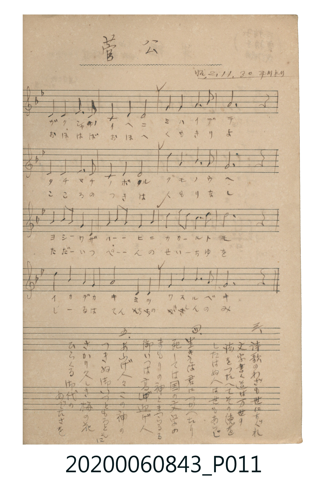

# 菅公（菅原道真）

> Re:Shōka 使用 AI 協助辨識與重建樂譜，可能會有錯誤。歡迎回報。

- **鋼琴伴奏版**：<br><audio controls src="kanko.mp3"></audio>

- 作詞：大和田建樹／作曲：多梅稚（明治29年〈菅公〉）
- 出處：平川より（昭. 2, 11. 30 抄）
- 《唱歌帖》第八冊（2020.006.0843）P011.jpg

## 說明


- 出處：出處：平川より（昭. 2, 11. 30 抄）
- 出處：《唱歌帖》第八冊（2020.006.0843）P011.jpg
- 調性與拍號：調號 ?= B,，拍號 <4/4>，速度 != 84


## 歌詞

```text
> [!NOTE]
> **原頁資訊與歌詞全文**（對應 `P011.jpg` 手抄五線譜）：
> - **出處與詞曲考證**：五線譜右上角記「`昭. 2, 11. 30 平川より`」（昭和 2 年 11 月 30 日自平川處轉抄；舊轉錄誤讀為「刊りすより」）。本曲為明治 29 年（1896）大和田建樹作詞、多梅稚作曲之著名歷史唱歌〈菅公〉（「學者の家に身は出でて…」）。
> - **調性與旋法還原**：原抄本四行高音譜表調號均明確標示 **2 個降記號**（B♭、E♭），屬 **ト短調（G 小調，`?= B,`, `key= Gm`）** 結合日本都節音階半音進行（`D5–E♭5`、`E♭4–D4`）；舊轉錄誤作 F 大調（`?= F`），致使全曲調式與半音結構盡失，今完整還原為 `?= B,`（`key= Gm`）。
> - **校訂與手抄原貌說明（依 Editorial Policy A 校訂）**：
>   1. **第 1–2、5–6 小節五線譜符頭移位還原**：原抄本第 3–4 小節及第 7–16 小節符頭位置均準確落在 G 小調五線譜正位（如第 3–4 小節 `G4 G4 A4. B♭4 | A4.`、第 7–8 小節 `D5 B♭4 G4. A4 | G4.`、第 11–12 小節 `D5 E♭5–D5 B♭4 D5–E♭5 | D5.`、第 14–16 小節 `E♭4 D4 D4 | G4 A4 B♭4. A4 | G4.`），惟抄寫者於第 1、5 行起首第 1–2 小節與第 5–6 小節誤將符頭整體下移（第 1–2 小節抄於下加一線 `D4` 至第一間 `F4` 一帶，第 5–6 小節抄於第一間 `F4` 至下加一線 `D4` 一帶）；依多梅稚原曲與第 3 小節同型樂句校訂還原為 `| 6_ - 6_ - 7_ - - 1 | 6_ - 4_ - 3_ - - - |`（`G4 G4 A4. B♭4 | G4 E♭4 D4`）。
>   2. **譜下第 1、2 段歌詞筆誤校訂**：
>      - 第 1 小節第 1 段第 4 音「`ノ`」有塗改重寫痕跡；第 6 小節「`ノ ボ ル`」之「`ル`」前有小墨點。
>      - 第 9 小節第 1 段原詞「よし禍（わざはひ）に」，原抄本「`ワ ザ`」之「`ザ`」筆畫近「`ガ`」，今正為「`ワ ザ`」。
>      - 第 13–16 小節第 2 段原詞為七五調「知るは天地の 神のみぞ」，原抄本於第 13 小節誤作帶濁點且拉長一拍之「`じ ー る は`」，致第 14 小節擠作「`てん [塗銷ち]ち の`」，第 15–16 小節又將「神（かみ）のみぞ」誤讀音讀作「`[塗銷ぬき] し ん の ｜ み`」（少一音節而漏「ぞ」字）；今依七五調字音對位與原詞校訂還原為「`し る は て ｜ ん ち の ｜ か み の み ｜ ぞ`」。
>   3. **頁底第 3–5 段直書歌詞跳行與脫字校訂**：
>      - 第 3 段末句原抄本脫「に」字作「`したはぬ人は世もあらじ`」，依大和田建樹原詞校訂為「世にもあらじ」。
>      - 第 4 段末句原抄本寫至「`御いつは高し`」時視線誤跳至第 5 段首句，續寫「`仰げ人`」（「高し」下有重描塗改痕），隨即另起第 5 段重寫「`五、あふげ人々この神の…`」而遺落第 4 段結語「菅公よ」；今依原詞校訂補全為「御いつは高し菅公よ」。
>
> **一、**
> ガクシャノ　イヘニ　ミハイデテ
> タチマチ　ノボル　クモノウヘ
> ヨシ　ワザハヒニ　カカルトモ
> イカデカ　キミヲ　ワスルベキ
>
> **二、**
> おほはば　おほへ　くもきりよ
> こころの　つきは　くもりなし
> ただ　いつぺんの　せいちゆを
> しるは　てんちの　かみのみぞ
>
> **三、**
> 詩歌のわざも　世にすぐれ
> 文字書く道は　万世の
> 法をつたへて　その徳を
> したはぬ人は　世にもあらじ
>
> **四、**
> 生きては君に　つかへたり
> 死しては国の　文学の
> まもりの神と　まつらるる
> 御いつは高し　菅公よ
>
> **五、**
> あふげ人々　この神の
> つきぬ御いつと　もろともに
> さかり久しき　梅の花
> ひらくる御代の　めでたさを
```

## ABC

<div class="abc-score" data-abc-src="kanko.abc" aria-label="五線譜載入中"></div>

[下載 ABC 原始檔](kanko.abc)

## TMD 檔案連結

- [主旋律 TMD 檔案](kanko.tmd) [[在 TMD Studio 編輯](https://tmdlang.github.io/Tmd-TS/#tmd=s7IKdvYPcrWy4qpTUCpJTLdSSM7PyUlNLsnMz7MqzsjPTkzOyFeCS5bl55TmploBqXgDC4RwcX5pUXJqfEFieqpVgIGhIboM3KT4vPyS1KT8_GyEioKi_LLUvMQ8oKrcxLzS4uSizIKS-OT8gkqEmtSyzJRUkIri5MS8-LLUosy0zNQUJGelFhWDHQxxR0lRYh7EHKAgQlV-UUlGfnpRYkFGpVVGZnFJflFmcmJOfHZiXiJCUUlGKtCDEGkkFwDVpmfmWeWmZmZlxpekVpSgegIqXZKYCfRpPBCXJ8bnJmbm5STmAZ2ppaXwor_1aeua93s6QIy--S8bJz-fM__9nk4FLS0uRVsFCxMue1sFJx2u7NRKWwX3XC4bE30TO5DxT_bOebFy3vs9s54uWf50Us_zKRue7t71bMXO93v6gVLPZm8CS816tqj1-YpZQPOfzeh7tmm3keXTnVseN4Bta13zuKETaBXYtU_bd72YORWkZ-fmp9vnPm7qeNzUBda2Vk_BSEfB0FBPwdhA4VlXC0zH44aup1M2Plvb83THtMcN3c_XrHnauvppG0iTkYGRgZ6BgZmegYWJMVA9KOr1sgrSlbi49LUUbKkFuBQUFOwUohX9_ENcYyEcLS1QIC5ofLG5_cWKrhcd7UD3AYPpaeuKZ9PatbSAbnu6ofdZe6dCAsxNCQrPOruB3nqya8rz7bNerJ0DdC8wGCDG6YIMBIcM0CigOcBgfdHQ_GJtJ8ioWXAtT_s3P9nR9WL5pBcrZjxu6ElACzTkIE143NALCVZgpCkYAeW2AJUpPJvTAQ7e6UtftK-CqAdZurcTHOCzX3R0Adkve1perFryYl3D86ZdQGuednQBDXzcOBNiMtjgzscNTc_mrAG6E6gGEuUKRpYgW4CWGlpYmgGVoCUYSEJ63NAITy2Q9PNkZ_eLidOfTuh9tnb70_5NkLhGTTodIFes3fGiofVx47qn67Y9blz9Ytfqx43rgWH2uHH548ZljxqWwd2FCNIXq_Y_a1gOip3p3c82T33Z1AKMNXCQAmmgj4E-eDp79ouFPS9Xz3g5fzMwhF8sXAHU9GLm_Kdz24Heer4I6PKZz5fsAhoGDMOG7pcze4FhD5QHx7HTo5lrgR5yBVLg2Ox5unENUOXj5o7n89cCzQEqcVd4uqEfzOxJAOewBB2FBGgmSwBqAmbN51snPJ3QAYwSoHNeNu99vr4B6JaXs_qe9naBGA2bgA4EmpTgYvqoYTLILlNg5DYmgFgmQBEXE5A5aJEHDFoFNwVgDEBcAbLaDaKs50X7lid794NSKjCRrdr_dE8_MIAgdgFd8mx59_PZC58u2QhU-WR319N1Pc-mboEEHDCmFaB-ABmJ5AmUQH-2YOGLFU2gQAend6DGF5t6XqxaBQxOoLYn--YquKZkgsq-xByFgPyczORKBUcFiCZweMAzhYICMFlraQEzvIIh0J9GQE-DQsAMFKLAQILniudrlr1csPb58t1P9vZii2KQAcZAjSZQjU_7u0BC5kAhQ5hhEDOABjzfuw4U9bumAaP-xYS9T-esUIBFIdzCZ2sXA1WC8viyJnTDFRLcTRSAyNFETwGUPEwUakBsUIzBLLWAK3UxhapxB6p2BCkFMmBKDUGeNgSmOoRicOSDohymD5EkgHpdTBF6QQkD7jkFSFpRcAEjkCUgy8AmIFkLSR3PmkGh9nT9amBmezZtD9gwUMArABPhi63bXy6bBo8PqOnAmAYJIUcNMAE-3QAUBYUpKPmsnvJkRzcwgoBBhq4bFEXT9gCln3YteLKjARjAQJ-aJCi8aN8MVAoUeTltskKCG1AEyH66YxvQiei2QYxAUw3Uj2kozAhQbgEmRHhBBEoqwMwA8YgxLJlM6Hk6r_vZiqan_UshyRMpG9QomMUDUzuYMAcRugqGwHAE801AhDFEUFehBpxZMBMFkAuLFZQspKBgBEr1wGQGCjNo8BspPFu3FVLFPF_bBgxeiINQMgsQ6CqANcDTNIgN1AhimCgA8zeoznjc3AeqG57N6Xy6cPqzKTtftvcCY_v59Kkvti8EBgtILSxgocoVHjfPAeLVIG3AwhoiCuY97QSbs6H_6aIVL3cDy3a4H-COAdYJqI4BlQegaqAHVJs0Tn--DJSRHjf1P26cBizQHzcC2xOdwPIdXJr3wPMwxNL1Co-btiE7A8IDBsnzqatf7J8IEVsDqftAxRcwp0LqMGTN2JxpCMrDSKXBGmCVCXcs0IgnO5qB2R9YCADNej5_6eOmblDts2Tl0zkbgFWSwvOl84DU48b9jxuBXkNxOSwTwZIVpHAGJsNn-xuBYfZkx5Rn3Z0vp24Hps1n3XCPNc4AhvgeoIu7FYAWQT0ELLkhmRuW8CcvABoFUb_scdNkhWhglL7s2v64cWEsEAN1roPqBGsD5Rm4F5_2A1so7SDfLAU27oAxAfQQsKYABj3CG5BGAKhiXNcAtQhuw5rHjb2xQBumA904GWSTwntglQPUCm14PN0wEZQdgXUK0MsNPc_29IOiHGzs07XToVlwdxcwF8KDFigOVA9sNwELV1CVBA57tJwH8SzIUnDAAPEyiMVgR4C9DHUISH4_mA-iIWLz0KLfGJTTgK24p7umwspxU3CGmb3l2ewdkPz2YvtmUNEHbJa1rAa6EF_GMwbn0jmrgQUGPPqBusAeByVooHZ4fE1_3DgfnN7XPNkFbMOsfwJs3DY1PW5setwEjIMZsCQMKqRQWlHIoQIJD5BOoPFImnGkcRMszgMV9O3gcuHpvoWPG1seNy4BOgbYHAK6EFxMzGx6ASzygdUeMC0AQwJcKiuAAwlYFQBNAiWuXT1AY0BmPNkNzA2TgB6CJgKgGMQoUJbd0Q0sK4ClzbP-fkjJAyxzIHXOy1krnvZuftq_DFjBIIwHl0tgU3dNARaBIN81boUY_xjUEJwMjFtIvgM2_kAWApPZy0ZQpQ33LLA982IVqKyBtiWBJQ7IXdCEhxyULxbPAbaIoO1djJBA1g4LWVg_AJjKga4D9qLAfGDp87hp_eOm7Y-bFwOLzscNDY-bljxunvG4GZivGx43z3_c3A8WaX_c3AbTsv9xc-Pj5nkgEqSmD1jeAgtYsN71j5sXgUSalgENgapvXgEyH6QSaNE2kIHNk6DmNwHTwWqQ3uYOoEaY-UvAgu0gEqRmLdgZm2Am7ASrBzbu16L6axewEY7wVyOwA7AbnGA3gDRCuTvAbKCPgHHTC-obNHXA1AOjZ_Ljpl5QeQJSAwxMIHs9Qj2oR7EKGLYw9cDcsAAsCwn5XcAcDdM7Gyy48HFT2-OmSTD10yFlMFgBqPADKYCqBxVl8HIMLbKAFS3cUy9WrgR1NYAqIdUP0FUNDdDsBOztNE543NQDUQns1IHy_uwdQMcDu84Qe5_saAcrXgdVs3kq0HlgxwP9AlQJ7JEAHTMX1GXZtxnF5ahZH2EpUh5GcTawk4Lk7OdTgNqBgbkMVAVNAAYOOFpB9gI9DrR3PjBsoU5aC4wjoHVglbP3QsIH7BegCNTZjxv3waIDkp1WgE3bBzIQ6BJgIDd1Q1Ri5gugSnjWQEs8oCyLSDyoWRdkPiL3wtRAUsgaJFvALgG5DSgOTPNAQ1bDFE8Febap68lOYEEA9CAwVzYAm3JA0150bYSp2QQOSWBi6waa-WT3YmjyaAIWJcAuIzAMQfEFUkz5CAEUKGjpc3F5J-Zl51uF5QOHdhxqDGqqQTYo2FhogQNHoTo3rRbMwDZAASqmgeUJsL5R0IA1lGGVvY4CbCRBE4tGoMUgQ0lolmJXCWVCoAFIHdhcH8MaUNEG5AOLJDAJKuDAikANRJDkEjB7BpjshlsCLGrAIv1gTSA1IF47WKYNu1VGQLnGLpC6xt1gEmQhiN4A0oUiswNhTyPEhiaweC9ER1MX2GUdGPbgj4BdPfAIADWZYN01qkeAMVgSqhisHKoQV_jvBwdeI5icBw3KRnBQ9oHZc8DkakSgQOKqeRE0miCBsgysAxRRuAJ_MjgQwWQTNCiBzSiQDDiSwcELixaMwAcGOkTHKrDMdBIDf0cnPPAtkfu_RIY-OMyNQBQiHnCJgsLfBEiC4sAYyIKI4Aj85hVgz20HByUkC2yDeB6ctiGRMQlMglI_KPBBEQElwZECrJShOkARgivwwfmlcQGYbAGToEAHyeyC2QNs60KiBCI-G0ntQrA8KGeBXAByDwmBDxkLgxY9KB0iIkMfJUWDA70GkupBEJzywQQ0mYMVgJQTk_bBKQ8amO1wNkhmLTz4IUXNJmggQyJpJzz4QfRMFB3Ygh-UXkGdC1gKB3UwIPaAAh2SssGBDA9-iFpw3gSLQXggGUgeRbanlotL104BXENE-xjGKiA4RmCOMhcA)]
- [鋼琴伴奏 TMD 檔案](kanko_piano.tmd) [[在 TMD Studio 編輯](https://tmdlang.github.io/Tmd-TS/#tmd=s7IKdvYPcrWy4qpTUCpJTLdSSM7PyUlNLsnMz7MqzsjPTkzOyFeCS5bl55TmploBqXgDC4RwcX5pUXJqfEFieqpVgIGhIboM3KT4vPyS1KT8_GyEioKi_LLUvMQ8oKrcxLzS4uSizIKS-OT8gkqEmtSyzJRUkIri5MS8-LLUosy0zNQUJGelFhWDHQxxR0lRYh7EHKAgQlV-UUlGfnpRYkFGpVVGZnFJflFmcmJOfHZiXiJCUWIRUHN6am5qXolVQWZiXn58YnJyfm5BYl4mSAyhsCQDqAhqDpJTgYamZ-ZZ5aZmZmXGl6RWlEB8q6Wl8KK_9Wnrmvd7OkCMvvkvGyc_nzP__Z5OBS0tLkVbBQsTLntbBScdruzUSlsF91wuGxN9EzuQuU_2znmxct77PbOeLln-dFLP8ykbnu7e9WzFzvd7-oFSz2ZvAkvNerao9fmKWUDzn83oe7Zpt5Hl051bHjeAbWtd87ihE2gV2JlP23e9mDkVpGfn5qfb5z5u6njc1AXWtlZPwUhHwdBQT8HYQOFZVwtMx-OGrqdTNj5b2_N0x7THDd3P16x52rr6aRtIk5GBkYGegYGZnoGFiTFQPSj29bIK0pW4uDzzSoryrQJAYRjk4VBjUFPNpQAENiZadmBGjUJ1bkGtgnG8tlk8gjQHk4ZAWYiQCYivoKtQw1WLYqQPdiPN4kGKjcEkhGcExFA-yAjvxLzsfKuwfGDMIxlgATWgOjetFm4SUAuYADpJFwhBbgLzgU4CWQEWhNiCRSWUCYEGYNtB5voY1ig8bloD5D9uWg8mtz9uXgxW9Li5D6jvcdMSMHsGmOyGW_K4eT5YpB-sCaQGxGsHy7Rht8oIKNfYBVLXuBtMgiwE0RtAulBkdiDsaYTY0AQW74XoaOoCu6wDwx6Sw8oYLAlVDFYOVYgrqPaD_dkIJudBfd0I9nUfmD0HTK5GuB8SrM2LoCEKcf8ysA5QmOIKp8lg_4LJJqivG9eBwwMcH-CQgIUgRjgBwweiYxVYZjqucAKHjhGIQoQYLlFQSJkASVBoGQNZEBEcwdS8AuyM7WBPQ9LVNogzwQkGEmyTwCQoSYGCCRRkUBIcfI-bQdEL0gEKOlzBBE6EjQvAZAuYBAUPSGYXzJ4mSFCug4rPRlK7ECwPSq4gF4DcgzWYUBIJOHRqIAkJBMGJCVIkICkAKScmOYEjE-rrdjgbJLMWHk6QjLYJGhqQ0NwJDycQPRNFB7ZwAiWBx02gsIYkmseNy6D2gEIHkljAoQEPJ4hacHIHi0F4IBlIske2B16OYZausJIMpXQFBRicRsqiMFGMXEpIF7x0g7ER_idCN45SVBsU7-DCH6EXGqcILkIK2UpTqBXgXIRuP0FpqNWg3AazHpzhoOIgaKoOYSNbit3FMN_iSLIwZTAnQXVDbMDwK64ox1P7geo6EDYFYtQa0DweLoSqCC4JYhgg-Y8E02A0qgjCMJhBCHWYIjDjYTRBlyG0QrVhOA3kbkOcTgMGqmteSmZeOv5mCjAfmYAiRdsIFDnQiAJHEzjuMMzBETuwkIO0UcC6dO0UwG0aBSADHL3RPoaxSBwjMAdiNoilzAUA)]

## 分析

```text
================================================================================
📊 TMD Song Profile: [ 菅公（菅原道真） ]
================================================================================
⏱  Duration:       1:31 (91.4s), 32 measures total
🎼 Key & Tempo:    首調基準 B,, != 84.0 BPM, <4/4>
   - 分析範圍：      由實際發聲的音符與和弦推測調性；播放脈絡另行呈現
🎤 人聲音域:    D4 (MIDI 62) – D#5 (MIDI 75) [跨度: 13 個半音 / 1.1 個八度, 難度: moderate]
   - 最低音:  D4 in [Kanko[L1] #1 @ m.2, 0:04]
   - 最高音: D#5 in [Kanko[L1] #1 @ m.11, 0:29]
   - 適合: soprano, mezzo-soprano, contralto, tenor, baritone, bass
🏛  結構:      Kanko[L1] (45.7s) -> Kanko[L2] (45.7s)
⚡ 編曲密度:        Peak 1 軌道同時演奏
🗝  調性診斷：       G 小調（純淨自然小調，未偵測到可信轉調）
   - 風格氣質:    純淨自然小調（陰鬱抒情、旋律集中，無明顯調外色彩）
   - 轉調歷程:    全曲維持單一推測調性（未偵測到可信轉調）
   - 核心骨幹音:  G, A, D, A#, D#
   - 調性數值:    G 小調 [相關度: 0.82, 穩定度: High, 自然音純度: 100.0%]
   - 候選調性 (K-S): G 小調 (0.82), G 大調 (0.69), D 大調 (0.57)
   - 五度圈歷程:   +1 -> +1
   - 各段落調性細節:
     • [Kanko[L1] #1]: G 小調 (r: 0.82, 自然音純度: 100.0%)
     • [Kanko[L2] #1]: G 小調 (r: 0.82, 自然音純度: 100.0%)

  [ 五度圈游移軌跡 ]
               C  
         F           [G ]*
      Bb               D  
      Eb               A  
         Ab           E  
            Db       B  
               F# 
     (* = active key center)

  [ 十二半音累積音高分佈 ]
     C  : █                          1.7%
     C# :                            0.0%
     D  : ███████████████           21.7%
     D# : ██████                     8.3%
     E  :                            0.0%
     F  :                            0.0%
     F# :                            0.0%
     G  : ████████████████████████  35.8%
     G# :                            0.0%
     A  : ███████████████           22.5%
     A# : ███████                   10.0%
     B  :                            0.0%
--------------------------------------------------------------------------------
Assignment 軌道音域：
  - Vocal         : D4 – D#5 (13 個半音 / 1.1 個八度, 106 個音符)
================================================================================
```


## 原書掃描頁




