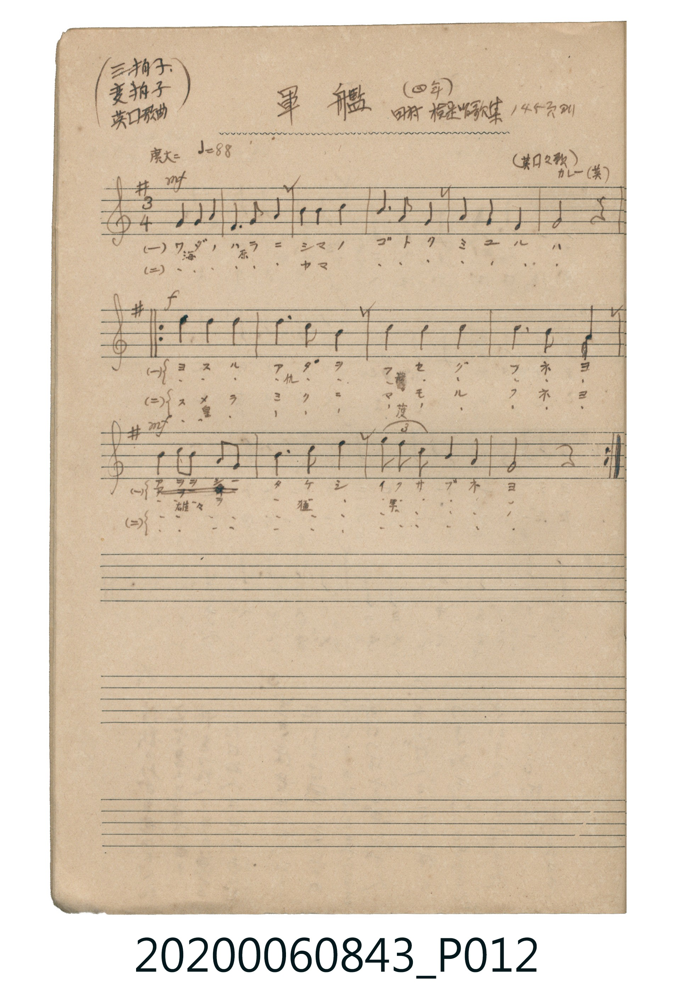

# 軍艦（軍艦）

> Re:Shōka 使用 AI 協助辨識與重建樂譜，可能會有錯誤。歡迎回報。

- **鋼琴伴奏版**：<br><audio controls src="gunkan.mp3"></audio>
- **NEUTRINO 歌聲合成版**：<br><audio controls src="gunkan_neutrino.mp3"></audio>

- 作詞：加藤義清／作曲：鳥居忱（原標：英国々歌 カレー）
- 出處：田村檢定唱歌集 145頁ヨリ（四年）
- 《唱歌帖》第八冊（2020.006.0843）P012.jpg

## 說明


- 出處：出處：田村檢定唱歌集 145頁ヨリ（四年）
- 出處：《唱歌帖》第八冊（2020.006.0843）P012.jpg
- 調性與拍號：調號 ?= G，拍號 <3/4>，速度 != 88


## 歌詞

```text
> [!NOTE]
> **原頁資訊與歌詞全文**（對應 `P012.jpg`）：
> - **出處與標題註記**：頁首標註「`(三拍子. 変拍子 英国歌曲)`」「`軍艦 (四年) 田村檢定唱歌集 145頁ヨリ`」，速度「`廣大ニ ♩= 88`」，右上記「`(英国々歌) カレー(英)`」。
> - **曲調與結構考證**：雖然抄本沿襲舊說註記英國國歌（Henry Carey,〈God Save the King〉），實為明治 26 年《小學唱歌》卷四加藤義清作詞、鳥居忱作曲之〈軍艦〉高聲部旋律（僅開頭動機借鑑英國國歌節奏型）。全曲共 14 小節（G 大調 3/4 拍），第 7 至 14 小節前後標有反覆記號 `||: ... :||`，先前版本誤於第 6 小節截斷，今補齊完整 14 小節與反覆段落。
> - **手抄頁面細節**：第 11 小節（第三行第 3 小節）原塗改處上方改寫片假名「ア ヲ ヲ シ ー」（對應下方漢字「雄々」），第 13 小節首拍為八分音符三連音 `(6 5 4)%(--)` 配「イ ク サ」。
>
> **一、**
> ワダノハラニ　シマノゴトク　ミユルハ
> ∥: ヨスルアダヲ　フセグフネヨ
> 　  アヲヲシタケシ　イクサブネヨ :∥
>
> **二、**
> ワダノハラニ　ヤマノゴトク　ミユルハ
> ∥: スメラミクニ　マモルフネヨ
> 　  アヲヲシタケシ　イクサブネヨ :∥
```

## ABC

<div class="abc-score" data-abc-src="gunkan.abc" aria-label="五線譜載入中"></div>

[下載 ABC 原始檔](gunkan.abc)

## TMD 檔案連結

- [主旋律 TMD 檔案](gunkan.tmd) [[在 TMD Studio 編輯](https://tmdlang.github.io/Tmd-TS/#tmd=s7IKdvYPcrWy4qpTUCpJTLdSSM7PyUlNLsnMz7MqzsjPTkzOyFeCS5bl55TmploBqXgDC4RwcX5pUXJqfEFieqpVgIGhEboM3KT4vPyS1KT8_GyEioKi_LLUvMQ8oKrcxLzS4uSizIKS-OT8gkqEmtSyzJRUkIri5MS8-LLUosy0zNQUJGelFhWDHQxxR0lRYh7EHKAgQlV-UUlGfnpRYkFGpVVGZnFJflFmcmJOfHZiXiJCUUlGKtCDuZk5mSWJRUhOgIiXJ5akFiGbmJmemWeVm5qZlRlfklpRguo1qHR5ajFQV158bmpOfgrQSC0thRe7e190Lnu_pwPG6FTQ0uJStFWwsOCyt1Vw57Ix1jexAxn0ZO-cFyvnvd8z62nXghfTlzzft_LZjtb3e_qB4s9mbwKKv9y89OnG1qf7NwJNe9o3_9mKmUDBF90bn87e-7ih9dnaHoXHTasfN6953LwHaA3YcU_bd72YORWo7PmUDc_mTny2atHTdbOeTtkIVPxydpuCoYnpywWNj5tXPG5eBTJ09uynO7fA9D5u6IKofLpj2uOG7udr1jxtXf20rQuo0MjAyEDPwMBMz8DCxBioHpQS9LIK0pW4uPS1FGypBbgUFBTsFKIV_fxDXGMhHC0toM-Bbn6xuf3Fiq4XHe1A9wFD7WnrimfT2rW0QJ7Y0PusvVMhAeamBKD7gAEA0a4LMgAcJiCtK2a-XNjzYsXuFytmgLTOApr7ctk0oDBQ7HFDT4LGkx2dz7p7n66doKfwdAmUqQAJcaC9wFjRTHjc0AtSColdBQ1IEGoqEA5vkM73e3peNsx_umsZyIinuxc_XbL8cXO3wqOZK0HpA6riaf_mJzu6gG4EOwk5vjUREQ4ShzqmCeFVoAtfrNoP9OrzrROeLe9-0dD8Ym0nxKuzpz1v2fasq-XZnDXPNu1_sXTTi46uF6tWQUIDZMmcbiACWgIMUo_UvKJKBefEotRKnccNHe75KQrBiWWpoJyi4J2Zl_64ARjCQNTzdP2y5027ns3oe7Zpt4KRmQIwKECpaEP_07U7IKEATEhPe7eDQgkpkUNS_uOGRngKh6T5Jzu7gdZBghZox8vVM140bnrZvOLZ9O6n-7pBcd3c-nJa98sFa592T322cv7ThvkvJ05Edvzz9Q1Pl_Y_nQdU3AkMGVAymb3paetGYEwoAJ0FlAaa4g6M3OXAcFIA5kQFYCRD_AJM7wrmCi_aNyPUPu3sfbqvB5g-ns3pfNrf-2JZGyisZs5XSKipsVLQ09NTsKqpAaa3nqetHUC1zzs7gKH7YtWSZ9P2gEwDhgfYmGcdq55N2w5U9mR314vFc17u7Xq6rufZ1C0Ii4AxBjH_2bqtLyYAYxs5Tju7gdEGSqpzFz3fsgGoGhyhIAsMDRGeAvKBqffFQrA_jOHincDs83Th9GdTdgLzADBZPZu2E8h-un718872p43tTyeAUvPjpkUKj5s3QXDTdiC9B5wUoXnryY5ukLY9i56unQ5U_XJ2CzA5ghXAws0QZiEoO3X3AtMEqOjoaHs5f_PzNcuA7nrZsBjIVkjQMFMwVTDRVNXQ1dVMUHjZCrF9CdDW9UC8FSk9w7L_kx0NwIQCLELB_MfN6x83Nzxu7nvc3P-4eSUw8zxuaAA6-XHzPJBg05bHzR1As0CCzfMfNy973AzML_0QvY86lloBDVjxuGknSLhpEdikTWC1Ux837X7ctAHEaO4FqoHa1tCgAHQWUOEmEAJa07T_cdNGEANk6xKQTUBHN0-DaFKwAlqB6vhdwAxAwPHNS4h3PMjlC8Fa54MUQg0A6gY6EaiWKo6nvBiHAgUtfS4u99I8YC3saBWWD6yQHWoMaqpBdijYWGiBA0mhOjetFszAVo8ogBN1AzBRg4o0IHtXD5ANypW9XQoa4IT3qGEyLJvpKMCqAE0sRgEdA7KmRsEQmKtA2AiIaxTM44EUSADCNQaSIGwC54EUgpTXgFWAWGAtEHNA0ADEA5vtY1gDimMgHxjNYLIPrBIYiWCVwIgD4m6IGDCbgUTmIatr2gJV1wHOEBC988Eiy8DkahTzdBXALoHYbUSC3c1LqGZ3LSyKnXBHMaEYhsTqvh5grAKLX1C7Y_ZsoIiCBqiUBRfLwFiGl5WgMpfIqDYFOhGGITxQzIJitQYcwzAM4YFiHpwKkCJzBcjrTTuRAwBYVkICqgFcXkICZSpY3W4wuQFJDKSuF2oOUkRBTVwIjRhEYIP0A0tCeERBoghkIyICMM2FeheUl6CpF-QTQ3gKNoGGAHLpC5aCJHocKRnsUeRqAeL9_VBnboSLaSCV4MAmSvM0qPMgzgU5EUtapYnpwNSoa6cALXOifQxjFeBcJ7xcoGIjVFmsXGUuAA)]
- [鋼琴伴奏 TMD 檔案](gunkan_piano.tmd) [[在 TMD Studio 編輯](https://tmdlang.github.io/Tmd-TS/#tmd=s7IKdvYPcrWy4qpTUCpJTLdSSM7PyUlNLsnMz7MqzsjPTkzOyFeCS5bl55TmploBqXgDC4RwcX5pUXJqfEFieqpVgIGhEboM3KT4vPyS1KT8_GyEioKi_LLUvMQ8oKrcxLzS4uSizIKS-OT8gkqEmtSyzJRUkIri5MS8-LLUosy0zNQUJGelFhWDHQxxR0lRYh7EHKAgQlViEVA8PTU3Na_EqiAzMS8_PjE5OT-3IDEvEySmxKWlpfBid--LzmXv93RAGI-bd7_s3vN8wpYne7Y8Xdr_vLPj_Z5OBS0tLkVbBQsLLntbBXcuG2N9EzuQJU_2znmxct77PbOedi14MX3J830rn-1ofb-nHyj-bPYmoPjLzUufbmx9un8j2E1P23e9mDkVKPx8yoZncyc-W7Xo6bpZT6dsfLa25-XsNgVDE9OXCxofN6943LwK6J6ns2c_3bkFaDtY7-OGLojKpzumPW7ofr5mzdPW1U_buoAKjQyMDPQMDMz0DCxMjIHqQfGhl1WQrsTF5V6al52Y52gVlp-cmONQY1BTzaUABDYWWnZgRnVuWi2YUaNgqKALxkZAXKNgHg-kQAIQrjGQBGETOA-kEKS8BqwCxAJrgZgDggYgHthsH8MahcfN64H8x80NYLIPrPJxcz9Y5ePmlUDcDRFr2g4WmYesrmkLVF0HkA0yB6R3PlhkGZhcjWKergLYJRC7jUiwu3kJ1eyuRYR9ACjhBXngD33TeG1QwEEpk3htSLgD-dCYAMsACYi4oTYoDsziYRQkXoDSkKgBqwMKQyIIahrCCmhMGcdrQ8UQ8YXubh9kd5vA3V0ATzXxIGQUHw-2Ph6OwTJmQAZECsgBiYIEgAkGXR2IYYBsuRPuBIsIMZBfoBjCAyVPkP-BPgazYckVRIKSLzjokFLkClD8Ne1EjsWmRdDYbgDiTdCYnQpWtxtMbkASA6nrhZqDlNqgJi6Epi5EigHpX4-U2iDpDGQjIhVhmgv1LiitQLMgyCeG8GxoAg0BDTMgw0RTVUNXVxMsBU0pKNEL9zzYoyAvgjE404FE90OduREupvG4aQnE3U1bNYGqp0GdB3EuyIlYMhxNTEdKHXiyFKI80waFizGYBGYXMA0TBYUaJAuBSjptI3D-wWQgSYLSDzjnQDIgcqRADEJEC4QPtQJqLUrkQBQgmYY_J0K9iyMnIvwbDzQGRMIyJZiJmidReHA_FAD9gNCBxDTBk1F17RSgBUW0j2GsApzrhJcLVGyEKouVq8wFAA)]

## 分析

```text
================================================================================
📊 TMD Song Profile: [ 軍艦（軍艦） ]
================================================================================
⏱  Duration:       1:30 (90.0s), 44 measures total
🎼 Key & Tempo:    首調基準 G, != 88.0 BPM, <3/4>
   - 分析範圍：      由實際發聲的音符與和弦推測調性；播放脈絡另行呈現
🎤 人聲音域:    F#4 (MIDI 66) – E5 (MIDI 76) [跨度: 10 個半音 / 0.8 個八度, 難度: easy]
   - 最低音:  F#4 in [GunkanA[L1] #1 @ m.2, 0:02]
   - 最高音: E5 in [GunkanB[L1] #1 @ m.13, 0:24]
   - 適合: soprano, mezzo-soprano, contralto, tenor, baritone, bass
🏛  結構:      GunkanA[L1] (12.3s) -> GunkanB[L1] (16.4s) -> GunkanB[L1] (16.4s) -> GunkanA[L2] (12.3s) -> GunkanB[L2] (16.4s) -> GunkanB[L2] (16.4s)
⚡ 編曲密度:        Peak 1 軌道同時演奏
🗝  調性診斷：       G 大調（純淨自然大調，未偵測到可信轉調）
   - 風格氣質:    純淨自然大調（陽光明朗、易唱易記，無明顯調外色彩）
   - 轉調歷程:    全曲維持單一推測調性（未偵測到可信轉調）
   - 核心骨幹音:  B, C, D, G, A
   - 調性數值:    G 大調 [相關度: 0.82, 穩定度: High, 自然音純度: 100.0%]
   - 候選調性 (K-S): G 大調 (0.82), B 小調 (0.56), C 大調 (0.56)
   - 五度圈歷程:   +1 -> +1 -> +1 -> +1 -> +1 -> +1
   - 各段落調性細節:
     • [GunkanA[L1] #1]: G 大調 (r: 0.68, 自然音純度: 100.0%)
     • [GunkanB[L1] #1]: G 大調 (r: 0.69, 自然音純度: 100.0%)
     • [GunkanB[L1] #2]: G 大調 (r: 0.69, 自然音純度: 100.0%)
     • [GunkanA[L2] #1]: G 大調 (r: 0.68, 自然音純度: 100.0%)
     • [GunkanB[L2] #1]: G 大調 (r: 0.69, 自然音純度: 100.0%)
     • [GunkanB[L2] #2]: G 大調 (r: 0.69, 自然音純度: 100.0%)

  [ 五度圈游移軌跡 ]
               C  
         F           [G ]*
      Bb               D  
      Eb               A  
         Ab           E  
            Db       B  
               F# 
     (* = active key center)

  [ 十二半音累積音高分佈 ]
     C  : ███████████████████████   21.7%
     C# :                            0.0%
     D  : ███████████████████       18.5%
     D# :                            0.0%
     E  : █                          1.1%
     F  :                            0.0%
     F# : ████                       4.0%
     G  : ███████████████████       18.3%
     G# :                            0.0%
     A  : ██████████████            13.5%
     A# :                            0.0%
     B  : ████████████████████████  23.0%
--------------------------------------------------------------------------------
Assignment 軌道音域：
  - Vocal         : F#4 – E5 (10 個半音 / 0.8 個八度, 136 個音符)
================================================================================
```


## 原書掃描頁




