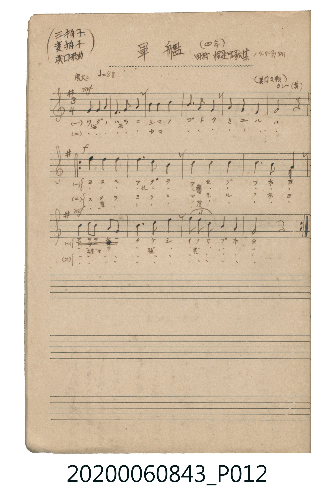

# 軍艦（軍艦）

<audio controls src="gunkan.mp3"></audio>

- 曲：カレー（英 / Henry Carey）
- 出處：田村檢定唱歌集 145頁ヨリ（四年）
- 《唱歌帖》（2020.006.0843）P012.jpg

## 說明

原書資訊與歌詞全文（對應 P012.jpg）：
調性與拍號：ト調 3/4 拍（G 大調 3/4 拍），♩=88，「廣大ニ」
註記：(三拍子 変拍子 英国歌曲) (四年) / 田村檢定唱歌集 145頁ヨリ / (英国々歌) カレー(英)

## 跨冊／重複收錄參照

> 同名異曲（各冊收錄之不同詞曲版本）

- **[同名異曲]** 《新定兒童唱歌》尋常科第五學年用（2020.006.0847.0005）：[**〈軍艦〉**](../../../shintei_jido_shoka/grade_5_2020.006.0847.0005/3_04_gunkan/index.md)（`G` / `3/4` — [原始 TMD](../../../shintei_jido_shoka/grade_5_2020.006.0847.0005/3_04_gunkan/gunkan.tmd)）
- **[同名異曲]** 楊金土手抄《唱歌帖》第 2 冊・II（2020.006.0843）：[**〈軍艦〉**](../../vol_02/p074_gunkan/index.md)（`G` / `4/4` — [原始 TMD](../../vol_02/p074_gunkan/gunkan.tmd)）
- 總表：[跨冊重複與同名歌曲總索引](../../../duplicate_songs.md)

## 歌詞

```text
一、
ワダノ ハラニ シマノ ゴトク ミユルハ
ヨスル アダヲ フセグ フネヨ
イサマシ タケシ イクサ ブネヨ

二、
ワダノ ハラニ ヤマノ ゴトク ミユルハ
スメラ ミクニ マモル フネヨ
ヲヲシ タケシ イクサ ブネヨ
```

## ABC

```abc
X:1
T:軍艦（軍艦）
C:曲：カレー（英 / Henry Carey）
M:3/4
L:1/16
Q:1/4=88
K:G
V:V1 name="Piano" snm="Pia"
[V:V1]
!mf! G4 G4 A4 | F6 G2 A4 | B4 B4 c4 | B6 A2 G4 |
A4 G4 F4 | G8 z4 | !f! d4 d4 d4 | d6 c2 B4 |
c4 c4 c4 | c6 B2 A4 | !mf! B4 c2 B2 A2 G2 | B6 c2 d4 |
e4/3 d4/3 c4/3 B4 A4 | G8 z4 | !f! d4 d4 d4 | d6 c2 B4 |
c4 c4 c4 | c6 B2 A4 | !mf! B4 c2 B2 A2 G2 | B6 c2 d4 |
e4/3 d4/3 c4/3 B4 A4 | G8 z4 |
```

## TMD 檔案連結

- [主旋律 TMD 檔案](gunkan.tmd) [[在 TMD Studio 編輯](https://tmdlang.github.io/Tmd-TS/#tmd=s7IKdvYPcrWy4tLSUnixu_dF57L3ezpgjE4FLS0uRVsFCwsue1sFdy4bY30TO646BaVnsze93zPrcdPqx81rHjfvAWnp3qigr-CRmldUqeCcWJRaCdStBFL6tH3Xi5lTgaqfT9nwbO7EZ6sWPV036-mUjc_W9ryc3aZgaGL6ckHj4-YVj5tXAY15Onv2051bYHofN3RBVD7dMe1xQzdQ3sjAyEDPwMBMz8DCxBioLMDA0EgvqyBdiYtLX0vBllqAS0FB4Wnf_Gezd7zY3P5iRdeLjnagK16snPe0dcWzae0gh27ofdbeqQCzH-gUoBdB2l6s2v-sYTlIQ3fvi5nzQcHU3AEUVACGnQJQDKjXXeHpkuUoQkDNPY9mrrS1sAAyHjf0PN29GKjkcXP344ZesKErdr9YMQNolsaTHZ1AHU_XTgCaAWMBw_7p7L1ABwKjRVNBAxKGmsDoIBzkQEUaEO2PG1qB8poK8EgFiWtygWx_sqPhcUMjiPW4ef3j5obHzX1AVv_j5pVAFwI1bH_cPA8s1rQF6NfHTeuBsvMfNy973Aw0qh-ib8Xjpp1APlDNIrAJm4BiUx837X7ctAHMau4FqgErbVryuGkryMSm7UDO_sdNGyEsoPB6oAxQ9TSoarDbdgHDC7fbmpcQdhvIYQuBGsAyQDvA-oCagA4FuhfFbc2bQIigw4BKKU-DUKCgpc_F5V6al52Y52gVkJmYl-9QY1CjUA2yRMHG0EzLDsyqzk2rBTNqFAwVdMEQRhtB6RoF83goEyaNkDKGsmC0CUwGaihMHGYgzPAauBkwEbglCJfAoAHc0FqYn5zw-QnuJVOoRnQaIQNzM8ydNXAfoNMIGZh_4aGAHpLIgQFTCPITanCAZBEO0jADckw0VTV0gUATrhAR0ngDRddOARrXCnCmExpTmQsA)]
- [鋼琴伴奏 TMD 檔案](gunkan_piano.tmd) [[在 TMD Studio 編輯](https://tmdlang.github.io/Tmd-TS/#tmd=s7IKdvYPcrWy4tLSUnixu_dF57L3ezogjMfNu19273k-YcuTPVueLu1_3tnxfk-ngpYWl6KtgoUFl72tgjuXjbG-iR1XnYLSs9mb3u-Z9bhp9ePmNY-b94AM6d6ooK_gkZpXVKngnFiUWgnUrQRS-rR914uZU4Gqn0_Z8GzuxGerFj1dN-vplI3P1va8nN2mYGhi-nJB4-PmFY-bVwGNeTp79tOdW2B6Hzd0QVQ-3THtcUM3UN7IwMhAz8DATM_AwsQYqCzAwNBIL6sgXYmLy700Lzsxz9EqIDMxLz_Iw6HGoEahmksBCGwMzbTswKzq3LRaMKNGwTRe21BBFwxRmUZQJliJeTyUh6TOHFmNobYxlI3MMoHJQy1DyCFZgmRtjYIZwlBU58BdgOJkGDSAW1SLFgI-uEKgABYChjCTjWEMI2S7kH1uBuYhxJA0wxkmCFl4EKOGHogHMQlihhGcjVAJZCFbgmwADv864Y9xeIQba5vC_IuFhSwPDgpwHCLirQYc7fCIxc1BUwgOIrApyMkGPTEi7AHpA7FBSkGRjZ52ICYju1vDTMFUwURTVUMXCDSRlKOkU-LSDjQscaYdhIMx0g5cBEkSGqGosoi4hic35ISFmmjA-pCkcaZhRLrCmkoh4YHmEkSKJS_96dopQLOcApzphMZU5gIA)]

## 分析

```text
================================================================================
📊 TMD Song Profile: [ 軍艦（軍艦） ]
================================================================================
⏱  Duration:       0:45 (45.0s), 22 measures total
🎼 Key & Tempo:    首調基準 G, != 88.0 BPM, <3/4>
   - 分析範圍：      由實際發聲的音符與和弦推測調性；播放脈絡另行呈現
🎤 人聲音域:    F#4 (MIDI 66) – E5 (MIDI 76) [跨度: 10 個半音 / 0.8 個八度, 難度: easy]
   - 最低音:  F#4 in [GunkanA #1 @ m.2, 0:02]
   - 最高音: E5 in [GunkanB #1 @ m.13, 0:24]
   - 適合: soprano, mezzo-soprano, contralto, tenor, baritone, bass
🏛  結構:      GunkanA (12.3s) -> GunkanB (16.4s) -> GunkanB (16.4s)
⚡ 編曲密度:        Peak 1 軌道同時演奏
🗝  調性診斷：       G 大調（純淨自然大調，未偵測到可信轉調）
   - 風格氣質:    純淨自然大調（陽光明朗、易唱易記，無明顯調外色彩）
   - 轉調歷程:    全曲維持單一推測調性（未偵測到可信轉調）
   - 核心骨幹音:  B, C, D, G, A
   - 調性數值:    G 大調 [相關度: 0.82, 穩定度: High, 自然音純度: 100.0%]
   - 候選調性 (K-S): G 大調 (0.82), B 小調 (0.56), C 大調 (0.56)
   - 五度圈歷程:   +1 -> +1 -> +1
   - 各段落調性細節:
     • [GunkanA #1]: G 大調 (r: 0.68, 自然音純度: 100.0%)
     • [GunkanB #1]: G 大調 (r: 0.69, 自然音純度: 100.0%)
     • [GunkanB #2]: G 大調 (r: 0.69, 自然音純度: 100.0%)

  [ 五度圈游移軌跡 ]
               C  
         F           [G ]*
      Bb               D  
      Eb               A  
         Ab           E  
            Db       B  
               F# 
     (* = active key center)

  [ 十二半音累積音高分佈 ]
     C  : ███████████████████████   21.7%
     C# :                            0.0%
     D  : ███████████████████       18.5%
     D# :                            0.0%
     E  : █                          1.1%
     F  :                            0.0%
     F# : ████                       4.0%
     G  : ███████████████████       18.3%
     G# :                            0.0%
     A  : ██████████████            13.5%
     A# :                            0.0%
     B  : ████████████████████████  23.0%
--------------------------------------------------------------------------------
Assignment 軌道音域：
  - Piano         : F#4 – E5 (10 個半音 / 0.8 個八度, 68 個音符)
================================================================================
```


## 原書掃描頁




