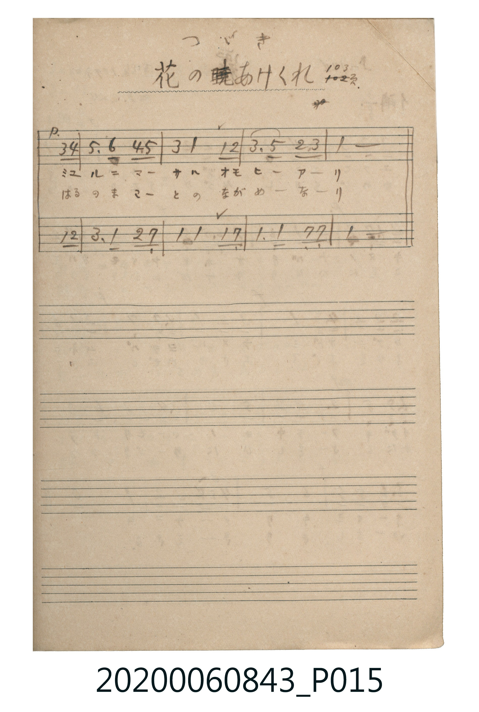

# 花のあけくれ（花的晨昏）

> Re:Shōka 使用 AI 協助辨識與重建樂譜，可能會有錯誤。歡迎回報。

- **鋼琴伴奏版**：<br><audio controls src="hana_no_akekure.mp3"></audio>
- **NEUTRINO 歌聲合成版**：<br><audio controls src="hana_no_akekure_neutrino.mp3"></audio>

- 出處：重音唱歌集第一 / 蓬唱ヨリ 103頁（昭2.3.25）
- 《唱歌帖》（2020.006.0843）P014.jpg–P015.jpg

## 說明

原書資訊與歌詞全文（對應 P014.jpg – P015.jpg）：
調性與拍號：ヘ調 3/4 拍（F 大調 3/4 拍），♩=126，「爽快ニ」（二部合唱）
註記：重音唱歌集第一 / 蓬唱ヨリ / 昭2.3.25 / つゞき 花のあけくれ 103頁


## 歌詞

```text
一、
アカツキ イダス カネノネニ
シラム サクラガ ヲカノクモ
ハナノ スガタノ ミエザルハ
ミユルニ マサル オモヒアリ

二、
からすの はねに ゆふひさし
そらの にほひも うすらぎて
はなを のこして くれゆくは
はるの まことの ながめなり
```

## ABC

<div class="abc-score" data-abc-src="hana_no_akekure.abc" aria-label="五線譜載入中"></div>

[下載 ABC 原始檔](hana_no_akekure.abc)

## TMD 檔案連結

- [主旋律 TMD 檔案](hana_no_akekure.tmd) [[在 TMD Studio 編輯](https://tmdlang.github.io/Tmd-TS/#tmd=s7IKdvYPcrWy4qpTUCpJTLdSSM7PyUlNLsnMz7MqzsjPTkzOyFeCS5bl55TmploBqXgDC4RwcX5pUXJqfEFieqpVgIGhCboM3KT4vPyS1KT8_GwMFRn5RYmZ8WB1xRmlCOmCovyy1LzEPKCS3MS80uLkosyCkvjk_IJKhJrUssyUVJCK1JTMkvyizMQcJBenFhWD_QJxYklRYh7EDKAgQlVJRirQWwU5iXklCEGgSemZeVYliZlAZ4GcVp4Yn5uYmQdUlYKsqiQjP70osSCj0iojsxhkf3JiTnx2Yl6iEpeWlsKLro2PG9c9bmx63DjxcWP_46ae93s6gILPZ7U8m7ni2Yz-93s6FbS0uBRtFQyNzLjsbRXcuGyM9U3sQDY8bd_1YubU93tmvWzvfTl_89MpG5-t7Xk5u-35mjVPdjQo6Cu8mLwGKPi4ecXj5lUKhgbGLxc0Ao1_NmOtkZ6xnpEp0GywSx83dEH0Pt0x7XFDN1CJkYGRgZ6BgZmegYWJMVAZKNr0sgrSHzVMBjJNQUwlLi59LQVbagEuBQWFp33zn83e8WJz-4sVXS862oEOerFy3tPWFc-mtQPd9HRD77P2TgWYUxSAbgFxwI4BOhEYDCAzXqza_6xhOUh3d--LmfOBoo-bZwAFFYCBpgAUAxrkpvB0yXIUIaDmnkczV9oCgxjIetzQ87xj79P9qx83dz9uAOl4sqvnZfOKpxM6gMEEVA22Z8XuFytmEBv2-grwQAeyHzcuedw073FjL5boh0YTF8gOoEGPGxpBrMdNix43Ad3T8rhpLZCz5HFzw-OmnUAWUKz3cXMfmOyGqNz-uHnl4-YFQNbWx03rQZymNQqPmzeBFfeBhRaBVTb3P27uAgoBVe4EqnnctB_MaZ7_uGnF46Ztj5uB6vshKuc_bl4G5ncDOfNAJjevBmpbBTTqcfMkkOuaV0GcvAsYfBAnN3Y_bup83DgT6EEgZ_3jxrWPG0Ga2h43bn3cuOlx49THjdMhKueCVYKUrX7cuBsk2dQE5ABVzgTL9D1uXAZRCTRm1eOmSUAWMNQmAw0AygA5oJADm9wPVAJT2dQNMXMfWOUKCGfV40agykawMV0glZQnXShQ0NLn4vIAZmy_fMfs1OzSolSr4PwCYImS71Cja1hTDbJMwcZCyw7MqM5NqwUzahQMFHTB2FjBBMgzBbJ0FcyAbFMgzxjINgRjIyhPFyhuAmTVAEVAPKg-sFk-hjUK8VBRYKSA0gdQHTDZwMXAqQcs1gDm7wSTwGhp7gWL9sFUAvm6YJFuuN7tQN5KmE1GSDY1AlNFUydIdeNMuBg40sFia8H81WAz2oCsrWDRTXCVUyE2NU6Hi8yFmAdOUcQGiTpQAUwpSABoJjxMQNkB5outQAx2F9AvIP4asG83wcMKEgIgNSAaJLIIHib9CFOB_gf5EeZiYAg27ob7C5R8QaIg384EiQJ9A1EHMR2kbhlcL8gmuF_NoY43A7IQPLB3FAzjoH4zBnoeV_wD8zTYrSCbIGXEGrAL9iNEm-dD3NC0Ah4q24CiEP-D_Ajx7XwgXobi31VgtZPArgbF72R4vEH8A8x_UJN74CaDwqAfrA4SohAfAzMnafFrBE7yIHEQBGUXZC-DEhfIyeDiCeqErWARSLJbBY5GkEqQ42HZAxK9IE-hmYkUucDiA-xRSKSBAgwiAwoMYFECtqkR7jGQWSARUBQgzKxFLxccc0pwFAoF6IUCciiA2Obx0GCAYDgXlAyMwMkCKASxHKwVahxZBoAZMBNAqQ0sgHARDMOMB2k3A5lHthPAHCQ-Ugjq2imgBKICUECZCwA)]
- [鋼琴伴奏 TMD 檔案](hana_no_akekure_piano.tmd) [[在 TMD Studio 編輯](https://tmdlang.github.io/Tmd-TS/#tmd=s7IKdvYPcrWy4qpTUCpJTLdSyC8qychPL0osyKi0ysgsLskvykxOzInPTsxLVIIrKs4vLUpOjS9ITE-1CjAwNNEFEqYI6ZKM1NxUq-LUxOL8vGIlLi0thRddGx83rnvc2PS4ceLjxv7HTT3v93QABZ_Pank2c8WzGf2Pm3e_7N7zfMKWJ3u2PF3a_7yz4_2eTgUtLS5FWwVDIzMue1sFNy4bY30TO5AtT9t3vZg59f2eWS_be1_O3_x0ysZna3tezm57vmbNkx0NCvoKLyavAQo-bl7xuHmVgqGB8csFjUALn81Ya6RnrGdkCjQb7NrHDV0QvU93THvc0A1UYmRgZKBnYGCmZ2BhYgxUBvKdXlZB-qOGySA_gphKXFyeeSVF-VYBmYl5-T4eDjW6hjXVXApAYGOiZQdm1ChEG8YqmMbHgzEJPK5aLi4PYFj75Ttmp2aXFgHDF2RLEIotFlBbqnPTaqHWGSjogrGxggmQZwpk6SqYAdmmQJ4xkG0IxkZQni5Q3ATIqgGKgHhQfWCzfAxrFOKhoo-bFgHxaqC6x80tcLG1QLwELNYA5u8Ek6uB_F6waB9MJZCvCxbphuvdDuStBNoEdTZRDlUHKoApBQkAzYS79HHzArjZW4F4Pdi-lWD-GrAbNsF9AHEXSA2IBoksgru0H2wq1FXmUGvMgCwED2yxgmEc1BXGQGfiCr_HzV1gU0E2gsIH5BagaNN-hGjzfIgbmlbA3b8NKApxKcg1EHfNB-JlpIWXEThiQeIgCEoUyA5bDTW4G4jnQZ2wFSwCknnctAocLCCVk-AOAwUTSGQVipnYUyr2dFqAnk6RnQxim4NyAsQvIAzngkLWCBzSQCGI7WCtdEyqEIeT5VQwg1aJFeIuUAIEW4MIURiGORrkKDOQK3EEIfVTK_FBBuYg8WmcYPW1FFDSrJGClj5aMjYa2BK3EejPpk6Q6xtnwsXWATE4sTSuBfMhPm8DsraCRTfBVU6F-LxxOlxkLsQ86pW4QNfAzAZmpMbdcBc8bmoCi4LcNRMcT51QdZDEDFK3DK4XlLCpWOI2guL6cRMoDUDCazI8HCC2ApsdEDc09cDcAA7BfrA6SDaDuOtxUzcVS1xocD1u3Ad2FCQYQNkIIgNy-OPGHrDDGuGOAHkGJALKmCgJGFtSHbAil2ZplYpFLlVTK_WKXKonVyoWubRPsUbYkmwNuHSFewWWbIHBiORYsMdAEQ4U1lUwgRKmIAVgEaj3wGEPFIW4BWoE3IcgY-mRgElwsno8OC3BYgRE0zYRw0oySNmFKNdAekygbgA6D-hSPAFJq2RMfMABeeC4BsvSNy3j6_-hFL8giKvTZwjjGEPDOto0VsEI1hmEmEBYJ1BDjYIGMCygOR9kiK6mqoaurq4mwhgkk7GaYgaRIccBmDK4sv5oeOEOL107BfDIggKQgRJ20T5AleiCRjBRZS4A)]

## 分析

```text
================================================================================
📊 TMD Song Profile: [ 花のあけくれ（花的晨昏） ]
================================================================================
⏱  Duration:       0:22 (22.9s), 16 measures total
🎼 Key & Tempo:    首調基準 F, != 126.0 BPM, <3/4>
   - 分析範圍：      由實際發聲的音符與和弦推測調性；播放脈絡另行呈現
🎤 人聲音域:    F4 (MIDI 65) – F5 (MIDI 77) [跨度: 12 個半音 / 1.0 個八度, 難度: easy]
   - 最低音:  F4 in [HanaNoAkekure #1 @ m.3, 0:03]
   - 最高音: F5 in [HanaNoAkekure #1 @ m.12, 0:15]
   - 適合: soprano, mezzo-soprano, contralto, tenor, baritone, bass
🏛  結構:      HanaNoAkekure (22.9s)
⚡ 編曲密度:        Peak 2 軌道同時演奏
🗝  調性診斷：       F 大調（純淨自然大調，未偵測到可信轉調）
   - 風格氣質:    純淨自然大調（陽光明朗、易唱易記，無明顯調外色彩）
   - 轉調歷程:    全曲維持單一推測調性（未偵測到可信轉調）
   - 核心骨幹音:  F, A, E, C, G
   - 調性數值:    F 大調 [相關度: 0.84, 穩定度: Moderate, 自然音純度: 99.5%]
   - 候選調性 (K-S): F 大調 (0.84), A 小調 (0.72), C 大調 (0.65)
   - 五度圈歷程:   -1
   - 各段落調性細節:
     • [HanaNoAkekure #1]: F 大調 (r: 0.81, 自然音純度: 99.5%, 調外音: B)

  [ 五度圈游移軌跡 ]
               C  
        [F ]*          G  
      Bb               D  
      Eb               A  
         Ab           E  
            Db       B  
               F# 
     (* = active key center)

  [ 十二半音累積音高分佈 ]
     C  : ████████████              14.6%
     C# :                            0.0%
     D  : ███                        3.1%
     D# :                            0.0%
     E  : ████████████              15.1%
     F  : ████████████████████████  29.2%
     F# :                            0.0%
     G  : ██████████                12.5%
     G# :                            0.0%
     A  : ██████████████████        21.4%
     A# : ███                        3.6%
     B  :                            0.5%
--------------------------------------------------------------------------------
Assignment 軌道音域：
  - Alto          : D4 – A4 (7 個半音 / 0.6 個八度, 58 個音符)
  - Soprano       : F4 – F5 (12 個半音 / 1.0 個八度, 58 個音符)
================================================================================
```


## 原書掃描頁





