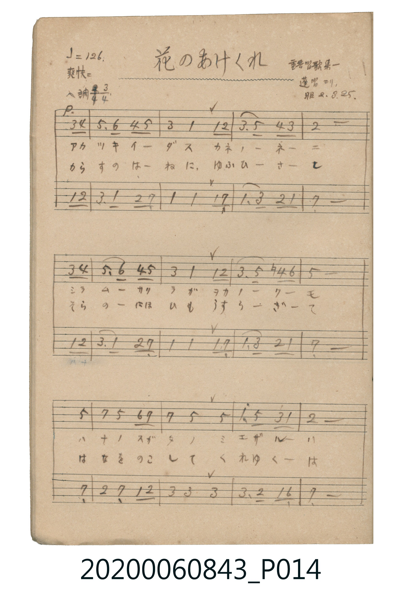
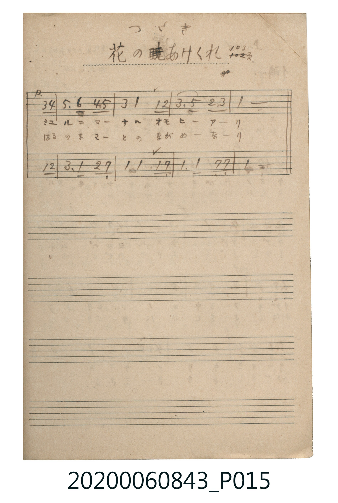

# 花のあけくれ（花的晨昏）

> Re:Shoka 使用 AI 協助辨識與重建樂譜，可能會有錯誤。歡迎回報。

<audio controls src="hana_no_akekure.mp3"></audio>

- 出處：重音唱歌集第一 / 蓬唱ヨリ 103頁（昭2.3.25）
- 《唱歌帖》（2020.006.0843）P014.jpg–P015.jpg

## 說明

原書資訊與歌詞全文（對應 P014.jpg – P015.jpg）：
調性與拍號：ヘ調 3/4 拍（F 大調 3/4 拍），♩=126，「爽快ニ」（二部合唱）
註記：重音唱歌集第一 / 蓬唱ヨリ / 昭2.3.25 / つゞき 花のあけくれ 103頁

## 歌詞

```text
一、
アカツキ イダス カネノネニ
シラム サクラガ ヲカノクモ
ハナノ スガタノ ミエザルハ
ミユルニ マサル オモヒアリ

二、
からすの はねに ゆふひさし
そらの にほひも うすらぎて
はなを のこして くれゆくは
はるの まことの ながめなり
```

## ABC

```abc
X:1
T:花のあけくれ（花的晨昏）
M:3/4
L:1/16
Q:1/4=126
K:F
V:V1 name="Alto" snm="Alt"
V:V2 name="Soprano" snm="Sop"
[V:V1]
!mp! z4 z4 F2 G2 | A6 F2 G2 E2 | F4 F4 F2 E2 | F6 A2 G2 F2 |
E8 F2 G2 | A6 F2 G2 E2 | F4 F4 F2 E2 | F6 A2 G2 F2 |
E8 E4 | G4 E4 F2 G2 | A4 A4 A4 | A6 G2 F2 D2 |
E8 F2 G2 | A6 F2 G2 E2 | F4 F4 F2 E2 | F6 F2 E2 E2 |
F8 z4 |
[V:V2]
!mf! z4 z4 A2 B2 | c6 d2 B2 c2 | A4 F4 F2 G2 | A6 c2 B2 A2 |
G8 A2 B2 | c6 d2 B2 c2 | A4 F4 F2 G2 | A6 c2 =B2 d2 |
c8 c4 | e4 c4 d2 e2 | e4 c4 c4 | f6 c2 A2 F2 |
G8 A2 B2 | c6 d2 B2 c2 | A4 F4 F2 G2 | A6 c2 G2 A2 |
F8 z4 |
```

## TMD 檔案連結

- [主旋律 TMD 檔案](hana_no_akekure.tmd) [[在 TMD Studio 編輯](https://tmdlang.github.io/Tmd-TS/#tmd=s7IKdvYPcrWy4qpTUCpJTLdSSM7PyUlNLsnMz7MqzsjPTkzOyFeCS5bl55TmploBqXgDC4RwcX5pUXJqfEFieqpVgIGhCboM3KT4vPyS1KT8_GwMFRn5RYmZ8WB1xRmlCOmCovyy1LzEPKCS3MS80uLkosyCkvjk_IJKhJrUssyUVJCK1JTMkvyizMQcJBenFhWD_QJxYklRYh7EDKAgQlVJRirQWwU5iXklSlxaWgovujY-blz3uLHpcePEx439j5t63u_pAAo-n9XybOaKZzP63-_pVNDS4lK0VTA0MuOyt1Vw47Ix1jexA5n4tH3Xi5lT3--Z9bK99-X8zU-nbHy2tufl7Lbna9Y82dGgoK_wYvIaoODj5hWPm1cpGBoYv1zQCDT-2Yy1RnrGekamQLPBLnvc0AXR-3THtMcN3UAlRgZGBnoGBmZ6BhYmxkBloLDWyypIf9QwGcg0BTGVuLj0tRRsqQW4FBQUnvbNfzZ7x4vN7S9WdL3oaAc66MXKeU9bVzyb1g5009MNvc_aOxVgTlEAugXEATsG6ERgMIDMeLFq_7OG5SDd3b0vZs4Hij5ungEUVAAGmgJQDGiQm8LTJctRhICaex7NXGkLDGIg63FDz_OOvU_3r37c3P24AaTjya6el80rnk7oAAYTUDXYnhW7X6yYQWzY6yvAAx3Ifty45HHTvMeNvViiHxpNXCA7gAY9bmgEsR43LXrcBHRPy-OmtUDOksfNDY-bdgJZQLHex819YLIbonL74-aVj5sXAFlbHzetB3Ga1ig8bt4EVtwHFloEVtnc_7i5CygEVLkTqOZx034wp3n-46YVj5u2PW4Gqu-HqJz_uHkZmN8N5MwDmdy8GqhtFdCox82TQK5rXgVx8i5g8EGc3Nj9uKnzceNMoAeBnPWPG9c-bgRpanvcuPVx46bHjVMfN06HqJwLVglStvpx426QZFMTkANUORMs0_e4cRlEJdCYVY-bJgFZwFCbDDQAKAPkgEIObHI_UAlMZVM3xMx9YJUrIJxVjxuBKhvBxnSBVFKedKFAQUufi8sjMS_RL98xOzW7tCjVKji_AFgM5DvUGNQoVIMsU7Cx0LIDM6pz02rBjBoFAwVdMDZWMAHyTIEsXQUzINsUyDMGsg3B2AjK0wWKmwBZNUAREA-qD2oWUbrVgQpgSkECunDt5lC-GZCF4IFVKBjGQZUbA80j33YjsNtB4iAI8ncNVy16wDnmlOAItQL0UEM2HcQ2j4caD8FwLsilRmCXA4UgloO1Qo0jywAwA2YCKEDAAggXwTDMeJB2M5B5ZDsBzEHiI4Wgrp0CSiAqAAWUuQA)]
- [鋼琴伴奏 TMD 檔案](hana_no_akekure_piano.tmd) [[在 TMD Studio 編輯](https://tmdlang.github.io/Tmd-TS/#tmd=s7IKdvYPcrWy4tLSUnjRtfFx47rHjU2PGyc-bux_3NTzfk8HUPD5rJZnM1c8m9H_uHn3y-49zydsebJny9Ol_c87O97v6VTQ0uJStFUwNDLjsrdVcOOyMdY3seOqU1B62r7rxcyp7_fMetne-3L-5qdTNj5b2_NydtvzNWue7GhQ0Fd4MXkNUPBx84rHzasUDA2MXy5oBFr4bMZaIz1jPSNToNlKIHMeN3RB9D7dMe1xQzdQiZGBkYGegYGZnoGFiTFQWYCBoYleVkH6o4bJQKYpiKnExeWRmJfol--YnZpdWpRqFZCZmJcf5OFQY1CjUM2lAAQ2Flp2YEZ1blotmFGjYKCgC8aG2sYKRtomQBFjbVMgHyRiBhYxjwcK1IAVAAXBGChkBBfSBesAqQTxayCSIGEkQ6GWkW20OlgL2GyICbowJsxoI21zhCDEfHOwjSBhiL0QEiRmGAc2wggoALLILJ7azjYEKgALAQlQmJjGa8OkIMFdw1WLNb58cMRXAXp8gQ1RMIwHUqbxCBJFCMyEihiDCBOIgCmIMkLSBDWbRNPAJuA2DUMcr2FmUDVUchtONaBw17VTQAl6BWwCylwA)]

## 分析

```text
================================================================================
📊 TMD Song Profile: [ 花のあけくれ（花的晨昏） ]
================================================================================
⏱  Duration:       0:24 (24.3s), 17 measures total
🎼 Key & Tempo:    首調基準 F, != 126.0 BPM, <3/4>
   - 分析範圍：      由實際發聲的音符與和弦推測調性；播放脈絡另行呈現
🎤 人聲音域:    D4 (MIDI 62) – A4 (MIDI 69) [跨度: 7 個半音 / 0.6 個八度, 難度: easy]
   - 最低音:  D4 in [HanaNoAkekure #1 @ m.12, 0:16]
   - 最高音: A4 in [HanaNoAkekure #1 @ m.2, 0:01]
   - 適合: soprano, mezzo-soprano, contralto, tenor, baritone, bass
🏛  結構:      HanaNoAkekure (24.3s)
⚡ 編曲密度:        Peak 2 軌道同時演奏
🗝  調性診斷：       F 大調（純淨自然大調，未偵測到可信轉調）
   - 風格氣質:    純淨自然大調（陽光明朗、易唱易記，無明顯調外色彩）
   - 轉調歷程:    全曲維持單一推測調性（未偵測到可信轉調）
   - 核心骨幹音:  F, A, E, C, G
   - 調性數值:    F 大調 [相關度: 0.84, 穩定度: Moderate, 自然音純度: 99.5%]
   - 候選調性 (K-S): F 大調 (0.84), A 小調 (0.72), C 大調 (0.65)
   - 五度圈歷程:   -1
   - 各段落調性細節:
     • [HanaNoAkekure #1]: F 大調 (r: 0.84, 自然音純度: 99.5%, 調外音: B)

  [ 五度圈游移軌跡 ]
               C  
        [F ]*          G  
      Bb               D  
      Eb               A  
         Ab           E  
            Db       B  
               F# 
     (* = active key center)

  [ 十二半音累積音高分佈 ]
     C  : ████████████              14.6%
     C# :                            0.0%
     D  : ███                        3.1%
     D# :                            0.0%
     E  : ████████████              15.1%
     F  : ████████████████████████  29.2%
     F# :                            0.0%
     G  : ██████████                12.5%
     G# :                            0.0%
     A  : ██████████████████        21.4%
     A# : ███                        3.6%
     B  :                            0.5%
--------------------------------------------------------------------------------
Assignment 軌道音域：
  - Alto          : D4 – A4 (7 個半音 / 0.6 個八度, 58 個音符)
  - Soprano       : F4 – F5 (12 個半音 / 1.0 個八度, 58 個音符)
================================================================================
```


## 原書掃描頁






