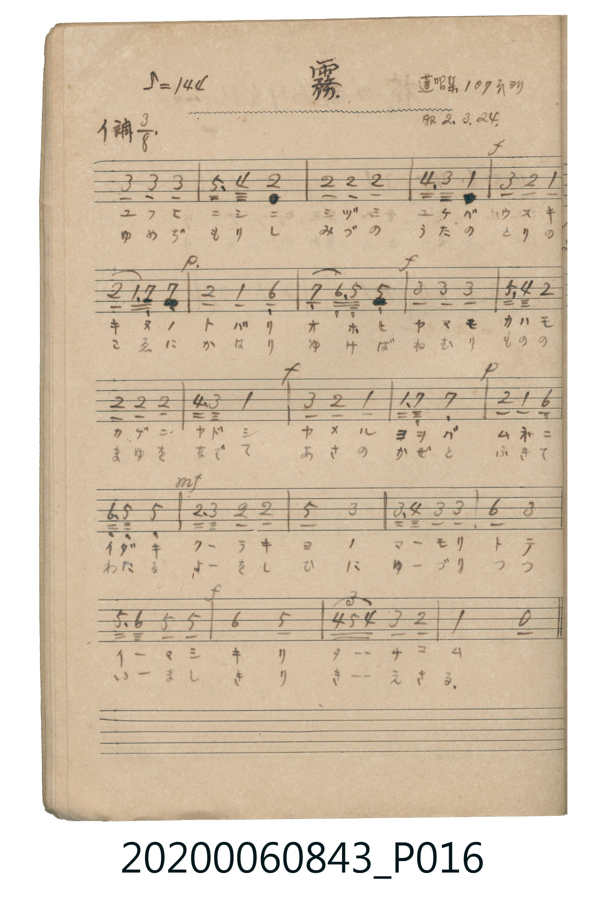

# 霧（霧）

> Re:Shōka 使用 AI 協助辨識與重建樂譜，可能會有錯誤。歡迎回報。

- **鋼琴伴奏版**：<br><audio controls src="kiri.mp3"></audio>

- 出處：蓬唱集 107頁ヨリ（昭 2. 3. 24 抄）
- 《唱歌帖》第八冊（2020.006.0843）P016.jpg
- Rigoletto Act III: La donna é mobile

## 說明


- 出處：出處：蓬唱集 107頁ヨリ（昭 2. 3. 24 抄）
- 出處：《唱歌帖》第八冊（2020.006.0843）P016.jpg
- 出處：Rigoletto Act III: La donna é mobile
- 調性與拍號：調號 ?= A，拍號 <3/8>，速度 != 72


## 歌詞

```text
> [!NOTE]
> **原頁資訊與歌詞全文**（對應 `P016.jpg`）：
> - **出處與抄寫日期**：頁頂記曲名「`霧.`」，右上角記「`蓬唱集 107頁ヨリ`」「`昭 2. 3. 24,`」（昭和 2 年 3 月 24 日抄自《蓬萊唱歌集》第 107 頁）；左上角記「`♪ = 144`」（八分音符 144，換算四分音符基準 `!= 72`）與「`イ調 3/8.`」（A 大調，`?= A`，`<3/8>`，全曲音域 `E4–F#5`）。
> - **力度記號**：第 5、9、13、22 小節標 `f`，第 7、15 小節標 `p.`/`p`，第 17 小節標 `mf`。
> - **校訂與手抄原貌說明（依 Editorial Policy A 校訂）**：
>   1. **第 2、4、10、12、14、16 小節附點十六分音符＋三十二分音符＋四分音符節奏**：原抄本明確以雙底線附點（`x.=`，3 個三十二分音符）接三底線（`y≡`，1 個三十二分音符）再接無底線四分音符（8 個三十二分音符，共 12 個 `<32*>` 單位 = `<3/8>` 一整小節），其中第 2 小節末音 `2` 與第 4 小節末音 `1` 下方各有濃圓墨團（塗銷誤畫之底線）；舊轉錄誤以 `<16*>` 記譜致時值失真，今以 `<32*>` 精確還原。
>   2. **第 6、8、17、19、21 小節細分底線補校**：第 6 小節 `2_  1.= 7≡_  7__` 與第 8 小節 `7__  6_.= 5≡_  5__` 中間複附點組之第二音（三十二分音符）原抄本少畫第三道底線（且第 6、8 小節末音八分音符底線上有濃墨塗痕），第 17、19、21 小節首拍 `x.= y≡` 之第二音亦僅畫雙底線（第 15 小節 `6_` 下方另有雙點狀低音點墨跡）；依 `<3/8>` 拍數統一校訂為標準附點十六分音符配三十二分音符（`3 + 1` 個 `<32*>` 單位）。
>   3. **第 18、20 小節長短拍底線錯置校訂**：對照第 22 小節正確記法 `6  5_`（四分音符＋八分音符，`2 + 1` 拍），原抄本第 18 小節 `5_  3` 與第 20 小節 `6_  3` 誤將八分音符單底線畫於首音下方而成逆長短拍，今依樂句平行結構校訂還原為 `| 5 - - - - - - - 3 - - - |` 與 `| 6 - - - - - - - 3 - - - |`。
>
> **1.**
> ユフヒ　ニシニ　シヅミ　ユケバ
> ウスキ　キヌノ　トバリ　オホヒ
> ヤマモ　カハモ　カゲニ　ヤドシ
> ヤメル　ヨヲバ　ムネニ　イダキ
> クーラキ　ヨノ　マーモリ　トテ
> イーマシ　キリ　ターチコ　ム
>
> **2.**
> ゆめぢ　もりし　みづの　うたの
> とりの　こゑに　かはり　ゆけば
> ねむり　ものの　まゆを　なでて
> あさの　かぜと　ふきて　わたる
> よーをし　ひに　ゆーづり　つつ
> いーまし　きり　きーえさ　る
```

## ABC

<div class="abc-score" data-abc-src="kiri.abc" aria-label="五線譜載入中"></div>

[下載 ABC 原始檔](kiri.abc)

## TMD 檔案連結

- [主旋律 TMD 檔案](kiri.tmd) [[在 TMD Studio 編輯](https://tmdlang.github.io/Tmd-TS/#tmd=s7IKdvYPcrWy4qpTUCpJTLdSSM7PyUlNLsnMz7MqzsjPTkzOyFeCS5bl55TmploBqXgDC4RwcX5pUXJqfEFieqpVgIGhGboM3KT4vPyS1KT8_GwMFRn5RYmZ8WB1xRmlCOmCovyy1LzEPKCS3MS80uLkosyCkvjk_IJKhJrUssyUVJCK4uTEvPiy1KLMtMzUFCRXpxYVg_0DcWZJUWIexBygIEJVflFJRn56UWJBRqVVRmZxSX5RZnJiTnx2Yl4iQlFJRirQ_3mJJaVFqeii5amJQEYRsomZ6Zl5ViWJmUB_gfxWnhifm5iZl5OYB3SdlpbCyznL3-_pAJOdClpaXIq2CuZGXPa2Co5cNsb6FnYgk56273oxc-r7PbNeTF7zdMrGl7PbFAwNzF8uaHzcvOJx8yqg_mcz1ioY6SkY6ykYmSg862oBGgZ2w-OGLqCGZ2t7nu6Y9rih-_maNU9bVz9t6wJqMTIwMtAzMDDTM7AwMQaqB0WaXlZBOlhfUGZ6fk5qSUm-gmNyiYKnp6eVgk-iQkp-Xl6iwuGVCrn5SZk5QM9z6Wsp2FILcCkoKNgpRCv6-Ye4xkI4WlpP--YD_flic_uLFV0vOtqBPnmxct7T1hXPprVraQF98XRD77P2ToUEmOsTgD4BBhREuy7IAHDYgbR2tTxdv_rZ9KXP5swHaZ0FNPflgqYXK2Y8m73p6YTexw09CcBo0Et43ND7fk_P0_7NT3Z0vVg-CagAJIU96EGKQbLI4a8DMQEUJ08n9SgYKTzduUXBWOHZnA5w5AAd0NXyon0VMGqAZr6YAI0goMmQCAKZrwC0AOyR2U-3L0NxxqOZqxRsFQxNTKCWgKKzo-3l_M3P1ywDCQNd_qx_9vN105_Ong2XeDp_17Nd0xQSwGkLFELA4AAZ9rhpyYtV-xWAyQzq6w5HhadLlgPFgMYkgNIgUHFPAjgdgligcJ-9CWjm0_nzFRJcTR41THZTNgUZ-LihCSnIu2Y_3bUM6OAXMyEhDfKV6eOGRksgNjQGEkbAQNnQ_3x9w7MVMxUS0kBmg9SYg-RNkaUK9BL0Ewpg8obmyHK5aUBHI1n7bMHCFyuaQDHd2Q2K7L75Lzb1vFi16tmMPqDPnuybq-CakgnK0ok5CgH5OZnJlQqOChBNQB-AHQoxTEHBUA9oHshGI6CLTECuMgARIJ4hmGsGdcjLmS0vd8972tv4tHUtPLjf7-l-sqMTKPhkVw-yIHKUAPU-XdoPthToUKBzn81ZA3To80W7nuxe-nL2zKe7pj7fPgtiPND1CRV6tqBQMFZ42oDV8M5nfUtB4mBtIA2VjzoXgnQY4tTxtK0XqOl5y0KIJmTXAQ2wwKUPmAo2KhgCI7ChWwGYNIy07BIUnk5b92RvLzBhQtOKwpMdDc-mboGEETghA3Vte7JjLThMYZE4ZzXQTIUEowQFYKSBZEzQZAxBBnU_m7bz6QRg-HQ-29_8dM7kp4tWPJ0zA5T0F05_2bX9xaolz6eufrKzG-Z1UK550dH1Ym_ny54WoCwwPIHOMjQDuROUJtfOedG-5dnMpqcNe54u2fh8znyg457s7oIog3jn-aZ9wIh42QRKQ_AkpgDK4JBUYQZMAhagZABOsKBUbQQMZrDTn2_ZAAwriFteLJ4DTF7wHABLM0Afx4OSGDAzAuMIyDSPj4cHATDYoYqAogoKZvFAZaYQZaYgZcAwfDlt8osl7ZCk8XxrC9DrQI3AOAIGGSidY41qWBJ7umEiMLRA6nd0vmycDE8uT3ZMgXsMJRKQyxeIamBxBI0LYEQsnP58OrBiAkUwJINiBMjLZdOedfcqgBKwAjhNKiA7-MmuZU-bW4FOgid5oGPAJsGKAYUEM7C3wcmgfxnQaqBSkM-7G57s7QMaAcp_i1a82L4QEvWgfA5LhUCLn03d8XzrRlByBGf05027gGUHsDDEmnFftvZiC76OBGMFbQVgYsRM8shFnwKo-IckEENQ6jAygAXB1O3P568FOgaaqXvWP9-7DuIeSAGwofd563Jw1oDnjbWLgSkQVDdtngoMAVDkAzNzB2oe7UaOHFBBbQRxJtAmaJ6DRTvETfAQNQWmJmN4koO7ExTUEIlVS55uaEeJ-mnrII4HRtWzaXuAkQqKPHCkvGjoedYx4WVDG9yb0Ay1b-6zFU1P-5c-3bn5xcKe51snPFveDfE1JGcB40IhoUbBFFh4I0NjKF0DdiBIhRlOFbCwh7UWDPWALSgw-3HzssfNUx83T3rc0PC4uftx03YQCWSDGK2Pm4H5Gii-7HHTxsfNE6BamoDcnY-b1oKVrX3c3PO4uQ-srAOoBljZg8VXPW6eDTQWZsuSx83zHjcvAkutftzcj2A3bYLaCFLTCbQXScvCx82rwVLANgRQ2QQwe8Hj5l6YI4FqQG6AOWz94-Y9j5tXQt0G0gVxGNBqoPgiqNtA7myDaQGaAJSaB_Iv1DsQ9-8Hizc-btoMsRQl_IwQ4dfU9rip8XEjxDdNj5u6HjdOB7Eb9z9uXPq4cR2Y3fa4cT6QDdXSuAKsDCI1-XHTxMeNYF82dj9uXA-SAhkF1AIU3wDTsvZxE1AQItUE0gvVvg_sAHDsNa563Lj8ceMymBagsqkwZUCT54DsBbG3Pm7sBSoDG9UPclhTN8wvwIDZAzIN6oVNUIcBrQCKA70DcUDjEiCC2dICltoH09ILUwOMIqB4B8gNIBPAVlDe9oUCBS19Li7vzKJMq4DMxLx8hxqDmmqQBQrgQgfMwtbiVgAX6A3AXKagAc7qwIYZrPzUUYA1jTWxaATaBzK0RqE6N60WnrHQaVgmNQHW3ahZsQYugk7XAFVDzDDE0FONZBdMPUxVDdhBPoY1oCwMFQPmZDhrEtwUYF6BiDVth7ORbQGJw3S1wlnzkfRDzAeWAUD2BCz64fY37YSz1qK60wikrg0u2whjNS5CMqcJKtsFFJ-OaU_jfriupXDWOiR5iPnAJI0kjqx_Bdz-Lkz9XPiTza4eeLIxAyYbQ1hlQGS6QY0-83gQgjmsuqAWI3qBNQxMGq4SKgaslYAIrpm89IhIPfCYAhbkcFYfItSaO-CisLgHlpEI-SYYG1jgw1nIqW8JXHQenIUc66uhYv1I4mjuBKWexskw3U0TYaxGiF5I7MJSNrAQhauExTNK6mtE6N-ApB8eDk0NWPVDUycwxWBJXQRSz45ORKEDKnXgzTYSkw_VSg8sCRFJJ94EiZR0YMEPrMRhLHgBg4h6YLWOVMggrEFOGgvhLKQobYZkWGDdj73gaV4A19WLaT9S0tkHdyeiCEJKoo2QJAysPoEYVpgh2dMIiXqQCngBi1LwQAvYxjlIhQyy_q1wXXB3wu0hkHSATVlE0gGVPPBmKJFJB0upgXAauDqDRLUxlsSFs80JZZlgKXJwtkKR0g0sXTQgFT9I4dUEz8DNK2EsRIUCTxcIiFpgYRYzKAUWvEBD6IalCuTKqh8iB6pMmrBVmvBiEZ6SEJUWKM5hOQJuC3JhhVQYwasy5MKmEZYzELphIgQrqinw9GIEKmqAY2kkpRdInJvB4x5GQwoU9NhFyGqYADkmmqoaukCgiVHywEocBDSAewg9YaDUFfCCA7muggcLUsRqABvtIKYmUBTevmjajNANLy5wuABcVLTAdCIKDZRo7UV3AVK0aUClgS5ohCcPeJEBcj96QkK4oJaLS9dOAdSmVQDSylwA)]
- [鋼琴伴奏 TMD 檔案](kiri_piano.tmd) [[在 TMD Studio 編輯](https://tmdlang.github.io/Tmd-TS/#tmd=s7IKdvYPcrWy4qpTUCpJTLdSSM7PyUlNLsnMz7MqzsjPTkzOyFeCS5bl55TmploBqXgDC4RwcX5pUXJqfEFieqpVgIGhGboM3KT4vPyS1KT8_GwMFRn5RYmZ8WB1xRmlCOmCovyy1LzEPKCS3MS80uLkosyCkvjk_IJKhJrUssyUVJCK4uTEvPiy1KLMtMzUFCRXpxYVg_0DcWZJUWIexBygIEJVflFJRn56UWJBRqVVRmZxSX5RZnJiTnx2Yl4iQlFiEVBzempual6JVUFmYl5-fGJycn5uQWJeJkgMobAkA6jIKi-xpLQoFV20PDURyChCtjozPTPPqiQxExgAoEAoT4zPTczMy0nMA3pDS0vh5Zzl7_d0gMlOBS0tLkVbBXMjLntbBUcuG2N9CzuQSU_bd72YOfX9nlkvJq95OmXjy9ltCoYG5i8XND5uXvG4eRVQ_7MZaxWM9BSM9RSMTBSedbUADQO74XFDF1DDs7U9T3dMe9zQ_XzNmqetq5-2dQG1GBkYGegZGJjpGViYGAPVg2JXL6sgXYmLyzOvpCjfKgAUCEEeDjUGNdVcCkBgY2ykZQdm1ShU5xbUKhhqGyvogqF5vLYRlGkWr20IZdYomMZrm8dDeTBoAJPlqkWxygeHVYYwA0zjYSwzOKtGwRjOxmqBd2ZRJsR8XB5Jq1WAeQOdBnoATJsowHwHgzVwEXS6BqgaYgYsGBB6qpHsgqmHBxbYQT6GNQqPm5dBxR43T4WzJsFNedzcDRFr2g5nI9sCEofpaoWz5iPph5j_uGkjkD0Bi364_U074ay1qO40Aqlrg8s2wliNi5DMaYLKdgHFp2Pa07gfrmspnLUOSR5i_uPG-UjiyPpXwO3vwtTPBY1h1IAGJkd4igRGCDAVo0eEGUIarhIqZhoPQnDN5KUcRDzDw_Rxcw-c1YfwX3MHXBQWS8DsjpBvgrEfN8-Gs5DTyRK46Dw4Czl-VkPF-pHE0dwJiufGyTDdTRNhrEaIXkg8wNLg48b1cJWwGEFJJ40I_RuQ9MPDoakBq35oOgLGLZZ0gB7PVMuQWFIMkk68KQcpjmHh9LhpE4wFz7OIOHrc3ImUbxHWIMfhQjgLKeybIXngcfMm7Hm5eQFcVy-m_UhxvA_uTkSuRkpLjZC09rhxORDDygckexohcQRSAS-zUPIytMxqnIOUb5H1b4XrgrsTbg88jrHkQ4QZ4KIcEifGWFIBJEMiICKrQlgmWDKxGS49SBEMi8AGpAyN5LEmeJZoXgljIQpTeAQiIGoRgJlxUYoAeBGB0A2LPuSCuh8iBypIm7BVGPCCBh7liAIbFDmwpAu3BTn7I2VveDGOnH0bYUkYoRsmAo9YSOSYwSMJRkOyKHo0IGQ1TIAcE01VDV0g0MTIy7A8jICIxgF6DKIUk_CsiFxMw92PFAMaj5vAtZgmUBReCTZtRuiGZ0AcLgBnvhaYTkQ2RAn_XnQXIIWvBlQa6IJGeDzCMyHI_egxjqOBhLutB4wCRFsPGwtUVWrDajykxiAMguVhgtiZoMytDSupge1G7IU1wSYn1M1IsvBSHLkxCinAgRqxmGESr43UBkDWhSh-jIHeRW0JUBhAmO6maTBhDxUkQ4gLHYxiGTlckEwDpSC4S4xxes0QGkQIiByCMLYJjhA21DbRRi8pkORh3QmoHWZItiFYsODDahKSKqAKDBvAIYnkG3BYYEQQjsxHQu8HLgRKnDC2EZyFECMsjxDFYg8oXvH2vWBlN1wE0RdDsJAtAerFdA9yFw6rJykKAgw30iIgkHxgjvAiKWEAdSaBkCDkC_whhXAwwhpkT5hgasKMbPxWYDECSZZAIMMFYRAlq7jmpWTmpRMxKgEuoODZEDVTomZJorIosr24Mim22MCWgLFaoGunAB4FUQAyQOVBtI9hLIJtBGZDHAFiKXMBAA)]

## 分析

```text
================================================================================
📊 TMD Song Profile: [ 霧（霧） ]
================================================================================
⏱  Duration:       0:30 (30.0s), 24 measures total
🎼 Key & Tempo:    首調基準 A, != 72.0 BPM, <3/8>
   - 分析範圍：      由實際發聲的音符與和弦推測調性；播放脈絡另行呈現
🎤 人聲音域:    E4 (MIDI 64) – F#5 (MIDI 78) [跨度: 14 個半音 / 1.2 個八度, 難度: moderate]
   - 最低音:  E4 in [Kiri #1 @ m.8, 0:09]
   - 最高音: F#5 in [Kiri #1 @ m.20, 0:23]
   - 適合: soprano, mezzo-soprano, tenor, baritone
🏛  結構:      Kiri (30.0s)
⚡ 編曲密度:        Peak 1 軌道同時演奏
🗝  調性診斷：       E 大調（純淨自然大調，未偵測到可信轉調）
   - 風格氣質:    純淨自然大調（陽光明朗、易唱易記，無明顯調外色彩）
   - 轉調歷程:    全曲維持單一推測調性（未偵測到可信轉調）
   - 核心骨幹音:  B, C#, A, E, F#
   - 調性數值:    E 大調 [相關度: 0.77, 穩定度: Moderate, 自然音純度: 95.9%]
   - 候選調性 (K-S): E 大調 (0.77), A 大調 (0.68), C# 小調 (0.60)
   - 五度圈歷程:   +4
   - 各段落調性細節:
     • [Kiri #1]: E 大調 (r: 0.77, 自然音純度: 95.9%, 調外音: D)

  [ 五度圈游移軌跡 ]
               C  
         F            G  
      Bb               D  
      Eb               A  
         Ab          [E ]*
            Db       B  
               F# 
     (* = active key center)

  [ 十二半音累積音高分佈 ]
     C  :                            0.0%
     C# : ███████████████████       20.4%
     D  : ████                       4.1%
     D# :                            0.0%
     E  : ██████████████            15.6%
     F  :                            0.0%
     F# : ██████████                10.9%
     G  :                            0.0%
     G# : ██████                     6.3%
     A  : ███████████████           16.2%
     A# :                            0.0%
     B  : ████████████████████████  26.4%
--------------------------------------------------------------------------------
Assignment 軌道音域：
  - Piano         : E4 – F#5 (14 個半音 / 1.2 個八度, 74 個音符)
================================================================================
```


## 原書掃描頁




