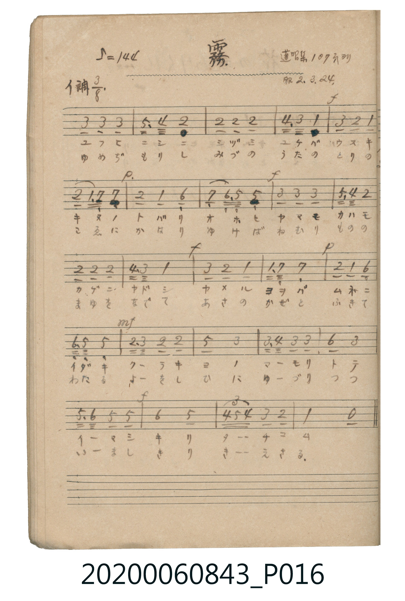

# 霧

<audio controls src="kiri.mp3"></audio>

- 出處：蓬唱集 107頁ヨリ（昭2.3.24）
- 《唱歌帖》（2020.006.0843）P016.jpg

## 說明

原書資訊與歌詞全文（對應 P016.jpg）：
調性與拍號：イ調 3/8 拍（A 大調 3/8 拍），♪=144
註記：蓬唱集 107頁ヨリ / 昭2.3.24

## 跨冊／重複收錄參照

> 同名異曲（各冊收錄之不同詞曲版本）

- **[同名異曲]** 《新定兒童唱歌》尋常科第六學年用（2020.006.0847.0006）：[**〈霧〉**](../../../shintei_jido_shoka/grade_6_2020.006.0847.0006/2_08_kiri/index.md)（`G` / `4/4` — [原始 TMD](../../../shintei_jido_shoka/grade_6_2020.006.0847.0006/2_08_kiri/kiri.tmd)）
- 總表：[跨冊重複與同名歌曲總索引](../../../duplicate_songs.md)

## 歌詞

```text
一、
タニマ ノ キリ ハ タチノボリ
ヤマ ノ コズエ ヲ ツツミタリ
ホノカニ ミユル スギ ノ ムラ
マツ ノ コダチ モ カクレ ユク

二、
あさひ の かげ の さしそひ て
きり の とばり は はれそめ ぬ
みどり の やま も あらはれ て
さやか に ひびく とり の こゑ
```

## ABC

```abc
X:1
T:霧
M:3/8
L:1/16
Q:1/8=288
K:A
V:V1 name="Piano" snm="Pia"
[V:V1]
!mf! c2 c2 c2 | e3 d B2 | B2 B2 B2 | d3 c A2 |
!f! c2 B2 A2 | B2 A G G2 | !p! B2 A2 F2 | G2 F E E2 |
!f! c2 c2 c2 | e3 d B2 | B2 B2 B2 | d3 c A2 |
c2 B2 A2 | A G G4 | !p! B2 A2 F2 | F E E4 |
!mf! B c B2 B2 | e4 c2 | c d c2 c2 | f4 c2 |
e f e2 e2 | !f! f4 e2 | d2/3 e2/3 d2/3 c2 B2 | A4 z2 |
!mf! c2 c2 c2 | e3 d B2 | B2 B2 B2 | d3 c A2 |
!f! c2 B2 A2 | B2 A G G2 | !p! B2 A2 F2 | G2 F E E2 |
!f! c2 c2 c2 | e3 d B2 | B2 B2 B2 | d3 c A2 |
c2 B2 A2 | A G G4 | !p! B2 A2 F2 | F E E4 |
!mf! B c B2 B2 | e4 c2 | c d c2 c2 | f4 c2 |
e f e2 e2 | !f! f4 e2 | d2/3 e2/3 d2/3 c2 B2 | A4 z2 |
```

## TMD 檔案連結

- [主旋律 TMD 檔案](kiri.tmd) [[在 TMD Studio 編輯](https://tmdlang.github.io/Tmd-TS/#tmd=s7IKdvYPcrWy4tLSUng5Z7mClhaXoq2CoYkJl72tgiOXjbG-hR1XnYLS0_ZdL2ZOfb9n1ovJa55O2fhydpuCoYH5ywWNj5tXPG5e9X5Px7MZa430jPWMTN7v6VQCaXnc0AVU-Wxtz9Md0x43dAOVGBkYGegZGJjpGViYGAOVBRgYmullFaQrcXHpaynYUgtwKSgoPO2b_2z2jheb21-s6HrR0Q50xYuV8562rng2rR3okKcbep-1dyrA7Ac6BegzkLYXq_Y_a1gO0tDd-2LmfKDo46YlQEEFYDgoAMWAeh0Vni5ZjiIE1NzzaOYqW1CogcxYsfvFihk4g0pBXwEeVFwg9U92NDxuaASxHjftf9zc_bh5nsLj5j4gby1I-ePmfogEUH_f4-Y5QDGw2uYlCIWbHzftety0AsjbBMQtYDQfrAmqdjZIb9NqoOlAzvzHzcseN68G6tv5uGkdxIjmBY-bV0LUzgNqh5vb3AC0GMhbBOStfty0_nHzGiBvGZAFcfuuHpjbG5seN0593Ah0QCPQzMbux42ToEyg6PTHjXMhcssginsfN3VBpVc8btwA4a0H4cdNPSDFTUBbG9dAFO9_3LgSrr6p5XHjPiDVBLayqROiBWHyVLAKoD8bgT5s3PS4cfPjRmAIAq2B2zj5cdNEkGLKkxoUKGjpc3F5ZxZlWgVkJublO9QY1ChUg2xQsDE007IDs6pz02rBjBoFYwVdOK5RMAWSugomCkZgHoiE4RqgKEjOWMEQxIMYg2IKSBVYDsoyjwchuNoCmFqYOjOwJEQNkG0KRtiNJteB6A5DOAoECTgMyU1IqhEhZwQ0HGE5xGEwZxoDHYNwtBmyHFS3KVAUpAeE0b0MUw-WU9AwATJMNFU1dHU14f4B-QWiyABsQC0Xl66dAijaFZBoZS4A)]
- [鋼琴伴奏 TMD 檔案](kiri_piano.tmd) [[在 TMD Studio 編輯](https://tmdlang.github.io/Tmd-TS/#tmd=s7IKdvYPcrWy4tLSUng5Z_n7PR0vu_c8n7DlyZ4tT5f2P-_seL-nU0FLi0vRVsHQxITL3lbBkcvGWN_CjqtOQelp-64XM6e-3zPrxeQ1T6dsfDm7TcHQwPzlgsbHzSseN68CGvZsxlojPWM9IxOgMUogLY8buoAqn63tebpj2uOGbqASIwMjAz0DAzM9AwsTY6CyAANDM72sgnQlLi7vzKJMq4DMxLz8IA-HGoMahWouBSCwMTTTsgOzqnPTasGMGgVDbWMFXRSyRsE8XtsUyNBVMFEwggmAGKgUSK8JWJmxgiGIDzEazWSoYrN4bbAaGN8QyAAhuLYCmDagSogCkCawFtN4bbBKINcUjHDZRT1f4HI92Nkw94AgYddDXG0MdAyaHkQcGAHtxnQVxPEgd4H4xkBvoPrPUNsMWQXULFMFM6heCIkZUiZwfUCTIGoUNEyAGk00VTV0dTWhFoB9CXUMkA0RBEEDsKm1yMnMB1cyg4eLIcjzpvEgEswEmQmijRDiWIUw9KGHnRlYDqICwoaZAyGNIWJo0WQEUw-iTKDaIEqxaEPKLVT1BnbXQ6xGdgwJroeQkChCiwJinAV1hDGyeyAWgOWhdiEHBlgp9qiBqEbSDnM5PH5groCrgKctXTsFUPJSQKKVuQA)]

## 分析

```text
================================================================================
📊 TMD Song Profile: [ 霧 ]
================================================================================
⏱  Duration:       0:30 (30.0s), 48 measures total
🎼 Key & Tempo:    首調基準 A, != 144.0 BPM, <3/8>
   - 分析範圍：      由實際發聲的音符與和弦推測調性；播放脈絡另行呈現
🎤 人聲音域:    E4 (MIDI 64) – F#5 (MIDI 78) [跨度: 14 個半音 / 1.2 個八度, 難度: moderate]
   - 最低音:  E4 in [Kiri #1 @ m.8, 0:04]
   - 最高音: F#5 in [Kiri #1 @ m.20, 0:11]
   - 適合: soprano, mezzo-soprano, tenor, baritone
🏛  結構:      Kiri (15.0s) -> Kiri (15.0s)
⚡ 編曲密度:        Peak 1 軌道同時演奏
🗝  調性診斷：       E 大調（流行色彩大調，未偵測到可信轉調）
   - 風格氣質:    流行大調（略帶和弦色彩音與裝飾副屬和弦）
   - 轉調歷程:    全曲維持單一推測調性（未偵測到可信轉調）
   - 核心骨幹音:  B, C#, E, A, F#
   - 調性數值:    E 大調 [相關度: 0.79, 穩定度: Moderate, 自然音純度: 92.7%]
   - 候選調性 (K-S): E 大調 (0.79), A 大調 (0.69), C# 小調 (0.67)
   - 五度圈歷程:   +4 -> +4
   - 各段落調性細節:
     • [Kiri #1]: E 大調 (r: 0.79, 自然音純度: 92.7%, 調外音: D)
     • [Kiri #2]: E 大調 (r: 0.79, 自然音純度: 92.7%, 調外音: D)

  [ 五度圈游移軌跡 ]
               C  
         F            G  
      Bb               D  
      Eb               A  
         Ab          [E ]*
            Db       B  
               F# 
     (* = active key center)

  [ 十二半音累積音高分佈 ]
     C  :                            0.0%
     C# : ██████████████████████    21.1%
     D  : ████████                   7.3%
     D# :                            0.0%
     E  : ███████████████████       18.1%
     F  :                            0.0%
     F# : ███████████               10.6%
     G  :                            0.0%
     G# : ███████                    7.0%
     A  : █████████████             12.7%
     A# :                            0.0%
     B  : ████████████████████████  23.2%
--------------------------------------------------------------------------------
Assignment 軌道音域：
  - Piano         : E4 – F#5 (14 個半音 / 1.2 個八度, 148 個音符)
================================================================================
```


## 原書掃描頁




