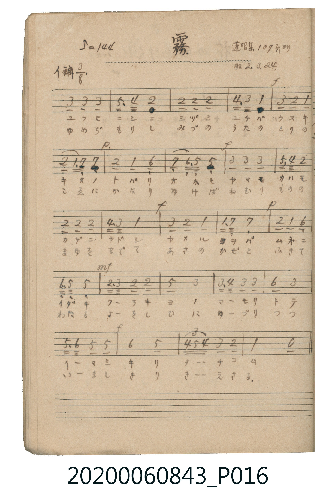

# 霧（霧）

> Re:Shōka 使用 AI 協助辨識與重建樂譜，可能會有錯誤。歡迎回報。

<audio controls src="kiri.mp3"></audio>

- 出處：蓬唱集 107頁ヨリ（昭2.3.24）
- 《唱歌帖》（2020.006.0843）P016.jpg

## 說明

原書資訊與歌詞全文（對應 P016.jpg）：
調性與拍號：イ調 3/8 拍（A 大調 3/8 拍），♪=144
註記：蓬唱集 107頁ヨリ / 昭2.3.24


## 歌詞

```text
一、
ユフヒ ニシ ニ シヅミ ユケバ
ウスキ キヌ ノ トバリ オホヒ
ヤマ モ カハ モ カゲ ニ ヤドシ
ヤメル ヨヲバ ムネ ニ イダキ
クラキ ヨ ノ マモリ トテ
イマシ キリ タチコム

二、
ゆめぢ もりし みづ の うた の
とり の こゑ に かはり ゆけば
ねむり もの の まゆ を なでて
あさ の かぜ と ふきて わたる
よ を しひ に ゆづり つつ
いまし きり きえさる
```

## ABC

```abc
X:1
T:霧（霧）
M:3/8
L:1/16
Q:1/8=144
K:A
V:V1 name="Piano" snm="Pia"
[V:V1]
!mf! c2 c2 c2 | e3 d B2 | B2 B2 B2 | d3 c A2 |
!f! c2 B2 A2 | B2 A G G2 | !p! B2 A2 F2 | G2 F E E2 |
!f! c2 c2 c2 | e3 d B2 | B2 B2 B2 | d3 c A2 |
c2 B2 A2 | A G G4 | !p! B2 A2 F2 | F E E4 |
!mf! B c B2 B2 | e4 c2 | c d c2 c2 | f4 c2 |
e f e2 e2 | !f! f4 e2 | d2/3 e2/3 d2/3 c2 B2 | A4 z2 |
```

## TMD 檔案連結

- [主旋律 TMD 檔案](kiri.tmd) [[在 TMD Studio 編輯](https://tmdlang.github.io/Tmd-TS/#tmd=s7IKdvYPcrWy4qpTUCpJTLdSSM7PyUlNLsnMz7MqzsjPTkzOyFeCS5bl55TmploBqXgDC4RwcX5pUXJqfEFieqpVgIGhGboM3KT4vPyS1KT8_GwMFRn5RYmZ8WB1xRmlCOmCovyy1LzEPKCS3MS80uLkosyCkvjk_IJKhJrUssyUVJCK1JTMkvyizMQcJBenFhWD_QJxYklRYh7EDKAgQlVJRirQW3mJJaVFqeii5amJQEYRQhhoQ3pmnlVJYibQuSAnlyfG5yZm5uUk5qUocWlpKbycs_z9ng4w2amgpcWlaKtgbsRlb6vgyGVjrG9hBzLpafuuFzOnvt8z68XkNU-nbHw5u03B0MD85YLGx80rHjevAup_NmOtkZ6xnpEJ0BSw5Y8buoAqn63tebpj2uOGbqASIwMjAz0DAzM9AwsTY6AyUNjrZRWkK3Fx6Wsp2FILcCkoKDztm_9s9o4Xm9tfrOh60dEOdMWLlfOetq54Nq0d6JCnG3qftXcqwOwHOgXoM5C2F6v2P2tYDtLQ3fti5nyg6OOmJUBBBWA4KADFgHodFZ4uWY4iBNTc82jmKltDExOwGSt2v1gxA2dQKegrwIOKC6T-yY6Gxw2NINbj5mWPm6c-bp4EZHU_btoOohSA9OPm1sfN88HSTRsfN08Aq20CcnY-bloLZK193NwDlO0D4g6gNMiSx02rHjfPBhoFMXfJ4-Z5QGoRUHz14-Z-OLNpE8QOkIJOoE1w1QsfN68GsoAO3gQ0Echa8Li5F-oeoHQD0FKIK9Y_bl4JdkXzCqgT5gENBzsB5Jg2iCqQ_WAPgdwKct3-x82Nj5s2A82FhMGuHlgYNLU9bmp83AhyX9Pjpq7HjdMVHjfuf9y4FEitA-K2x43AoGhcB1bcuAKoBCox-XHTRCAFdHZj9-PG9WAJoGGNEx83boAoXvu4CehwkHATRAsI7wMqAooAw7xx1ePG5Y8bl0EUA5VMhSoBGjcHZBcQb33c2AtUAtTQD3TH46ZuiJs7oCZMf9wIDFGQG0A2L4U4bgkQQcxsAVkH9lAvRApoVgfQHqg5lCd9KFDQ0ufi8s4syrQKyEzMy3eoMahRqAbZoGBjaKZlB2ZV56bVghk1CsYKunBco2AKJHUVTBSMwDwQCcM1QFGQnLGCIYgHMQbFFJAqsByUZR4PQnC1BTC1MHVmYEmIGiDbFIywG02uA9EdhnAUCBJwGJKbkFQjQs4IaDjCcojDYM40BjoG4WgzZDmoblOgKEgPCKN7GaYeLKegYQJkmGiqaujqasL9A_ILRJEB2IBaLi5dOwVQtCsAaWUuAA)]
- [鋼琴伴奏 TMD 檔案](kiri_piano.tmd) [[在 TMD Studio 編輯](https://tmdlang.github.io/Tmd-TS/#tmd=s7IKdvYPcrWy4tLSUng5Z_n7PR1A8nHz7pfde55P2PJkz5anS_ufd3a839OpoKXFpWirYG7EZW-r4MhlY6xvYcdVp6D0tH3Xi5lT3--Z9WLymqdTNr6c3aZgaGD-ckHj4-YVj5tXAU18NmOtkZ6xnpEJ0BQlkJbHDV1Alc_W9jzdMe1xQzdQiZGBkYGegYGZnoGFiTFQWYCBoZleVkG6EheXd2ZRplVAZmJefpCHQ41BjUI1lwIQ2BiaadmBWdW5abVgRo2Cobaxgi4KWaNgHq9tCmToKpgoGMEEQAxUCqTXBKzMWMEQxIcYjWYyVLFZvDZYDYxvCGSAEFxbAUwbUCVEAUgTWItpvDZYJZBrCka47KKeL3C5HuxsmHtAkLDrIa42BjoGTQ8iDoyAdmO6CuJ4kLtAfGOgN1D9Z6hthqwCapapghlUL4TEDCkTuD6gSRA1ChomQI0mmqoaurqaUAvAvoQ6BsiGCIKgAdjUWuRk5oMrmcHDxRDkedN4EAlmgswE0UYIcaxCGPrQw84MLAdRAWHDzIGQxhAxtGgygqkHUSZQbRClWLQh5RaqegO76yFWIzuGBNdDSEgUoUUBMc6COsIY2T0QC8DyULuQAwOsFHvUQFQjaYe5HB4_MFfAVcDTlq6dAih5KSDRylwA)]

## 分析

```text
================================================================================
📊 TMD Song Profile: [ 霧（霧） ]
================================================================================
⏱  Duration:       0:30 (30.0s), 24 measures total
🎼 Key & Tempo:    首調基準 A, != 72.0 BPM, <3/8>
   - 分析範圍：      由實際發聲的音符與和弦推測調性；播放脈絡另行呈現
🎤 人聲音域:    E4 (MIDI 64) – F#5 (MIDI 78) [跨度: 14 個半音 / 1.2 個八度, 難度: moderate]
   - 最低音:  E4 in [Kiri #1 @ m.8, 0:09]
   - 最高音: F#5 in [Kiri #1 @ m.20, 0:23]
   - 適合: soprano, mezzo-soprano, tenor, baritone
🏛  結構:      Kiri (30.0s)
⚡ 編曲密度:        Peak 1 軌道同時演奏
🗝  調性診斷：       E 大調（流行色彩大調，未偵測到可信轉調）
   - 風格氣質:    流行大調（略帶和弦色彩音與裝飾副屬和弦）
   - 轉調歷程:    全曲維持單一推測調性（未偵測到可信轉調）
   - 核心骨幹音:  B, C#, E, A, F#
   - 調性數值:    E 大調 [相關度: 0.79, 穩定度: Moderate, 自然音純度: 92.7%]
   - 候選調性 (K-S): E 大調 (0.79), A 大調 (0.69), C# 小調 (0.67)
   - 五度圈歷程:   +4
   - 各段落調性細節:
     • [Kiri #1]: E 大調 (r: 0.79, 自然音純度: 92.7%, 調外音: D)

  [ 五度圈游移軌跡 ]
               C  
         F            G  
      Bb               D  
      Eb               A  
         Ab          [E ]*
            Db       B  
               F# 
     (* = active key center)

  [ 十二半音累積音高分佈 ]
     C  :                            0.0%
     C# : ██████████████████████    21.1%
     D  : ████████                   7.3%
     D# :                            0.0%
     E  : ███████████████████       18.1%
     F  :                            0.0%
     F# : ███████████               10.6%
     G  :                            0.0%
     G# : ███████                    7.0%
     A  : █████████████             12.7%
     A# :                            0.0%
     B  : ████████████████████████  23.2%
--------------------------------------------------------------------------------
Assignment 軌道音域：
  - Piano         : E4 – F#5 (14 個半音 / 1.2 個八度, 74 個音符)
================================================================================
```


## 原書掃描頁




