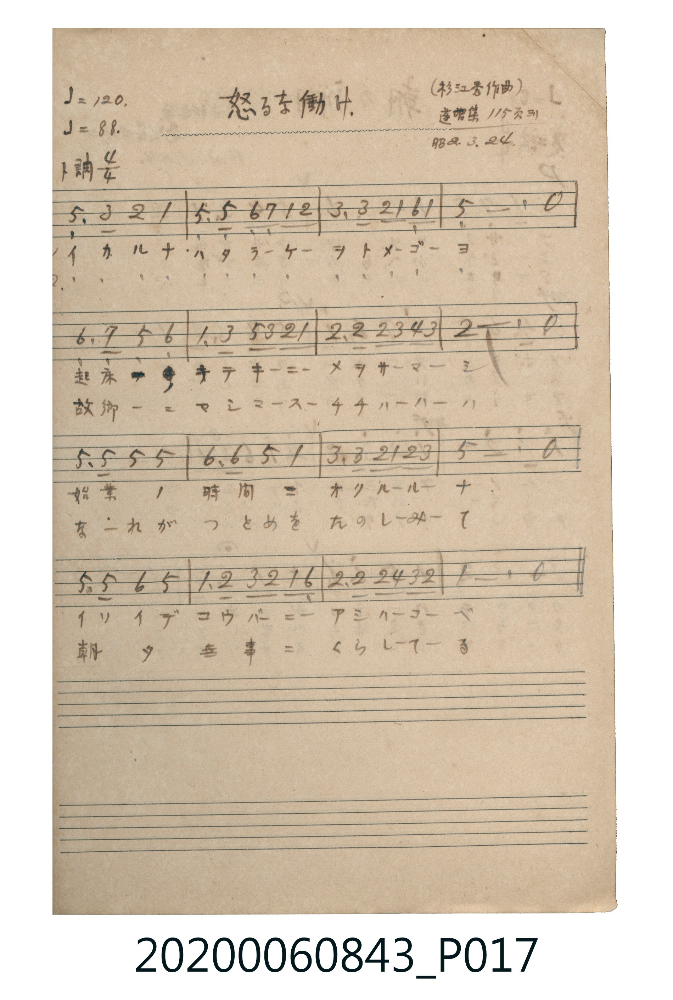

# 怒るな働け（不要發怒，努力工作）

> Re:Shōka 使用 AI 協助辨識與重建樂譜，可能會有錯誤。歡迎回報。

- **鋼琴伴奏版**：<br><audio controls src="ikaruna_hatarake.mp3"></audio>
- **NEUTRINO 歌聲合成版**：<br><audio controls src="ikaruna_hatarake_neutrino.mp3"></audio>

- 曲：杉江秀
- 出處：蓬唱集 115頁ヨリ（昭2.3.24）
- 《唱歌帖》（2020.006.0843）P017.jpg

## 說明

原書資訊與歌詞全文（對應 P017.jpg）：
調性與拍號：ト調 4/4 拍（G 大調 4/4 拍），♩=120 (♩=88)
註記：(杉江秀作曲) / 蓬唱集 115頁ヨリ / 昭2.3.24


## 歌詞

```text
一、
イカルナ ハタラケ ツトメゴヨ
起床ノ ラッパ キテキニ メヲサマシ
始業ノ 時間ニ オクルルナ
イソイデ コウバニ アシハコベ

二、
イカルナ ハタラケ ツトメゴヨ
故郷ニ マシマス チチハハハ
なれが つとめを たのしみて
朝夕 無事ニ くらしてる
```

## ABC

<div class="abc-score" data-abc-src="ikaruna_hatarake.abc" aria-label="五線譜載入中"></div>

[下載 ABC 原始檔](ikaruna_hatarake.abc)

## TMD 檔案連結

- [主旋律 TMD 檔案](ikaruna_hatarake.tmd) [[在 TMD Studio 編輯](https://tmdlang.github.io/Tmd-TS/#tmd=s7IKdvYPcrWy4qpTUCpJTLdSSM7PyUlNLsnMz7MqzsjPTkzOyFeCS5bl55TmploBqXgDC4RwcX5pUXJqfEFieqpVgIGhOboM3KT4vPyS1KT8_GwMFRn5RYmZ8WB1xRmlCOmCovyy1LzEPKCS3MS80uLkosyCkvjk_IJKhJrUssyUVJCK1JTMkvyizMQcJBenFhWD_QJxYklRYh7EDKAgQlVJRirQW-X5RUgOAxqUnplnVZKYCXQVyGXlifG5iZl5OYl5KciqSjLy04sSCzIqrTIyi0HWJyfmxGcn5iUqcWlpKTxrmPS4qftx46qnzb2PGye-39PxZEfvi2WNz2fuAUq939PztGvV067ZT7cvfbJ3zvs9nQpaWlyKtgqGRgZc9rYK7lw2JvomdiDbns3e9H7PrGdzO59tnP98eQPYBU_bd72YORUo_GLymqdTNr6c3aZgaGj6ckHj4-YVj5tXAS17NmOtkZ6xnpEJ0GiwlscNXUCVz9b2PN0x7XFDN1CJkYGRgZ6BgZmegYWJMVAZKAL1sgrSlbi49LUUbKkFuBQUFJ72zX82e8eLze0vVnS96GgHuuLFynlPW1c8m9YOdMjTDb3P2jsVYPYDnQL0GUjbi1X7nzUsB2no7n0xcz5Q9HFzB1BQARg2CkAxoF53hadLlqMIATX3PJq50hYYkgoaIIaFhSbYsBW7X6yYATRDAx6WwJAHhq6mgr4C9nAESsDDkQtkxpMdDY8bGkGsx01LHjetftwMRF0Kj5v7Hzftf9y88nHTRiCnBejKx80LHzdtARoDtnrr9qe7uh439wElVz5ubn7cPBFowNrHzW1gshsovPBx86bHTVsfN8973LQdHGTLu58tBUr2KTyb2fRy2mSwsqZVj5vWgy0F2Qt3x14Q2dwO5Gx-3LTscfMEiOJFQKPATtv8uHkmxP27eshx_7OprS-bgUaBHApyH5jcCeQAwwmI-iEIbGwj0IU9jxt7gKwljxtXPG5qfNw0CciZ_7hx3ePG6Y8b9z9uXAY2c87cp0umKjxvWfhkVzfY6EagIzrBapYBcw5IDeWJDwoUtPS5uDyzE4tK8xI9EksSixKzgQVWZmJevkONQU01yC4FGwstOzCjOjetFsyoUTCNV9AFQmMFIyBpCMRwISBlFq9gHg8UNQKKGsPVGYLEDUEKwUIQaADSCjbTx7AGFPZgUWAEAMNwNYgFjASQ4cBQhMrsByUVMGsjVKYFahYwckDpBSy3BSK1ArtVRnSxChpUQF-DxIAhAg4hMLcGHGagcDGFhk0NOCR1gaQRUMQEiGEi2AIKmG_AosDMA3VPH8SFTWuh_DYoG5SAIA4EuRbE3wSU2QpmzYPqgZiFLZSA6RssCkzkUN0w00B6Qb7fDmWDkj1EphGqshEakhASEa5YggiSIkzBNAgDAw0sYgbmQZIXckICBRG-dAQsIsCiwHICJXiABQbEO9Mmo3qnaRXUO-vhiQFEghwNCWCsSagRogukrwdEAjM3WE8jNGk1rgDKgIIDlNMhMvOhMuuAeDqYtR8qs4xQ4ICCBBI4kLQDCgRorkJOPKCkA8p4EEXYQgeR9PdC2aAiEhIOm6Eyy4BiE1BCaBFUBhTh4GgFqwWF0EycIQQsyqDioBINwqoBlWxQNrCAQ7ajEZbxOuGhAwoVkO2Q-ES2o5aLS9dOAa3oUgAKKXMBAA)]
- [鋼琴伴奏 TMD 檔案](ikaruna_hatarake_piano.tmd) [[在 TMD Studio 編輯](https://tmdlang.github.io/Tmd-TS/#tmd=s7IKdvYPcrWy4qpTUCpJTLdSyC8qychPL0osyKi0ysgsLskvykxOzInPTsxLVIIrKs4vLUpOjS9ITE-1CjAwNEfIlGSk5qZapaaUJieWZObnKXFpaSk8a5j0uKn7ceOqp829jxsnvt_T8WRH74tljc9n7gFKvd_T87Rr1dOu2U-3L32yd87j5t0vu_c8n7DlyZ4tT5f2P-_seL-nU0FLi0vRVsHQyIDL3lbBncvGRN_EDmTns9mb3u-Z9Wxu57ON858vbwC742n7rhczpwKFX0xe83TKxpez2xQMDU1fLmh83LzicfMqoPXPZqw10jPWMzIBGg3W8rihC6jy2dqepzumPW7oBioxMjAy0DMwMNMzsDAxBioD-VIvqyBdiYvLM6-kKN8qIDMxL9-hxqCmmksBCGwstOzAjOrctFowo0bBVEEXCE0VzMCkLlDEECxipGAMxIYKZvFAISOokJGCCVgYpggCDUDauGpRLPXxQLLWBG5tAcxaw3gF43gFk3gQowZoSbyCKRADOSZACugqIGkEEQPhGoVow1iFaNN4IAFkGECty04sKs1L9EgsSSxKzAZGMhbfQq0DeRhoEti5IA_ogj0Asgfi_XiQP82BDgB7zhiuDux_Q3gwIfsXZLCPYY3C46YlYNHHTasVHjevBrGau8CGP27uh8rsB7JXglkboTItEJnmDiBeCJbZApVZgd0mI3rYBA0toJ9BYsDwAIcPmAuLcmNgUEBCBjlZGIMTBkwEezCthTpx--Pm5UBqGdAFfWAhJMnmNij7cXM31JUgN4P4m4AyW8GseVA92_GE1GaoZWthliEbCTIA7BIo-3HTTqhMI9SyRmiQQkhEAGMJLFgGAtGQDATKSsBQA_MgyQw5QYECC396gvjrcdM6ZLeDggokuQMqCUoCIE_CfdW0CiqzHp44QCTI7aBEgiOgGiG6QPp6QGQjiASJQ5Na4wqgDChUHjdNgsrMh8qsA-LpYNZ-qAzIpXjDiOJCBjPT7YWyHze3Q8MBFvWgBDYBJYQWQWVA8Q6OXbBaUAjNxBNCTVD_TgWqbwOzQCRIZhss7BpnINvTCMuMnfAQAoUMyAUgFaj24CrHsBagoIKsoBZUTMJKRnDxCS9MgdkVzAPJgApSjMIUVHJCDAJJoRS5UG0Qs1A0ASkchqDpgRTnUEG4LNyZuIyguCLQtVMAVz0KIAZqYEb7AJVhEzYCCytzAQA)]

## 分析

```text
================================================================================
📊 TMD Song Profile: [ 怒るな働け（不要發怒，努力工作） ]
================================================================================
⏱  Duration:       0:32 (32.0s), 16 measures total
🎼 Key & Tempo:    首調基準 G, != 120.0 BPM, <4/4>
   - 分析範圍：      由實際發聲的音符與和弦推測調性；播放脈絡另行呈現
🎤 人聲音域:    D4 (MIDI 62) – E5 (MIDI 76) [跨度: 14 個半音 / 1.2 個八度, 難度: moderate]
   - 最低音:  D4 in [IkarunaHatarake #1 @ m.1, 0:00]
   - 最高音: E5 in [IkarunaHatarake #1 @ m.10, 0:18]
   - 適合: soprano, mezzo-soprano, contralto, tenor, baritone, bass
🏛  結構:      IkarunaHatarake (32.0s)
⚡ 編曲密度:        Peak 1 軌道同時演奏
🗝  調性診斷：       D 大調（純淨自然大調，未偵測到可信轉調）
   - 風格氣質:    純淨自然大調（陽光明朗、易唱易記，無明顯調外色彩）
   - 轉調歷程:    全曲維持單一推測調性（未偵測到可信轉調）
   - 核心骨幹音:  D, A, G, B, E
   - 調性數值:    D 大調 [相關度: 0.89, 穩定度: High, 自然音純度: 98.3%]
   - 候選調性 (K-S): D 大調 (0.89), G 大調 (0.77), D 小調 (0.58)
   - 五度圈歷程:   +2
   - 各段落調性細節:
     • [IkarunaHatarake #1]: D 大調 (r: 0.89, 自然音純度: 98.3%, 調外音: C)

  [ 五度圈游移軌跡 ]
               C  
         F            G  
      Bb              [D ]*
      Eb               A  
         Ab           E  
            Db       B  
               F# 
     (* = active key center)

  [ 十二半音累積音高分佈 ]
     C  : █                          1.7%
     C# :                            0.0%
     D  : ████████████████████████  31.7%
     D# :                            0.0%
     E  : █████████                 11.7%
     F  :                            0.0%
     F# : █                          1.7%
     G  : ██████████████            18.3%
     G# :                            0.0%
     A  : ████████████████          21.7%
     A# :                            0.0%
     B  : ██████████                13.3%
--------------------------------------------------------------------------------
Assignment 軌道音域：
  - Piano         : D4 – E5 (14 個半音 / 1.2 個八度, 66 個音符)
================================================================================
```


## 原書掃描頁




