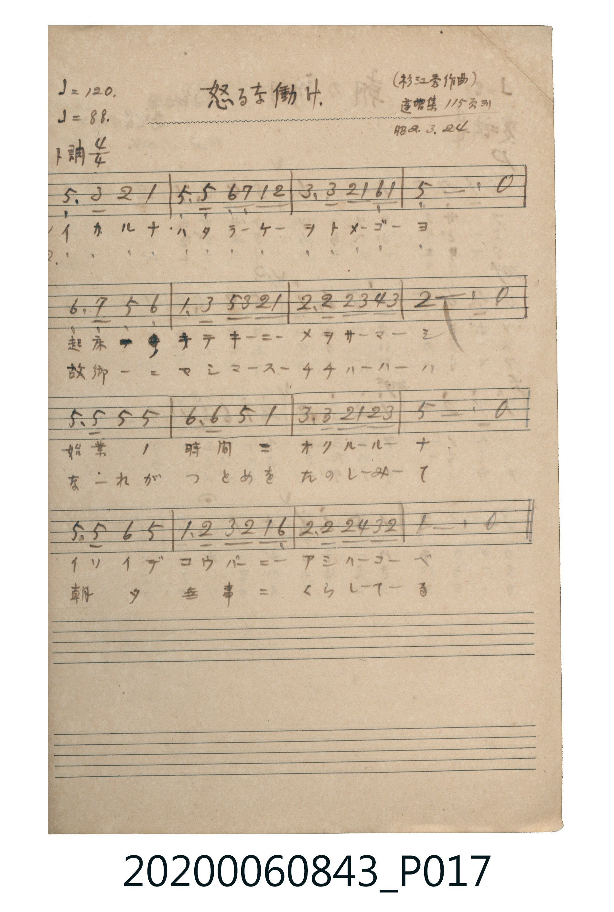

# 怒るな働け（不要發怒，努力工作）

<audio controls src="ikaruna_hatarake.mp3"></audio>

- 曲：杉江秀
- 出處：蓬唱集 115頁ヨリ（昭2.3.24）
- 《唱歌帖》（2020.006.0843）P017.jpg

## 說明

原書資訊與歌詞全文（對應 P017.jpg）：
調性與拍號：ト調 4/4 拍（G 大調 4/4 拍），♩=120 (♩=88)
註記：(杉江秀作曲) / 蓬唱集 115頁ヨリ / 昭2.3.24

## 歌詞

```text
一、
イカルナ ハタラケ ツトメゴヨ
起床 ラッパ キテキニ メヲサマシ
始業ノ 時間ニ オクルルナ
イソイデ コウバニ アシハコベ

二、
イカルナ ハタラケ ツトメゴヨ
故郷ニ マシマス チチハハハ
なれが つとめを たのしみて
朝夕 無事ニ くらしてる
```

## ABC

```abc
X:1
T:怒るな働け（不要發怒，努力工作）
C:曲：杉江秀
M:4/4
L:1/16
Q:1/4=120
K:G
V:V1 name="Piano" snm="Pia"
[V:V1]
!mf! D6 B2 A4 G4 | D4 D4 E2 F2 G2 A2 | B6 B2 A2 G2 E2 G2 | d12 z4 |
E6 F2 D4 E4 | G6 B2 d2 B2 A2 G2 | A6 A2 A2 B2 c2 B2 | A12 z4 |
d6 d2 d4 d4 | e6 e2 d4 G4 | B6 B2 A2 G2 A2 B2 | d12 z4 |
d6 d2 e4 d4 | G6 A2 B2 A2 G2 E2 | A6 A2 A2 c2 B2 A2 | G12 z4 |
!mf! D6 B2 A4 G4 | D4 D4 E2 F2 G2 A2 | B6 B2 A2 G2 E2 G2 | d12 z4 |
E6 F2 D4 E4 | G6 B2 d2 B2 A2 G2 | A6 A2 A2 B2 c2 B2 | A12 z4 |
d6 d2 d4 d4 | e6 e2 d4 G4 | B6 B2 A2 G2 A2 B2 | d12 z4 |
d6 d2 e4 d4 | G6 A2 B2 A2 G2 E2 | A6 A2 A2 c2 B2 A2 | G12 z4 |
```

## TMD 檔案連結

- [主旋律 TMD 檔案](ikaruna_hatarake.tmd) [[在 TMD Studio 編輯](https://tmdlang.github.io/Tmd-TS/#tmd=s7IKdvYPcrWy4tLSUnjWMOlxU_fjxlVPm3sfN058v6fjyY7eF8san8_cA5R6v6fnadeqp12zn25f-mTvnPd7OhW0tLgUbRUMjQy47G0V3LlsTPRN7LjqFJSezd70fs-sZ3M7n22c_3x5gxJI7Gn7rhczpwKFX0xe83TKxpez2xQMDU1fLmh83LzicfMqoGXPZqw10jPWMzIBGg3W8rihC6jy2dqepzumPW7oBioxMjAy0DMwMNMzsDAxBioLMDA018sqSFfi4tLXUrClFuBSUFB42jf_2ewdLza3v1jR9aKjHeiKFyvnPW1d8WxaO9AhTzf0PmvvVIDZD3QK0GcgbS9W7X_WsBykobv3xcz5QNHHzR1AQQVg2CgAxYB63RWeLlmOIgTU3PNo5kpbYEgqaIAYFhaaYMNW7H6xYgbQDA14WAJDHhi6mgr6CtjDESgBD0cukBlPdjQ8bmgEsR43LXnctPpxMxB1KTxu7n_ctP9x88rHTRuBnBagKx83L3zctAVoDNjqrduf7gIpW_m4uflx80Sg7rWPm9vAZDdQeOHj5k2Pm7Y-bp73uGk7OLyWdz9bCpTsU3g2s-nltMlgZU2rHjetB9sIshTuiL0gsrkdyNn8uGnZ4-YJEMWLgEaB3bX5cfNMiON39ZDj-GdTW182A40CORTkPjC5E8gBBhIQ9UMQ2NhGoAt7Hjf2AFlLHjeueNzU-LhpEpAz_3HjuseN0x837n_cuAxs5py5T5dMVXjesvDJrm6w0Y1AR3SC1SwDZhuQGspTHhQoaOlzcXlmJxaV5iV6JJYkFiVmp1oFZCbm5TvUGNQoVIMsU7Cx0LIDM6pz02rBjBoF03gFXSA0VjACkoZADBUCE2bxCubxQFEjoKgxXJ0hSNwQpBAsBIEGIK1QM4HSICGgVpgpIGNBhoMMMIUaUgO2UhdIGgFFTIAYJoJpIsQmUzANwkA7wCJmYB7E2cgOBJmI230w00BmQEyDuA2kC-o9ZMeBnAYKAYgiZONqubh07RTQgl0Bu5AyFwA)]
- [鋼琴伴奏 TMD 檔案](ikaruna_hatarake_piano.tmd) [[在 TMD Studio 編輯](https://tmdlang.github.io/Tmd-TS/#tmd=s7IKdvYPcrWy4tLSUnjWMOlxU_fjxlVPm3sfN058v6fjyY7eF8san8_cA5R6v6fnadeqp12zn25f-mTvnMfNu19273k-YcuTPVueLu1_3tnxfk-ngpYWl6KtgqGRAZe9rYI7l42JvokdV52C0rPZm97vmfVsbuezjfOfL29QAok9bd_1YuZUoPCLyWueTtn4cnabgqGh6csFjY-bVzxuXgW0_tmMtUZ6xnpGJkCjwVoeN3QBVT5b2_N0x7THDd1AJUYGRgZ6BgZmegYWJsZAZQEGhuZ6WQXpSlxcntmJRaV5iR6JJYlFidmpVgGZiXn5QR4ONQY1CtVcCkBgY6FlB2ZU56bVghk1CqbxCrpAaKxgBCQNgRgqBCbM4hXM44GiRkBRQ21juEpDkIwhUNA8XttI2xQsDoEGIBOgRgPVgISAJsAMA5kOsgNkiinUJIghYEEjIDRWMAFiJEFMc42hNgJNALNAuEbBRNsMLGoGFYX4BdXVIOMJOBphOMRACB_mbJABUO-juRvkalAwmcZrw-xENrwWR_z44IifAlj8GEIiA0GCBaDixiDCBB5dKKpNkEiQs0C0EUIa2c8QRUjGw3QhGYewD4thYCYBS3CYBXY9WABJAW5vE7YCESZQLWa4fIdhFhbLwUx4FOraKaDFogJ2IWUuAA)]

## 分析

```text
================================================================================
📊 TMD Song Profile: [ 怒るな働け（不要發怒，努力工作） ]
================================================================================
⏱  Duration:       1:04 (64.0s), 32 measures total
🎼 Key & Tempo:    首調基準 G, != 120.0 BPM, <4/4>
   - 分析範圍：      由實際發聲的音符與和弦推測調性；播放脈絡另行呈現
🎤 人聲音域:    D4 (MIDI 62) – E5 (MIDI 76) [跨度: 14 個半音 / 1.2 個八度, 難度: moderate]
   - 最低音:  D4 in [IkarunaHatarake #1 @ m.1, 0:00]
   - 最高音: E5 in [IkarunaHatarake #1 @ m.10, 0:18]
   - 適合: soprano, mezzo-soprano, contralto, tenor, baritone, bass
🏛  結構:      IkarunaHatarake (32.0s) -> IkarunaHatarake (32.0s)
⚡ 編曲密度:        Peak 1 軌道同時演奏
🗝  調性診斷：       D 大調（純淨自然大調，未偵測到可信轉調）
   - 風格氣質:    純淨自然大調（陽光明朗、易唱易記，無明顯調外色彩）
   - 轉調歷程:    全曲維持單一推測調性（未偵測到可信轉調）
   - 核心骨幹音:  D, A, G, B, E
   - 調性數值:    D 大調 [相關度: 0.89, 穩定度: High, 自然音純度: 98.3%]
   - 候選調性 (K-S): D 大調 (0.89), G 大調 (0.77), D 小調 (0.58)
   - 五度圈歷程:   +2 -> +2
   - 各段落調性細節:
     • [IkarunaHatarake #1]: D 大調 (r: 0.89, 自然音純度: 98.3%, 調外音: C)
     • [IkarunaHatarake #2]: D 大調 (r: 0.89, 自然音純度: 98.3%, 調外音: C)

  [ 五度圈游移軌跡 ]
               C  
         F            G  
      Bb              [D ]*
      Eb               A  
         Ab           E  
            Db       B  
               F# 
     (* = active key center)

  [ 十二半音累積音高分佈 ]
     C  : █                          1.7%
     C# :                            0.0%
     D  : ████████████████████████  31.7%
     D# :                            0.0%
     E  : █████████                 11.7%
     F  :                            0.0%
     F# : █                          1.7%
     G  : ██████████████            18.3%
     G# :                            0.0%
     A  : ████████████████          21.7%
     A# :                            0.0%
     B  : ██████████                13.3%
--------------------------------------------------------------------------------
Assignment 軌道音域：
  - Piano         : D4 – E5 (14 個半音 / 1.2 個八度, 132 個音符)
================================================================================
```


## 原書掃描頁




