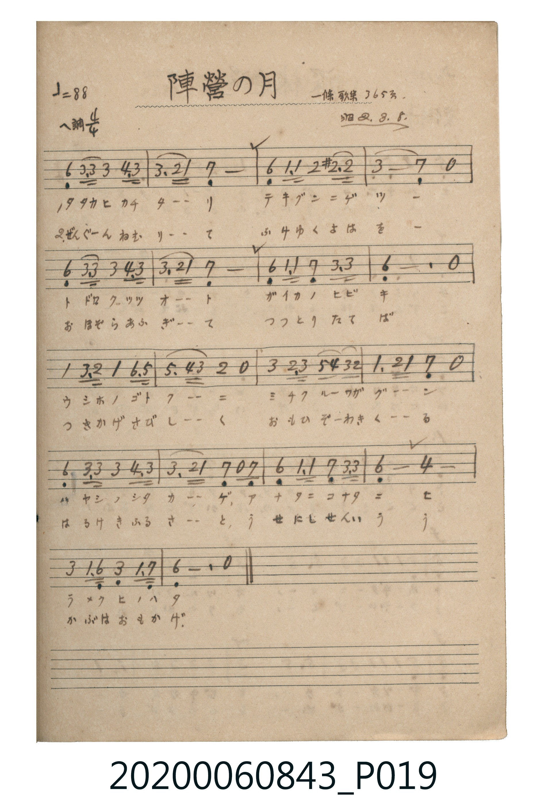

# 陣營の月（軍營之月）

> Re:Shōka 使用 AI 協助辨識與重建樂譜，可能會有錯誤。歡迎回報。

- **鋼琴伴奏版**：<br><audio controls src="jinei_no_tsuki.mp3"></audio>

- 出處：一條歌集 365頁（昭2.3.8）
- 《唱歌帖》（2020.006.0843）P019.jpg

## 說明

> [!NOTE]
> **原書資訊與歌詞全文**（對應 `P019.jpg`）：
> - **調性與拍號**：ヘ調 4/4 拍（關係小調 D 小調，`?= F` 記法下以 `6_` 為終止音），♩= 88
> - **頁首註記**：`一條歌集 365頁.` / `昭 2. 3. 8.`（抄自一條慎三郎編《新編 小學校・公學校 唱歌教材集》高等科一・二學年第 14 首〈陣營の月〉，原書 pp. 364–365）。
> - **抄本記譜特徵**：
>   1. 第 3、7、15 小節第 2 拍，原刊本五線譜為四分音符加八分音符連音線再接十六分音符（`1 - - 1`），楊金土簡譜直接記為附點八分音符加十六分音符（`1. 1=`，時值相同）。
>   2. 第 10 小節原刊本為低音 `5_. 4_= 3_ 2_ 0`，楊金土手抄時漏點 `4 3 2` 下方低音點（記作 `5_. 4= 3 2 0`）。
>
> **一、**
> タタカヒ カチタリ テキグン ニゲツ
> トドロク ツツオト ガイカノ ヒビキ
> ウシホノ ゴトクニ ミチクル ワガグン
> ハヤシノ シタカゲ あなたに こなたに
> ヒラメク ヒノハタ
>
> **二、**
> ぜんぐん ねむりて ふけゆく よはを
> おほぞら あふぎて つつとり たてば
> つきかげ さびしく おもひぞ わきくる
> はるけき ふるさと うせにし せんいう
> うかぶは おもかげ


## 歌詞

```text
（TMD 檔案未包含歌詞註解）
```

## ABC

<div class="abc-score" data-abc-src="jinei_no_tsuki.abc" aria-label="五線譜載入中"></div>

[下載 ABC 原始檔](jinei_no_tsuki.abc)

## TMD 檔案連結

- [主旋律 TMD 檔案](jinei_no_tsuki.tmd) [[在 TMD Studio 編輯](https://tmdlang.github.io/Tmd-TS/#tmd=s7IKdvYPcrWy4qpTUCpJTLdSSM7PyUlNLsnMz7MqzsjPTkzOyFeCS5bl55TmploBqXgDC4RwcX5pUXJqfEFieqpVgIGhJboM3KT4vPyS1KT8_GyEioKi_LLUvMQ8oKrcxLzS4uSizIKS-OT8gkqEmtSyzJRUkIri5MS8-LLUosy0zNQUJGelFhWDHQxxR0lRYh7EHKAgQlV-UUlGfnpRYkFGpVVGZnFJflFmcmJOfHZiXiJCUUlGKtCDeYklpUWp6KK5mTmZJYlFSA4DGpGemWdVkphZDnRYflpaZnJmYo4Sl5aWwsuZi5-3z3_cuO7ZnI73ezpe7O4Fcp_s7AZzOxW0tLgUbRUsLLjsbRXcuGxM9E3sQKY-bd_1YubU93tmPdnR8GzR3Gdre17OblMwNjN9uaARaMqzGWuN9Iz1LIAmgB3xuKHr6ZSNQFVPd0x73NANVGFkYGSgZ2BgpmdgYWIMVAaKDr2sgnQlLi59LQVbagEuBQUFO4VoRT__ENdYCEdL62nf_Gezd7zY3P5iRdeLjnags16snPe0dcWzae1aWkC3Pd3Q-6y9UyEB5qYEoPuAXoVo1wUa8GLV_mcNy0Fau3tfzJwP0jTrcfMMoLACMIAUgKJAU15On_Nkf9PTDf0gYRcFCOP9np4EUEgmKLxYMePZ5qlPdnQ_2b1UIcEsPkHhedOu51ubnq1d9HL-ZrCNPY9mrgSHPdxiYOi-XDbtxYrdQN1gWxOwhL9egoK-QgIwChSM9BSM9RQs9IAe6HjW1fKifRVUeWvfkx2dL5v7nm9fAYyaZ9M2ABkgFz5du-PZgoWPm3c_bV0DYStA4u3Z1JnP5k4A2gGMvZerZzxf2_l8-USgYUClT3b1AJU-3bnl-Zo1CoYmCkAHPm7oQE5WjxtAnoGEukJBAdBRZiaPGiYDXQv05uOGJoT_gI58NmcN0HMv1s553rnz6b6tYF9CFCgoGOopgCwxftzQaA7EhqYgNz9f3wASNIIEO8iapx1dQFOe7JryfPsskEFNu57Onv20ow0Yrs_XLHvateBp62o492XDYhBj-6ynbb3P-pY-7W182roWLgsMuARDoNN0FQwhqaDn2dKul-0Tn86Z_3zDQpDhs7cAdQFdDLTl5cyWl7uBCQlhOMguLAbqKRjaAo3reTaz6WnDnuezdzyd0IMcFAqgmAMHpwHUh3BfAa15srcPaJZCgmm8noJJvK2CcbyCUbyCAdhAmOOedXaDwnJm07M9_UA3KSSYKBgrGCUoANPbs2k7ISYAxUEZfsWMJ3vnQE0DGgYMSJBRcMfAMg0oshsagcUBmP-4aT8YrX7cPAnIAVKNIH7zKoXHzW2Pm9Y-btrwuHkzkNP9uGnT4-YWqK7mjsfNnY-bgdLrgZwWEGpaBRQFGrHmcdMSsEF9QJlJj5snA02B2bXscdP2x82zwXJNW0CmNK0HGg1UOB9sMZCzGshZDzYFZDHMuv7HzUBDgXpBGrdDXdy0SeFxY9PjxlWPG4EJFKixcTKcA9MIdMDKx80LIe4EcvpAZjXtRw2RXT3IIdI453ET0KAJQBLIAXqx4XFT1-PGZUDO1seNEx83tT1u7Ac6o-NxI9Chk2C6gEp2P26c97ipE-IqoNo-iK4lYLQCaAqQA3TcsseNG2C6gBK9jxu7HzcCQ79x6uPGzY8bp4ONB5rXBDRlE9BIoF39YGVAl3fDNAKtBuqaCBQHuwvEAWpfAeQAnTcbGAJAg4Cc2WC_tABFYRqB0kC124AmwC0BWQ-SpryYhgIFLX0uLq_MvNRMv_yQ4tLsTKuAzMS8fIcag5pqkEUKNoZmWuDwV6jOTasFM7DVFqC8A0yvLxb2KGiYQHOQjgKsONfEogFoMciwGgWzeHBu1wVmBAgJoXUVTKD8GriIEahUAGJzmBYYRDIFWnaA1YL1qMMohDkwCDfHAGYO2E0-hjWg7AYVg7GACRmUMuGiqyF0cyPQYIRqGARlTHQ3AjMqXPdaKL0BKLoZrqcbKroJrLoFzQQYhLka6lojoFpwVoAZ0zgBbg1CDGZhA9i5XejOBaZ_DOc2boXLToTqbgOy--Gmd0Bl14PNhAUNbufiTz67egZR8oGrgRmLpAYdYkk9wAIWGkjNnVB6LTCI1sNFIXELokFBh55WEPoRTgQWtTDZpiVQGpQi--B6IBEALMjBqtficC221ANLDsCSEUqDyjKIy0G8Jii9FZwsYDbCXYs18UDcCJKFuhZU5sETHrB8hesFqd5A0LUEyp5OchIPJLZhkWwE50Oj2jQeqAZIQARBCQqkEFaywKMdJYGB1JiiqUZYhJEEsZU8sNAEVqAQunk2cjw3bYGKdoDjGZam4LEBLUWQwg5UbcNlG6GmgOpZSBkGEgWZAklhIDPRYwNRRmFLPYiY7oXSwIYCsJ6EiU6F0pvBMT0d3Wx4gYLkXkSKbIKlPVAbYh5cFKQHYh9INcwEuJlNGGGAP_0Am6v0LnxAMQ_mkFn6QKxAQOTSB15EN8NKiu0oKQiaroC1Fii2YakAEXqboCyQnY-bFoEd-bgZESfQGhHUIGxC1F4Qeaip8FQINxVed6K5GJyG4CUjNOZAVQ4sPUFKHpgsSDUkRSGZDSxbkFzcCKpnQepmw-WhtTWkqQW3C1I9AptdYNWw2hlhKroIwSpsCjgVGZGWimBJBBL7wIhGFQAmBhIrn5UwDzQvhHoU3KiGi0ISAiiZYGu6wCC2rA6LVGC7FEqDG6cwUXhmhUQT4RZBLReXrp0CcgM02scwVgFDzAgspswFAA)]
- [鋼琴伴奏 TMD 檔案](jinei_no_tsuki_piano.tmd) [[在 TMD Studio 編輯](https://tmdlang.github.io/Tmd-TS/#tmd=s7IKdvYPcrWy4qpTUCpJTLdSyC8qychPL0osyKi0ysgsLskvykxOzInPTsxLVIIrKs4vLUpOjS9ITE-1CjAwtETIlGSk5qZaJRaXFOXn5edWKnFpaSm8nLn4efv8x43rns3peL-n48XuXiD3yc5uIPdx8-6X3XueT9jyZM-Wp0v7n3cCFXQqaGlxKdoqWFhw2dsquHHZmOib2IEseNq-68XMqe_3zHqyo-HZornP1va8nN2mYGxm-nJBI9DcZzPWGukZ61kATQC753FD19MpG4Gqnu6Y9rihG6jCyMDIQM_AwEzPwMLEGKgM5HS9rIJ0JS4ur8y81Ey__JDi0uxMq4DMxLx8hxqDmmouBSCwMTTTsgOzqnPTasGMGgWzeAVdMDSGkhBaV8EEyq-BixgBsSEQm8O0wCCSKSB5EAlSC9ajDqMQ5sAg3BwDmDlgN_kY1ig8btoPFYOxHjetVnjcPAkuuhpCNzcCDUaohsHHzasw3Pi4uQ2uey2U3gAU3QzX0w0V3QRW3YJmAgzCXA11rRFQbeOcx02TYcY0ToBbgxCDWdgAdm4XunMbl2E6t3ErXHYiVHcbkN0PN70DKrsebCYsaPA7l2YRDlcDMxZJDTrEEt_NEM-AYqETSq8Femo9XBQSGyAa5Fn02EXoRzjxcdMamGzTEigNSkN9cD2QIHvcPBmsei0O12KLb1gEPm7cDaXnAU2AuBzEa4LSW8ERCbMR7lqs0Q1xI0gW6trGFUhJ5XHjfLhekOoNRLm2Bho_sGgxgvOhkWMaD1QDJCCCoCQAUgjLvfCIQkkSIDWmaKoRFmEkGmy5G-b_x03bIXTzbOSYadoCFe0AxwwsFcDDD5pTkXwLFIOED6RMgJiyHsiGlBMgUZApkDQBMhM9_BDlALb4RsRNL5TuBmJ4adQ4FUpvBsfNdHSz4ZkWyb2INNQESy2bwOkIJgrSA7EPpBpmAtzMJowwoEIGB8UVmENmDodYgYDIORxecDXDcuN2lDiHpgRgWQ6KH1i8Ify7CcoC2fm4aRHYkY-bEaEIrSeAaeNxE6JMh8hDTYWnG7ip8BoFzcXgWIeXPtCwBhXEsBQAyd0wWZBqSBpAMhuYf5Fc3AiqfUDqZsPloXUYML0giUIrjceN4JIOrAvVVHQRWLzDIhUSX8CoQRUARh-JRfJKmJXNC6FOA2UoeKKHRh0oYrFVwTCILTvBouFx4zYoDTQZS4aABCzhmq0WW8MnyIPYpo-hNixJw1ggMUR2QYjCMoyperw2vlrRLF4bvSUEFEJuDIFMILJBRC-XoiiFcODWAZNXvDZcLSZEd7EpQinMTUbIglirH6B9sDoFyMSshBC-g0uDAgKzLkJyKNZwoFX4Yis-KQxgkBDUAQiIcDdQEiPfo5iMkv2JjUOs-ckHOT9ZwLNTASI7AYuceDTKCMJClzUGUubxYDYsuLDoAlLgtgeqYggJciwiGCi32QRIGaJaAZMD60WOYnjbChjWEG2oFNA4UKoGuwGJgmqGKYTKAHlAEqgFxEdxjhHclZR4FqQbRBPjUzAFTNswL4MYSBUMRBhJJ3pA4ggtYHLStVNATlHRPoaxChhiRmAxZS4A)]

## 分析

```text
================================================================================
📊 TMD Song Profile: [ 陣營の月（軍營之月） ]
================================================================================
⏱  Duration:       1:38 (98.2s), 36 measures total
🎼 Key & Tempo:    首調基準 F, != 88.0 BPM, <4/4>
   - 分析範圍：      由實際發聲的音符與和弦推測調性；播放脈絡另行呈現
🎤 人聲音域:    C4 (MIDI 60) – C5 (MIDI 72) [跨度: 12 個半音 / 1.0 個八度, 難度: easy]
   - 最低音:  C4 in [JineiNoTsuki[L1] #1 @ m.9, 0:24]
   - 最高音: C5 in [JineiNoTsuki[L1] #1 @ m.11, 0:28]
   - 適合: soprano, mezzo-soprano, contralto, tenor, baritone, bass
🏛  結構:      JineiNoTsuki[L1] (49.1s) -> JineiNoTsuki[L2] (49.1s)
⚡ 編曲密度:        Peak 1 軌道同時演奏
🗝  調性診斷：       D 小調（純淨自然小調，未偵測到可信轉調）
   - 風格氣質:    純淨自然小調（陰鬱抒情、旋律集中，無明顯調外色彩）
   - 轉調歷程:    全曲維持單一推測調性（未偵測到可信轉調）
   - 核心骨幹音:  A, D, E, F, G
   - 調性數值:    D 小調 [相關度: 0.84, 穩定度: High, 自然音純度: 98.5%]
   - 候選調性 (K-S): D 小調 (0.84), A 小調 (0.63), D 大調 (0.63)
   - 五度圈歷程:   +2 -> +2
   - 各段落調性細節:
     • [JineiNoTsuki[L1] #1]: D 小調 (r: 0.84, 自然音純度: 98.5%, 調外音: G#)
     • [JineiNoTsuki[L2] #1]: D 小調 (r: 0.84, 自然音純度: 98.5%, 調外音: G#)

  [ 五度圈游移軌跡 ]
               C  
         F            G  
      Bb              [D ]*
      Eb               A  
         Ab           E  
            Db       B  
               F# 
     (* = active key center)

  [ 十二半音累積音高分佈 ]
     C  : ██                         2.6%
     C# :                            0.0%
     D  : ███████████████████       22.6%
     D# :                            0.0%
     E  : ████████████              14.7%
     F  : ████████████              14.3%
     F# :                            0.0%
     G  : ███████                    8.3%
     G# : █                          1.5%
     A  : ████████████████████████  28.2%
     A# : ███████                    7.9%
     B  :                            0.0%
--------------------------------------------------------------------------------
Assignment 軌道音域：
  - Piano         : C4 – C5 (12 個半音 / 1.0 個八度, 164 個音符)
================================================================================
```


## 原書掃描頁




