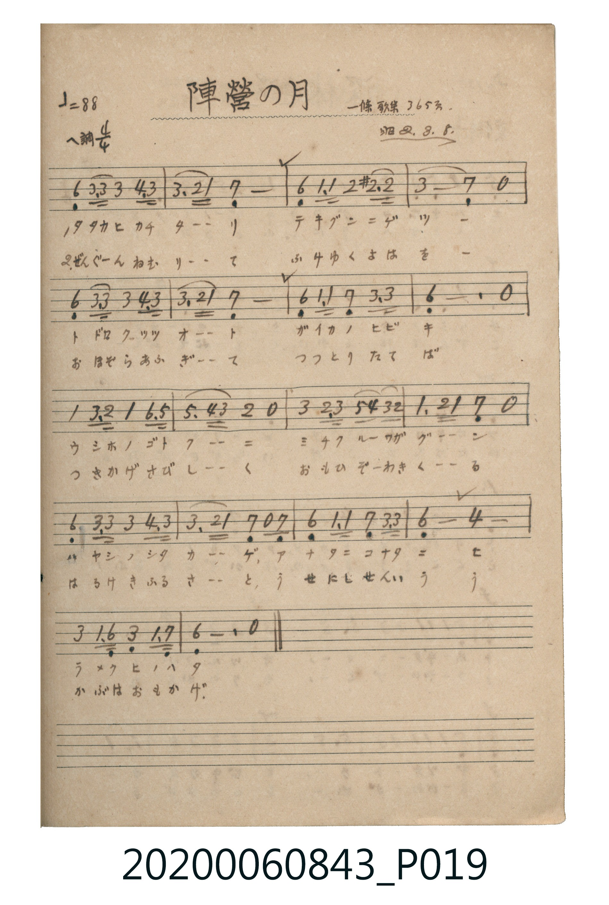

# 陣營の月（軍營之月）

> Re:Shōka 使用 AI 協助辨識與重建樂譜，可能會有錯誤。歡迎回報。

<audio controls src="jinei_no_tsuki.mp3"></audio>

- 出處：一條歌集 365頁（昭2.3.8）
- 《唱歌帖》（2020.006.0843）P019.jpg

## 說明

> [!NOTE]
> **原書資訊與歌詞全文**（對應 `P019.jpg`）：
> - **調性與拍號**：ヘ調 4/4 拍（關係小調 D 小調，`?= F` 記法下以 `6_` 為終止音），♩= 88
> - **頁首註記**：`一條歌集 365頁.` / `昭 2. 3. 8.`（抄自一條慎三郎編《新編 小學校・公學校 唱歌教材集》高等科一・二學年第 14 首〈陣營の月〉，原書 pp. 364–365）。
> - **抄本記譜特徵**：
>   1. 第 3、7、15 小節第 2 拍，原刊本五線譜為四分音符加八分音符連音線再接十六分音符（`1 - - 1`），楊金土簡譜直接記為附點八分音符加十六分音符（`1. 1=`，時值相同）。
>   2. 第 10 小節原刊本為低音 `5_. 4_= 3_ 2_ 0`，楊金土手抄時漏點 `4 3 2` 下方低音點（記作 `5_. 4= 3 2 0`）。
>
> **一、**
> タタカヒ カチタリ テキグン ニゲツ
> トドロク ツツオト ガイカノ ヒビキ
> ウシホノ ゴトクニ ミチクル ワガグン
> ハヤシノ シタカゲ あなたに こなたに
> ヒラメク ヒノハタ
>
> **二、**
> ぜんぐん ねむりて ふけゆく よはを
> おほぞら あふぎて つつとり たてば
> つきかげ さびしく おもひぞ わきくる
> はるけき ふるさと うせにし せんいう
> うかぶは おもかげ


## 歌詞

```text
（TMD 檔案未包含歌詞註解）
```

## ABC

```abc
X:1
T:陣營の月（軍營之月）
M:4/4
L:1/16
Q:1/4=88
K:F
V:V1 name="Piano" snm="Pia"
[V:V1]
!mf! D4 A3 A A4 B3 A | A4 G2 F2 E8 | D4 F3 F G4 ^G3 G | A8 E4 z4 |
w: タ タ カ ヒ カ チ | タ _ _ リ | テ キ グ ン ニ ゲ | ツ _
D4 A3 A A4 B3 A | A4 G2 F2 E8 | D4 F3 F E4 A3 A | D12 z4 |
w: ト ド ロ ク ツ ツ | オ _ _ ト | ガ イ カ ノ ヒ ビ | キ
F4 A3 G F4 D3 C | C4 B2 A2 G4 z4 | A4 G3 A c2 B2 A2 G2 | F4 G2 F2 E4 z4 |
w: ウ シ ホ ノ ゴ ト | ク _ _ ニ | ミ チ ク ル _ ワ ガ | グ _ _ ン
D4 A3 A A4 B3 A | A4 G2 F2 E4 z2 E2 | D4 F3 F E4 A3 A | D8 B8 |
w: ハ ヤ シ ノ シ タ | カ _ _ ゲ ア | ナ タ ニ コ ナ タ | ニ ヒ
A4 F3 D A4 F3 E | D12 z4 | !mf! D4 A3 A A4 B3 A | A4 G2 F2 E8 |
w: ラ メ ク ヒ ノ ハ | タ | ぜん ぐ _ ん ね む | り _ _ て
D4 F3 F G4 ^G3 G | A8 E4 z4 | D4 A3 A A4 B3 A | A4 G2 F2 E8 |
w: ふ け ゆ く よ は | を _ | お ほ ぞ ら あ ふ | ぎ _ _ て
D4 F3 F E4 A3 A | D12 z4 | F4 A3 G F4 D3 C | C4 B2 A2 G4 z4 |
w: つ つ と り た て | ば | つ き か げ さ び | し _ _ く
A4 G3 A c2 B2 A2 G2 | F4 G2 F2 E4 z4 | D4 A3 A A4 B3 A | A4 G2 F2 E4 z2 E2 |
w: お も ひ ぞ _ わ き | く _ _ る | は る け き ふ る | さ _ _ と う
D4 F3 F E4 A3 A | D8 B8 | A4 F3 D A4 F3 E | D12 z4 |
w: せ に し せ ん い | う う | か ぶ は お も か | げ
```

## TMD 檔案連結

- [主旋律 TMD 檔案](jinei_no_tsuki.tmd) [[在 TMD Studio 編輯](https://tmdlang.github.io/Tmd-TS/#tmd=s7IKdvYPcrWy4qpTUCpJTLdSSM7PyUlNLsnMz7MqzsjPTkzOyFeCS5bl55TmploBqXgDC4RwcX5pUXJqfEFieqpVgIGhJboM3KT4vPyS1KT8_GyEioKi_LLUvMQ8oKrcxLzS4uSizIKS-OT8gkqEmtSyzJRUkIri5MS8-LLUosy0zNQUJGelFhWDHQxxR0lRYh7EHKAgQlV-UUlGfnpRYkFGpVVGZnFJflFmcmJOfHZiXiJCUUlGKtCDeYklpUWp6KK5mTmZJYlFQIdpaSm8nLn4efv8x43rns3peL-n48XuXiD3yc5uMLdTQUuLS9FWwcKCy95WwY3LxkTfxA5k2tP2XS9mTn2_Z9aTHQ3PFs19trbn5ew2BWMz05cLGoGmPJux1kjPWM8CaALY8scNXU-nbASqerpj2uOGbqAKIwMjAz0DAzM9AwsTY6AyUHDrZRWkK3Fx6Wsp2FILcCkoKNgpRCv6-Ye4xkI4WlpP--Y_m73jxeb2Fyu6XnS0A531YuW8p60rnk1r19ICuu3pht5n7Z0KCTA3JQDdB_QqRLsu0IAXq_Y_a1gO0trd-2LmfJCmWY-bZwCFFYABpAAUBZrycvqcJ_ubnm7oBwm7KEAY7_f0JIBCMkHhxYoZzzZPfbKj-8nupQoJZvEJCs-bdj3f2vRs7aKX8zeDbex5NHMlOOzhFgND9-WyaS9W7AbqBtuagCX89RIU9BUSgFGgYKSnYKynYKEH9EDHs66WF-2roMpb-57s6HzZ3Pd8-wpg1DybtgHIALnw6dodzxYsfNy8-2nrGghbARJvz6bOfDZ3AtAOYOy9XD3j-drO58snAg0DKn2yqweo9OnOLc_XrFEwNFEAOvBxQwdysnrcAPIMJNQVCgqAjjIzedQwGehaoDcfNzQh_Ad05LM5a4Cee7F2zvPOnU_3bQX7EqJAQcFQTwFkifHjhkZzIDY0Bbn5-foGkKARJNhB1jzt6AKa8mTXlOfbZ4EMatr1dPbspx1twHB9vmbZ064FT1tXw7kvGxaDGNtnPW3rfda39Glv49PWtXBZYMAlGAKdpqtgCEkFPc-Wdr1sn_h0zvznGxaCDJ-9BagL6GKgLS9ntrzcDUxICMNBdmExUE_B0BZoXM-zmU1PG_Y8n73j6YQe5KBQAMUcODgNoD6E-wpozZO9fUCzFBJM4_UUTOJtFYzjFYziFQzABsIc96yzGxSWM5ue7ekHukkhwUTBWMEoQQGY3p5N2wkxASgOyvArZjzZOwdqGtAwYECCjII7BpZpQJHd0AgsDsD8x037wWj14-ZJQA6QagTxm1cpPG5ue9y09nHThsfNm4Gc7sdNmx43t0B1NXc8bu583AyUXg_ktIBQ0yqgKNCINY-bloAN6gPKTHrcPBloCsyuZY-btj9ung2Wa9oCMqVpPdBooML5YIuBnNVAznqwKSCLYdb1P24GGgrUC9K4Heripk0KjxubHjeuetwITKBAjY2T4RyYRqADVj5uXghxJ5DTBzKraT9qiOzqQQ6RxjmPm4AGTQCSQA7Qiw2Pm7oeNy4DcrY-bpz4uKntcWM_0BkdjxuBDp0E0wVUsvtx47zHTZ0QVwHV9kF0LQGjFUBTgByg45Y9btwA0wWU6H3c2P24ERj6jVMfN25-3DgdbDzQvCagKZuARgLt6gcrA7q8G6YRaDVQ10SgONhdIA5Q-wogB-i82cAQABoE5MwG-6UFKArTCJQGqt0GNAFuCch6kDTlxTQUKGjpc3F5ZealZvrlhxSXZmdaBWQm5uU71BjUKFSDbFKwMTTTAkeAQnVuWi2Yga26AGUeYIJ9sbBHQcMEmoV0FGDluSYWDUCbQYbVKJjFg7O7LjAnQEgIratgAuXXwEWMQMUCEJvDtMAgkinQwgOsFqxHHUYhzIFBuDkGMHPAbvIxrAHlN6gYjAVMyaCkCRddDaGbG4EGI1TDIChnorsRmFPhutdC6Q1A0c1wPd1Q0U1g1S1oJsAgzNVQ1xoB1YLzAsyYxglwaxBiMAsbwM7tQncuMANgOLdxK1x2IlR3G5DdDze9Ayq7HmwmLGhwOxd_8tnVM4iSD1wNzFgkNegQS-oBlrDQQGruhNJrgUG0Hi4KiVsQDQo69LSC0I9wIrCshck2LYHSoBTZB9cDiQBgSQ5WvRaHa7GlHlhyABaNUBpUmEFcDuI1Qemt4GQBsxHuWqyJB-JGkCzUtaBCD57wgAUsXC9I9QaCriVQ9nSSk3ggsQ2LZCM4HxrVpvFANUACIghKUCCFsJIFHu0oCQykxhRNNcIijCSIreSBhSawBoXQzbOR47lpC1S0AxzPsDQFjw1oKYIUdqB6Gy7bCDUFVNFCyjCQKMgUSAoDmYkeG4gyClvqQcR0L5QGthSAFSVMdCqU3gyO6enoZsMLFCT3IlJkEyztgRoR8-CiID0Q-0CqYSbAzWzCCAP86QfYXqV34QOKeTCHzNIHYgUCIpc-8CK6GVZSbEdJQdB0Bay1QLENSwWI0NsEZYHsfNy0COzIx82IOIHWiKAWYROi9oLIQ02Fp0K4qfC6E83F4DQELxmhMQeqcmDpCVLywGRBqiEpCslsYNmC5OJGUD0LUjcbLg-trSFtLbhdkOoR2O4Cq4bVzghT0UUIVmFTwKnIiLRUBEsikNgHRjSqADAxkFj5rIR5oHkh1KPgVjVcFJIQQMkEW9MFBrFldVikAhumUBrcOoWJwjMrJJoItwhqubh07RSQW6DRPoaxChhiRmAxZS4A)]
- [鋼琴伴奏 TMD 檔案](jinei_no_tsuki_piano.tmd) [[在 TMD Studio 編輯](https://tmdlang.github.io/Tmd-TS/#tmd=s7IKdvYPcrWy4tLSUng5c_Hz9vmPG9c9m9Pxfk_Hi929QO6Tnd1A7uPm3S-79zyfsOXJni1Pl_Y_7wQq6FTQ0uJStFWwsOCyt1Vw47Ix0Tex46pTUHravuvFzKnv98x6sqPh2aK5z9b2vJzdpmBsZvpyQSPQ3Gcz1hrpGetZAE1QAil_3ND1dMpGoKqnO6Y9bugGqjAyMDLQMzAw0zOwMDEGKgswMLTUyypIV-Li8srMS830yw8pLs3OtArLT07McagxqFGo5lIAAhtDMy07MKs6N60WzKhRMItX0AVDYygJoXUVTKD8GriIERAbArE5TAsMIpkCkgeRILVgPeowCmEODMLNMYCZA3aTj2GNwuOm_VAxGOtx02qFx82T4KKrIXRzI9BghGoYfNy8CsONj5vb4LrXQukNQNHNcD3dUNFNYNUtaCbAIMzVUNcaAdU2znncNBlmTOMEuDUIMZiFDWDndqE7t3EZpnMbt8JlJ0J1twHZ_XDTO6Cy68FmwoIGv3NpFuFwNTBjkdSgQyzx3QzxDCgWOqH0WqCn1sNFIbEBokGeRY9dhH6EEx83rYHJNi2B0qA01AfXAwmyx82TwarX4nAttviGReDjxt1Qeh7QBIjLQbwmKL0VHJEwG-GuxRrdEDeCZKGubVyBlFQeN86H6wWp3kCUa2ug8QOLFiM4Hxo5pvFANUACIghKAiCFsNwLjyiUJAFSY4qmGmERRqLBlrth_n_ctB1CN89GjpmmLVDRDnDMwFIBPPygORXJt0AxSPhAygSIKeuBbEg5ARIFmQJJEyAz0cMPUQ5gi29E3PRC6W4ghpdGjVOh9GZw3ExHNxueaZHci0hDTbDUsgmcjmCiID0Q-0CqYSbAzWzCCAMqZHBQXIE5ZOZwiBUIiJzD4QVXMyw3bkeJc2hKAJbloPiBxRvCv5ugLJCdj5sWgR35uBkRitB6Apg2HjchynSIPNRUeLqBmwqvUdBcDI51eOkDDWtQQQxLAZDcDZMFqYakASSzgfkXycWNoNoHpG42XB5ahwHTC5IotNJ43Agu6cC6UE1FF4HFOyxSIfEFjBpUAWD0kVgkr4RZ2bwQ6jRQhoInemjUgSIWWxUMg9iyEywaHjdug9JAk7FkCEjAEq7ZatFaPgGZiXn5QR5Et30MtWFpGsYCiSHyC0IUlmNM1eO18VWLZvHa6E0hoBByawhkApEtInq5FEUphAO3Dpi-4rXhajEhuotNEUphbjJCFsRa_wDtg1UqQCZmLYTwHVwaFBCYlRGSQ7GGA63CF1v5SWEAg4SgDkBAhLuBkhgZH8VklPxPbBxizVA-uDJUASJDgTxnDCKwM40QfFyqjcFM83ioCKLGJGgimAlRi8MQBAszAdDH5SZgpiEuZyHUQs1Gz7jo7gabZIowFDsTbDUon8F9gsFEMRzZACSVYFEwC2wgRAaL94zQQoB2gQ0zHcIjL6Th5oIgxOnQgIdwkF0OjxcspmKPeCJjE5jhdO0UkPNctI9hrAKGmBFYTJkLAA)]

## 分析

```text
================================================================================
📊 TMD Song Profile: [ 陣營の月（軍營之月） ]
================================================================================
⏱  Duration:       1:38 (98.2s), 36 measures total
🎼 Key & Tempo:    首調基準 F, != 88.0 BPM, <4/4>
   - 分析範圍：      由實際發聲的音符與和弦推測調性；播放脈絡另行呈現
🎤 人聲音域:    C4 (MIDI 60) – C5 (MIDI 72) [跨度: 12 個半音 / 1.0 個八度, 難度: easy]
   - 最低音:  C4 in [JineiNoTsuki[L1] #1 @ m.9, 0:24]
   - 最高音: C5 in [JineiNoTsuki[L1] #1 @ m.11, 0:28]
   - 適合: soprano, mezzo-soprano, contralto, tenor, baritone, bass
🏛  結構:      JineiNoTsuki[L1] (49.1s) -> JineiNoTsuki[L2] (49.1s)
⚡ 編曲密度:        Peak 1 軌道同時演奏
🗝  調性診斷：       D 小調（純淨自然小調，未偵測到可信轉調）
   - 風格氣質:    純淨自然小調（陰鬱抒情、旋律集中，無明顯調外色彩）
   - 轉調歷程:    全曲維持單一推測調性（未偵測到可信轉調）
   - 核心骨幹音:  A, D, E, F, G
   - 調性數值:    D 小調 [相關度: 0.84, 穩定度: High, 自然音純度: 98.5%]
   - 候選調性 (K-S): D 小調 (0.84), A 小調 (0.63), D 大調 (0.63)
   - 五度圈歷程:   +2 -> +2
   - 各段落調性細節:
     • [JineiNoTsuki[L1] #1]: D 小調 (r: 0.84, 自然音純度: 98.5%, 調外音: G#)
     • [JineiNoTsuki[L2] #1]: D 小調 (r: 0.84, 自然音純度: 98.5%, 調外音: G#)

  [ 五度圈游移軌跡 ]
               C  
         F            G  
      Bb              [D ]*
      Eb               A  
         Ab           E  
            Db       B  
               F# 
     (* = active key center)

  [ 十二半音累積音高分佈 ]
     C  : ██                         2.6%
     C# :                            0.0%
     D  : ███████████████████       22.6%
     D# :                            0.0%
     E  : ████████████              14.7%
     F  : ████████████              14.3%
     F# :                            0.0%
     G  : ███████                    8.3%
     G# : █                          1.5%
     A  : ████████████████████████  28.2%
     A# : ███████                    7.9%
     B  :                            0.0%
--------------------------------------------------------------------------------
Assignment 軌道音域：
  - Piano         : C4 – C5 (12 個半音 / 1.0 個八度, 164 個音符)
================================================================================
```


## 原書掃描頁




