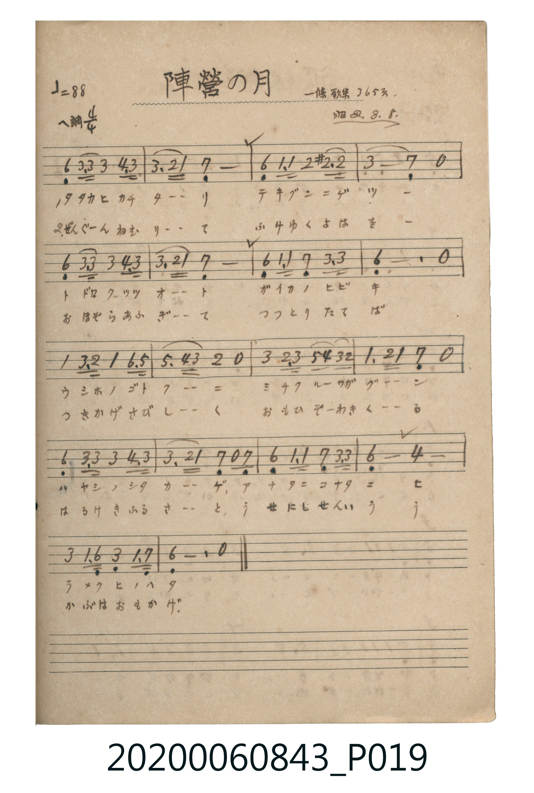

# 陣營の月

<audio controls src="jinei_no_tsuki.mp3"></audio>

- 出處：一條歌集 365頁（昭2.3.8）
- 《唱歌帖》（2020.006.0843）P019.jpg

## 說明

原書資訊與歌詞全文（對應 P019.jpg）：
調性與拍號：ヘ調 / イ短調 4/4 拍（A 小調 4/4 拍），♩=88
註記：一條歌集 365頁 / 昭2.3.8

## 歌詞

```text
一、
アレミヨ タカネニ テルツキノ
カゲモ サヤカニ フケワタル
ツワモノ ネムル ジンエイノ
カガリビ スゴク モエノコリ
コマノ イナナキ サビシクテ
シモオく ジンヤニ カゼサムシ

二、
イクサノ ニハニ タツ身ニハ
イノチハ カロシ クニノタメ
アスノ タタカヒ マツヨハノ
ユメヂヲ テラス ツキノカゲ
ふるさと とほく おもひやり
はるかに をがむ おほみいつ
```

## ABC

```abc
X:1
T:陣營の月
M:4/4
L:1/16
Q:1/4=88
K:F
V:V1 name="Piano" snm="Pia"
[V:V1]
!mf! D4 A3 A A4 B3 A | A4 G2 F2 E8 | D2 F2 F4 G2 ^G2 =G4 | A8 E4 z4 |
D4 A3 A A4 B3 A | A4 G2 F2 E8 | D2 F2 F4 E2 A2 A4 | D12 z4 |
F4 A3 G F4 D3 C | C4 B2 A2 G4 z4 | A4 G3 A c2 B2 A2 G2 | F4 G2 F2 E4 z4 |
D4 A3 A A4 B3 A | A4 G2 F2 E2 z2 E4 | D2 F2 F4 E2 A2 A4 | D8 B8 |
A4 F3 D A4 F3 E | D12 z4 | !mf! D4 A3 A A4 B3 A | A4 G2 F2 E8 |
D2 F2 F4 G2 ^G2 =G4 | A8 E4 z4 | D4 A3 A A4 B3 A | A4 G2 F2 E8 |
D2 F2 F4 E2 A2 A4 | D12 z4 | F4 A3 G F4 D3 C | C4 B2 A2 G4 z4 |
A4 G3 A c2 B2 A2 G2 | F4 G2 F2 E4 z4 | D4 A3 A A4 B3 A | A4 G2 F2 E2 z2 E4 |
D2 F2 F4 E2 A2 A4 | D8 B8 | A4 F3 D A4 F3 E | D12 z4 |
```

## TMD 檔案連結

- [主旋律 TMD 檔案](jinei_no_tsuki.tmd) [[在 TMD Studio 編輯](https://tmdlang.github.io/Tmd-TS/#tmd=s7IKdvYPcrWy4tLSUng5c_Hz9vmPG9c9m9OhoKXFpWirYGHBZW-r4MZlY6JvYsdVp6D0tH3Xi5lT3--Z9WRHw7NFc5-t7Xk5u03B2Mz05YLG93s6ns1Ya6RnrGfxfk-nEkj544aup1M2AlU93THtcUM3UIWRgZGBnoGBmZ6BhYkxUFmAgaGlXlZBuhIXl76Wgi21AJeCgsLTvvnPZu94sbn9xYquFx3tQFe8WDnvaeuKZ9PagQ55uqH3WXunAsx-oFOAvgJpe7Fq_7OG5SAN3b0vZs4Hij5ungEUVNBXeNy05Pn8tSA2MDwUgPJAcxwVnm7oRxECGtTzaOZKW2DggYxbsfvFihnYQwxoJCzEuEBqgUoeNzSCWI-bFj1uXvO4ef7j5hVAzv7HTasfN_c-bu5WeNzc9rgZyGl53LT2cXMfRPHqx02bHjcvArK2Pm5eAlYMUjn1cdPGx83rQfqbV4NVArUB-c1Aw_uAHKCBC4AyQG07Hjdvfty0AuhBZDOBDlj1uHkykLPzcdOWx03rgXoWgZQ19z1u2gyUhKgEsuaBDQTp7gKhprUQp0x-3LQdqA3oZojK7WD9qx439sPsBLoW5FSQbXvAWhYAVUECY1cPPDCAXgL6AigLcnX34-Z-iCagt1pe7AJ5FigEUwl0W3MjkA82tHkt0DggC-gEoBqgq4FaFsICGOgrsKuBoQsJ4ElA04E-AYYR0ItAOyAh0bwMqOdxc9Pj5k2Q0F8J1AkOSnAMQEIfrLJx6-Om7seNUx83AiOtccXjxt1gnzYCA6TpceOmx01ALV0QlUDvAFUCESj0Jz1u7Hnc1ABWCdKz_3Fjy-PGJSCVlGcFKFDQ0ufi8srMS830yw8pLs3OtArITMzLd6gxqFGoBtmkYGNopmUHZlXnptWCGTUKZvEKumBoDCUhtK6CCZRfAxcxAmJDIDaHaYFBqCkgORCGqTVShzIgamDGwCDcGAOYEto6CawGpBGmGckmdIjuJJgZEK1GcD7UANN4oBoggXAmSCHM63DDUJwNUmOKphphEYbHqBVIIHPghpIZShArkAIb6iaYFohZQG2oAkCjiQryWi4uXTsF5KSsgIWvzAUA)]
- [鋼琴伴奏 TMD 檔案](jinei_no_tsuki_piano.tmd) [[在 TMD Studio 編輯](https://tmdlang.github.io/Tmd-TS/#tmd=s7IKdvYPcrWy4tLSUng5c_Hz9vmPG9c9m9Pxfk_Hy-49zydsebJny9Ol_c87gSKdClpaXIq2ChYWXPa2Cm5cNib6JnZcdQpKT9t3vZg59f2eWU92NDxbNPfZ2p6Xs9sUjM1MXy5oBBr0bMZaIz1jPQugCUog5Y8bup5O2QhU9XTHtMcN3UAVRgZGBnoGBmZ6BhYmxkBlAQaGlnpZBelKXFxemXmpmX75IcWl2ZlWAZmJeflBHg41BjUK1VwKQGBjaKZlB2ZV56bVghk1CmbxCrpgaKhtDKaN4SyQmAlUrAZJ1AgkA8Sm6vHa5jDtMAg1ESRvFq8NomBajNQhYiA2RCXIAJihMAg30ACmjK4OhSs1hzgNwoebWKNgHK-NpBwdojvaFKEU5iwjZEGop0zjwWqhgkD7QL4BKQcyYcEFNxrJg3BpUFiYAmmYPpAoyIMoEYARFLQIYpCZcAuoGsYgIagbkGIR7nSgJNypUPXoJkPEgVYTH4212HKVD65cVYDIVSD_GYMI7EwjBB-XamMw0zweKoIcpgRMBDNhQYnVEAQLMw3Qx-UmYKYhLmch1ELNRs--6O4Gm2SKMBQ7E2w1KKvBfYLBRDEc2QAklWBRMAtsIEQGi_eM0EKAdoENMpnSkIabC4IQp0MDHsJBdjk8XrCYij3iiYxNYIbTtVNAznMKWPjKXAA)]

## 分析

```text
================================================================================
📊 TMD Song Profile: [ 陣營の月 ]
================================================================================
⏱  Duration:       1:38 (98.2s), 36 measures total
🎼 Key & Tempo:    首調基準 F, != 88.0 BPM, <4/4>
   - 分析範圍：      由實際發聲的音符與和弦推測調性；播放脈絡另行呈現
🎤 人聲音域:    C4 (MIDI 60) – C5 (MIDI 72) [跨度: 12 個半音 / 1.0 個八度, 難度: easy]
   - 最低音:  C4 in [JineiNoTsuki #1 @ m.9, 0:24]
   - 最高音: C5 in [JineiNoTsuki #1 @ m.11, 0:28]
   - 適合: soprano, mezzo-soprano, contralto, tenor, baritone, bass
🏛  結構:      JineiNoTsuki (49.1s) -> JineiNoTsuki (49.1s)
⚡ 編曲密度:        Peak 1 軌道同時演奏
🗝  調性診斷：       D 小調（純淨自然小調，未偵測到可信轉調）
   - 風格氣質:    純淨自然小調（陰鬱抒情、旋律集中，無明顯調外色彩）
   - 轉調歷程:    全曲維持單一推測調性（未偵測到可信轉調）
   - 核心骨幹音:  A, D, F, E, G
   - 調性數值:    D 小調 [相關度: 0.83, 穩定度: High, 自然音純度: 99.2%]
   - 候選調性 (K-S): D 小調 (0.83), A 小調 (0.65), D 大調 (0.58)
   - 五度圈歷程:   +2 -> +2
   - 各段落調性細節:
     • [JineiNoTsuki #1]: D 小調 (r: 0.83, 自然音純度: 99.2%, 調外音: G#)
     • [JineiNoTsuki #2]: D 小調 (r: 0.83, 自然音純度: 99.2%, 調外音: G#)

  [ 五度圈游移軌跡 ]
               C  
         F            G  
      Bb              [D ]*
      Eb               A  
         Ab           E  
            Db       B  
               F# 
     (* = active key center)

  [ 十二半音累積音高分佈 ]
     C  : ██                         2.6%
     C# :                            0.0%
     D  : ████████████████          20.3%
     D# :                            0.0%
     E  : ███████████               13.2%
     F  : █████████████             16.5%
     F# :                            0.0%
     G  : ███████                    9.0%
     G# : █                          0.8%
     A  : ████████████████████████  29.7%
     A# : ██████                     7.9%
     B  :                            0.0%
--------------------------------------------------------------------------------
Assignment 軌道音域：
  - Piano         : C4 – C5 (12 個半音 / 1.0 個八度, 164 個音符)
================================================================================
```


## 原書掃描頁




