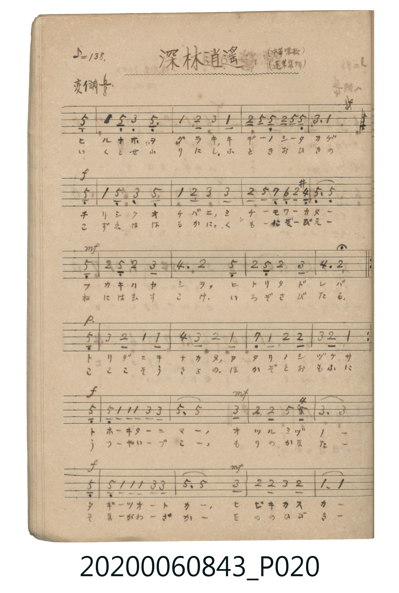
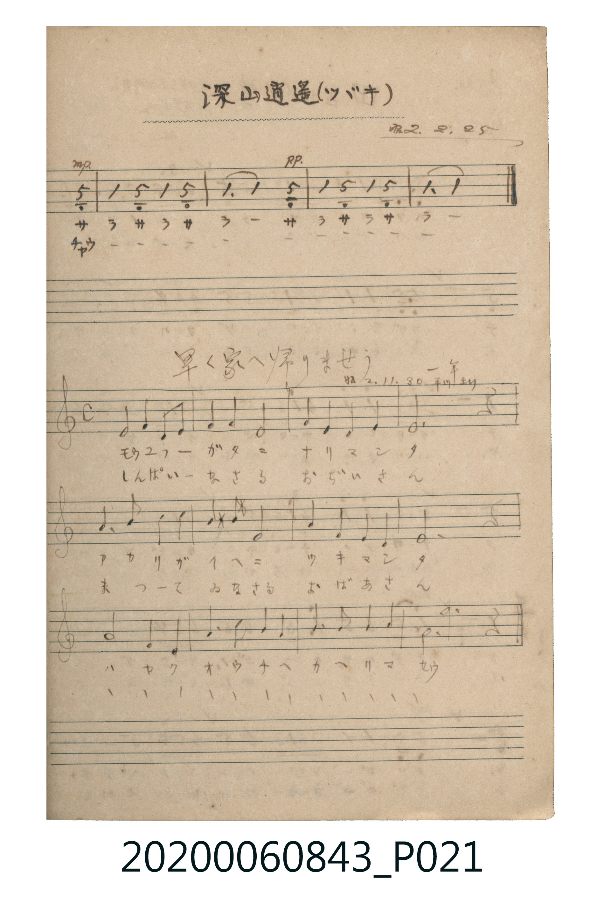

# 深林逍遥

<audio controls src="shinrin_shoyo.mp3"></audio>

- 出處：中華唱歌 / 蓬莱集ヨリ（昭2.2.25）
- 《唱歌帖》（2020.006.0843）P020.jpg–P021.jpg (top)

## 說明

原書資訊與歌詞全文（對應 P020.jpg – P021.jpg 上半）：
調性與拍號：変イ調 6/8 拍（Ab 大調 6/8 拍），♪=138
註記：(中華唱歌) (蓬莱集ヨリ) / 深山逍遥(ツゞキ) 昭2.2.25

## 歌詞

```text
一、
コダチ ノ オク ニ カゼ キヨク
ミドリ ノ カゲ ニ トリ ウタフ
イザ ヤ トモドチ テ ヲ トリテ
タノシキ モリ ヲ タヅネ ミン

二、
こずゑ を もるる ひ の ひかり
しばふ の うへ に あや を おる
こころ も きよき やま の なか
けふ の ひとひ を あそび てん
```

## ABC

```abc
X:1
T:深林逍遥
M:6/8
L:1/16
Q:3/8=92
K:Ab
V:V1 name="Piano" snm="Pia"
[V:V1]
!mf! z2 z2 z2 z2 z2 E2 | A2 E4 C2 E4 | A2 B4 c2 A4 | B2 E2 E2 B2 E2 E2 |
c6 A4 E2 | !f! A2 E4 C2 E4 | A2 B4 c2 c4 | B2 e2 G2 F2 B2 =D2 |
E6 E4 E2 | !mf! B2 E2 B2 c6 | d6 B4 E2 | B2 E2 B2 c6 |
d6 B4 E2 | !p! c2 B4 A2 A4 | d2 c4 B2 A4 | G2 A2 B2 B6 |
c2 B2 A6 E2 | !f! e2 A2 A2 A2 c2 c2 | e6 e4 c2 | !mf! B4 B2 e2 d2 B2 |
c6 c4 E2 | !f! e2 A2 A2 A2 c2 c2 | e6 e4 c2 | !mf! B4 B2 c4 B2 |
A6 A4 E2 | !mp! A4 E2 A4 E2 | A6 A4 E2 | !pp! A4 E2 A4 E2 |
A6 A4 z2 |
```

## TMD 檔案連結

- [主旋律 TMD 檔案](shinrin_shoyo.tmd) [[在 TMD Studio 編輯](https://tmdlang.github.io/Tmd-TS/#tmd=s7IKdvYPcrWy4tLSUni2feOzedNfNvS-bFyqoKXFpWirYGhswWVvq-Cow2Vjpm9hx1WnoPS0fdeLmVPf75n1ZMfaF_3rn07Z-Gxtj4K-wovJa170bXw5u-1x84rHzave7-l4NmOtkR4Qmr7f06kE0vq4oQui_OmOaY8buoFKjAyMDPQMDMz0DCxMjIHKAkD8rIL0Rw2TgUxDEFNBoyS_QFOJi0tfS8GWWoBLQUHhad_8Z7N3vNjc_mJF14uOdqCzXqyc97R1xbNp7UCXPd3Q-6y9UwHmIAWgi0AciJOe7Oh62tsFdC8wGEBGvVi1_1nDcpAh3b0vZs4Hij5d0vm4aQlQXAEYbgpAYaCRjkkKT5csRxEDGtDzaOYqW1A4g8xZsfvFihlA7RrIgaupoIEWuJrA8AbG1tONGyGxpfG4ueVx07zHTWs1FeChzgUy8cmOhscNjSDW46bNj5sbHjc3Kjxu7gPyVj1uWg9kdgOZqx837QFSa0GGN60HK26e_7i5E2gTVDFQxSaI4uYOsGjTssdN-x83T4WYvORx0zag1BKI9CKwVpA9bUAM0gfSA-RBFAO19T1u2g60DygDVAuyA6gIJN76uLkXYvdmiOt39cBc3zj5ceOsx00TgQonAXHT46ZuIAKKA7U2rgPRjxuBIl0QxdMfN2543LgVKtX2uHEHkFoNxEB9LRAjGruA-uFGT37cBLS5qQnI633c1AEkgbyWx437oEasApoOUTwRYS7QyhVgB4DNa3rcOPdx42YgCxg2k0GKKU-nUKCgpc_FFZyRmVeUmReckV-ZbxWQmZiX71BjUKNQDbJJwcZCyw7MqM5NqwUzahQM4NA0Hsg1BFG6CsbxEBokYATiA2kQzwgkDEQwugYoowuEIFkQF2I63HCcpoF0gU1TMI9XMAOZZ6IOMg2sDGwUsnkI14LtNYJaWqNgAqZBRoLdglcWYlQBzCRjsIQh1F8mYE1GUB7QTSCHghSAuCClIAmsXjQFm2EI9hOIB1YG9iMWx4OsMAVaZgQPOBBJDVMhzgcFMGZ05MI9DRWHSWNVXUCEagOg4louLl07BeT0pgDkK3MBAA)]
- [鋼琴伴奏 TMD 檔案](shinrin_shoyo_piano.tmd) [[在 TMD Studio 編輯](https://tmdlang.github.io/Tmd-TS/#tmd=s7IKdvYPcrWy4tLSUni2feOzedNfNvS-bFz6fk_Hy-49zydsebJny9Ol_c87O97v6VTQ0uJStFUwNLbgsrdVcNThsjHTt7DjqlNQetq-68XMqe_3zHqyY-2L_vVPp2x8trZHQV_hxeQ1L_o2vpzd9rh5xePmVUBTn81Ya6QHhKZA85RAWh83dEGUP90x7XFDN1CJkYGRgZ6BgZmegYWJMVBZAIifVZD-qGEykGkIYipolOQXaCpxcQVnZOYVZeYFZ-RX5lsFZCbm5Qd5ONQY1ChUcykAgY2Flh2YUZ2bVgtm1CgYwKFpPJBrCKJ0FYzjITRIwAjEB9Ignnm8thFIBoiQmEBV2sZAeV2wKpAAxBa4JThMBemC6ISZDKQUzOKBkibqIGPN44Gi8dpgTWCDkU1H-AHmFCO4O8BiJmAmWBKij2iFEAsK4M4HKoZIaRtCA8IMpAtkBFAMaBpYDMgEOh_kNahRIEGQTrA-qA_Qg8ZY2xSoBQyhoQERAymH0EARrB7WhVhkqmACZCBFAZimhU0gc0E2IXkHzECKEniQGcOlECy4KCgloOksIKwTbi2CbQDUXost2fvgSPZwWxDJHmiGgiEoYYIsBEYfgolbHMQyAmUBII3MRtcBcSFakJJqmRGQNAOZDmKgcGAOQbgE1Uq4b5HdiNcjYN0kKkePQFz-MIEIgF1P79AkGCqD3F7kwAXlCKg8iIFPFzHaDJG1ATOTrp0Ccn5SAPKVuQA)]

## 分析

```text
================================================================================
📊 TMD Song Profile: [ 深林逍遥 ]
================================================================================
⏱  Duration:       0:37 (37.8s), 29 measures total
🎼 Key & Tempo:    首調基準 A,, != 138.0 BPM, <6/8>
   - 分析範圍：      由實際發聲的音符與和弦推測調性；播放脈絡另行呈現
🎤 人聲音域:    C4 (MIDI 60) – D#5 (MIDI 75) [跨度: 15 個半音 / 1.2 個八度, 難度: moderate]
   - 最低音:  C4 in [ShinrinShoyo #1 @ m.2, 0:01]
   - 最高音: D#5 in [ShinrinShoyo #1 @ m.8, 0:09]
   - 適合: soprano, mezzo-soprano, contralto, tenor, baritone, bass
🏛  結構:      ShinrinShoyo (37.8s)
⚡ 編曲密度:        Peak 1 軌道同時演奏
🗝  調性診斷：       G# 大調（純淨自然大調，未偵測到可信轉調）
   - 風格氣質:    純淨自然大調（陽光明朗、易唱易記，無明顯調外色彩）
   - 轉調歷程:    全曲維持單一推測調性（未偵測到可信轉調）
   - 核心骨幹音:  D#, G#, C, A#, C#
   - 調性數值:    G# 大調 [相關度: 0.87, 穩定度: Moderate, 自然音純度: 99.4%]
   - 候選調性 (K-S): G# 大調 (0.87), D# 大調 (0.77), C 小調 (0.61)
   - 五度圈歷程:   -4
   - 各段落調性細節:
     • [ShinrinShoyo #1]: G# 大調 (r: 0.87, 自然音純度: 99.4%, 調外音: D)

  [ 五度圈游移軌跡 ]
               C  
         F            G  
      Bb               D  
      Eb               A  
        [Ab]*          E  
            Db       B  
               F# 
     (* = active key center)

  [ 十二半音累積音高分佈 ]
     C  : █████████████████         19.0%
     C# : ████                       4.8%
     D  : █                          0.6%
     D# : ████████████████████████  27.4%
     E  :                            0.0%
     F  : █                          0.6%
     F# :                            0.0%
     G  : █                          1.2%
     G# : ████████████████████████  27.4%
     A  :                            0.0%
     A# : █████████████████         19.0%
     B  :                            0.0%
--------------------------------------------------------------------------------
Assignment 軌道音域：
  - Piano         : C4 – D#5 (15 個半音 / 1.2 個八度, 111 個音符)
================================================================================
```


## 原書掃描頁






