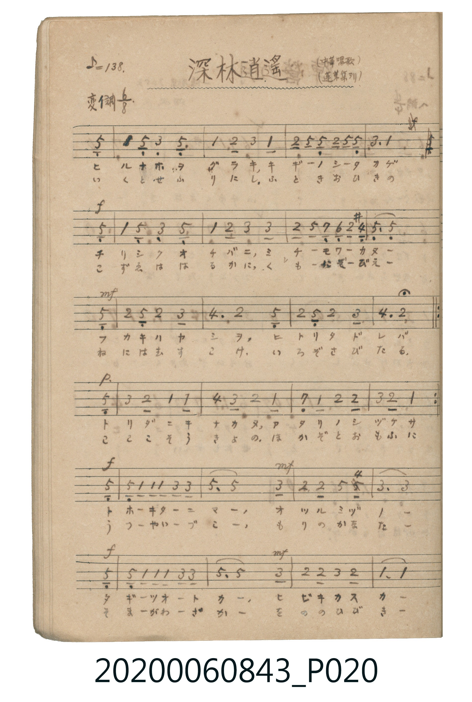
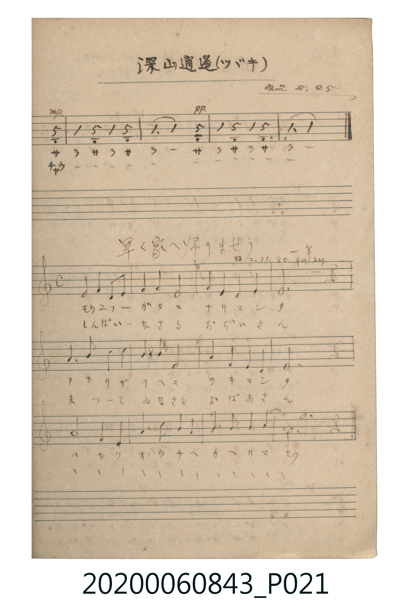

# 深林逍遥（漫步深林）

> Re:Shōka 使用 AI 協助辨識與重建樂譜，可能會有錯誤。歡迎回報。

- **鋼琴伴奏版**：<br><audio controls src="shinrin_shoyo.mp3"></audio>
- **NEUTRINO 歌聲合成版**：<br><audio controls src="shinrin_shoyo_neutrino.mp3"></audio>

- 出處：中華唱歌 / 蓬莱集ヨリ（昭2.2.25）
- 《唱歌帖》（2020.006.0843）P020.jpg–P021.jpg (top)

## 說明

原書資訊與歌詞全文（對應 P020.jpg – P021.jpg 上半）：
調性與拍號：変イ調 6/8 拍（Ab 大調 6/8 拍），♪=138
註記：(中華唱歌) (蓬莱集ヨリ) / 深山逍遥(ツゞキ) 昭2.2.25


## 歌詞

```text
一、
ヒルナホクラキ、キギーノシータカゲ
チリシクオチバニ、ミチーモワーカヌー
フカキハヤシヲ、ヒトリタドレバ
トリダニナカヌ、アタリノシヅケサ
トホーキタニマー、オツルミヅノー
タギーツオートカー、ヒビキカスカ

昼なほ暗き、木々の下陰（ひるなおくらき、きぎのしたかげ）
散りしく落葉に、道もわかぬ（ちりしくおちばに、みちもわかぬ）
深き林を、独りたどれば（ふかきはやしを、ひとりたどれば）
鳥だに鳴かぬ、あたりの静けさ（とりだになかぬ、あたりのしずけさ）
遠き谷間、落つる水の（とおきたにま、おつるみずの）
たぎつ音か、響きかすか（たぎつおとか、ひびきかすか）

二、
いくとせふりにし、ふときおひきの
こずゑははるかに、くもをそびえ
ねにはむすこけ、いろぞさびたる
ここそうきよの、ほかぞとおもふに
うつやいぶこ、もりのかなた
そまがわざか、をののひびき

幾歳古りにし、太き老木の（いくとせふりにし、ふときおいきの）
梢ははるかに、雲をそびえ（こずえははるかに、くもをそびえ）
根には蒸す苔、色ぞ錆びたる（ねにはむすこけ、いろぞさびたる）
ここぞ浮世の、外ぞと思ふに（ここぞうきよの、ほかぞとおもうに）
打つや伊吹（／いぶき）、森のかなた（うつやいぶき、もりのかなた）
杣が業か、斧の響き（そまがわざか、おののひびき）
```

## ABC

<div class="abc-score" data-abc-src="shinrin_shoyo.abc" aria-label="五線譜載入中"></div>

[下載 ABC 原始檔](shinrin_shoyo.abc)

## TMD 檔案連結

- [主旋律 TMD 檔案](shinrin_shoyo.tmd) [[在 TMD Studio 編輯](https://tmdlang.github.io/Tmd-TS/#tmd=s7IKdvYPcrWy4qpTUCpJTLdSSM7PyUlNLsnMz7MqzsjPTkzOyFeCS5bl55TmploBqXgDC4RwcX5pUXJqfEFieqpVgIGRAboM3KT4vPyS1KT8_GwMFRn5RYmZ8WB1xRmlCOmCovyy1LzEPKCS3MS80uLkosyCkvjk_IJKhJrUssyUVJCK1JTMkvyizMQcJBenFhWD_QJxYklRYh7EDKAgQlVJRirQW3mJJaVFqQhRoFHpmXlWJYmZQHeB3FaeGJ-bmJmXk5iXosSlpaXwbPvGZ_Omv2zofdm49P2ejmd7Vj9buxQi-H5Pp4KWFpeirYKZJZe9rYKjDpeNmb6FHcjwp-27Xsyc-n7PrCc71r7oX_90ysZna3sU9BVeTF7zom_jy9ltj5tXPG5eBTJxxlojPSA0BRoHdtfjhi6I8qc7pj1u6AYqMQKGt56BgZmegYWJMVAZKPz1sgrSHzVMBjINQUwFjZL8Ak0lLi59LQVbagEuBQWFp33zn83e8WJz-4sVXS862oHOerFy3tPWFc-mtQNd9nRD77P2TgWYgxSALgJxIE56sqPraW8X0L3AYAAZ9WLV_mcNy0GGdPe-mDkfKPp0SefjpiVAcQVguCkAhYFGOiYpPF2yHEUMaEDPo5mrbA2NLcDmrNj9YsUMoHYN5MDVVNBAC1xNYHgDY-rpxo2Q6NN43NzyuGne46a1mgrwUOcCmfhkR8PjhkYQS-Fx86THzasfN3c9bp79uGn94-aVQPVASRDZtO5x857HzX2Pm7aDGE37Hzetfty0CaqvEWglSAaoqWkVmDvhcXM3SGvzfDAXqHXR42agkUCtQBt6gAyo1qlgg9Y-bu5_3LwEbPomsD6gUzrApu5_3Nz5uHkN0EioDrBwcwPIAqBTIcaBHLkIrBYoBXFk6-OmjY-btiI0zQbbDvQKUBVQ6zwQF6QPqKMF7G-gU1tBumFuA3kS4m1g2AFVARkdYPvA-kAunAw2D-j-nUASHJzA0N3zuHHV48bdz2ZNf9zYC1T5bM6Kxw2tjxvXPdnR_XLmBmA8P27c9LipG6ys63Fj_-OmTohKENnYB1T5uBGod_7jRqCaScA0ADF46uLHTUDlQJn-FxP2vpgI1LQaqOllI9AVTY-b-sHK14CNXwhXCbZh4ePGDRDFjxv3g2WR1UON374RaD0waz9umgRU-Lx7DdgMoCOAqaAHaADY4K1gTUBXAiO6BWQDWDHIP40rMNRDDH65eenjxgVA619u3gKxEqyjCaQWpGPdy7kzHzdOfNwILDKANkCMAakHhw8W9WCPzYJpgVoC0tH7YsP2l9MmA5UDw-dxIzA1dT_bALRzHdRgUFAAnQ50ItDsfWBTgSIgZeBgARoJVAkxD6wKGBNLXs7fDHIEMJjnA5UAdQPVAp0LKprgasDGAI0HJ3hQUAC1IKvshGS0XaBkCjUdGHbA8AfqmQ0KU5C3gE6aDtYPDGKgOFA_UBBoFpCxDqppMsiNTUBvrweHP9B8IILEKjANAaN00uPGuWDbO6A61oLNBaptALsFaMBEsHJgegaaOw8YgGDlwIDtRtgBREBT2kBWNwE9uQ6sYzfYMqAOcDACLQO5czVUE1AtMBSBfgKibSADQNkK6B5IbEES-nyoWqDR-x439oDT3zRomIEcDlQIRNDAg2Slpzv3PVu7-Wk_0GxEAD1dAjSs9wUkW0GjlsjQBCoDhSY8xS9ahBmUL2cDsyYiHMHGg8O9EcggHO5wsxfshAT9i0k7gEH_onsKKFV2Ar0372UPMLiggQ42noRIQiRPSDzNe7YVWKoAgxEUSU-XABmgGHrWAHQNKHpgrgepJCJGgQqAWqAe6ARqAkXqkz1dTyfsBJr0fg8wjCERDKqXQAXbYkikQSMYbBtaUgCXahhJAW7J3MXApPBsKTAEQOng2bTloOIAnNHAhmFLK6CIREkrUMMor_KhQEFLn4srOCMzrygzLzgjvzLfKiAzMS_foUbXsKYa7GwbCy07SAqtUajOTatVMFDQhULTeIUasIyPYY1CPFwYWFnAxI1QxBtbgOJQowwh-o1B0iBzwAJGCsZA0hDIM1IwBQlDqRqwOEgGzVJgTQa2sAuIZ4NZm4CKgTUzmL0SyFoLYgFJkOg6sGgfkLUdLLofLAoyAcTbBJZtRHI6MMWDnb0CiMGmN24F6-gCs1cD8XSEKFAViN0LxBB5sEuAfIjXwXY3TkYEQDUwKPEEgjE0EMzjFcxA4WCiDpIHKoIGPEZArAJ7YjvM802rQNYDvQPy1AQg7gaz5iOJLgJiiNrVYNEepBicihIMs8CqJgJZYPVAEhQMYBMbu8FBAWL1g0WbwGongQo_sOhmcDB0IKUCYGSgJCgjiGdAFMjXJmBlUEFQIOCRRfgfHI2giAa2rcA-WAJ2DSiiIckCmi5BrSMwexU4AYBYnWDRNVCVE8BkB4r_If5bD9TRAGbNBPtpMtQ_E8EkMG0D5UHRDSxngHgqku_nQ1RCQww5ERTUgmPbCBzzoIQP8p8x2H8gHjD2QQwQ1wiaCyBKsUV-cwMsmiHpHZgrIJELiVpgmxHsRIingd4H5gRIkgGpbQWzNwLxViwBAPIqiIRFahs8bQPLWHjq3g0WhXgSFASQHNGFSBbAnAILTKAJyDnBFOgrEDQGR7IpOLxAJIgHTySg_KALDCFYcQAi0QICnE1BqQDqzW6w5-aBlUPiAJIvWsCyoKABxQ3I-yBRUIDA1AELB6QAWAIWawHHM8j5S5FSAER9E1LRsA4eDGDboPEPSS1zyfI4JOYhBQS2chBatgEdCPQgNP7gZRu8UAaS4JgEBxAkw-xEVweMf2SP7wM7ugcoDikLp8HjGKYebC40BYA8Ds5q0IQPKf0Q5sKzPTDdQz0B8wua14BZA68aA5RoXwm1AcGCiSLZToQ6eJiC_E5VU2u5uHTtFJBrWgUgX5kLAA)]
- [鋼琴伴奏 TMD 檔案](shinrin_shoyo_piano.tmd) [[在 TMD Studio 編輯](https://tmdlang.github.io/Tmd-TS/#tmd=s7IKdvYPcrWy4tLSUni2feOzedNfNvS-bFz6fk_Hsz2rn61dChF83Lz7Zfee5xO2PNmz5enS_uedHe_3dCpoaXEp2iqYWXLZ2yo46nDZmOlb2HHVKSg9bd_1YubU93tmPdmx9kX_-qdTNj5b26Ogr_Bi8poXfRtfzm573LzicfMqkB0z1hrpAaEp0DglkNbHDV0Q5U93THvc0A1UYmRgZKBnYGCmZ2BhYgxUFgDiZxWkP2qYDGQagpgKGiX5BZpKXFzBGZl5RZl5wRn5lflWAZmJeflBHg41uoY11VwKQGBjoWXHBWbVKFTnptUqGCjoQqFpvEINWMbHsEYhHi78uHkSTNwIRbyxBSgONcoQot8YJA0yByxgpGAMJA2BPCMFU5AwlKoBi4Nk0Cx93LwabGEXEM8GszYBFT9uWg9mrwSy1oJYQBIkug4s2gdkbQeL7geLgkwA8TaBZRuRnP64sR_s7BVADDa9cStYRxeYvRqIpyNEgapA7F4ghsiDXQLkQ7wOtrtxMiIAqoFBiScQjKGBYB6vYAYKBxN1kDxQETTgMQJiFdgT22Geb1oFsh7oHZCnJgBxN5g1H0l0ERBD1K4Gi_YgxeBUlGCYBVY1EcgCqweSoGAAm9jYDQ4KEKsfLNoEVjsJyJ8LFt0MDoYOpFQAjAyUBGUE8QyIAvnaBKwMKggKBDyyCP-DoxEU0Y-bwZHWvATsGlBEQ5IFNF0CSZBbQOEFSgAgVidYdA1U5QQw2YHif4j_1gN1NIBZM8F-mgz1z0QwCUzbQHlQdD9unAfEU5F8Px-iEhpiyImgoBYc20bgmAclfJD_jMH-A_GAsQ9igLhG0FwAUYot8psbYNEMSe_AXAGJXEjUPm5aBHYixNNA7wNzAiTJgNS2gtkbgXgrlgAAeRVEwiK1DZ62Hzd1wFP3brAoxJOgIIDkiC5EsgDmFFhgAk1AzgmmQF-BoDE4kk3B4QUiQTx4IgHlB11gCMGKAxCJFhDgbApKBVBvdoM9Nw-sHBIHkHzRApYFBQ0obkDeB4mCAgSmDlg4IAXAErBYCzieQc5fipQCIOqbkIqGdfBgANsGjX9IaplLlschMQ8pILCVg9CyDehAoAeh8Qcv2-CFMpAExyQ4gCAZZie6OmD8I3t8H9jRPUBxSFk4DR7HMPVgc6EpAORxcFaDJnxI6YcwF57tgeke6gmYX9C8BswaeNUYoET7SqgNCBZMFMl2ItTBwxTkd6qaWoutovXBqGhBDFDoQAPKAAkCfR8PDAVQdQEMEQQTtziIZRQPLESANDIbXQciNEEpDlZBk2iZEZA0A5kOYqBwYA5BuATVSrhvkd2I1yNg3SQqh1gGTFQE_GcCEQC7nt6hSTBUBrm9yIELyrFQeRADny5itBkiawNmJl07BeT8FO1jGKuAIWYEFlPmAgA)]

## 分析

```text
================================================================================
📊 TMD Song Profile: [ 深林逍遥（漫步深林） ]
================================================================================
⏱  Duration:       1:13 (73.0s), 28 measures total
🎼 Key & Tempo:    首調基準 A,, != 69.0 BPM, <6/8>
   - 分析範圍：      由實際發聲的音符與和弦推測調性；播放脈絡另行呈現
🎤 人聲音域:    C4 (MIDI 60) – D#5 (MIDI 75) [跨度: 15 個半音 / 1.2 個八度, 難度: moderate]
   - 最低音:  C4 in [ShinrinShoyo #1 @ m.2, 0:03]
   - 最高音: D#5 in [ShinrinShoyo #1 @ m.4, 0:08]
   - 適合: soprano, mezzo-soprano, contralto, tenor, baritone, bass
🏛  結構:      ShinrinShoyo (73.0s)
⚡ 編曲密度:        Peak 1 軌道同時演奏
🗝  調性診斷：       G# 大調（純淨自然大調，未偵測到可信轉調）
   - 風格氣質:    純淨自然大調（陽光明朗、易唱易記，無明顯調外色彩）
   - 轉調歷程:    全曲維持單一推測調性（未偵測到可信轉調）
   - 核心骨幹音:  G#, D#, C, A#, C#
   - 調性數值:    G# 大調 [相關度: 0.88, 穩定度: High, 自然音純度: 99.4%]
   - 候選調性 (K-S): G# 大調 (0.88), D# 大調 (0.75), C 小調 (0.61)
   - 五度圈歷程:   -4
   - 各段落調性細節:
     • [ShinrinShoyo #1]: G# 大調 (r: 0.87, 自然音純度: 99.4%, 調外音: D)

  [ 五度圈游移軌跡 ]
               C  
         F            G  
      Bb               D  
      Eb               A  
        [Ab]*          E  
            Db       B  
               F# 
     (* = active key center)

  [ 十二半音累積音高分佈 ]
     C  : ████████████████          19.0%
     C# : █████                      5.4%
     D  : █                          0.6%
     D# : ██████████████████████    25.6%
     E  :                            0.0%
     F  : █                          0.6%
     F# :                            0.0%
     G  : ██                         1.8%
     G# : ████████████████████████  28.0%
     A  :                            0.0%
     A# : ████████████████          19.0%
     B  :                            0.0%
--------------------------------------------------------------------------------
Assignment 軌道音域：
  - Piano         : C4 – D#5 (15 個半音 / 1.2 個八度, 110 個音符)
================================================================================
```


## 原書掃描頁






