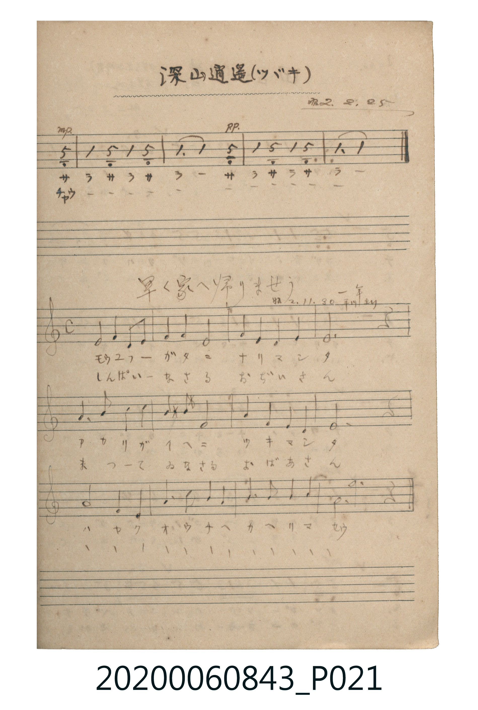

# 早く家へ帰りませう（快回家吧）

> Re:Shōka 使用 AI 協助辨識與重建樂譜，可能會有錯誤。歡迎回報。

- **鋼琴伴奏版**：<br><audio controls src="hayaku_ie_e_kaerimasho.mp3"></audio>

- 出處：一年 / 刊りすより（昭2.11.30）
- 《唱歌帖》（2020.006.0843）P021.jpg (bottom)

## 說明

原書資訊與歌詞全文（對應 P021.jpg 下半）：
調性與拍號：ハ調 4/4 拍（C 大調 4/4 拍）
註記：一年 / 昭2.11.30 刊りすより


## 歌詞

```text
一、
モウユフガタニ ナリマシタ
アカリガ イヘニ ツキマシタ
ハヤク オウチヘ カヘリマセウ

二、
しんぱいなさる おぢいさん
まってゐなさる おばあさん
ハヤク オウチヘ カヘリマセウ
```

## ABC

<div class="abc-score" data-abc-src="hayaku_ie_e_kaerimasho.abc" aria-label="五線譜載入中"></div>

[下載 ABC 原始檔](hayaku_ie_e_kaerimasho.abc)

## TMD 檔案連結

- [主旋律 TMD 檔案](hayaku_ie_e_kaerimasho.tmd) [[在 TMD Studio 編輯](https://tmdlang.github.io/Tmd-TS/#tmd=s7IKdvYPcrWy4qpTUCpJTLdSSM7PyUlNLsnMz7MqzsjPTkzOyFeCS5bl55TmploBqXgDC4RwcX5pUXJqfEFieqpVgIGRIboM3KT4vPyS1KT8_GwMFRn5RYmZ8WB1xRmlCOmCovyy1LzEPKCS3MS80uLkosyCkvjk_IJKhJrUssyUVJCK1JTMkvyizMQcJBenFhWD_QJxYklRYh7EDKAgQhVQU3pmnlVJYibQBSBXlCfG5yZm5uUk5qUocWlpKTybvvJxY__TddseN-54umPD46aux437HjfOftzY9n5Px9P9q5_OngeUfTph-fs9nQpaWlyKtgqGBgZc9rYKzlw2JvomdiC7nrbvejFz6vs9s57saHi6c4uCvsLTji6wWTMfN3UAGUCzns1Ya6RnaKhnbAA0CezCxw1dT6dsfLa25-mOaY8buoFqjAyMDPQMDMz0DCxMjIHKQGGul1WQrqCRlF9Skp-rqcTFpa-lYEstwKWgoPC0b_6z2TtebG5_saLrRUc70DkvVs572rri2bR2UAhs6H3W3qkAd8iTHd1Pe4He6QR6FqT7xar9zxqWg_R1976YOR8o-ri5HyioAAwaBaAY0AhnhadLlqMIdYJ1rtj9YsUM5DBDhBB68HGBNADVPW5oBLEeNy963LTscTMQTX3ctOZx0_7Hzd1A0a7HzaseN8973LQdKARW2ARUuBok2rQGyFnyuHkGRGXL46a1qCqb-x83L3nctB6oDKgaaHIjUDGQA9QN1AMxdjdQAuKUXT0wpzROf9w0-XHjxseNLY8bVz1uBDoIaEEj0O2LwEJA_mSIQmCyWvy4cdnjpgloCjc8bmxCUki0S4CKKU8CUKCgpc_F5ZFYmZhd6pnq6p2YWpSZC8yw-VYBmYl5-Q41BjUK1SALFWwstOzAjOrctFowo0bBUEEXDI2A2BiIaxRMgCQIg3ggWAOWA6kzj4cqRGgDQQOQCNQ4iCYTBVOolhoFM7CIKdhIiHEgNShGAhWBKGzmgdSBIFidKUQxSD_INJAdCCeD2CDVIFFs7qvl4tK1U8ASTApAYWUuAA)]
- [鋼琴伴奏 TMD 檔案](hayaku_ie_e_kaerimasho_piano.tmd) [[在 TMD Studio 編輯](https://tmdlang.github.io/Tmd-TS/#tmd=s7IKdvYPcrWy4tLSUng2feXjxv6n67Y9btzxdMeGx01djxv3PW6c_bix7f2ejqf7Vz-dPQ8o-3TC8sfNu19273k-YcuTPVueLu1_3tnxfk-ngpYWl6KtgqGBAZe9rYIzl42JvokdV52C0tP2XS9mTn2_Z9aTHQ1Pd25R0Fd42tEFNn3m46YOIANo-rMZa430DA31jA2AJimBdD1u6Ho6ZeOztT1Pd0x73NANVGNkYGSgZ2BgpmdgYWIMVBZgYGSol1WQrqCRlF9Skp-rqcTF5ZFYmZhd6pnq6p2YWpSZm1ickW8VkJmYlx_k4VBjUKNQzaUABDYWWnZgRnVuWi2YUaNgqKALhkZAbAzEQBFtEyANI0FiIFijYB6vDVIE0mAeD9VRo2Aarw0zAgQNQIIwo6GaTRSMtU2hOkGiZmBRU6gVEMMhapGsMFWP1wZbU6NgHK9tBmJhswOqAwTBqk0hWiDGGYEtgFoOFoH5DuRXqFYgBZIH69E2jMOwpxZP6PrgCN0CeOjC3YRg1SiYgCgwgSwKpozhAqbxUK-gGoESwKhSYL1Q08ECRnB7QIEIN9MYiaxRMIPygASEiWwDRAPYHCQm3GasHkMIoHkBzQ_AgNW1U8AStgq4hZW5AA)]

## 分析

```text
================================================================================
📊 TMD Song Profile: [ 早く家へ帰りませう（快回家吧） ]
================================================================================
⏱  Duration:       0:28 (28.8s), 12 measures total
🎼 Key & Tempo:    首調基準 C, != 100.0 BPM, <4/4>
   - 分析範圍：      由實際發聲的音符與和弦推測調性；播放脈絡另行呈現
🎤 人聲音域:    G3 (MIDI 55) – A4 (MIDI 69) [跨度: 14 個半音 / 1.2 個八度, 難度: moderate]
   - 最低音:  G3 in [HayakuIeEKaerimasho #1 @ m.9, 0:21]
   - 最高音: A4 in [HayakuIeEKaerimasho #1 @ m.6, 0:12]
   - 適合: mezzo-soprano, contralto, tenor, baritone, bass
🏛  結構:      HayakuIeEKaerimasho (28.8s)
⚡ 編曲密度:        Peak 1 軌道同時演奏
🗝  調性診斷：       C 大調（純淨自然大調，未偵測到可信轉調）
   - 風格氣質:    純淨自然大調（陽光明朗、易唱易記，無明顯調外色彩）
   - 轉調歷程:    全曲維持單一推測調性（未偵測到可信轉調）
   - 核心骨幹音:  C, E, D, F, G
   - 調性數值:    C 大調 [相關度: 0.89, 穩定度: High, 自然音純度: 100.0%]
   - 候選調性 (K-S): C 大調 (0.89), A 小調 (0.72), F 大調 (0.65)
   - 五度圈歷程:   +0
   - 各段落調性細節:
     • [HayakuIeEKaerimasho #1]: C 大調 (r: 0.89, 自然音純度: 100.0%)

  [ 五度圈游移軌跡 ]
              [C ]*
         F            G  
      Bb               D  
      Eb               A  
         Ab           E  
            Db       B  
               F# 
     (* = active key center)

  [ 十二半音累積音高分佈 ]
     C  : ████████████████████████  24.4%
     C# :                            0.0%
     D  : ███████████████           15.6%
     D# :                            0.0%
     E  : █████████████████         17.8%
     F  : ███████████████           15.6%
     F# :                            0.0%
     G  : ██████████                10.0%
     G# :                            0.0%
     A  : ██████████                10.0%
     A# :                            0.0%
     B  : ███████                    6.7%
--------------------------------------------------------------------------------
Assignment 軌道音域：
  - Piano         : G3 – A4 (14 個半音 / 1.2 個八度, 35 個音符)
================================================================================
```


## 原書掃描頁




