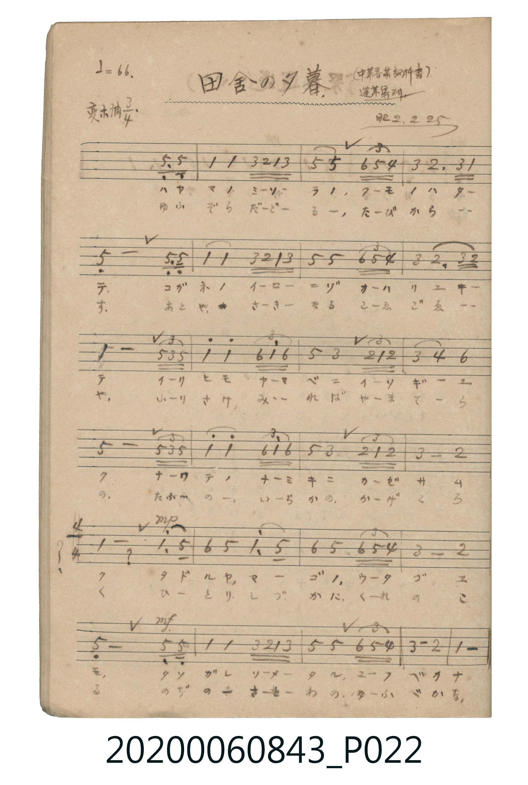

# 田舎の夕暮

> Re:Shōka 使用 AI 協助辨識與重建樂譜，可能會有錯誤。歡迎回報。

- **鋼琴伴奏版**：<br><audio controls src="inaka_no_yugure.mp3"></audio>

- 曲：北村季晴（編）
- 出處：(中等音楽教科書) 蓬莱集ヨリ（昭2.2.25）
- 《唱歌帖》（2020.006.0843）P022.jpg

## 說明

> [!NOTE]
> **原書資訊與校勘註記**（對應 `P022.jpg` 手抄簡譜）：
> - **曲名**：田舎の夕暮
> - **調性與拍號**：変ホ調 3/4 拍（E♭ 大調 3/4 拍），速度 `♩ = 66.`，弱起第 3 拍進入。
> - **原件出處標註**：右上角親筆註記 `(中等音楽教科書) / 蓬莱集ヨリ. / 昭 2. 2. 25`。
> - **楊金土手抄筆誤與自我存疑實錄（依 Policy A 校補譜面並詳列原貌）**：
>   1. **第 5 行左欄親筆 `4/4 ?` 存疑之成因**：原件第 16 小節（第 5 行首小節）第 3 拍與第 17 小節第 3 拍之附點八分＋十六分音符（`1^ - - 5`，共 1 拍），楊氏漏畫一條減時底線而誤抄作「無底線附點四分音符 `1^.`（1.5 拍）＋單底線八分音符 `5`（0.5 拍）＝ 2 拍」，致整小節合計變成 4 拍（`1 -` 2 拍 ＋ `1^. 5_` 2 拍），與 3/4 拍不合；楊氏遂親筆於第 5 行左欄寫下 `4/4` 與 `?`，並於 `1 -` 下方再補一個 `?` 存疑。本譜依原曲拍律校還為 `1^ - - 5`。
>   2. **三連音減時底線誤加雙線**：第 3、4 行之 1 拍三連音 `5 3 5`、`6 1^ 6`、`2 1 2` 下方，楊氏誤畫雙底線（十六分三連音），而第 1、2、5、6 行之同型三連音 `6 5 4` 則正確畫單底線；本譜統一依 1 拍三連音記為 `( ... )%(----)`。
>   3. **唱詞筆誤與塗改痕跡**：
>      - 第 1 小節二段「たどる」原抄誤加濁點作「だーどーるー」，校還為「たーどーるー」。
>      - 第 5 小節二段「あとや」第 2 拍下方原有誤寫假名後塗黑銷去（蓋因「や」跨延兩拍）。
>      - 第 11 小節二段「やまでら」原抄無濁點作「やまてら」（依歷史抄本無濁點慣例保留或參照底文）；第 12 小節一段「なはて」原抄作表音「ナーワテ」，保留原抄假名。
>      - 第 21–22 小節二段「のぢのさとわのゆふべかな」，楊氏先於第 21 小節第 2 拍寫「さ」，旋即橫線塗銷改為長音「ー」，將「さーとー｜わの（ゆーふ）」後移半拍，使二段「ゆーふ」與一段三連音「ユーフ」工整對齊，本譜從其改定稿轉錄。
>
> **一、**
> ハヤマノ　ミソラノ　クモノ　ハタテ
> コガネノ　イロニゾ　カハリ　ユキテ
> イリヒモ　ヤマベニ　イソギ　ユク
> ナーワテノ　ナミキニ　カゼ　サムク
> タドルヤ　マゴノ　ウタゴエモ
> タソガレ　ソメタル　ユフベカナ
>
> **二、**
> ゆふぞら　たどる　たびからす
> あとや　さきなる　こゑごゑや
> ふりさけ　みれば　やまてらの
> たふの　いらかの　かげくろく
> ひとり　しづかに　くれのこる
> のぢの　さとわの　ゆふべかな


## 歌詞

```text
（TMD 檔案未包含歌詞註解）
```

## ABC

<div class="abc-score" data-abc-src="inaka_no_yugure.abc" aria-label="五線譜載入中"></div>

[下載 ABC 原始檔](inaka_no_yugure.abc)

## TMD 檔案連結

- [主旋律 TMD 檔案](inaka_no_yugure.tmd) [[在 TMD Studio 編輯](https://tmdlang.github.io/Tmd-TS/#tmd=s7IKdvYPcrWy4qpTUCpJTLdSSM7PyUlNLsnMz7MqzsjPTkzOyFeCS5bl55TmploBqXgDC4RwcX5pUXJqfEFieqpVgIGREboM3KT4vPyS1KT8_GwMFRn5RYmZ8WB1xRmlCOmCovyy1LzEPKCS3MS80uLkosyCkvjk_IJKhJrUssyUVJCK4uTEvPiy1KLMtMzUFCRXpxYVg_0DcWZJUWIexBygIEJVflFJRn56UWJBRqVVRmZxSX5RZnJiTnx2Yl4iQlFJRirQ_3mJJaVFqchaM9Mz86xKEjOBHgB5ojwxPjcxMy8nMQ_oDC0thedTNrzo6HvcuO7pkqnPZq1T0NLiUrRVMDPjsrdVcNXhsjHWN7EDmfZs9qb3e2Y97Zn-bO7Ep2sXP5u55f2ejufbV7zf0wm27Wn7rhczpwKVaDzZsfb52s6X8zc_W7r32dSZz5dPfDZ7h6bCi8lrXvRtfDm77XHzisfNq4C6n81Ya6QHhKYwMx43dD2dsvHZ2p6nO6Y9bugGKjEyMDLQMzAw0zOwMDEGKgNFoV5WQboSF5e-loIttQCXgoKCnUK0op9_iGsshKOl9bRvPtDhLza3v1jR9aKj_dmChU-7Z7xYsfvFihlaWkC3Pd3Q-6y9UyEB5qYEhWed3c-6Wp5vWPhi7RygY4GBATFLF2gaMPyeTugFaZyFFuQINS9W7X_WsBxkV3fvi5nzwYqfLul83DwbKKMAjAkFoATQZtdHM9cqPF2yHEUUaF3Py4b5T3ctU0h4NHOlAigS9RKAgk_3bHyxdfvzNWsUjEEqXzZsetq69HFDE8JeoE-f7N4GicFnK2YC_Qixun_zkx1dL5ZPerFs1fO1bRCvKyTgimB99CjWAwoB41jBSA-MTBNQLH22tOtl-8Snc-ZDQw1owaolQL-_aF_1rAOYxGY8nzbx6fplL3tagD5-sm-uQkB-TmZypYKjAjAmXiyeAwzjl3MXPdmx7MXKzU87pgP98GJTDzAYwE6HWKOgYKgHtAnkdVOFFwt7nm5f9mxNC8Q3CgkmwJCzT1CA2PRkZ_ezjglPZy-A-BwcICB9hmYKTzf0P1_fAErtMHNeLpsGE-yEhyvQ6WAN5lANcAmg0S9ntrzcPe9p6-qnHW3v93Q_7W182roWyAaG4fM1y4BGJxjGAQNFV8EUHGGtGxUMEZEKDKhnG_qf7el_PnX1kx0NzxbNfbZj9rOZTU93TX2-fdaLhh5guAED8MneOY8bep63LISIQ62cPRtujQLQElCC6DDUM4Wb3v102jqIBojrYEpBDukwQFI4V8EIxH7cAOT2vGjf8mzqFog_n07oeLGi48W6LmD4KcBSaIKhgm4CRIcC0BKw1Qqm8VAhiL-AAQZLvU929AKNeb9nNsSvLxubIJH0bNoetMh7uh4YBkDzgJGXoAAyIcEeFGTAZABUC7QGZC1QwbNpO5-29QJTCTDAnjYA1cMjGpgGn81ZA0w8wCQFzuGbgPY_3dcNTFQvm1qeN-0CuRUaF_D0qgBKwFpaT3Z0vmxYDEr4yBGwasnTrgUvZ88EsiHZGxTxjxsaTUCuBkY-JC7heoFhC0wXIMMbE8wUgHaZgZlGQGVGMLfDYx1oODDWgYZD7AKVOrC0AzcQGprAuAclP6BZRkBsCsRmUAc8ndDzdF43kgPMgCEKDL6nne3P1i5-vmgX0Ap4MgBFAjh8nm_dCAw8UMZDdT-wDACHkoaCnp6egqaqhi4QaCKHlTEorIAF-YuV8-C5-unC6c-m7Hw-feqL7QtRcigQ6CqAXQ7NN0929TxbtxWYlB83zn_cuPJxUzcwzYFiqqsFEtTP9jcCUzYkuT9uXPC4eQ9IGZAEqgSS4AQKj02oORhqkJwLd4EppguaHjeueNzUAtQAUgBOvNDUBXTQnE6Qg9avftrYDizan-7rAXry5e6JL7u2P-3bDYyqF5O7gQUKyBywCS-2r3gKLGVbV0JyADYXGGIGAlBr477HjcsfNwF1QMMBmMlRAgGqZhlEDaS4fLZ2-9P-TUDFwNiEq3_WuvjJvu4n--c-nzrzWce0p_3Nz1uXA-P92bR2cCqaDXaEEcwRwMIGGg6rHjeuB1kAcwHQ4hcLVwBTA0i2uQsUps3rHze3QUIfYgFEJSRwsHnWyPBRw2QjuGWIQF_3uHERmJwKDv1-ELup7XHj1seNOx83doNcA4lkcBZ52toBLSaMYKEHjytg5IBNnArVMB1Y9G5-tnI1qLgDxlXXdlCabNr1cup2mFeg6efphnaoRlDKAVZme94DgxrsFGDwglwDEt8KjkZQzD9fvvtpbxc4Ynue7N2PFH1QlaD472iHhCg8K4FtXAYOPJALn25fCi5Ve1_u7QK5FpwNn-4D1hvbgO58um7W8xX7X-ztBNaIsOCENVWA5gLzO7DpBuY_bu5_3LzkcfO8x819jxsaHjfPf9y093EzMP2DuU3AiFoEk-p_3LQfGG9QjU2bHzetedzcC1MJNGTt4-bux037wNzVYJOBoQ_UCExsQCm4RqDKVY-bJ4FMBslCbJ8J0gsxB-iApnUwjeth7kRKOFD3AEWArgVbCrGxCRgjQMbWx80LEBpBbgY2i4DuWQLWNe9x0xaYm4Hm7wdxm4CxtgihHuQAoNfWgNUAQ2Mh2BBg8gA7CRj-QNeCPNiFGrC7epADFpoKgdYB470BqYCCsDeDUidQqnEmVD2i_AAqAKbmXlDahaqf_Lhp4uPGKSCyqQWmfuvjpi6wSmA9BVQDdDYwEW4AuxkpjzdC24xgS4HuAQdsYwtYCpg9IFwgY9LjRmD8Ai3th6nfBHZPF1jB9MeNS8HKwIEAUgnJe0CHdcPUw7Ii1P2w3AhyD0qGBKmnvBkOBQpa-lxcnnmJ2Yl--ZGl6cD-jFVAZmJevkONrmFNNcgqBRtDMy1wJClg6waAihdglgDWfgoakNYvpA5T0AbWvJAiQkcB1mzXxKIf6ACQ2TUKBuCWgC6crs5NqwW2YyDtg3igAmCDAwxhtDGw4DEEkjXA2gQiAqM1wLUurL4EKjCGShhBaYh2Q4UasN0-hjUKEHt04TQw-0HpJUD9wGQPF--Ds-YD8R5gSt0LpkGqVmKo0gDmJIiy5kUglyDrh9gA5TXth5gCcZERFhc1tUHoxq0gcxrhLmrqhLEaoS5qXAlzUVM33LY9cBfBlW0Gu6gRrgZuEkwHxEX4I39XDzjyTUiLbWjEIiBNY9oIKaaBJSCa1cCyGEqvAcdQLzwE4HHVtAQaHmvhcY0ItX3wkG1aDVXWD4nrVXCTlqHYBzUFHtfAYgzdTY1NUHoFOB5b4CbB4hFYSkCjsRfmpka4ffB4B8b2ZGgynQiJ7SlwNROR7SMytnd0khPbsIiEQQ1wuxwp2qD9AGCUwxjAmAU12JHUwOIcFsUa4HY8lrg3gdJmUBpf3APjDBa1qyBxNgkeIovgaoCFAETNPIgaWGwhUgHCnKa9YDVN65BCFj0VIMU8PGYRLgJmcIhJXZAYmwrT3wiLMaAaSHEBxBDbeuBqNiBc1AJNIPsg5sBsR3IRPMcTiHdg55asXI7uN5rGOwzC8j5SvAMLYfRQbu6ChuB6SJzCUgZy2Q1XMx8SymvhapDiHZrnm6AxsRXNJmBrCtU94PwOSx0I94BKZUjMQ2ILM_0A1UBjtKkTreSGqwaq6YbG-iSIGuRaBqy2qRfuHgIl-xRq5PXq3IJaWPSaAuVhuRIWrXikcJbuMEhMTINqVkg4doLjeTU8XJfAWZC6FFZnboGLI9Xiy6Ahvx8SyzA1CFtWoLoFHMsYYd-4CdkmYNkO090FVzEdSi9Fi2GYu4Ex3A91Sw9qSkHYMhnuFvy5unUtOIZhvXFy625aNNVgEB7FGAkL1lBELt5hRTYiWqCRD2ykgaJtDUy8Gc6CNt-A3RR4AoDoAalCBDqw7IYom4paBSBsgqkFycKiEwZhIYZc8MOiFm4CNCKB_QAcBQCiyl8BdyssiSEXAcCWIkTZVkgC2YlhE8xu5EYDpltrubh07RRQugcKQAFlLgA)]
- [鋼琴伴奏 TMD 檔案](inaka_no_yugure_piano.tmd) [[在 TMD Studio 編輯](https://tmdlang.github.io/Tmd-TS/#tmd=s7IKdvYPcrWy4qpTUCpJTLdSSM7PyUlNLsnMz7MqzsjPTkzOyFeCS5bl55TmploBqXgDC4RwcX5pUXJqfEFieqpVgIGREboM3KT4vPyS1KT8_GwMFRn5RYmZ8WB1xRmlCOmCovyy1LzEPKCS3MS80uLkosyCkvjk_IJKhJrUssyUVJCK4uTEvPiy1KLMtMzUFCRXpxYVg_0DcWZJUWIexBygIEJVflFJRn56UWJBRqVVRmZxSX5RZnJiTnx2Yl4iQlFiEVBzempual6JVUFmYl5-fGJycn5uQWJeJkgMobAkA6jIKi-xpLQoFdmOzPTMPKuSxEygT0G-LU-Mz03MzMtJzAO6V0tL4fmUDS86-h43rnu6ZOqzWeve7-l42b3n-YQtT_Zsebq0_3lnx_s9nQpaWlyKtgpmZlz2tgquOlw2xvomdiArns3e9H7PrKc905_Nnfh07eJnM7cA9T_fvgKoB-yEp-27XsycClSi8WTH2udrO1_O3_xs6d5nU2c-Xz7x2ewdmgovJq950bfx5ey2x80rHjevAup-NmOtkR4QmsLMeNzQ9XTKxmdre57umPa4oRuoxMjAyEDPwMBMz8DCxBioDJQA9LIK0pW4uDzzErMT_fIjS9OBoWAVAAovhxpdw5pqLgUgsDE007IDs2oUDBR0wRBGV-em1SqYxoPZQKpGwRAqAaONFYyAbGOgjClUBEZrmAGZJpqqGrpAoAlUYAyVMILSEO2GCjVgu30MaxQg9ujC6cfN_VB6CVD_4-Z5cPE-OGs-EO9ReNy0F0yDVK3EUKXxuGk9RFnzIpBLkPVDbIDymvZDTIG4yAiLi5raIHTjVpA5jXAXNXXCWI1QFzWuhLmoqRtu2x64i-DKNoNd1AhXAzcJpgPiImgEQeMCAWkaOUZIkfO4GeJ15ODaDKXXgAO1F-5oePA2LYF6YS08ehAe3QcPjKbVUGX9kOhZBTdpGYp9UFPg0fO4cSa6mxqboPQKcNC3wE2CBf3jxqnQkO-FuakRbh88qoARNBmasiZCImgKXM1EZPvQIwgW9jCoYQoMR1OkkDaMg8rAGcDIALLNkNTAogkWKxqgeDTCEl0mUNoMSuOLLmAww2JjFSSYJ8E9sQiuBpjVIGrmQdTAAhgRcQhzmvaC1TStQwoM9IhDiix4ZCBcBMxGEJO6IIE8Faa_ERbIQDWQTAnEENt64Go2IFzUAo3TfRBzYLYjuQierxB5Cd05NI0qGITlMKSoApZO6AHT3AX19HpINMAiE7lQg6uZDwmYtXA1SFEFzVlN0MDbimbT4-YFqO4B5ypYhCLcAyquIJEFCWDMKAeqgUZCUydakQZXDVTTDY2oSRA1yMUvWG1TL9w9OHJUdW5BLSxGTIHysLQPiwk8UjiLPRgkJnJAtQTE653gqFkND4olcBakXoCV_1vg4kg10jJoYO2HRAxMDcKWFahuAUcMRnA1bkK2CVjowXR3wVVMh9JL0SIF5m5gpPRD3dKDGrkIWybD3YKrHqJFSwEG4bGCkRZg7RTkcg9WliFCEhpfwDYCKKTXwMSb4Sxo6-Fx80J4nEH0gFQhwglYqEGUTUUtGxE2wdSCZGExAIOwEEMuEWGxATcBGvaPGxfhyGaI6msF3K2wVIGc0YANFYiyrZA43YlhE8xu5AoQ0621WJuPQR5YG5CgrImjJYmcNEzjtWERicREJBBDbXhehrMwEomhNiyZmMdrY29TIiVTo3htOJueToG1oHDZhFHnGGvDKxskJma9g-wwnHUPQspQG9ZUMNRGbSzUgB0NNw2FQy_XwSBS8OEPtmrUKgDhJySL8UvjiUS8roEKIKcncIVEw0QFg0CzkJ0ENhtDEaJExJ5zfUjOuXATFQxBfjSNB5HGCCZYFJ8CEzQFEL-AWEYIRaihjEWSms5AKgrwOAPJGLjhGK6ASYJZ6D5F0gxhIlmCMBOuy4TMkCDfDWAd4DBCixlC4QDKgAh3gO0Ey2FTi0MeybfIOsCuwe4QrKEBzn1UTxw4wwTVhxhRAsp1unYKKBkv2scwVgFT0AgsqMwFAA)]

## 分析

```text
================================================================================
📊 TMD Song Profile: [ 田舎の夕暮 ]
================================================================================
⏱  Duration:       1:05 (65.5s), 24 measures total
🎼 Key & Tempo:    首調基準 E,, != 66.0 BPM, <3/4>
   - 分析範圍：      由實際發聲的音符與和弦推測調性；播放脈絡另行呈現
🎤 人聲音域:    A#3 (MIDI 58) – D#5 (MIDI 75) [跨度: 17 個半音 / 1.4 個八度, 難度: challenging]
   - 最低音:  A#3 in [InakaNoYugure #1 @ m.1, 0:01]
   - 最高音: D#5 in [InakaNoYugure #1 @ m.10, 0:24]
   - 適合: soprano, mezzo-soprano, contralto, tenor, baritone, bass
🏛  結構:      InakaNoYugure (65.5s)
⚡ 編曲密度:        Peak 1 軌道同時演奏
🗝  調性診斷：       D# 大調（純淨自然大調，未偵測到可信轉調）
   - 風格氣質:    純淨自然大調（陽光明朗、易唱易記，無明顯調外色彩）
   - 轉調歷程:    全曲維持單一推測調性（未偵測到可信轉調）
   - 核心骨幹音:  A#, D#, G, F, C
   - 調性數值:    D# 大調 [相關度: 0.92, 穩定度: High, 自然音純度: 100.0%]
   - 候選調性 (K-S): D# 大調 (0.92), A# 大調 (0.75), G 小調 (0.66)
   - 五度圈歷程:   -3
   - 各段落調性細節:
     • [InakaNoYugure #1]: D# 大調 (r: 0.90, 自然音純度: 100.0%)

  [ 五度圈游移軌跡 ]
               C  
         F            G  
      Bb               D  
     [Eb]*              A  
         Ab           E  
            Db       B  
               F# 
     (* = active key center)

  [ 十二半音累積音高分佈 ]
     C  : ██████                     7.9%
     C# :                            0.0%
     D  :                            0.0%
     D# : █████████████████████     27.5%
     E  :                            0.0%
     F  : █████████                 11.6%
     F# :                            0.0%
     G  : ███████████████           19.0%
     G# : ███                        3.2%
     A  :                            0.0%
     A# : ████████████████████████  30.8%
     B  :                            0.0%
--------------------------------------------------------------------------------
Assignment 軌道音域：
  - Piano         : A#3 – D#5 (17 個半音 / 1.4 個八度, 99 個音符)
================================================================================
```


## 原書掃描頁




