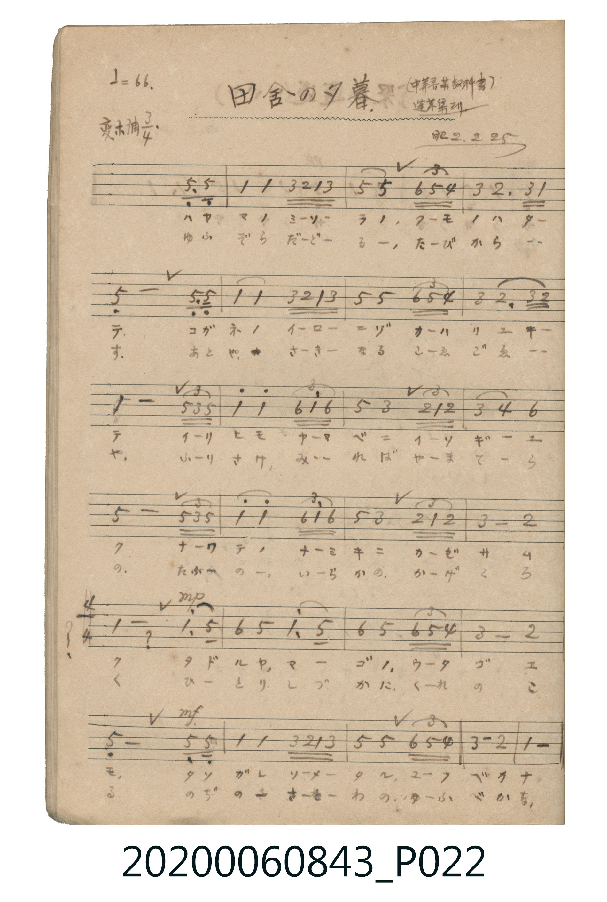

# 田舎の夕暮（鄉村的黃昏）

> Re:Shōka 使用 AI 協助辨識與重建樂譜，可能會有錯誤。歡迎回報。

- **鋼琴伴奏版**：<br><audio controls src="inaka_no_yugure.mp3"></audio>

- 曲：北村季晴
- 出處：中等音楽教科書 / 蓬莱集ヨリ（昭2.2.25）
- 《唱歌帖》（2020.006.0843）P022.jpg

## 說明

原書資訊與歌詞全文（對應 P022.jpg）：
調性與拍號：変ホ調 3/4 拍（Eb 大調 3/4 拍），♩=66
註記：(中等音楽教科書) / 蓬莱集ヨリ / 昭2.2.25


## 歌詞

```text
一、
ハヤマ ノ ミソラ ノ クモ ノ ハタテ
コガネ ノ イロ ニゾ カハリ ユキテ
イリヒ モ ヤマベ ニ イソギ ユク
ナハテ ノ ナミキ ニ カゼ サムク
タドル ヤ マゴ ノ ウタゴエ モ
タソガレ ソメタル ユフベ カナ

二、
ゆふぞら たどる たびからす
あと や さき なる こゑごゑ や
ふりさけ みれば やまでら の
たふ の いらか の かげ くろく
ひとり しづかに くれのこる
のぢ の さとわ の ゆふべ かな
```

## ABC

<div class="abc-score" data-abc-src="inaka_no_yugure.abc" aria-label="五線譜載入中"></div>

[下載 ABC 原始檔](inaka_no_yugure.abc)

## TMD 檔案連結

- [主旋律 TMD 檔案](inaka_no_yugure.tmd) [[在 TMD Studio 編輯](https://tmdlang.github.io/Tmd-TS/#tmd=s7IKdvYPcrWy4qpTUCpJTLdSSM7PyUlNLsnMz7MqzsjPTkzOyFeCS5bl55TmploBqXgDC4RwcX5pUXJqfEFieqpVgIGREboM3KT4vPyS1KT8_GwMFRn5RYmZ8WB1xRmlCOmCovyy1LzEPKCS3MS80uLkosyCkvjk_IJKhJrUssyUVJCK1JTMkvyizMQcJBenFhWD_QJxYklRYh7EDKAgQlVJRirQW3mJJaVFqQhRoFHpmXlWJYmZQHeB3FaeGJ-bmJmXk5iXosSlpaXwfMqGFx19jxvXPV0y9dmsde_3dLxs6Xw2d-LzWS0vdzc_m9H_fk-ngpYWl6KtgpkZl72tgqsOl42xvokdyIpnsze93zPrac90oIanaxc_m7kFbPPT9l0vZk4FyjzZsfb52s6X8zc_W7r32dSZz5dPfDZ7h4K-wovJa170bXw5u-1x84rHzauAlj6bsdZIDwhNgdaBzXjc0PV0ysZna3ue7pj2uKEbqMTIwMhAz8DATM_AwsQYqAwUS3pZBelKXFz6Wgq21AJcCgoKT_vmAx36YnP7ixVdLzraga54sXLe09YVz6a1Ax3ydEPvs_ZOBZj9QKcAvQrS9mLV_mcNy0EauntfzJwPCpolnY-bZwPFFYBBpgAUBmp3TVJ4umQ5ihjQgJ5HM1faAkMYZMyK3S9WzADq1sAafpqYAQgUgQcgF8iIJzsaHjc0gliPm_sfNy953DwPyOoD4vmPm_Y-bl4J4TWtf9y8CCrR_7hp_-PmNrCeps2Pm9Y8bu6FqgJqXwtkdj9u2gfkrQYbuQoosOxx01q4FqCiVY-bJwGFQSaCbHzcPBOkCywHtLRpHUTLeoizusDGtEFtB_KALgPbAraiaQ-Q2vq4eQFMPchxwLBcDTIbiOc9btoCdR3QyP1A3uOmFSC7YYpBFgK9sAbIAfp3IVg_SPOyx81TwQ4D-aMLEli7emCB1dT2uHHr40ag6Z0KjxvnP25c-bgJ6CAQa_PjRmAAdD5unAlW2dj0uBFoYVMLkDn1cSMwqBpXQdROftw08XHjFCAJkoYo3vq4qQusDijWCHRcz-PGDSDZx437Hjcuh9i2DqIUaNVWEA-IW8D2gcwE8bofNwJDtxEYT71AEqJ4E9ARQKOBrOmPG5eC1QA9CVIDtGEd2C3dEJVADjBewAYBnQHU1A_hQX28E2LBKpBiyvMQFCho6XNxeeYlZif65UeWpgMLJquAzMS8fIcag5pqkE0KNoZmWnZgVnVuWi2YUaNgoKALhjDaNB5G1SgYQsVgtLGCEZBtDJQxhamG0hpmQKaJpqqGLhBoAhUYQyWMoDREu6FCDdRaqDUISFN7jeD2woyEQQ1ToLQpkgGGcTDLYQygHUC2GZIamO0wyzRAzjPC4goTKG0GpeG-p6srYBAWJrjCojq3oBZmoSlQHuZqmEV4pHDGAy67MeIflCSpnQgwLMfwMizV13DVcnHp2img5B8FoIAyFwA)]
- [鋼琴伴奏 TMD 檔案](inaka_no_yugure_piano.tmd) [[在 TMD Studio 編輯](https://tmdlang.github.io/Tmd-TS/#tmd=s7IKdvYPcrWy4tLSUng-ZcOLjr7HjeueLpn6bNa693s6XrZ0Pps78fmslpe7m5_N6H_cvPtl957nE7Y82bPl6dL-550d7_d0KmhpcSnaKpiZcdnbKrjqcNkY65vYcdUpKD1t3_Vi5tT3e2Y92bH2-drOl_M3P1u699nUmc-XT3w2e4eCvsKLyWte9G18ObvtcfOKx82rgPY9m7HWSA8ITYHmKoHMeNzQ9XTKxmdre57umPa4oRuoxMjAyEDPwMBMz8DCxBioLMDAyEgvqyBdiYvLMy8xO9EvP7I0vbQo1SogMzEvP8jDocagpppLAQhsDM207MCs6ty0WjCjRsFAQRcMYbRpPIyqARLahnBhONNYwUjBEEjWKBhqm0LFECwNMwVTBRNNVQ1dINAEKzKGSpnHaxtBmRBzDBVqoK6A2qqrYBSvDWfT0ylGSE7BZpOGKVCRKZJZxtqGcTDdCCbQSiDbDMVOhMNgtmuAXG2E1WGG2iZwlhmUBXMZyNFw01A49HIdDCIFH_5gq84tqAXZCRYGGwXzFJLN-KXxxCJe50AFkBMUKNnTMlXBINAsZCeBzcZQBMtwNVy1WHOuD46cW4Ar58INVDAEedE0HkQaI5hgUXwKTNAUQLwCYhkhFKEGMhZJajoDqSjA4wwkY-CGY7gCJglmofsUSTOEiWQJwky4LhMyQ4J8N4B1gMMILWYIhUM1MP8h3AG2EyyHTS0OeSTfIusAuwa7Q7CGBrgooHriwBkmqD7EiBJQptO1U0DJdwrYBJS5AA)]

## 分析

```text
================================================================================
📊 TMD Song Profile: [ 田舎の夕暮（鄉村的黃昏） ]
================================================================================
⏱  Duration:       1:08 (68.2s), 25 measures total
🎼 Key & Tempo:    首調基準 E,, != 66.0 BPM, <3/4>
   - 分析範圍：      由實際發聲的音符與和弦推測調性；播放脈絡另行呈現
🎤 人聲音域:    A#3 (MIDI 58) – D#5 (MIDI 75) [跨度: 17 個半音 / 1.4 個八度, 難度: challenging]
   - 最低音:  A#3 in [InakaNoYugure #1 @ m.1, 0:01]
   - 最高音: D#5 in [InakaNoYugure #1 @ m.10, 0:24]
   - 適合: soprano, mezzo-soprano, contralto, tenor, baritone, bass
🏛  結構:      InakaNoYugure (68.2s)
⚡ 編曲密度:        Peak 1 軌道同時演奏
🗝  調性診斷：       D# 大調（純淨自然大調，未偵測到可信轉調）
   - 風格氣質:    純淨自然大調（陽光明朗、易唱易記，無明顯調外色彩）
   - 轉調歷程:    全曲維持單一推測調性（未偵測到可信轉調）
   - 核心骨幹音:  A#, D#, G, F, C
   - 調性數值:    D# 大調 [相關度: 0.92, 穩定度: High, 自然音純度: 100.0%]
   - 候選調性 (K-S): D# 大調 (0.92), A# 大調 (0.75), G 小調 (0.66)
   - 五度圈歷程:   -3
   - 各段落調性細節:
     • [InakaNoYugure #1]: D# 大調 (r: 0.92, 自然音純度: 100.0%)

  [ 五度圈游移軌跡 ]
               C  
         F            G  
      Bb               D  
     [Eb]*              A  
         Ab           E  
            Db       B  
               F# 
     (* = active key center)

  [ 十二半音累積音高分佈 ]
     C  : ██████                     7.9%
     C# :                            0.0%
     D  :                            0.0%
     D# : █████████████████████     27.5%
     E  :                            0.0%
     F  : █████████                 11.6%
     F# :                            0.0%
     G  : ███████████████           19.0%
     G# : ███                        3.2%
     A  :                            0.0%
     A# : ████████████████████████  30.8%
     B  :                            0.0%
--------------------------------------------------------------------------------
Assignment 軌道音域：
  - Piano         : A#3 – D#5 (17 個半音 / 1.4 個八度, 99 個音符)
================================================================================
```


## 原書掃描頁




