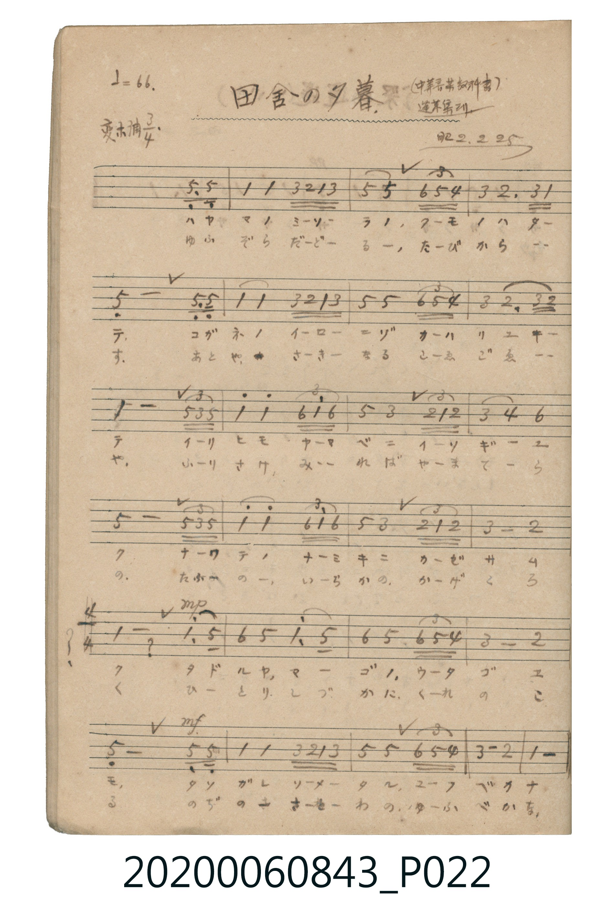

# 田舎の夕暮（鄉村的黃昏）

<audio controls src="inaka_no_yugure.mp3"></audio>

- 曲：北村季晴
- 出處：中等音楽教科書 / 蓬莱集ヨリ（昭2.2.25）
- 《唱歌帖》（2020.006.0843）P022.jpg

## 說明

原書資訊與歌詞全文（對應 P022.jpg）：
調性與拍號：変ホ調 3/4 拍（Eb 大調 3/4 拍），♩=66
註記：(中等音楽教科書) / 蓬莱集ヨリ / 昭2.2.25

## 跨冊／重複收錄參照

> 同曲（北村季晴作曲〈田舍の夕暮〉；收錄於《新定兒童唱歌》高等科男子用與《唱歌帖》P022《中等音樂教科書／蓬萊唱歌集》抄譜）

- **[同曲]** 《新定兒童唱歌》高等科男子用（2020.006.0848）：[**〈田舍の夕暮〉**](../../../shintei_jido_shoka/koto_boys_2020.006.0848/2_2_07_inaka_no_yugure/index.md)（`E,` / `3/4` — [原始 TMD](../../../shintei_jido_shoka/koto_boys_2020.006.0848/2_2_07_inaka_no_yugure/inaka_no_yugure.tmd)）
- 總表：[跨冊重複與同名歌曲總索引](../../../duplicate_songs.md)

## 歌詞

```text
一、
ハヤマ ノ ミソラ ノ クモ ノ ハタテ
コガネ ノ イロ ニゾ カハリ ユキテ
イリヒ モ ヤマベ ニ イソギ ユク
ナハテ ノ ナミキ ニ カゼ サムク
タドル ヤ マゴ ノ ウタゴエ モ
タソガレ ソメタル ユフベ カナ

二、
ゆふぞら たどる たびからす
あと や さき なる こゑごゑ や
ふりさけ みれば やまでら の
たふ の いらか の かげ くろく
ひとり しづかに くれのこる
のぢ の さとわ の ゆふべ かな
```

## ABC

```abc
X:1
T:田舎の夕暮（鄉村的黃昏）
C:曲：北村季晴
M:3/4
L:1/16
Q:1/4=66
K:Eb
V:V1 name="Piano" snm="Pia"
[V:V1]
!mf! z4 z4 B,3 B, | E4 E4 G F E G | B4 B4 c4/3 B4/3 A4/3 | G4 F6 G E |
B,8 B,3 B, | E4 E4 G F E G | B4 B4 c4/3 B4/3 A4/3 | G4 F6 G F |
E8 B4/3 G4/3 B4/3 | e4 e4 c4/3 e4/3 c4/3 | B4 G4 F4/3 E4/3 F4/3 | G4 A4 c4 |
B8 B4/3 G4/3 B4/3 | e4 e4 c4/3 e4/3 c4/3 | B4 G4 F4/3 E4/3 F4/3 | G8 F4 |
!mp! E8 e3 B | c4 B4 e3 B | c4 B4 c4/3 B4/3 A4/3 | G8 F4 |
!mf! B,8 B,3 B, | E4 E4 G F E G | B4 B4 c4/3 B4/3 A4/3 | G8 F4 |
E8 z4 | !mf! z4 z4 B,3 B, | E4 E4 G F E G | B4 B4 c4/3 B4/3 A4/3 |
G4 F6 G E | B,8 B,3 B, | E4 E4 G F E G | B4 B4 c4/3 B4/3 A4/3 |
G4 F6 G F | E8 B4/3 G4/3 B4/3 | e4 e4 c4/3 e4/3 c4/3 | B4 G4 F4/3 E4/3 F4/3 |
G4 A4 c4 | B8 B4/3 G4/3 B4/3 | e4 e4 c4/3 e4/3 c4/3 | B4 G4 F4/3 E4/3 F4/3 |
G8 F4 | !mp! E8 e3 B | c4 B4 e3 B | c4 B4 c4/3 B4/3 A4/3 |
G8 F4 | !mf! B,8 B,3 B, | E4 E4 G F E G | B4 B4 c4/3 B4/3 A4/3 |
G8 F4 | E8 z4 |
```

## TMD 檔案連結

- [主旋律 TMD 檔案](inaka_no_yugure.tmd) [[在 TMD Studio 編輯](https://tmdlang.github.io/Tmd-TS/#tmd=s7IKdvYPcrWy4qpTUCpJTLdSSM7PyUlNLsnMz7MqzsjPTkzOyFeCS5bl55TmploBqXgDC4RwcX5pUXJqfEFieqpVgIGREboM3KT4vPyS1KT8_GwMFRn5RYmZ8WB1xRmlCOmCovyy1LzEPKCS3MS80uLkosyCkvjk_IJKhJrUssyUVJCK1JTMkvyizMQcJBenFhWD_QJxYklRYh7EDKAgQlVJRirQW3mJJaVFqUpcWloKz6dseNHR97hx3dMlU5_NWvd-T8fLls5ncyc-n9Xycnfzsxn97_d0KmhpcSnaKpiZcdnbKrjqcNkY65vYgYx8NnvT-z2znvZMB2p4unbxs5lbwDY9bd_1YuZUoMyTHWufr-18OX_zs6V7n02d-Xz5xGezdyjoK7yYvOZF38aXs9seN6943LwKaOmzGWuN9IDQFGgd2IzHDV1Pp2x8trbn6Y5pjxu6gUqMDIwM9AwMzPQMLEyMgcpA4a-XVZCuxMWlr6VgSy3ApaCg8LRvPtChLza3v1jR9aKjHeiKFyvnPW1d8WxaO9AhTzf0PmvvVIDZD3QK0KsgbS9W7X_WsBykobv3xcz5oKBZ0vm4eTZQXAEYZApAYaB21ySFp0uWo4gBDeh5NHOlLTCEQcas2P1ixQygbg2s4aeJGYBAEXgAcoGMeLKj4XFDI4j1uLn_cfOSx83zgKw-IJ7_uGnv4-aVEF7T-sfNi6AS_Y-b9j9ubgPradr8uGnN4-ZeqCqg9rVAZvfjpn1A3mqwkauAAsseN62FawEqWvW4eRJQGGQiyMbHzTNBusByQEub1kG0rIc4qwtsTBvUdiAP6DKwLWArmvYAqa2PmxfA1IMcBwzL1SCzgXje46YtUNcBjdwP5D1uWgGyG6YYZCHQC2uAHKB_F4L1gzQve9w8FewwkD-6IIG1qwcWWE1tjxu3Pm4Emt6p8Lhx_uPGlY-bgA4CsTY_bgQGQOfjxplglY1NjxuBFja1AJlTHzcCg6pxFUTt5MdNEx83TgGSIGmI4q2Pm7rA6oBijUDH9Txu3ACSfdy473Hjcoht6yBKgVZtBfGAuAVsH8hMEK_7cSMwdBuB8dQLJCGKNwEdATQayJr-uHEpWA3QkyA1QBvWgd3SDVEJ5ADjBWwQ0BlATf0QHtTHOyEWrAIppjwPQYGClj4Xl2deYnaiX35kaTqwyLEKyEzMy3eoMahRqAZZpWBjaKZlB2ZV56bVghk1CgYKumAIo03jYVSNgiFUDEYbKxgB2cZAGVOYaiitYQZkmmiqaugCgSZQgTFUwghKQ7QbKtRArYVag4A0tdcIbi_MSBjUMAVKmyIZYBgHsxzGANoBZJshqYHZDrNMA-Q8IyyuMIHSZlAa7nu6ugIGYWGCKyyqcwtqYRaaAuVhroZZhEcKZzzgshsj_kFJktqJAMNyDC_DUn0NVy0Xl66dAkoGUsAmoMwFAA)]
- [鋼琴伴奏 TMD 檔案](inaka_no_yugure_piano.tmd) [[在 TMD Studio 編輯](https://tmdlang.github.io/Tmd-TS/#tmd=s7IKdvYPcrWy4tLSUng-ZcOLjr7HjeueLpn6bNa693s6XrZ0Pps78fmslpe7m5_N6H_cvPtl957nE7Y82bPl6dL-550d7_d0KmhpcSnaKpiZcdnbKrjqcNkY65vYcdUpKD1t3_Vi5tT3e2Y92bH2-drOl_M3P1u699nUmc-XT3w2e4eCvsKLyWte9G18ObvtcfOKx82rgPY9m7HWSA8ITYHmKoHMeNzQ9XTKxmdre57umPa4oRuoxMjAyEDPwMBMz8DCxBioLMDAyEgvqyBdiYvLMy8xO9EvP7I0vbQo1SogMzEvP8jDocagRqGaSwEIbAzNtOzArOrctFowo0bBQEEXDGG0aTyMqgES2oZwYTjTWMFIwRBI1igYaptCxRAsDTMFUwUTTVUNXSDQBCsyhkqZx2sbQZkQcwwVaqCugNqqq2AUrw1n09MpRkhOwWaThilQkSmSWcbahnEw3Qgm0Eog2wzFToTDYLZrgFxthNVhhtomcJYZlAVzGcjRcNNQOPRyHQwiBR_-YKvOLagF2QkWBhsF8xSSzfil8cQiXudABZATFCjZ0zJVwSDQLGQngc3GUATLcDVctVizrg-urFuAK-vCTVQwBPnRNB5EGiOYYFF8CkzQFED8AmIZIRShhjIWSWo6A6kswOMMJGPghmO4AiYJZqH7FEkzhIlkCcJMuC4TMkOCfDeAdYDDCC1mCIVDNTADItwBthMsh00tDnkk3yLrALsGu0Owhga4LKB64sAZJqg-xIgSUK7TtVNAyXgK2ASUuQA)]

## 分析

```text
================================================================================
📊 TMD Song Profile: [ 田舎の夕暮（鄉村的黃昏） ]
================================================================================
⏱  Duration:       2:16 (136.4s), 50 measures total
🎼 Key & Tempo:    首調基準 E,, != 66.0 BPM, <3/4>
   - 分析範圍：      由實際發聲的音符與和弦推測調性；播放脈絡另行呈現
🎤 人聲音域:    A#3 (MIDI 58) – D#5 (MIDI 75) [跨度: 17 個半音 / 1.4 個八度, 難度: challenging]
   - 最低音:  A#3 in [InakaNoYugure #1 @ m.1, 0:01]
   - 最高音: D#5 in [InakaNoYugure #1 @ m.10, 0:24]
   - 適合: soprano, mezzo-soprano, contralto, tenor, baritone, bass
🏛  結構:      InakaNoYugure (68.2s) -> InakaNoYugure (68.2s)
⚡ 編曲密度:        Peak 1 軌道同時演奏
🗝  調性診斷：       D# 大調（純淨自然大調，未偵測到可信轉調）
   - 風格氣質:    純淨自然大調（陽光明朗、易唱易記，無明顯調外色彩）
   - 轉調歷程:    全曲維持單一推測調性（未偵測到可信轉調）
   - 核心骨幹音:  A#, D#, G, F, C
   - 調性數值:    D# 大調 [相關度: 0.92, 穩定度: High, 自然音純度: 100.0%]
   - 候選調性 (K-S): D# 大調 (0.92), A# 大調 (0.75), G 小調 (0.66)
   - 五度圈歷程:   -3 -> -3
   - 各段落調性細節:
     • [InakaNoYugure #1]: D# 大調 (r: 0.92, 自然音純度: 100.0%)
     • [InakaNoYugure #2]: D# 大調 (r: 0.92, 自然音純度: 100.0%)

  [ 五度圈游移軌跡 ]
               C  
         F            G  
      Bb               D  
     [Eb]*              A  
         Ab           E  
            Db       B  
               F# 
     (* = active key center)

  [ 十二半音累積音高分佈 ]
     C  : ██████                     7.9%
     C# :                            0.0%
     D  :                            0.0%
     D# : █████████████████████     27.5%
     E  :                            0.0%
     F  : █████████                 11.6%
     F# :                            0.0%
     G  : ███████████████           19.0%
     G# : ███                        3.2%
     A  :                            0.0%
     A# : ████████████████████████  30.8%
     B  :                            0.0%
--------------------------------------------------------------------------------
Assignment 軌道音域：
  - Piano         : A#3 – D#5 (17 個半音 / 1.4 個八度, 198 個音符)
================================================================================
```


## 原書掃描頁




