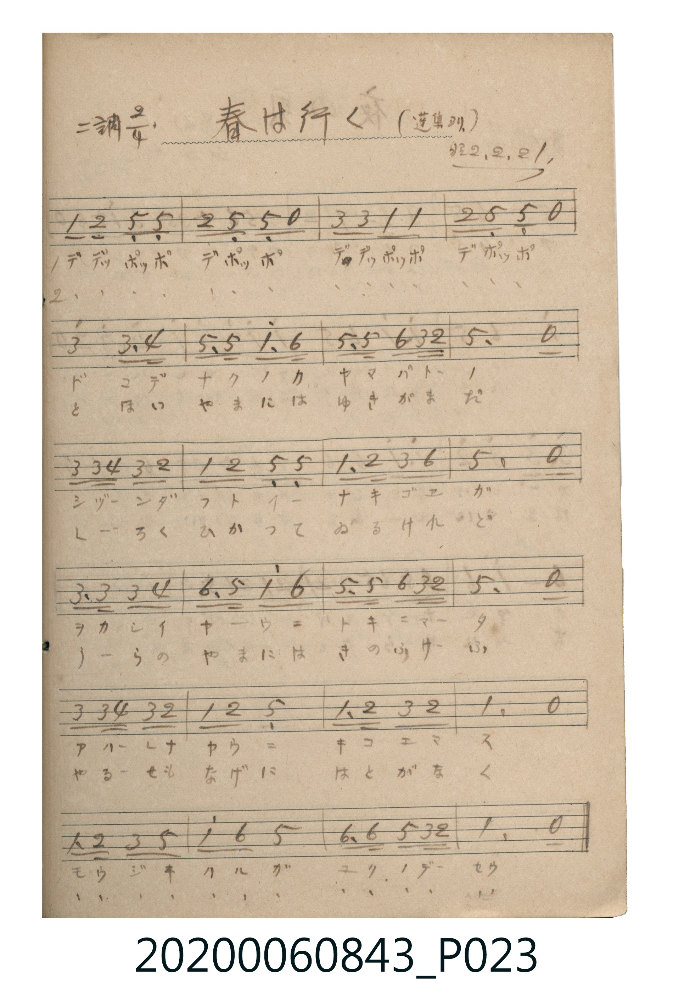

# 春は行く（春將離去）

> Re:Shōka 使用 AI 協助辨識與重建樂譜，可能會有錯誤。歡迎回報。

- **鋼琴伴奏版**：<br><audio controls src="haru_wa_yuku.mp3"></audio>

- 出處：蓬集ヨリ（昭2.2.21）
- 《唱歌帖》（2020.006.0843）P023.jpg

## 說明

原書資訊與歌詞全文（對應 P023.jpg）：
調性與拍號：ニ調 2/4 拍（D 大調 2/4 拍）
註記：(蓬集ヨリ) / 昭2.2.21


## 歌詞

```text
一、
ハル ハ ユク ハル ハ ユク
ヲカ ノ ニシ ニ ヤマ ノ ヒガシ ニ
サキ ノコル ハナ モ チリ テ
ユフ カゼ ニ ハル ハ ユク
ユフ カゼ ニ ハル ハ ユク

二、
はる は ゆく はる は ゆく
のべ の くさ に みづ の ほとり に
なき わたる とり の こゑ も
かすか に て はる は ゆく
かすか に て はる は ゆく
```

## ABC

<div class="abc-score" data-abc-src="haru_wa_yuku.abc" aria-label="五線譜載入中"></div>

[下載 ABC 原始檔](haru_wa_yuku.abc)

## TMD 檔案連結

- [主旋律 TMD 檔案](haru_wa_yuku.tmd) [[在 TMD Studio 編輯](https://tmdlang.github.io/Tmd-TS/#tmd=s7IKdvYPcrWy4qpTUCpJTLdSSM7PyUlNLsnMz7MqzsjPTkzOyFeCS5bl55TmploBqXgDC4RwcX5pUXJqfEFieqpVgIGRMboM3KT4vPyS1KT8_GwMFRn5RYmZ8WB1xRmlCOmCovyy1LzEPKCS3MS80uLkosyCkvjk_IJKhJrUssyUVJCK1JTMkvyizMQcJBenFhWD_QJxYklRYh7EDKAgQlVJRirQW-WpiUBGEbpwcWpicX5eMUIYaEV6Zp5VSWIm0L0gN5cnxucmZublJOalKHFpaSk8m7H0ceP6Fwt7Hjf2v9_TAeQ-3dD-cvaip3273-_pVNDS4lK0VbA047K3VXDhsjHSN7EDmf20fdeLmVPf75n1YvKal7PbHjeveNy8Cqx9rZEeEBoC9YId8bih6-mUjc_W9jzdMe1xQzdQiZGBkYGegYGZnoGFiTFQGSgS9LIK0pW4uPS1FGypBbgUFBSe9s1_NnvHi83tL1Z0vehoB7rixcp5T1tXPJvWDnTI0w29z9o7FWD2A50C9A9I24tV-581LAdp6O59MXM-UPRxczdQUAHoewWgGFCvi8LTJctRhDrBOlfsfrFiBlCDBnK4aCroA4MZGjBcIHVPdjQ8bmgEsR439z9uXg2igHjZ46b1mCIQZZseN4EE-4C4-3HTdhAFxEseN8-Dik563LQGKgHW0bT1cdNakNzjps1QAx83dwGpRUDcCHQWkGqDmL3scfNUoIbVj5v2QM3F6gTCysB-29UD81vj-sdNQGWNQE81tQHTF6YIRNm6x407QRQQ9z9uBNrRCDS1cf_jxqVQ0d2PG1c8bgI6vnE1RMeqx429QCOAqudDDIRKgxRPftw0ESjXBFHZ_bhxJpCEmrkMlxOIUkZ5qoQCBS19Li6PxKLS8MTI0uxSq4DMxLx8hxqDGoVqkD0KNoZmWnZgVnVuWi2YUaNgqKCrYATEpvEwogaNbwAWMwaSIAxSD8JYVUHNBKkDQQhtAhQxBSkD6YwDC5khCZmBFRpBRWAQ3ThjoDEgGmQpdkeDxECiIFUgM_GbBzIRRJuAVYLUg1wDdh5CM1WcB4KorkMowmYcTDNIJchKoAjMVTAXwBxsBhaBuA7TuFouLl07BUR6UADylLkA)]
- [鋼琴伴奏 TMD 檔案](haru_wa_yuku_piano.tmd) [[在 TMD Studio 編輯](https://tmdlang.github.io/Tmd-TS/#tmd=s7IKdvYPcrWy4tLSUng2Y-njxvUvFvY8bux_v6cDyH26of3l7EVP-3Y_bt79snvP8wlbnuzZ8nRp__POjvd7OhW0tLgUbRUszbjsbRVcuGyM9E3suOoUlJ6273oxc-r7PbNeTF7zcnbb4-YVj5tXgQ1ca6QHhIZAvUoghY8bup5O2fhsbc_THdMeN3QDlRgZGBnoGRiY6RlYmBgDlQUYGBnrZRWkK3FxeSQWlYYnRpZml1oFZCbm5Qd5ONQY1ChUcykAgY2hmZYdmFWdm1YLZtQoGCroKhgBsWk8jKhRMI_XRhUyAAsbahsDaSgJxbgUw0wHKwZBGMsEKGqsbQpkwUjDOLCEGVwChA21zUCSQKdBbABLwCCmDcZAcyEsqHOwewwkBhKF-QRkB1Hmg2yAaTKBBgZIM8ixUB_ATKOZH0AQ3Qum8dpwxUA2IrgxrICaBLUK7BSQW5Gcbgh3H8hFJlD_mYG0QGIK7BEcttRipj0fXGmvAJ72IFEDIsFMY0gsgX1rhJCDpj4SFOMwH8KEioP1m8AJDFEzqGKIJhJtgGg2AZMQMRS7IRxkRWTaA3YpWIR-PjHGCEVoFsPwIJiJzxJoHCLcjl2UCPOB6U_XTgGRBBUweMpcAA)]

## 分析

```text
================================================================================
📊 TMD Song Profile: [ 春は行く（春將離去） ]
================================================================================
⏱  Duration:       0:30 (30.0s), 24 measures total
🎼 Key & Tempo:    首調基準 D, != 96.0 BPM, <2/4>
   - 分析範圍：      由實際發聲的音符與和弦推測調性；播放脈絡另行呈現
🎤 人聲音域:    A3 (MIDI 57) – D5 (MIDI 74) [跨度: 17 個半音 / 1.4 個八度, 難度: challenging]
   - 最低音:  A3 in [HaruWaYuku #1 @ m.1, 0:00]
   - 最高音: D5 in [HaruWaYuku #1 @ m.6, 0:06]
   - 適合: soprano, mezzo-soprano, contralto, tenor, baritone, bass
🏛  結構:      HaruWaYuku (30.0s)
⚡ 編曲密度:        Peak 1 軌道同時演奏
🗝  調性診斷：       D 大調（純淨自然大調，未偵測到可信轉調）
   - 風格氣質:    純淨自然大調（陽光明朗、易唱易記，無明顯調外色彩）
   - 轉調歷程:    全曲維持單一推測調性（未偵測到可信轉調）
   - 核心骨幹音:  A, D, F#, E, B
   - 調性數值:    D 大調 [相關度: 0.85, 穩定度: Moderate, 自然音純度: 100.0%]
   - 候選調性 (K-S): D 大調 (0.85), A 大調 (0.80), F# 小調 (0.70)
   - 五度圈歷程:   +2
   - 各段落調性細節:
     • [HaruWaYuku #1]: D 大調 (r: 0.85, 自然音純度: 100.0%)

  [ 五度圈游移軌跡 ]
               C  
         F            G  
      Bb              [D ]*
      Eb               A  
         Ab           E  
            Db       B  
               F# 
     (* = active key center)

  [ 十二半音累積音高分佈 ]
     C  :                            0.0%
     C# :                            0.0%
     D  : ███████████████           20.8%
     D# :                            0.0%
     E  : █████████                 12.9%
     F  :                            0.0%
     F# : ███████████████           20.2%
     G  : ██                         2.8%
     G# :                            0.0%
     A  : ████████████████████████  33.1%
     A# :                            0.0%
     B  : ███████                   10.1%
--------------------------------------------------------------------------------
Assignment 軌道音域：
  - Piano         : A3 – D5 (17 個半音 / 1.4 個八度, 81 個音符)
================================================================================
```


## 原書掃描頁




