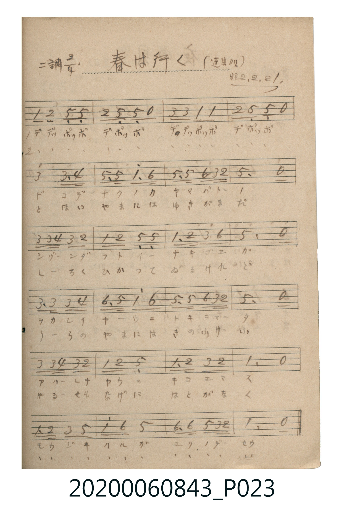

# 春は行く（春將離去）

> Re:Shoka 使用 AI 協助辨識與重建樂譜，可能會有錯誤。歡迎回報。

<audio controls src="haru_wa_yuku.mp3"></audio>

- 出處：蓬集ヨリ（昭2.2.21）
- 《唱歌帖》（2020.006.0843）P023.jpg

## 說明

原書資訊與歌詞全文（對應 P023.jpg）：
調性與拍號：ニ調 2/4 拍（D 大調 2/4 拍）
註記：(蓬集ヨリ) / 昭2.2.21

## 歌詞

```text
一、
ハル ハ ユク ハル ハ ユク
ヲカ ノ ニシ ニ ヤマ ノ ヒガシ ニ
サキ ノコル ハナ モ チリ テ
ユフ カゼ ニ ハル ハ ユク
ユフ カゼ ニ ハル ハ ユク

二、
はる は ゆく はる は ゆく
のべ の くさ に みづ の ほとり に
なき わたる とり の こゑ も
かすか に て はる は ゆく
かすか に て はる は ゆく
```

## ABC

```abc
X:1
T:春は行く（春將離去）
M:2/4
L:1/16
Q:1/4=96
K:D
V:V1 name="Piano" snm="Pia"
[V:V1]
!mf! D2 E2 A,2 A,2 | E2 A,2 A,2 z2 | F2 F2 D2 D2 | E2 A,2 A,2 z2 |
F4 F3 G | A2 A2 d3 B | A2 A2 B2 F E | A6 z2 |
F2 F G F2 E2 | D2 E2 A,2 A,2 | D3 E F2 B2 | A6 z2 |
F3 F F2 G2 | B3 A d2 B2 | A2 A2 B2 F E | A6 z2 |
F2 F G F2 E2 | D2 E2 A,4 | D3 E F2 E2 | D6 z2 |
D2 E2 F2 A2 | d2 B2 A4 | B3 B A2 F E | D6 z2 |
```

## TMD 檔案連結

- [主旋律 TMD 檔案](haru_wa_yuku.tmd) [[在 TMD Studio 編輯](https://tmdlang.github.io/Tmd-TS/#tmd=s7IKdvYPcrWy4qpTUCpJTLdSSM7PyUlNLsnMz7MqzsjPTkzOyFeCS5bl55TmploBqXgDC4RwcX5pUXJqfEFieqpVgIGRMboM3KT4vPyS1KT8_GwMFRn5RYmZ8WB1xRmlCOmCovyy1LzEPKCS3MS80uLkosyCkvjk_IJKhJrUssyUVJCK1JTMkvyizMQcJBenFhWD_QJxYklRYh7EDKAgQlVJRirQW-WpiUBGEbpwcWpicX5esRKXlpbCsxlLHzeuf7Gw53Fj__s9HUDu0w3tL2cvetq3-_2eTgUtLS5FWwVLMy57WwUXLhsjfRM7kGFP23e9mDn1_Z5ZLyaveTm77XHzisfNq8Da1xrpAaEhUC_Y1scNXU-nbHy2tufpjmmPG7qBSowMjAz0DAzM9AwsTIyBykDBq5dVkK7ExaWvpWBLLcCloKDwtG_-s9k7Xmxuf7Gi60VHO9AVL1bOe9q64tm0dqBDnm7ofdbeqQCzH-gUoH9A2l6s2v-sYTlIQ3fvi5nzgaKPm7uBggpA3ysAxYB6XRSeLlmOItQJ1rli94sVM4AaNJDDRVNBHxjM0IDhAql7sqPhcUMjiPW4uf9x82oQBcTLHjetxxSBKNv0uAkk2AfE3Y-btoMoIF7yuHkeVHTS46Y1UAmwjqatj5vWguQeN22GGvi4uQtILQLiRqCzgFQbxOxlj5unAjWsfty0B2ouVicQVgb2264emN8a1z9uAiprBHqqqQ2YvjBFIMrWPW7cCaKAuP9xI9CORqCpjfsfNy6Fiu5-3LjicRPQ8Y2rITpWPW7sBRoBVD0fYiBUGqR48uOmiUC5JojK7seNM4Ek1MxluJxAlDLKUyUUKGjpc3F5JBaVhidGlmaXWgVkJublO9QY1ChUg-xRsDE007IDs6pz02rBjBoFQwVdBSMgNo2HETVofAOwmDGQBGGQehDGqgpqJkgdCEJoE6CIKUgZSGccWMgMScgMrNAIKgKD6MYZA40B0SBLsTsaJAYSBakCmYnfPJCJINoErBKkHuQasPMQmqniPBBEdR1CETbjYJpBKkFWAkVgroK5AOZgM7AIxHWYxtVycenaKSDSgwKQp8wFAA)]
- [鋼琴伴奏 TMD 檔案](haru_wa_yuku_piano.tmd) [[在 TMD Studio 編輯](https://tmdlang.github.io/Tmd-TS/#tmd=s7IKdvYPcrWy4tLSUng2Y-njxvUvFvY8bux_v6cDyH26of3l7EVP-3Y_bt79snvP8wlbnuzZ8nRp__POjvd7OhW0tLgUbRUszbjsbRVcuGyM9E3suOoUlJ6273oxc-r7PbNeTF7zcnbb4-YVj5tXgQ1ca6QHhIZAvUoghY8bup5O2fhsbc_THdMeN3QDlRgZGBnoGRiY6RlYmBgDlQUYGBnrZRWkK3FxeSQWlYYnRpZml1oFZCbm5Qd5ONQY1ChUcykAgY2hmZYdmFWdm1YLZtQoGCroKhgBsWk8jKhRMI_XRhUyAAsbahsDaSgJxbgUw0wHKwZBGMsEKGqsbQpkwUjDOLCEGVwChA21zUCSQKdBbABLwCCmDcZAcyEsqHOwewwkBhKF-QRkB1Hmg2yAaTKBBgZIM8ixUB_ATKOZH0AQ3Qum8dpwxUA2IrgxrICaBLUK7BSQW5Gcbgh3H8hFJlD_mYG0QGIK7BEcttRipj0fXGmvAJ72IFEDIsFMY0gsgX1rhJCDpj4SFOMwH8KEioP1m8AJDFEzqGKIJhJtgGg2AZMQMRS7IRxkRWTaA3YpWIR-PjHGCEVoFsPwIJiJzxJoHCLcjl2UCPOB6U_XTgGRBBUweMpcAA)]

## 分析

```text
================================================================================
📊 TMD Song Profile: [ 春は行く（春將離去） ]
================================================================================
⏱  Duration:       0:30 (30.0s), 24 measures total
🎼 Key & Tempo:    首調基準 D, != 96.0 BPM, <2/4>
   - 分析範圍：      由實際發聲的音符與和弦推測調性；播放脈絡另行呈現
🎤 人聲音域:    A3 (MIDI 57) – D5 (MIDI 74) [跨度: 17 個半音 / 1.4 個八度, 難度: challenging]
   - 最低音:  A3 in [HaruWaYuku #1 @ m.1, 0:00]
   - 最高音: D5 in [HaruWaYuku #1 @ m.6, 0:06]
   - 適合: soprano, mezzo-soprano, contralto, tenor, baritone, bass
🏛  結構:      HaruWaYuku (30.0s)
⚡ 編曲密度:        Peak 1 軌道同時演奏
🗝  調性診斷：       D 大調（純淨自然大調，未偵測到可信轉調）
   - 風格氣質:    純淨自然大調（陽光明朗、易唱易記，無明顯調外色彩）
   - 轉調歷程:    全曲維持單一推測調性（未偵測到可信轉調）
   - 核心骨幹音:  A, D, F#, E, B
   - 調性數值:    D 大調 [相關度: 0.85, 穩定度: Moderate, 自然音純度: 100.0%]
   - 候選調性 (K-S): D 大調 (0.85), A 大調 (0.80), F# 小調 (0.70)
   - 五度圈歷程:   +2
   - 各段落調性細節:
     • [HaruWaYuku #1]: D 大調 (r: 0.85, 自然音純度: 100.0%)

  [ 五度圈游移軌跡 ]
               C  
         F            G  
      Bb              [D ]*
      Eb               A  
         Ab           E  
            Db       B  
               F# 
     (* = active key center)

  [ 十二半音累積音高分佈 ]
     C  :                            0.0%
     C# :                            0.0%
     D  : ███████████████           20.8%
     D# :                            0.0%
     E  : █████████                 12.9%
     F  :                            0.0%
     F# : ███████████████           20.2%
     G  : ██                         2.8%
     G# :                            0.0%
     A  : ████████████████████████  33.1%
     A# :                            0.0%
     B  : ███████                   10.1%
--------------------------------------------------------------------------------
Assignment 軌道音域：
  - Piano         : A3 – D5 (17 個半音 / 1.4 個八度, 81 個音符)
================================================================================
```


## 原書掃描頁




