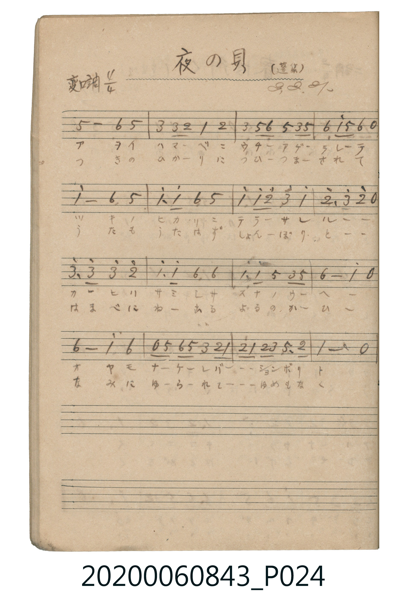

# 夜の貝（夜之貝）

> Re:Shōka 使用 AI 協助辨識與重建樂譜，可能會有錯誤。歡迎回報。

- **鋼琴伴奏版**：<br><audio controls src="yoru_no_kai.mp3"></audio>

- 出處：蓬集（昭2.2.21）
- 《唱歌帖》（2020.006.0843）P024.jpg

## 說明

原書資訊與歌詞全文（對應 P024.jpg）：
調性與拍號：変ロ調 4/4 拍（Bb 大調 4/4 拍）
註記：(蓬集) / 2.2.21


## 歌詞

```text
一、
イソベ ノ スナ ニ ウヅモレ テ
ヨル ノ ナミ ニ ユラルル カヒ ヨ
ツキ ノ ヒカリ ヲ アビ ナガラ
ナニ ヲ ユメ ミテ ネムル ラン

二、
とほき うなばら しのび つつ
なみ の しらべ を きく ならん
あけ ゆく そら を まち わびて
しほ の みち くる とき を まつ
```

## ABC

<div class="abc-score" data-abc-src="yoru_no_kai.abc" aria-label="五線譜載入中"></div>

[下載 ABC 原始檔](yoru_no_kai.abc)

## TMD 檔案連結

- [主旋律 TMD 檔案](yoru_no_kai.tmd) [[在 TMD Studio 編輯](https://tmdlang.github.io/Tmd-TS/#tmd=s7IKdvYPcrWy4qpTUCpJTLdSSM7PyUlNLsnMz7MqzsjPTkzOyFeCS5bl55TmploBqXgDC4RwcX5pUXJqfEFieqpVgIGRCboM3KT4vPyS1KT8_GwMFRn5RYmZ8WB1xRmlCOmCovyy1LzEPKCS3MS80uLkosyCkvjk_IJKhJrUssyUVJCK1JTMkvyizMQcJBenFhWD_QJxYklRYh7EDKAgQhVQU3pmnlVJYibQBSBXlCfG5yZm5uUk5qUgqyrJyE8vSizIqLTKyCwGWZWcmBOfnZiXiFBUkpEKDKHUlNLkRIgdWloKT5fMedy47sWmue_3dADZT3Z2g9mdClpaXIq2ChYmXPa2Ck46XDYm-iZ2IJOetu96MXPq-z2zXkxe83J2G1DbsxlrjfSA0BCoDWzZ44aup1M2Plvb83THtMcN3UAlRgZGBnoGBmZ6BhYmxkBloJjQyypIV-Li0tdSsKUW4FJQUHjaN__Z7B0vNre_WNH1oqMd6IoXK-c9bV3xbFo7yIsbep-1dyrA7Ac6BegTkLYXq_Y_a1gO0tDd-2LmfKDo0yWdj5vXAsUVgF5XAAoDtTslAQNsOYpYJ1j3it0vVswAatKAhIqmgr4CJEy4QNJPdjQ8bmgEsR43LXnctPdx80yFx819QN7Ox81dQGY3kLnscXPr4-ZFj5vXAAXawIqbVzxuXg1R2dz1uHk-RGUzUOVKoARYrglITQKphGhoedy0FqphElhuFZC1CagMaO5ksClNa4C6IYqBRoKMA0qDjFwIpOYDbQZSvY-bF0BsBtqzGeKFXT0wLzSueNy4-3FjL5DV9rhx1ePGDY-bOoGc6cCE9LhxM5C1BIggSoGy-4HUOrB0U-fjxp1AtwDd29j7uLEfLA8UbJoMUdz0uHEiUBpoKEhqLthUsOJ9jxuBrmvqB5r-uHEZRDHQtt1Qk_eDpRv7HzcBvQNyHdBpMH1gd1CesqBAQUufiysyv6jUL987MdMqIDMxL9-hxqCmGmSLgo2Flh2YUZ1bUAtm1CiYxivogqEZiAHm1SgYgyggYRSvYAhiAmm4MFAJUClYIZAPpGsgWg2hMroKBiDFUOMNsZgOEgNhTDEjBWOoXA2QDdJnDKaRTQSpAImDaJAczA5DiHlgAiGG6U6IOKqZKBJQEwwQPgX7GxIWQHeBaSAJMRWkC8gB2ggzAwQhhtdycenaKcCjQwHIUeYCAA)]
- [鋼琴伴奏 TMD 檔案](yoru_no_kai_piano.tmd) [[在 TMD Studio 編輯](https://tmdlang.github.io/Tmd-TS/#tmd=s7IKdvYPcrWy4qpTUCpJTLdSyC8qychPL0osyKi0ysgsLskvykxOzInPTsxLVIIrKs4vLUpOjS9ITE-1CjAwMkHIlGSk5qZapaaUJieWZObnKXFpaSk8XTLnceO6F5vmvt_TAWQ_2dkNZD9u3v2ye8_zCVue7NnydGn_886O93s6FbS0uBRtFSxMuOxtFZx0uGxM9E3sQGY_bd_1YubU93tmvZi85uXsNqBBz2asNdIDQkOgNrD1jxu6nk7Z-Gxtz9Md0x43dAOVGBkYGegZGJjpGViYGAOVgVyql1WQrsTFFZlfVOqX752YaRWQmZiXH-ThUGNQU82lAAQ2Flp2YEZ1bkEtmFGjYBivbRqvoAuGQLYZiA0TA8sag1hAwigeyAMyzePjtYFsZFmgYqA-mC6gEJAGy0JMA3FhHAOQRqjVxvHahjhthkpCKZzyhgpGQOO1jcFMkDiQYwQ20hjGRLYSqhQqC2JCFSG5xhDZNjCNLonVm2BTIcqQbQRKm2CqQJhsAA09SBiBgxMS0jVQGkgCRSGhDosqoBjIL0CzoFpgEGJzLUYq8EFOBSawVICUCECmKZgAMdhmKN8MiEE0WABoD4SsgakDUQZIHgX5wQTZBDQeTDuQCfQAyGB03RCyBmwxUCm6e_DajySI7gdjsB-MoL6BYogaKBPEABkFDDldOwV44Cmgc5S5AA)]

## 分析

```text
================================================================================
📊 TMD Song Profile: [ 夜の貝（夜之貝） ]
================================================================================
⏱  Duration:       0:45 (45.7s), 16 measures total
🎼 Key & Tempo:    首調基準 B,, != 84.0 BPM, <4/4>
   - 分析範圍：      由實際發聲的音符與和弦推測調性；播放脈絡另行呈現
🎤 人聲音域:    A#3 (MIDI 58) – D5 (MIDI 74) [跨度: 16 個半音 / 1.3 個八度, 難度: moderate]
   - 最低音:  A#3 in [YoruNoKai #1 @ m.2, 0:04]
   - 最高音: D5 in [YoruNoKai #1 @ m.7, 0:18]
   - 適合: soprano, mezzo-soprano, contralto, tenor, baritone, bass
🏛  結構:      YoruNoKai (45.7s)
⚡ 編曲密度:        Peak 1 軌道同時演奏
🗝  調性診斷：       A# 大調（純淨自然大調，未偵測到可信轉調）
   - 風格氣質:    純淨自然大調（陽光明朗、易唱易記，無明顯調外色彩）
   - 轉調歷程:    全曲維持單一推測調性（未偵測到可信轉調）
   - 核心骨幹音:  A#, G, F, D, C
   - 調性數值:    A# 大調 [相關度: 0.86, 穩定度: Moderate, 自然音純度: 100.0%]
   - 候選調性 (K-S): A# 大調 (0.86), G 小調 (0.78), F 大調 (0.61)
   - 五度圈歷程:   -2
   - 各段落調性細節:
     • [YoruNoKai #1]: A# 大調 (r: 0.86, 自然音純度: 100.0%)

  [ 五度圈游移軌跡 ]
               C  
         F            G  
     [Bb]*              D  
      Eb               A  
         Ab           E  
            Db       B  
               F# 
     (* = active key center)

  [ 十二半音累積音高分佈 ]
     C  : ██████████                12.6%
     C# :                            0.0%
     D  : █████████████             16.0%
     D# :                            0.0%
     E  :                            0.0%
     F  : ███████████████           19.3%
     F# :                            0.0%
     G  : █████████████████         21.8%
     G# :                            0.0%
     A  :                            0.0%
     A# : ████████████████████████  30.3%
     B  :                            0.0%
--------------------------------------------------------------------------------
Assignment 軌道音域：
  - Piano         : A#3 – D5 (16 個半音 / 1.3 個八度, 64 個音符)
================================================================================
```


## 原書掃描頁




