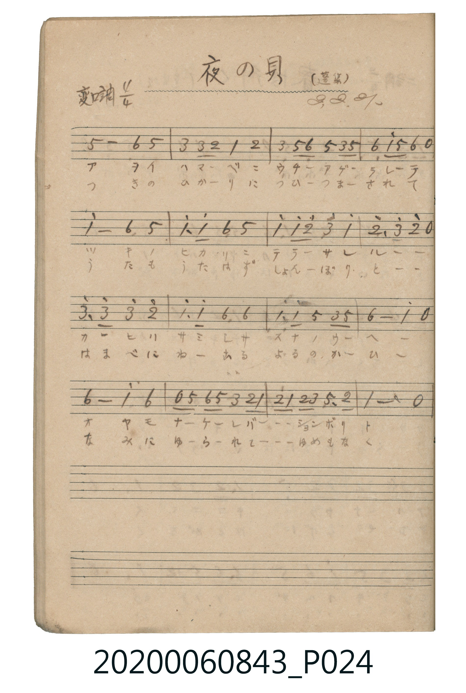

# 夜の貝（夜之貝）

> Re:Shōka 使用 AI 協助辨識與重建樂譜，可能會有錯誤。歡迎回報。

<audio controls src="yoru_no_kai.mp3"></audio>

- 出處：蓬集（昭2.2.21）
- 《唱歌帖》（2020.006.0843）P024.jpg

## 說明

原書資訊與歌詞全文（對應 P024.jpg）：
調性與拍號：変ロ調 4/4 拍（Bb 大調 4/4 拍）
註記：(蓬集) / 2.2.21


## 歌詞

```text
一、
イソベ ノ スナ ニ ウヅモレ テ
ヨル ノ ナミ ニ ユラルル カヒ ヨ
ツキ ノ ヒカリ ヲ アビ ナガラ
ナニ ヲ ユメ ミテ ネムル ラン

二、
とほき うなばら しのび つつ
なみ の しらべ を きく ならん
あけ ゆく そら を まち わびて
しほ の みち くる とき を まつ
```

## ABC

```abc
X:1
T:夜の貝（夜之貝）
M:4/4
L:1/16
Q:1/4=84
K:Bb
V:V1 name="Piano" snm="Pia"
[V:V1]
!mp! f8 g4 f4 | d4 d2 c2 B4 c4 | d4 f2 g2 f4 d2 f2 | g4 b2 f2 g4 z4 |
b8 g4 f4 | b4 b4 g4 f4 | b4 b2 c'2 d'4 b4 | c'6 d'2 c'4 z4 |
d'6 d'2 d'4 c'4 | b6 b2 g4 g4 | b6 b2 f4 d2 f2 | g8 b4 z4 |
g8 b4 g4 | z2 f2 g2 f2 d4 c2 B2 | c2 B2 c2 d2 f6 c2 | B12 z4 |
```

## TMD 檔案連結

- [主旋律 TMD 檔案](yoru_no_kai.tmd) [[在 TMD Studio 編輯](https://tmdlang.github.io/Tmd-TS/#tmd=s7IKdvYPcrWy4qpTUCpJTLdSSM7PyUlNLsnMz7MqzsjPTkzOyFeCS5bl55TmploBqXgDC4RwcX5pUXJqfEFieqpVgIGRCboM3KT4vPyS1KT8_GwMFRn5RYmZ8WB1xRmlCOmCovyy1LzEPKCS3MS80uLkosyCkvjk_IJKhJrUssyUVJCK1JTMkvyizMQcJBenFhWD_QJxYklRYh7EDKAgQhVQU3pmnlVJYibQBSBXlCfG5yZm5uUk5qUocWlpKTxdMudx47oXm-a-39MBZD_Z2Q1mdypoaXEp2ipYmHDZ2yo46XDZmOib2IGMfdq-68XMqe_3zHoxec3L2W1Abc9mrDXSA0JDoDawzY8bup5O2fhsbc_THdMeN3QDlRgZGBnoGRiY6RlYmBgDlYHCUi-rIF2Ji0tfS8GWWoBLQUHhad_8Z7N3vNjc_mJF14uOdqArXqyc97R1xbNp7SAvbuh91t6pALMf6BSgT0DaXqza_6xhOUhDd--LmfOBok-XdD5uXgsUVwB6XQEoDNTulAQMsOUoYp1g3St2v1gxA6hJAxIqmgr6CpAw4QJJP9nR8LihEcR63LTkcdPex80zFR439wF5Ox83dwGZ3UDmssfNrY-bFz1uXgMUaAMrbl7xuHk1RGVz1-Pm-RCVzUCVK4ESYLkmIDUJpBKioeVx01qohklguVVA1iagMqC5k8GmNK0B6oYoBhoJMg4oDTJyIZCaD7QZSPU-bl4AsRloz2aIF3b1wLzQuOJx4-7Hjb1AVtvjxlWPGzc8buoEcqYDE9Ljxs1A1hIggigFyu4HUuvA0k2djxt3At0CdG9j7-PGfrA8ULBpMkRx0-PGiUBpoKEgqblgU8GK9z1uBLquqR9o-uPGZRDFQNt2Q03eD5Zu7H_cBPQOyHVAp8H0gd1BecqCAgUtfS6uyPyiUr9878RMq4DMxLx8hxqDGoVqkDUKNhZadmBGdW5BLZhRo2CqoAuGZkAMYtcoGANJYwUjBUMgbQQXMQWqAMkbA8kasGrDOLCgroIBSBHUOKAgunlgITCBKWYUp2AMl64BcUF6gUJgFrLBYGVgKTALLA-3DkiBzAZhZDFU90IFUY1FkYDoN4D6FeRrUCgAnQUkjcAmgZQageyAagNBiHG1XFy6dgrwsFcAcpS5AA)]
- [鋼琴伴奏 TMD 檔案](yoru_no_kai_piano.tmd) [[在 TMD Studio 編輯](https://tmdlang.github.io/Tmd-TS/#tmd=s7IKdvYPcrWy4tLSUni6ZM7jxnUvNs19v6cDyH6ysxvIfty8-2X3nucTtjzZs-Xp0v7nnR3v93QqaGlxKdoqWJhw2dsqOOlw2Zjom9hx1SkoPW3f9WLm1Pd7Zr2YvObl7DagQc9mrDXSA0JDoDYlkJLHDV1Pp2x8trbn6Y5pjxu6gUqMDIwM9AwMzPQMLEyMgcoCDIxM9LIK0pW4uCLzi0r98r0TM60CMhPz8oM8HGoMahSquRSAwMZCyw7MqM4tqAUzahQMtU0VdMHQUNsMTIL4IHFjIG2sYKRgCKTN47WNkIRNFcygCo2BbJAoWGsckANhGoAUQ20w1gZKYLMCKgGlsMoBCSOgqdrGUA5IylQbKAQyDSgIZSNbB1UMlQazoaqQnAKkYPaBSHQZdJ-BjYOoQLbKUNsEXRpmngE4jEDBAQovUCDWgEkjoLmgwISGuhHIwfHaEFUwCLGiFiMufbDHJSIq40F-jQeRJmASLIAibgYmIWyohDFcJZhVg6wXwkTxMkQ_WA7DBpyiyMaDBYwQzsBuOoJVA3U0WDsufxHtfgxJXGFkDA0jI6TwhMgDSZgeJC6EA486XTsFeOwpoHOUuQA)]

## 分析

```text
================================================================================
📊 TMD Song Profile: [ 夜の貝（夜之貝） ]
================================================================================
⏱  Duration:       0:45 (45.7s), 16 measures total
🎼 Key & Tempo:    首調基準 B,, != 84.0 BPM, <4/4>
   - 分析範圍：      由實際發聲的音符與和弦推測調性；播放脈絡另行呈現
🎤 人聲音域:    A#4 (MIDI 70) – D6 (MIDI 86) [跨度: 16 個半音 / 1.3 個八度, 難度: moderate]
   - 最低音:  A#4 in [YoruNoKai #1 @ m.2, 0:04]
   - 最高音: D6 in [YoruNoKai #1 @ m.7, 0:18]
   - 適合: soprano, tenor
🏛  結構:      YoruNoKai (45.7s)
⚡ 編曲密度:        Peak 1 軌道同時演奏
🗝  調性診斷：       A# 大調（純淨自然大調，未偵測到可信轉調）
   - 風格氣質:    純淨自然大調（陽光明朗、易唱易記，無明顯調外色彩）
   - 轉調歷程:    全曲維持單一推測調性（未偵測到可信轉調）
   - 核心骨幹音:  A#, G, F, D, C
   - 調性數值:    A# 大調 [相關度: 0.86, 穩定度: Moderate, 自然音純度: 100.0%]
   - 候選調性 (K-S): A# 大調 (0.86), G 小調 (0.78), F 大調 (0.61)
   - 五度圈歷程:   -2
   - 各段落調性細節:
     • [YoruNoKai #1]: A# 大調 (r: 0.86, 自然音純度: 100.0%)

  [ 五度圈游移軌跡 ]
               C  
         F            G  
     [Bb]*              D  
      Eb               A  
         Ab           E  
            Db       B  
               F# 
     (* = active key center)

  [ 十二半音累積音高分佈 ]
     C  : ██████████                12.6%
     C# :                            0.0%
     D  : █████████████             16.0%
     D# :                            0.0%
     E  :                            0.0%
     F  : ███████████████           19.3%
     F# :                            0.0%
     G  : █████████████████         21.8%
     G# :                            0.0%
     A  :                            0.0%
     A# : ████████████████████████  30.3%
     B  :                            0.0%
--------------------------------------------------------------------------------
Assignment 軌道音域：
  - Piano         : A#4 – D6 (16 個半音 / 1.3 個八度, 64 個音符)
================================================================================
```


## 原書掃描頁




