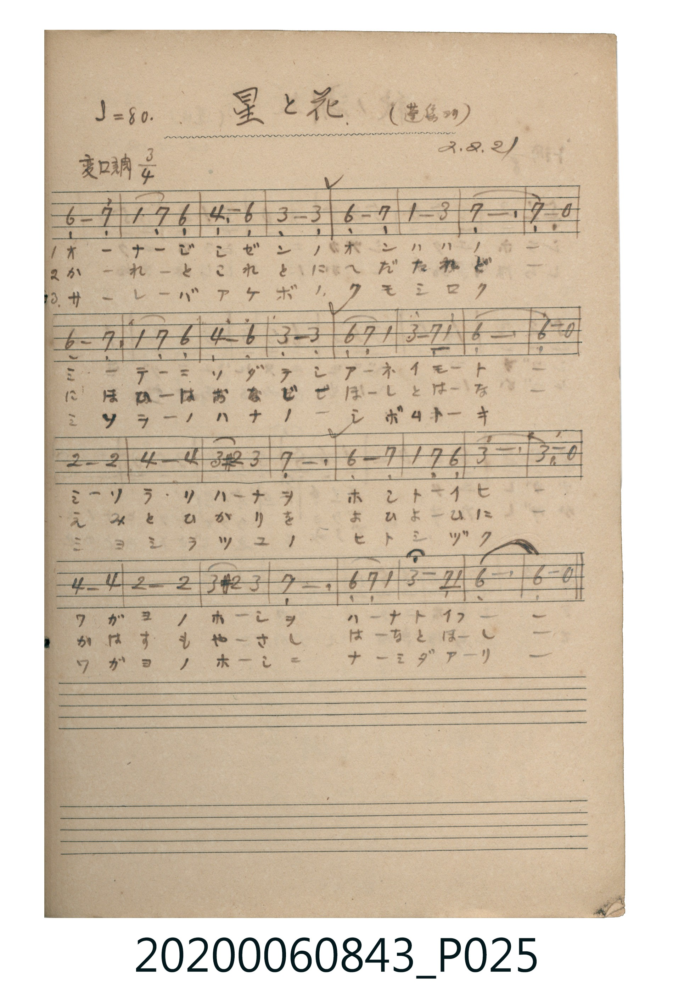

# 星と花（星與花）

> Re:Shoka 使用 AI 協助辨識與重建樂譜，可能會有錯誤。歡迎回報。

<audio controls src="hoshi_to_hana.mp3"></audio>

- 出處：蓬集ヨリ（昭2.2.21）
- 《唱歌帖》（2020.006.0843）P025.jpg

## 說明

原書資訊與歌詞全文（對應 P025.jpg）：
調性與拍號：変ロ調 / ト短調 3/4 拍（G 小調 3/4 拍），♩=80
註記：(蓬集ヨリ) / 2.2.21

## 歌詞

```text
一、
ミソラ ニ ニホフ ホシ ノ カゲ
ノヤマ ニ サケル ハナ ノ イロ
カガヤク ホシ ハ ソラ ノ ハナ
カヲレル ハナ ハ チ ノ ホシ ヨ

二、
ゆふべ の そら に ほし いでて
やさしき はな の つゆ を てらす
あした の のべ に はな さきて
きえゆく ほし の かげ を おくる
```

## ABC

```abc
X:1
T:星と花（星與花）
M:3/4
L:1/16
Q:1/4=80
K:Bb
V:V1 name="Piano" snm="Pia"
[V:V1]
!mp! G8 A4 | B4 A4 G4 | E8 G4 | d8 d4 |
G8 A4 | B8 d4 | A12 | A8 z4 |
G8 A4 | B4 A4 G4 | E8 G4 | d8 d4 |
G4 A4 B4 | d8 A2 B2 | G12 | G8 z4 |
c8 c4 | e8 e4 | d4 ^c4 d4 | A12 |
G8 A4 | B4 A4 G4 | d12 | d8 z4 |
e8 e4 | c8 c4 | d4 ^c4 d4 | A12 |
G4 A4 B4 | d8 A2 B2 | G12 | G8 z4 |
!mp! G8 A4 | B4 A4 G4 | E8 G4 | d8 d4 |
G8 A4 | B8 d4 | A12 | A8 z4 |
G8 A4 | B4 A4 G4 | E8 G4 | d8 d4 |
G4 A4 B4 | d8 A2 B2 | G12 | G8 z4 |
c8 c4 | e8 e4 | d4 ^c4 d4 | A12 |
G8 A4 | B4 A4 G4 | d12 | d8 z4 |
e8 e4 | c8 c4 | d4 ^c4 d4 | A12 |
G4 A4 B4 | d8 A2 B2 | G12 | G8 z4 |
```

## TMD 檔案連結

- [主旋律 TMD 檔案](hoshi_to_hana.tmd) [[在 TMD Studio 編輯](https://tmdlang.github.io/Tmd-TS/#tmd=s7IKdvYPcrWy4qpTUCpJTLdSSM7PyUlNLsnMz7MqzsjPTkzOyFeCS5bl55TmploBqXgDC4RwcX5pUXJqfEFieqpVgIGRKboM3KT4vPyS1KT8_GwMFRn5RYmZ8WB1xRmlCOmCovyy1LzEPKCS3MS80uLkosyCkvjk_IJKhJrUssyUVJCK1JTMkvyizMQcJBenFhWD_QJxYklRYh7EDKAgQlVJRirQWwU5iXkl6IJ5iSWlRalKXFpaCs9mzH_cuOJF18b3ezqA7Bcd7WB2p4KWFpeirYKFAZe9rYKTDpeNsb6JHciYp-27Xsyc-n7PrBeT17yc3fa4ecXj5lVgzWuN9IDQEKgZbN_jhq6nUzY-W9vzdMe0xw3dQCVGBkYGegYGZnoGFibGQGWgYNXLKkhX4uLS11KwpRbgUlBQeNo3_9nsHS82t79Y0QX0E9AVL1bOe9q64tm0dqBDnm7ofdbeqQCzH-gUoH9A2l6s2v-sYTlIQ3fvi5nzgaJPl3Q-bl4LFFfQV3jc3PF8PpgNDAwFoBKgUe4KTzf0owgBzep5NHOlLTDoQCau2P1ixQygQRrI4aUJNA0SWlwgRU92NDxuaASxHjfPf9y093HzSiCrG4QfN89-3DwVyJr9uGk7kOpTeNy0-nHTJojivsfNSx43z4Mobtr6uGnj4-bVQF7_4-YuqGKg_FqwYpC2NSD1TesRxvUDxaHWARWD9cEUN2963AxUj2QcUHFzI1QlVP8KiPt39cDc39T2uHHr48adCo8b1wHx3MdNnUAKaEjj7seN04FUy-PG5Y8bl0EUAzlTgcKPG3uBMusfN66CagM6sg0oPQnIXAY04XHjTLD6xiaw4vlQVesg9oAMh-oFGtYLMxzE6gC7B-humO0gbd2PG4EGgw3vAko-buoGqac83UGBgpY-F5dHfnFGZki-R2JeolVAZmJevkONQY1CNcgiBRsLLTswozq3oBbMqFEwi1fQBUNzEKNGwRDGBEvUKJjA5KF8YygXRGPXjZAFC8IgEtcAxKWe_WDlIH0IWaCQIbLhEAfAucgOMIKKgWigdVAeiIYYZ6SOyz-EnA5zDEQ1jIdsN6ptqC4hwm5yPV7LxaVrp4CUUhQwucpcAA)]
- [鋼琴伴奏 TMD 檔案](hoshi_to_hana_piano.tmd) [[在 TMD Studio 編輯](https://tmdlang.github.io/Tmd-TS/#tmd=s7IKdvYPcrWy4tLSUng2Y_7jxhUvuja-39MBZL_oaAeyHzfvftm95_mELU_2bHm6tP95Z8f7PZ0KWlpcirYKFgZc9rYKTjpcNsb6JnZcdQpKT9t3vZg59f2eWS8mr3k5u-1x84rHzavAxq010gNCQ6BmJZDCxw1dT6dsfLa25-mOaY8buoFKjAyMDPQMDMz0DCxMjIHKAgyMTPWyCtKVuLg88oszMkPyPRLzEq0CMhPz8oM8HGoMahSquRSAwMZCyw7MqM4tqAUzahSM47XN4hV0wdAcxKhRMIvXNoTxwHI1CiYwJVC-qXq8tnm8tjFUFETjMwqiE6wcphcqCoJoQgYgIdq5DqoRbAiGUqCkIZq1EBciiyA7EGiQEVQYRIMFTKACIBosADLdSJ1AGBDnVTT3IgcfXBDNfRjOwXAwSe4jOvzgMY-kHy4GcWMtlhTrgz3FwhOsWXw8yAXGYBLKwSVqhMyFcEAOgXgDSQNppmI1AEJjBj_NHWtCtrfQHYvVAVgFSQgXIkIArw-whyvtnUqNYAUmb107BaQUroDJVeYCAA)]

## 分析

```text
================================================================================
📊 TMD Song Profile: [ 星と花（星與花） ]
================================================================================
⏱  Duration:       2:24 (144.0s), 64 measures total
🎼 Key & Tempo:    首調基準 B,, != 80.0 BPM, <3/4>
   - 分析範圍：      由實際發聲的音符與和弦推測調性；播放脈絡另行呈現
🎤 人聲音域:    D#4 (MIDI 63) – D#5 (MIDI 75) [跨度: 12 個半音 / 1.0 個八度, 難度: easy]
   - 最低音:  D#4 in [HoshiToHana #1 @ m.3, 0:04]
   - 最高音: D#5 in [HoshiToHana #1 @ m.18, 0:38]
   - 適合: soprano, mezzo-soprano, contralto, tenor, baritone, bass
🏛  結構:      HoshiToHana (72.0s) -> HoshiToHana (72.0s)
⚡ 編曲密度:        Peak 1 軌道同時演奏
🗝  調性診斷：       G 小調（純淨自然小調，未偵測到可信轉調）
   - 風格氣質:    純淨自然小調（陰鬱抒情、旋律集中，無明顯調外色彩）
   - 轉調歷程:    全曲維持單一推測調性（未偵測到可信轉調）
   - 核心骨幹音:  G, A, D, D#, A#
   - 調性數值:    G 小調 [相關度: 0.76, 穩定度: Moderate, 自然音純度: 97.8%]
   - 候選調性 (K-S): G 小調 (0.76), G 大調 (0.64), D 大調 (0.58)
   - 五度圈歷程:   +1 -> +1
   - 各段落調性細節:
     • [HoshiToHana #1]: G 小調 (r: 0.76, 自然音純度: 97.8%, 調外音: C#)
     • [HoshiToHana #2]: G 小調 (r: 0.76, 自然音純度: 97.8%, 調外音: C#)

  [ 五度圈游移軌跡 ]
               C  
         F           [G ]*
      Bb               D  
      Eb               A  
         Ab           E  
            Db       B  
               F# 
     (* = active key center)

  [ 十二半音累積音高分佈 ]
     C  : ██████                     6.5%
     C# : ██                         2.2%
     D  : ███████████████████       21.7%
     D# : ██████████                10.9%
     E  :                            0.0%
     F  :                            0.0%
     F# :                            0.0%
     G  : ████████████████████████  27.2%
     G# :                            0.0%
     A  : ████████████████████      22.8%
     A# : ████████                   8.7%
     B  :                            0.0%
--------------------------------------------------------------------------------
Assignment 軌道音域：
  - Piano         : D#4 – D#5 (12 個半音 / 1.0 個八度, 126 個音符)
================================================================================
```


## 原書掃描頁




