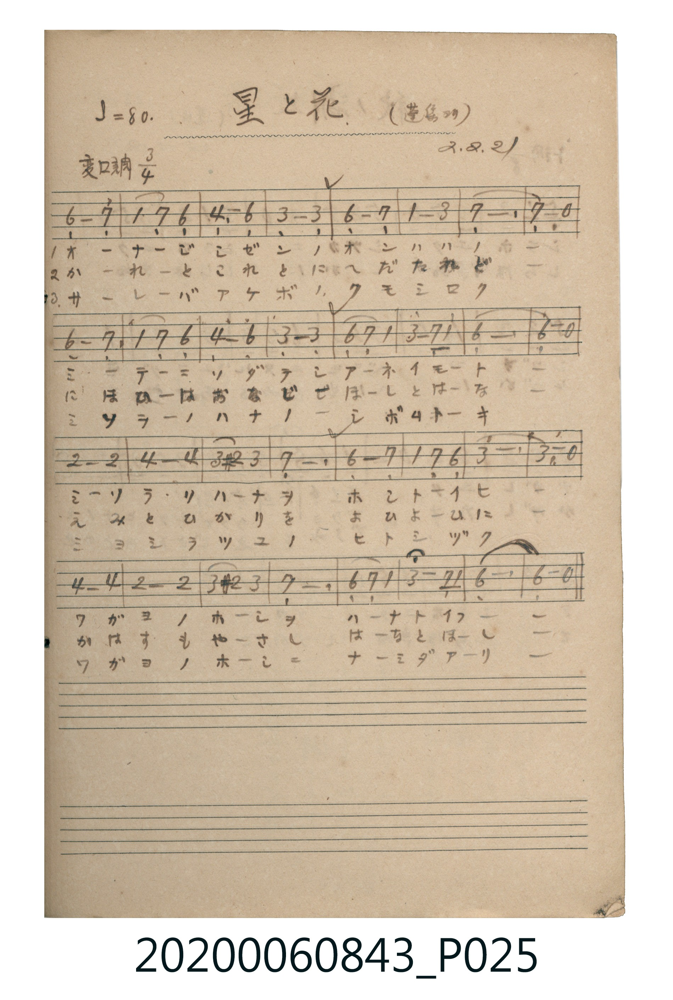

# 星と花（星與花）

> Re:Shōka 使用 AI 協助辨識與重建樂譜，可能會有錯誤。歡迎回報。

- **鋼琴伴奏版**：<br><audio controls src="hoshi_to_hana.mp3"></audio>

- 出處：蓬集ヨリ（昭2.2.21）
- 《唱歌帖》（2020.006.0843）P025.jpg

## 說明

原書資訊與歌詞全文（對應 P025.jpg）：
調性與拍號：変ロ調 / ト短調 3/4 拍（G 小調 3/4 拍），♩=80
註記：(蓬集ヨリ) / 2.2.21


## 歌詞

```text
一、
ミソラ ニ ニホフ ホシ ノ カゲ
ノヤマ ニ サケル ハナ ノ イロ
カガヤク ホシ ハ ソラ ノ ハナ
カヲレル ハナ ハ チ ノ ホシ ヨ

二、
ゆふべ の そら に ほし いでて
やさしき はな の つゆ を てらす
あした の のべ に はな さきて
きえゆく ほし の かげ を おくる
```

## ABC

<div class="abc-score" data-abc-src="hoshi_to_hana.abc" aria-label="五線譜載入中"></div>

[下載 ABC 原始檔](hoshi_to_hana.abc)

## TMD 檔案連結

- [主旋律 TMD 檔案](hoshi_to_hana.tmd) [[在 TMD Studio 編輯](https://tmdlang.github.io/Tmd-TS/#tmd=s7IKdvYPcrWy4qpTUCpJTLdSSM7PyUlNLsnMz7MqzsjPTkzOyFeCS5bl55TmploBqXgDC4RwcX5pUXJqfEFieqpVgIGRKboM3KT4vPyS1KT8_GwMFRn5RYmZ8WB1xRmlCOmCovyy1LzEPKCS3MS80uLkosyCkvjk_IJKhJrUssyUVJCK1JTMkvyizMQcJBenFhWD_QJxYklRYh7EDKAgQlVJRirQWwU5iXkl6IJ5iSWlRakIUaD56Zl5ViWJmUDHghxcnhifm5iZB9SbgqyqJCM_vSixIKPSKiOzGOSq5MSc-OzEvEQlLi0thWcz5j9uXPGia-P7PR1A9ouOdjC7U0FLi0vRVsHCgMveVsFJh8vGWN_EDmTq0_ZdL2ZOfb9n1ovJa17ObnvcvOJx8yqw5rVGekBoCNQMtv5xQ9fTKRufre15umPa44ZuoBIjAyMDPQMDMz0DCxNjoDJQDOllFaQrcXHpaynYUgtwKSgoPO2b_2z2jheb21-s6AL6CeiKFyvnPW1d8WxaO9AhTzf0PmvvVIDZD3QK0D8gbS9W7X_WsBykobv3xcz5QNGnSzofN68FiivoKzxu7ng-H8wGBoYCUAnQKHeFpxv6UYSAZvU8mrnSFhh0IBNX7H6xYgbQIA3k8NIEmgYJLS6Qoic7Gh43NIJYj5vnP27a-7h5JZDVDcKPm2c_bp4KZM1-3LQdSPUpPG5a_bhpE0Rx3-PmJY-b50EUN2193LTxcfNqIK__cXMXVDFQfi1YMUjbGpD6pvUI4_qB4lDrgIrB-mCKmzc9bgaqRzIOqLi5EaoSqn8FxP27emDub2p73Lj1ceNOhceN64B47uOmTiAFNKRx9-PG6UCq5XHj8seNyyCKgZypQOHHjb1AmfWPG1dBtQEd2QaUngRkLgOa8LhxJlh9YxNY8XyoqnUQe0CGQ_UCDeuFGQ5idYDdA3Q3zHaQtu7HjUCDwYZ3ASUfN3WD1FOe7qBAQUufi8sjvzgjMyTfA5jNrAIyE_PyHWoMaqpB9ijYWGjZgRnVuQW1YEaNglm8gi4YmoMYNQqGMCZYokbBBCYP5RtDuSAau26ELFgQBpG4BiAu9ewHKwfpQ8gChQyRDYc4AM5FdoARVAxEA62D8kA0xDgjdVz-IeR0mGMgqmE8ZLtRbUN1CRF2k-vxWi4uXTsFpISiAOQqcwEA)]
- [鋼琴伴奏 TMD 檔案](hoshi_to_hana_piano.tmd) [[在 TMD Studio 編輯](https://tmdlang.github.io/Tmd-TS/#tmd=s7IKdvYPcrWy4qpTUCpJTLdSyC8qychPL0osyKi0ysgsLskvykxOzInPTsxLVIIrKs4vLUpOjS9ITE-1CjAwMkXIlGSk5qZaFacmFufnFStxaWkpPJsx_3HjihddG9_v6QCyX3S0A9mPm3e_7N7zfMKWJ3u2PF3a_7yz4_2eTgUtLS5FWwULAy57WwUnHS4bY30TO5DJT9t3vZg59f2eWS8mr3k5u-1x84rHzavAxq010gNCQ6BmsBMeN3Q9nbLx2dqepzumPW7oBioxMjAy0DMwMNMzsDAxBioDuVYvqyBdiYvLI784IzMk3wPoM6uAzMS8_CAPhxqDmmouBSCwsdCyAzOqcwtqwYwaBeN4bbN4BV0wNAcxahTM4rUNYTywXI2CCUwJlG-qHq9tHq9tDBUF0fiMgugEK4fphYqCIJqQAUiIdq6DagQbgqEUKGmIZi3EhcgiyA4EGmQEFQbRYAETqACIBguATDdSJxAGxHkVzb3IwQcXRHMfhnMwHEyS-4gOP3jMI-mHi0HcWIslwfogJ1gTWIKFp1ez-Ph4oFnxEAYm3wjGBDFAtsYDHQVVQlg3mnIQCXIrIjSpYrkJ0U5DthzNcDQuAZ_gdDlWt6D7mzpWk-ptYOrQtVNASiAKmFxlLgA)]

## 分析

```text
================================================================================
📊 TMD Song Profile: [ 星と花（星與花） ]
================================================================================
⏱  Duration:       1:12 (72.0s), 32 measures total
🎼 Key & Tempo:    首調基準 B,, != 80.0 BPM, <3/4>
   - 分析範圍：      由實際發聲的音符與和弦推測調性；播放脈絡另行呈現
🎤 人聲音域:    D#4 (MIDI 63) – D#5 (MIDI 75) [跨度: 12 個半音 / 1.0 個八度, 難度: easy]
   - 最低音:  D#4 in [HoshiToHana #1 @ m.3, 0:04]
   - 最高音: D#5 in [HoshiToHana #1 @ m.18, 0:38]
   - 適合: soprano, mezzo-soprano, contralto, tenor, baritone, bass
🏛  結構:      HoshiToHana (72.0s)
⚡ 編曲密度:        Peak 1 軌道同時演奏
🗝  調性診斷：       G 小調（純淨自然小調，未偵測到可信轉調）
   - 風格氣質:    純淨自然小調（陰鬱抒情、旋律集中，無明顯調外色彩）
   - 轉調歷程:    全曲維持單一推測調性（未偵測到可信轉調）
   - 核心骨幹音:  G, A, D, D#, A#
   - 調性數值:    G 小調 [相關度: 0.76, 穩定度: Moderate, 自然音純度: 97.8%]
   - 候選調性 (K-S): G 小調 (0.76), G 大調 (0.64), D 大調 (0.58)
   - 五度圈歷程:   +1
   - 各段落調性細節:
     • [HoshiToHana #1]: G 小調 (r: 0.76, 自然音純度: 97.8%, 調外音: C#)

  [ 五度圈游移軌跡 ]
               C  
         F           [G ]*
      Bb               D  
      Eb               A  
         Ab           E  
            Db       B  
               F# 
     (* = active key center)

  [ 十二半音累積音高分佈 ]
     C  : ██████                     6.5%
     C# : ██                         2.2%
     D  : ███████████████████       21.7%
     D# : ██████████                10.9%
     E  :                            0.0%
     F  :                            0.0%
     F# :                            0.0%
     G  : ████████████████████████  27.2%
     G# :                            0.0%
     A  : ████████████████████      22.8%
     A# : ████████                   8.7%
     B  :                            0.0%
--------------------------------------------------------------------------------
Assignment 軌道音域：
  - Piano         : D#4 – D#5 (12 個半音 / 1.0 個八度, 63 個音符)
================================================================================
```


## 原書掃描頁




