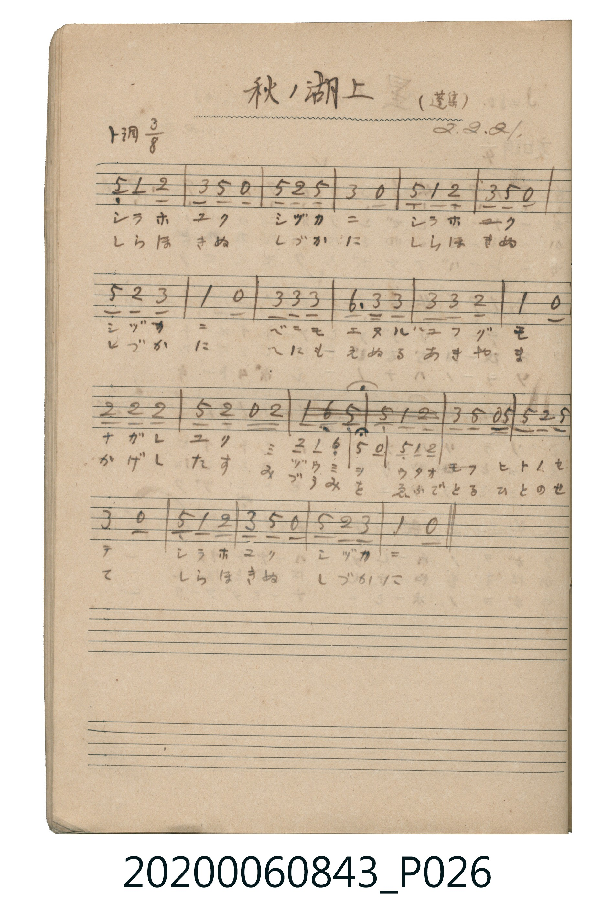

# 秋ノ湖上（秋日湖上）

<audio controls src="aki_no_kojo.mp3"></audio>

- 出處：蓬集（昭2.2.21）
- 《唱歌帖》（2020.006.0843）P026.jpg

## 說明

原書資訊與歌詞全文（對應 P026.jpg）：
調性與拍號：ト調 3/8 拍（G 大調 3/8 拍）
註記：(蓬集) / 2.2.21

## 跨冊／重複收錄參照

> 同名異曲（各冊收錄之不同詞曲版本）

- **[同名異曲]** 《新定兒童唱歌》高等科女子用（2020.006.0849）：[**〈秋の湖上〉**](../../../shintei_jido_shoka/koto_girls_2020.006.0849/2_2_03_aki_no_kojo/index.md)（`A` / `3/8` — [原始 TMD](../../../shintei_jido_shoka/koto_girls_2020.006.0849/2_2_03_aki_no_kojo/aki_no_kojo.tmd)）
- 總表：[跨冊重複與同名歌曲總索引](../../../duplicate_songs.md)

## 歌詞

```text
一、
アキ ノ ミヅウミ ミヅ スミテ
カガミ ノ ゴトク カゲ ヲ ウツス
モミヂ ノ ヤマ モ ソラ ノ クモ モ
フネ ノ ユクヘ ニ ウカビ イヅ

二、
しづかに こぎゆく さを の おと
すずしき かぜ に さざなみ たつ
ゆふひ に にほふ みづ の うへ
あき の ながめ の うつくし や
```

## ABC

```abc
X:1
T:秋ノ湖上（秋日湖上）
M:3/8
L:1/16
Q:1/8=216
K:G
V:V1 name="Piano" snm="Pia"
[V:V1]
!mp! D2 G2 A2 | B2 d2 z2 | d2 A2 d2 | B4 z2 |
D2 G2 A2 | B2 d2 z2 | d2 A2 B2 | G4 z2 |
B2 B2 B2 | e3 B B2 | B2 B2 A2 | G4 z2 |
A2 A2 A2 | d2 A2 z A | G2 E2 D2 | D2 G2 A2 |
B2 d2 z d | d2 A2 d2 | B4 z2 | D2 G2 A2 |
B2 d2 z2 | d2 A2 B2 | G4 z2 | !mp! D2 G2 A2 |
B2 d2 z2 | d2 A2 d2 | B4 z2 | D2 G2 A2 |
B2 d2 z2 | d2 A2 B2 | G4 z2 | B2 B2 B2 |
e3 B B2 | B2 B2 A2 | G4 z2 | A2 A2 A2 |
d2 A2 z A | G2 E2 D2 | D2 G2 A2 | B2 d2 z d |
d2 A2 d2 | B4 z2 | D2 G2 A2 | B2 d2 z2 |
d2 A2 B2 | G4 z2 |
```

## TMD 檔案連結

- [主旋律 TMD 檔案](aki_no_kojo.tmd) [[在 TMD Studio 編輯](https://tmdlang.github.io/Tmd-TS/#tmd=s7IKdvYPcrWy4tLSUni-vPtxc9-zndOe7Oh6v6cDyH02fSmM26mgpcWlaKtgaGDBZW-r4M5lY6xvYcdVp6D0tH3Xi5lT3--Z9WLympez24A6n81Ya6QHhIZAbUogJY8bup5O2fhsbc_THdMeN3QDlRgZGBnoGRiY6RlYmBgDlQUYGJnpZRWkK3Fx6Wsp2FILcCkoKDztm_9s9o4Xm9tfrOh60dEOdMWLlfOetq54Nq0d6JCnG3qftXcqwOwHOgXoE5C2F6v2P2tYDtLQ3fti5nyg6OPmDqCgAtDfCkAxoF53hadLlqMIdYJ1rtj9YsUMoAYNSIhoKugrQMKDCyT9ZEfD44ZGEOtx06LHTWsVgIEOxPMfN7c-bloGZEA5QOmdYFYbRO3qx01rILJA5U1bgK553LQeIr4JKAjEIN0tQF1g9c2LwJqboMYvedw8DyQIVLX3cfNKqCnrwSLNiyA6pj5u7oUqXwaWmwFkdYPNBdrSPBnIAhrTCvHFrh6YLxqnP25c-rix-3HjaiBn8uPGvsdNbY8b-4GcqY-bJgGpdUDc9bhxBUT5zMeNs8CagJaBdM0BUiCdUx83TnvcuOpx434gZ_7jxiUQfwON2vq4Eeg9sKLVjxt3AwWArP1AW6FmA5XsgJjdBDEVJAg0qOdxUyNCyRKgm4D2Ao1sASmmPHVBgYKWPheXY3amX753fla-VUBmYl6-Q41BjUI1yBoFG0MzLTswqzq3oBbMqFEwjVfQVTAEYiMgrlEwBpKmQGwA5oFYIHEQDZEDQagcHo0ws6GyILkasFqEdpAYDNcomIFljKE8mDjEZBR9UJNBMjCMsMcASELUm4EcB3YhHoeaovsQajjx_sTnQ65aLi5dOwV4dCigc5S5AA)]
- [鋼琴伴奏 TMD 檔案](aki_no_kojo_piano.tmd) [[在 TMD Studio 編輯](https://tmdlang.github.io/Tmd-TS/#tmd=s7IKdvYPcrWy4tLSUni-vPtxc9-zndOe7Oh6v6cDyH02fSmE-7h598vuPc8nbHmyZ8vTpf3POzve7-lU0NLiUrRVMDSw4LK3VXDnsjHWt7DjqlNQetq-68XMqe_3zHoxec3L2W1As57NWGukB4SGQG1KICWPG7qeTtn4bG3P0x3THjd0A5UYGRgZ6BkYmOkZWJgYA5UFGBiZ6WUVpCtxcTlmZ_rle-dn5VsFZCbm5Qd5ONQY1ChUcykAgY2hmZYdmFWdW1ALZtQomMYr6CoYArERENcoGGobA2ljbVMgaQAWMY8Hc0DSUCZMFQhC1BAyBGoXVD-QgpoGUgbSrQ3SizAOoh-ZBImZgVUYI4kg5E3VIWbWKJihGYawGmonEoXuIgOg-4EmAM0CGWEG8pQRUAGIJuBHU-wBBbWc1ODCF1CoRnHVYkS5D44oh8e4Ich203gEiSIEZoKsgvgeryJiTIInMyLMMwNzjEEEhFmjYIKQhwkZg2mYWlSdUBkCNmMRMoIKYSoDhTM0WRIRSphhTEJYERVKoCjXtVOAx7oCOkeZCwA)]

## 分析

```text
================================================================================
📊 TMD Song Profile: [ 秋ノ湖上（秋日湖上） ]
================================================================================
⏱  Duration:       0:38 (38.3s), 46 measures total
🎼 Key & Tempo:    首調基準 G, != 108.0 BPM, <3/8>
   - 分析範圍：      由實際發聲的音符與和弦推測調性；播放脈絡另行呈現
🎤 人聲音域:    D4 (MIDI 62) – E5 (MIDI 76) [跨度: 14 個半音 / 1.2 個八度, 難度: moderate]
   - 最低音:  D4 in [AkiNoKojo #1 @ m.1, 0:00]
   - 最高音: E5 in [AkiNoKojo #1 @ m.10, 0:07]
   - 適合: soprano, mezzo-soprano, contralto, tenor, baritone, bass
🏛  結構:      AkiNoKojo (19.2s) -> AkiNoKojo (19.2s)
⚡ 編曲密度:        Peak 1 軌道同時演奏
🗝  調性診斷：       D 大調（純淨自然大調，未偵測到可信轉調）
   - 風格氣質:    純淨自然大調（陽光明朗、易唱易記，無明顯調外色彩）
   - 轉調歷程:    全曲維持單一推測調性（未偵測到可信轉調）
   - 核心骨幹音:  D, B, A, G, E
   - 調性數值:    D 大調 [相關度: 0.78, 穩定度: Moderate, 自然音純度: 100.0%]
   - 候選調性 (K-S): D 大調 (0.78), G 大調 (0.73), B 小調 (0.73)
   - 五度圈歷程:   +2 -> +2
   - 各段落調性細節:
     • [AkiNoKojo #1]: D 大調 (r: 0.78, 自然音純度: 100.0%)
     • [AkiNoKojo #2]: D 大調 (r: 0.78, 自然音純度: 100.0%)

  [ 五度圈游移軌跡 ]
               C  
         F            G  
      Bb              [D ]*
      Eb               A  
         Ab           E  
            Db       B  
               F# 
     (* = active key center)

  [ 十二半音累積音高分佈 ]
     C  :                            0.0%
     C# :                            0.0%
     D  : ████████████████████████  27.5%
     D# :                            0.0%
     E  : ████                       4.2%
     F  :                            0.0%
     F# :                            0.0%
     G  : ████████████████          18.3%
     G# :                            0.0%
     A  : ████████████████████      22.5%
     A# :                            0.0%
     B  : ████████████████████████  27.5%
--------------------------------------------------------------------------------
Assignment 軌道音域：
  - Piano         : D4 – E5 (14 個半音 / 1.2 個八度, 112 個音符)
================================================================================
```


## 原書掃描頁




