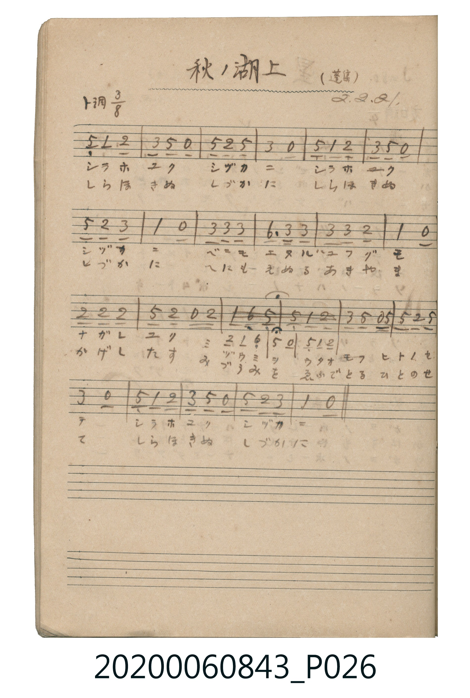

# 秋ノ湖上（秋日湖上）

> Re:Shōka 使用 AI 協助辨識與重建樂譜，可能會有錯誤。歡迎回報。

- **鋼琴伴奏版**：<br><audio controls src="aki_no_kojo.mp3"></audio>

- 出處：蓬集ヨリ / 特選樂譜
- 《唱歌帖》（2020.006.0843）P026.jpg

## 說明

原書資訊與歌詞全文（對應 P026.jpg）：
調性與拍號：ト調 3/8 拍（G 大調 3/8 拍）
註記：(蓬集) / 2.2.21


## 歌詞

```text
一、
シラホ ユク シヅカ ニ
シラホ ユク シヅカ ニ
ベニ モエヌル ユフグモ
ナガレ ユク ミヅウミ ヲ
ウタ オモフ ヒト ノセテ
シラホ ユク シヅカ ニ

二、
しらほ きぬ しづか に
しらほ きぬ しづか に
べに もえぬる あきやま
かげ ひたす みづうみ を
ゑふで とる ひと のせて
しらほ きぬ しづか に
考證資訊：與《新定兒童唱歌》高等科女子用〈秋の湖上〉（高二第二學期第 3 首，標註「特選樂譜」）完全同曲同詞，出自成樂會（原田彦四郎）《特選樂譜》。
```

## ABC

<div class="abc-score" data-abc-src="aki_no_kojo.abc" aria-label="五線譜載入中"></div>

[下載 ABC 原始檔](aki_no_kojo.abc)

## TMD 檔案連結

- [主旋律 TMD 檔案](aki_no_kojo.tmd) [[在 TMD Studio 編輯](https://tmdlang.github.io/Tmd-TS/#tmd=s7IKdvYPcrWy4qpTUCpJTLdSSM7PyUlNLsnMz7MqzsjPTkzOyFeCS5bl55TmploBqXgDC4RwcX5pUXJqfEFieqpVgIGRGboM3KT4vPyS1KT8_GwMFRn5RYmZ8WB1xRmlCOmCovyy1LzEPKCS3MS80uLkosyCkvjk_IJKhJrUssyUVJCK1JTMkvyizMQcJBenFhWD_QJxYklRYh7EDKAgQlVJRirQW-WpiUBGEbpwcWpicX5eMbpwWmJuZg6SK4AWp2fmWZUkZgJ9AfJJeWJ8bmJmXk5iXgqyqpKM_PSixIKMSquMzGKQc5MTc-KzE_MSlbi0tBSeL-9-3Nz3bOe0Jzu63u_pAHKfTV8K43YqaGlxKdoqGBpYcNnbKrhz2RjrW9iBzH7avuvFzKnv98x6MXnNy9ltj5tXPG5epaCv8Lxz58vGHc9WNL1YOwfsiMcNXU-nbHy2tufpjmmPG7qBVhgZGBnoGRiY6RlYmBgD7QBFoF5WQboSF5e-loIttQCXgoLC0775z2bveLG5_cWKrhcd7UBXvFg572nrimfT2oEOebqh91l7pwLMfqBTgP4BaXuxav-zhuUgDd29L2bOB4o-bu4ACioAfa8AFAPqdVd4umQ5ilAnWOeK3S9WzABq0ICEiyYwSIz0gNCQCyT9ZEfD44ZGEOtx0_bHzSsfN89WeNy87HHTeohA6-Om1UCBbiJVNM8EsoDUosdNwODvedwMklr2uHnq46YNQFGImq7HTWseN6-Bm9I8H2wKUNl8IGcTxCqg1H4gtQpkVvNUoPgkoI-BVN_jpt2Pm9uIcA_Ye7t6YN5rnP64qfNx424gq_dxI9B2oEDj0seNQOc2riZWxU4gC2hN0-PGDqCKx00gKSCn93FTy-PGfRA13Y8bJwGpTY8b5z9unAlk7Qeb0gZkALVOgrh84uPGrY8blwNlV0BMASpfAaTWPW6c_bhxGXHuedHQ_GJtJyQxgRJ-RzswbT-btuHpullPWyc9X70Uks6Bifzl6hnP13Y-Xz7x6dLNT9dOeD5lxeMGUM4CWgjJWY8bgEmtA6gMGGLP16wBkk_X7ng2Zz6QrWCs8HLZtPd7ep6tmAlMTY8bepCz1OMGUEp7uq4HmIifTuh5NnsTkASmaaB6UI5sX_WsYwJQ5bM5zaD03Tf_-ZQNT_cuezp79svmPqBGoINRTet-3NAE8hvl2Q0KFLT0ubgcszP98r3zs_KtAjIT8_IdagxqqkG2KNgYmmnZgVnVuQW1YEaNgmm8gq6CIRAbAXEN0P-6CqZAbADmgVggcRANkQNBqBwejTCzobIguRqwWoT26ty0WrAEDNcomIGljaE8mDjEeBTNUOOrgSaAZGEYYaEBkKwBs0D6zEAuhToY2QEFtbg9YYrhCWxhUI3PCIgCkArcwcBVy8Wla6cAjzIFIEeZCwA)]
- [鋼琴伴奏 TMD 檔案](aki_no_kojo_piano.tmd) [[在 TMD Studio 編輯](https://tmdlang.github.io/Tmd-TS/#tmd=s7IKdvYPcrWy4qpTUCpJTLdSyC8qychPL0osyKi0ysgsLskvykxOzInPTsxLVIIrKs4vLUpOjS9ITE-1CjAwMkPIlGSk5qZapaaUJieWZObnKXFpaSk8X979uLnv2c5pT3Z0vd_TAeQ-m74Uwn3cvPtl957nE7Y82bPl6dL-550d7_d0KmhpcSnaKhgaWHDZ2yq4c9kY61vYgWx42r7rxcyp7_fMejF5zcvZbY-bVzxuXqWgr_C8c-fLxh3PVjS9WDsH7JTHDV1Pp2x8trbn6Y5pjxu6gZYaGRgZ6BkYmOkZWJgYA-0AuVovqyBdiYvLMTvTL987PyvfKiAzMS8_yMOhxqCmmksBCGwMzbTswKzq3IJaMKNGwTReQVfBEIiNgLhGwVDbGEgba5sCSQOwiHk8mAOShjJhqkAQooaQIVC7oPqBFNQ0kDKQbm2QXoRx1blptVBDkEmQwWZgZcZIIgh5U3WIwTUKZmgmQu2vBhqLsByJQneaAdAjQFOg5oFokHFmIF_WKBgBlYJYyO4tqMUfBqboYYA3OKsJGQdRBFSFJ0RRzeSqxUgaPtiTBjxlGIJcYBqPIFGEwEyQTSDaCL8iYkyCJ0cizAOHtxlYxBhEQJg1CiYIRTAhYzANUwsRQ-YB2cjWg1MeFjdgETJCMhksgaIKEZFU9zwo3qkWN6B0oWunAE8aCugcZS4A)]

## 分析

```text
================================================================================
📊 TMD Song Profile: [ 秋ノ湖上（秋日湖上） ]
================================================================================
⏱  Duration:       0:20 (20.0s), 24 measures total
🎼 Key & Tempo:    首調基準 G, != 108.0 BPM, <3/8>
   - 分析範圍：      由實際發聲的音符與和弦推測調性；播放脈絡另行呈現
🎤 人聲音域:    D4 (MIDI 62) – E5 (MIDI 76) [跨度: 14 個半音 / 1.2 個八度, 難度: moderate]
   - 最低音:  D4 in [AkiNoKojo #1 @ m.1, 0:00]
   - 最高音: E5 in [AkiNoKojo #1 @ m.10, 0:07]
   - 適合: soprano, mezzo-soprano, contralto, tenor, baritone, bass
🏛  結構:      AkiNoKojo (20.0s)
⚡ 編曲密度:        Peak 1 軌道同時演奏
🗝  調性診斷：       D 大調（純淨自然大調，未偵測到可信轉調）
   - 風格氣質:    純淨自然大調（陽光明朗、易唱易記，無明顯調外色彩）
   - 轉調歷程:    全曲維持單一推測調性（未偵測到可信轉調）
   - 核心骨幹音:  D, B, A, G, E
   - 調性數值:    D 大調 [相關度: 0.79, 穩定度: Moderate, 自然音純度: 100.0%]
   - 候選調性 (K-S): D 大調 (0.79), G 大調 (0.72), B 小調 (0.71)
   - 五度圈歷程:   +2
   - 各段落調性細節:
     • [AkiNoKojo #1]: D 大調 (r: 0.79, 自然音純度: 100.0%)

  [ 五度圈游移軌跡 ]
               C  
         F            G  
      Bb              [D ]*
      Eb               A  
         Ab           E  
            Db       B  
               F# 
     (* = active key center)

  [ 十二半音累積音高分佈 ]
     C  :                            0.0%
     C# :                            0.0%
     D  : ████████████████████████  28.2%
     D# :                            0.0%
     E  : ███                        4.0%
     F  :                            0.0%
     F# :                            0.0%
     G  : ███████████████           17.7%
     G# :                            0.0%
     A  : ████████████████████      23.4%
     A# :                            0.0%
     B  : ███████████████████████   26.6%
--------------------------------------------------------------------------------
Assignment 軌道音域：
  - Piano         : D4 – E5 (14 個半音 / 1.2 個八度, 57 個音符)
================================================================================
```


## 原書掃描頁




