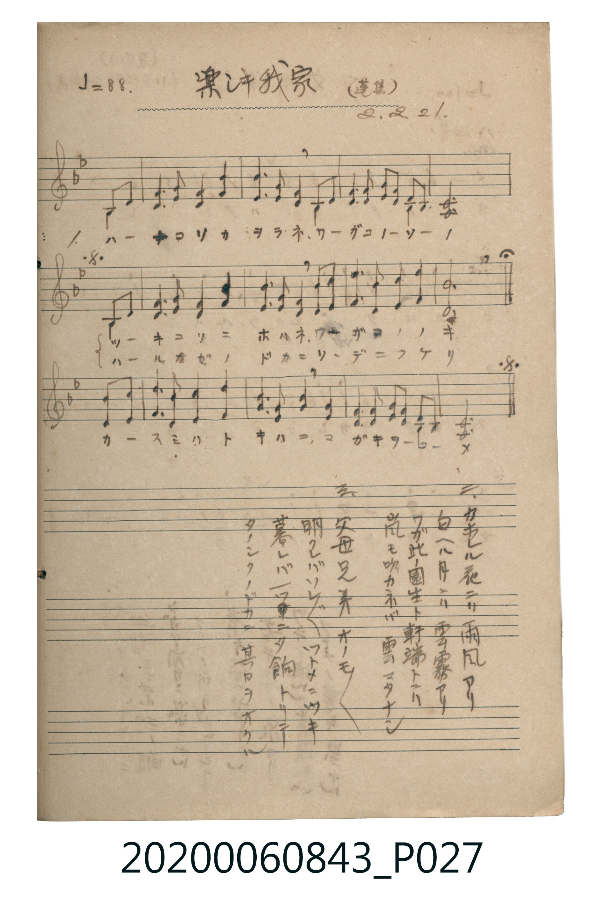

# 樂シキ我家（快樂的我家）

<audio controls src="tanoshiki_waga_ie.mp3"></audio>

- 出處：蓬集（昭2.2.21）
- 《唱歌帖》（2020.006.0843）P027.jpg

## 說明

原書資訊與歌詞全文（對應 P027.jpg）：
調性與拍號：変ロ調 4/4 拍（Bb 大調 4/4 拍），♩=88（五線譜二部合唱，D.S. al Fine）
註記：(蓬集) / 2.2.21

## 跨冊／重複收錄參照

> 同詞異曲＋同名異曲（《新定兒童唱歌》六年級〈樂しき我家〉與《唱歌帖》P027〈樂シキ我家〉同採「花こそ薫らねわがこの園」歌詞而譜曲不同；《唱歌帖》P102〈樂しき我家〉則採英國名曲 *Home! Sweet Home!*〈埴生の宿〉旋律）

- **[同詞異曲]** 《新定兒童唱歌》尋常科第六學年用（2020.006.0847.0006）：[**〈樂しき我家〉**](../../../shintei_jido_shoka/grade_6_2020.006.0847.0006/3_04_tanoshiki_wagaya/index.md)（`E` / `6/8` — [原始 TMD](../../../shintei_jido_shoka/grade_6_2020.006.0847.0006/3_04_tanoshiki_wagaya/tanoshiki_wagaya.tmd)）
- **[同名異曲]** 楊金土手抄《唱歌帖》第 2 冊・II（2020.006.0843）：[**〈樂しき我家〉**](../../vol_02/p102_tanoshiki_wagaya/index.md)（`B,` / `4/4` — [原始 TMD](../../vol_02/p102_tanoshiki_wagaya/tanoshiki_wagaya.tmd)）
- 總表：[跨冊重複與同名歌曲總索引](../../../duplicate_songs.md)

## 歌詞

```text
一、
ハナ コソ カヲラネ ワガ コノ ソノ
ツキ コソ ニホハネ ワガ コノ ノキ
カスミ ハ トキハ ニ マガキ ヲ コメ
ハルカゼ ノドカニ ソデ ニ フケリ

二、
カヲレル 花ニハ 雨風アリ
匂ヘル 月ニハ 雲霧アリ
ワガ此ノ 園生ト 軒端トニハ
嵐モ 吹カネバ 雲マタナシ

三、
父母兄弟 オノモ〳〵
明クレバ ソレ〲 ツトメニツキ
暮レバ 一ツニ 夕餉トリテ
タノシク ノドカニ 其日ヲオクル
```

## ABC

```abc
X:1
T:樂シキ我家（快樂的我家）
M:4/4
L:1/16
Q:1/4=88
K:Bb
V:V1 name="Alto" snm="Alt"
V:V2 name="Soprano" snm="Sop"
[V:V1]
!mp! z4 z4 z4 F2 F2 | B6 B2 B4 B4 | G6 G2 F4 F2 F2 | F6 F2 F4 F4 |
F12 F2 F2 | B6 B2 B4 B4 | G6 G2 F4 F2 F2 | F4 B4 A4 A4 |
B12 d4 | c4 A2 F2 B4 B4 | A6 F2 F6 F2 | G6 G2 F2 F2 F2 F2 |
F12 F2 F2 | B6 B2 B4 B4 | G6 G2 F4 F2 F2 | F4 B4 A4 A4 |
B12 z4 |
[V:V2]
!mf! z4 z4 z4 F2 B2 | d6 d2 d4 f4 | e6 c2 B4 A2 c2 | B6 B2 c4 A4 |
B12 F2 B2 | d6 d2 d4 f4 | e6 c2 B4 A2 c2 | B4 d4 c4 f4 |
d12 f4 | f4 e2 c2 d4 f4 | e6 c2 B6 B2 | c6 c2 d2 c2 B2 A2 |
B12 F2 B2 | d6 d2 d4 f4 | e6 c2 B4 A2 c2 | B4 d4 c4 f4 |
B12 z4 |
```

## TMD 檔案連結

- [主旋律 TMD 檔案](tanoshiki_waga_ie.tmd) [[在 TMD Studio 編輯](https://tmdlang.github.io/Tmd-TS/#tmd=s7IKdvYPcrWy4tLSUni2oulx0_bHTWufdUx8um7b-z0dT_evBgo-n9UCE-lU0NLiUrRVsLDgsrdVcNLhsjHRN7HjqlNQetq-68XMqe_3zHoxec3L2W1Azc9mrDXSA0JDoDYlkJLHDV1Pp2x8trbn6Y5pjxu6gUqMDIwM9AwMzPQMLEyMgcoCDIzM9bIK0pW4uPS1FGypBbgUFBSe9s1_NnvHi83tL1Z0vehoB7rixcp5T1tXPJvWDvLoht5n7Z0KMPuBTgH6BKTtxar9zxqWgzR0976YOR8o-nRJ5-PmtUBxBaDXFYDCQO1OSQpPlyxHEQMa0PNo5kpbCwug_JNdU55vn_Vi7Zwnu3peNq94OqEDGBBABS56wXoKiTkKbpl5qUAtYAtX7H6xYgbQHg1IQGoq6CtAgpELJP1kR8PjhkYQ63Fz_-PmLoXHTZsfN-0FUqsfN2963LzycXMvUGr946Y1YKnmPiC1F0hBtLQAYxeupbn7cfNssDEYWpr7gArBWoDmNu183DwfZB8QdwDFIaxuIJ4H1AM2sXkTROtCuMuA2oBoD9io5k6w84A6QE5ph2qe-rhp4-PmVRBv7eqBeQvqkTVAIxRedAFVAF3Zr_By9oqXi1Y8bloE0gGKzp6mx80zQGqezemAq9n0cs5yhBqIn56tXQLy0tM5k55PmQ_0gMKL3ZOer14P8gpYG9i0rRMeNy9SeDphJ9j63sfNE0CmgT24HxjKwGwBDf1OqDOfd2x7tr73aWvL0z3AoGlaBfbmoscNmx83bAXJP5sBDEGgJUBvTIB4e83jBmAgAWMAZPFCsN2g2AArnrUOqhIUvSAl3cD0NPUlKKUBFQMNb4MEDdAtQGOBWXQ9arg-bd32bPpSULgBXQKydjVIPeUZBwoUtPS5uEIS8_KLMzKzM8MT0xM9U62C8wuKgEIONQY1CtUg6xRsLLTswIzq3LRaMKNGwUBBF45N4xUMgULGQKYukATRpkBco2ACFjECyuoqmMcDGTVgpi6QNIIIgVRBhCAQYhTUDqINBCkAGQhRBNEGNQ8kAjUOxDYBqsNuHMhRNWBTQCLGYFGgFdR3HrJ5oNCr4arFjATHnBIcMVCAIwaACBG6IBqEaxTMQGGsC6KAChAKwRwYF0yDFENF4X4FKYXaRprJ0ADAGsWg0ICZCk0F4GCFmQvWgnAamIVmGxzRycnwaNK1U0CLKQWgkDIXAA)]
- [鋼琴伴奏 TMD 檔案](tanoshiki_waga_ie_piano.tmd) [[在 TMD Studio 編輯](https://tmdlang.github.io/Tmd-TS/#tmd=s7IKdvYPcrWy4tLSUni2oulx0_bHTWufdUx8um7b-z0dT_evBgo-n9UCEXncvPtl957nE7Y82bPl6dL-550d7_d0KmhpcSnaKlhYcNnbKjjpcNmY6JvYcdUpKD1t3_Vi5tT3e2a9mLzm5ew2oHHPZqw10gNCQ6A2JZCSxw1dT6dsfLa25-mOaY8buoFKjAyMDPQMDMz0DCxMjIHKAgyMzPWyCtKVuLhCEvPyizMyszPDE9MTPVOtAjKBAkEeDjUGNQrVXApAYGOhZQdmVOem1YIZNQoGCrpwbBoPRNqGQFFDbWMgXxdMQ9iG2qZAskbBLF7bBCwFZBhBlIM0apuD9RoBVUDFwKKGEEGYCpABcGkIhNsJdQ8VbIZoM4dYDKQg2mEGQ6AxRBRqqRGYB1RqAjEK1WKwONRDcIuh3gM7C2QPwlnGSOogzhs4T4MkUfwNiuYarlocqcUHR2opwJZawEYpGMaDotU0HkxBOMZgskbBBCIIpaBKoBRMI0QtdjkUQyEOhwYXZXaa4ZPEaSmqclRb8ckR46LB4lNgutC1U0BLGgpAIWUuAA)]

## 分析

```text
================================================================================
📊 TMD Song Profile: [ 樂シキ我家（快樂的我家） ]
================================================================================
⏱  Duration:       0:46 (46.4s), 17 measures total
🎼 Key & Tempo:    首調基準 B,, != 88.0 BPM, <4/4>
   - 分析範圍：      由實際發聲的音符與和弦推測調性；播放脈絡另行呈現
🎤 人聲音域:    F4 (MIDI 65) – D5 (MIDI 74) [跨度: 9 個半音 / 0.8 個八度, 難度: easy]
   - 最低音:  F4 in [TanoshikiWagaIe #1 @ m.1, 0:02]
   - 最高音: D5 in [TanoshikiWagaIe #1 @ m.9, 0:23]
   - 適合: soprano, mezzo-soprano, contralto, tenor, baritone, bass
🏛  結構:      TanoshikiWagaIe (46.4s)
⚡ 編曲密度:        Peak 2 軌道同時演奏
🗝  調性診斷：       A# 大調（純淨自然大調，未偵測到可信轉調）
   - 風格氣質:    純淨自然大調（陽光明朗、易唱易記，無明顯調外色彩）
   - 轉調歷程:    全曲維持單一推測調性（未偵測到可信轉調）
   - 核心骨幹音:  A#, F, D, C, A
   - 調性數值:    A# 大調 [相關度: 0.95, 穩定度: High, 自然音純度: 100.0%]
   - 候選調性 (K-S): A# 大調 (0.95), F 大調 (0.72), A# 小調 (0.60)
   - 五度圈歷程:   -2
   - 各段落調性細節:
     • [TanoshikiWagaIe #1]: A# 大調 (r: 0.95, 自然音純度: 100.0%)

  [ 五度圈游移軌跡 ]
               C  
         F            G  
     [Bb]*              D  
      Eb               A  
         Ab           E  
            Db       B  
               F# 
     (* = active key center)

  [ 十二半音累積音高分佈 ]
     C  : ██████                     8.2%
     C# :                            0.0%
     D  : █████████                 12.9%
     D# : ████                       5.1%
     E  :                            0.0%
     F  : ████████████████████      27.7%
     F# :                            0.0%
     G  : █████                      6.2%
     G# :                            0.0%
     A  : █████                      7.0%
     A# : ████████████████████████  32.8%
     B  :                            0.0%
--------------------------------------------------------------------------------
Assignment 軌道音域：
  - Alto          : F4 – D5 (9 個半音 / 0.8 個八度, 65 個音符)
  - Soprano       : F4 – F5 (12 個半音 / 1.0 個八度, 65 個音符)
================================================================================
```


## 原書掃描頁




