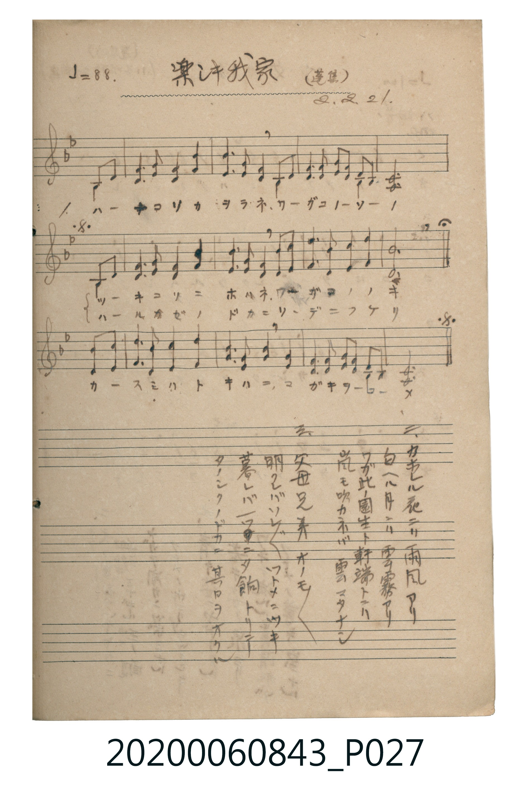

# 樂シキ我家（快樂的我家）

> Re:Shōka 使用 AI 協助辨識與重建樂譜，可能會有錯誤。歡迎回報。

- **鋼琴伴奏版**：<br><audio controls src="tanoshiki_waga_ie.mp3"></audio>
- **NEUTRINO 歌聲合成版**：<br><audio controls src="tanoshiki_waga_ie_neutrino.mp3"></audio>

- 作詞：里見義（改作）／出處：《蓬萊唱歌集》（昭2.2.21抄）
- 《唱歌帖》第八冊（2020.006.0843）P027.jpg

## 說明


- 出處：《唱歌帖》第八冊（2020.006.0843）P027.jpg
- 調性與拍號：調號 ?= B,，拍號 <4/4>，速度 != 88


## 歌詞

```text
> [!NOTE]
> **原頁資訊與歌詞全文**（對應 `P027.jpg`）：
> - **出處與抄寫日期**：標題「`樂シキ我家 (蓬集)`」，左上記「`♩= 88`」，右上記「`2. 2. 21.`」（昭和 2 年 2 月 21 日），抄自《蓬萊唱歌集》。
> - **曲調考證（非 Bishop〈Home, Sweet Home〉）**：歌詞首段沿用里見義〈楽しき吾家〉（明治 16 年《小學唱歌集》第二編第 28 首「花こそ薫らね」）詞意並改寫二、三段，惟《蓬萊唱歌集》並非採用常見之英國曲〈Home, Sweet Home〉，而係另行譜曲之**降 B 大調 4/4 拍二部合唱曲**。
> - **曲式結構（D.S. al Fine）**：全頁共三行五線譜（每行 4 小節）：
>   - 第一行（第 1–4 小節）：起句 A1，末拍弱起接第二行。
>   - 第二行（第 5–8 小節）：句首標有 Dal Segno 記號（`.S.`），第 8 小節二分音符 `1` 上方標有延音終止記號（Fine）；第一次唱畢末拍弱起 `1 2`（「カー」／「ワー」／「クー」）進入第三行。
>   - 第三行（第 9–12 小節）：中段 B，第 12 小節末拍弱起 `1_ 3_`（「ハー」／「アー」／「ター」）下方標有 `.S.`，返始回第二行重唱第 13–16 小節至 Fine 終止（共 16 小節完整曲式）。第三段第 14 小節末拍「其日（ソノヒ）」二字分唱兩個八分音符 `1 2`。
>
> **一、**
> ハナコソカヲラネ　ワガコノソノ
> ツキコソニホハネ　ワガコノノキ
> カスミハトキハニ　マガキヲコメ
> ハルカゼノドカニ　ソデニフケリ
>
> **二、（頁面下方手抄歌詞）**
> カヲレル花ニハ　雨風アリ
> 匂ヘル月ニハ　雲霧アリ
> ワガ此ノ園生ト　軒端トニハ
> 嵐モ吹カネバ　雲マタナシ
>
> **三、（頁面下方手抄歌詞）**
> 父母兄弟　オノモ〳〵
> 明クレバソレ〲　ツトメニツキ
> 暮レバ一ツニ　夕餉トリテ
> タノシクノドカニ　其日ヲオクル
```

## ABC

<div class="abc-score" data-abc-src="tanoshiki_waga_ie.abc" aria-label="五線譜載入中"></div>

[下載 ABC 原始檔](tanoshiki_waga_ie.abc)

## TMD 檔案連結

- [主旋律 TMD 檔案](tanoshiki_waga_ie.tmd) [[在 TMD Studio 編輯](https://tmdlang.github.io/Tmd-TS/#tmd=s7IKdvYPcrWy4qpTUCpJTLdSSM7PyUlNLsnMz7MqzsjPTkzOyFeCS5bl55TmploBqXgDC4RwcX5pUXJqfEFieqpVgIGROboM3KT4vPyS1KT8_GwMFRn5RYmZ8WB1xRmlCOmCovyy1LzEPKCS3MS80uLkosyCkvjk_IJKhJrUssyUVJCK4uTEvPiy1KLMtMzUFCRXpxYVg_0DcWZJUWIexBygIEJVflFJRn56UWJBRqVVRmZxSX5RZnJiTnx2Yl4iQlFJRirQ_2mJuZk5SA4AKk3PzLPKTc3MyowvSa0oQfUiVLo8tbgktSgvPjc1Jz8FqFtLS-HZiqbHTdsfN6191jHx6bpt7_d0PN2_Gij4fFYLTKRTQUuLS9FWwcKCy95WwUmHy8ZE38QOZPaTvXNerJz3fs-sl-09L5Z1P9-3Eqj_2ZSdQHGgtvd7-p-273oxcypQweOGrheT17yY0PV0ysZna3tezm573NANUjxjrZEeEBo-62oBagG7GKgWourpjmlAVc_XrHnauvppWxdQuZGBkYGegYGZnoGFiTFQPSiq9bIK0pW4uPS1FGypBbgUFBTsFKIV_fxDXGMhHC2tp33zXy5ofLG5_cWKrhcd7UD3Af3-tHXFs2ntWlqgcNvQ-6y9UyEB5qYEcBDMgmjXBRkADgyQ1q6Wp-tXP5u-9Nmc-SCts56tmPlyYc_jhp4EtOhQ0ACGGjCwNBMeN_S-39PzdPuyJzu6XqyYAVL7aOZKUKTApPo3I6SM9BRAyFAPIgkK5qeTehSMFJ7u3AIkn83pAEoqAF0AdmMP0EEv2ldhjaPHDU0IHzybvenFqv0vGppfrAVq63g5d56CUyYwxxQ8bujwyM9N1VEILk9NLVEAsR83AJV0QrwHDqqXy6Y9W7f12ab9z6esgKcXoMZnS_c-bpz-uLH36YR9QC-D9QEd3Pds024FQzOQi0EJYkP_07U7kB0GTBZPdvU8374CyFAwslAAGg_0-YuujY8bJz9unPti2urHTZ2PG9eCA6ATaP-zlv4nO5YBUycw7IE6Hzc0PtnRCXQRyP_N87F6Hqge6MdnfQuBTn66YwfQyU92dr_o3vh0TjcwKHB5uudFQ8-T_U1P-5e9WNjzYu0coFKgNi2tlzN7FZwUni5ZDgxDBWAWUnjW3Qt0yMvmFU8ndICsnb1JSws9vJ_u6X--dcKz5aDM4qIXrKeQmKPglpmXCgtbYAIEpsqnrRuBngFa92TXlOfbZwEtBYXh-n6giIKJAjDwnq9vQE6OCkDjQQG4owGoAqgUFIaGjxomo6p9sXX70_6lCo6GoCCasxro3Kd7NgIFn_UthYQ-UDPcvTAjwaJQI02BRlqgGAk0D5QOVsx8NqdTwQXol-DU9Lx8BWCyfTFzPlBXAtCLkIzTAzIAphlo6tOOtpfzNz9fs0whwTBBAZjUn03bCTHn6e5tIJmtTc_WLoIbBA2j93tmQ_z5bM1CYBA_n7oI2SNAoxSMgNZ1AFPO46bVj5v3gFNLP4jbvB6F2wTndr5s2PS0FRwC4CDHCAGwKDQELIEhYAjMdkhB8GTHWmCqU3CCehEui-aweAXjeJjTmvtR3bIIlbsf7rQnO7rhwaIADcueF_unPF3e_XT2PHj0vGzvBQUGyHZjkAOBuQzshBftm8GJSwESmKBCrXUjOBOCpZ-u63k2dQskUQItA3oc4l2gd8BmwVIPxCdApz1t3QYuYzoeN-193Nz3uHkSWBso1T9dOx0Yo0BXPG1d-bShG1TCI0UwMFZgwQorfoFxCMyywJoIzAcHSdfjps0gk0Ext-lx88rHzUBLG0Ax17QGJAW0EWwvTEsLsFyFamnuftw8G2wIhhaQrrVQLUCTm3Y-BpYOIJVAX6wFM4CFIlDLPLAWoMgmsMaFSA4D6gKiPWDTOsHOA2sB2dsOtnrq46aNj5tXoXoQXCaBitUFjS_nLoJGZWc3sHCGFKDgLI9wGMjLa4B2gYo8kJnAtNDwcvaKl4tWgBMIxHCFpz1Nj5tnAJUBy3wkZZtezlmOrAwSAs_WLgG6-emcSc-nAL0MTHoNL3ZPer4amPSheqFmbp3wuHnR0wk7wc7ofdw8AWImOEyAiREYL9vR4g4Y60R67XnHtmfre5-2tjzdAyyUgYG2ChyMix43bH7csBWiBlg7gDMk0PsTwKG65nEDsDgGRkoL2KkLwa4FRTdU_ax1EMWgRARSA4qOp0umvlzSCVYPtKINFrBA9wMNB1bBQPNRog-SmMHRvQosuxqkhfLGBhQoaOlzcYUk5uUXZ2RmZ4Ynpid6ploF5xcAm4r5DjW6hjXVIOsUbCy0wMGqUJ2bVgtmYGv4IAp3YOmtoAEtVLThdYGOAqyVoolFM9AlIINrFAyAJRoMgwskoJhpPJCjq2AWD2EZAnENmEQSw1BqHg8iTaDiRhBxCIQqBtvoY1ijAJKDYWCKAxsPTFJgtcCMBsR7wazVUJlNEJnmlUDcC2ath8g0rUHoae4Ds0A6QXpAPBgEpgeQKMR-IzT7MWxZA8QgMQyXNXdDxYC5CiqzEGr_aiDegyKzCsX-boT9xuj-b4TqANEQW6G2wO1fibAFzAamThRfArMOVAwiApIBuQNuP8RVXPjTErjaUHA0AjWzgFXp822TXzb2KWgAaxgdUhMVMQkI2EatUTAGi4HYumA2TBU03YDUwFMNMKtDfQNPIZBwBdKzkcKOQAqBhRDUNFgIgVMBPIUgTJwBTw3gNIRwBVJqgNoFDXOQCkj840oNYPXw1ADRD0t5E8D6YKkY5vp9UDbcFc0dUD0LoaGA7j6YvyB2EShFQK0ZYLtVAxHNoPp9xUwFcOQTFeW4YhIY3yAGkAKJkVVcAOtnqGfnw7MGyPvIkQGKeEgwzIPKwIIOFBmgrA1KAsiZFhYZ4EyGiHiCRQqwZofaj56UQJEHk4ElTJDp6NkQHvHghIUS8c2ToPpg0dsC99cyqMxUqFmb4HbBCoM2FLv2g-0iLsurKyD3OxQgrUlIAxE5UdAz74PqI6QkAAsqREkLL-k6ETKQoIJHWDs0EEE5FRRswBYZVAY5P4JTJlLOh5W226E5GqIXFM2w6OqF51O0nA9MfJCAh9QZID3bsdsEjn5oggLZBDYJv59AsiA5UBIBqQUmAEiZD3cFxH3IdtVitjccc0pwNDYKII0NjDYByHBghgSZCsmvupBorAFxkUUx1AKVAUlg5gbK1ACzPFouR47h0TbBALYJiIxfIAFkwrM4hAtXDDUCAqFKRytvalXeuEIdXLGCowjMAkuRmQVH61kQi4J6lvrZaLQWRPcTmbWgrp0CWkWoABRS5gIA)]
- [鋼琴伴奏 TMD 檔案](tanoshiki_waga_ie_piano.tmd) [[在 TMD Studio 編輯](https://tmdlang.github.io/Tmd-TS/#tmd=s7IKdvYPcrWy4qpTUCpJTLdSSM7PyUlNLsnMz7MqzsjPTkzOyFeCS5bl55TmploBqXgDC4RwcX5pUXJqfEFieqpVgIGROboM3KT4vPyS1KT8_GwMFRn5RYmZ8WB1xRmlCOmCovyy1LzEPKCS3MS80uLkosyCkvjk_IJKhJrUssyUVJCK4uTEvPiy1KLMtMzUFCRXpxYVg_0DcWZJUWIexBygIEJVYhFQPD01NzWvxKogMzEvPz4xOTk_tyAxLxMkhlCYX1SSkZ9elFiQUWmVkVlckl-UmZyYE5-dmJeIUFSSATTJKjWlNDkRYo2WlsKzFU2Pm7Y_blr7rGPi03Xb3u_peLp_NVDw-awWiMjj5t0vu_c8n7DlyZ4tT5f2P-_seL-nU0FLi0vRVsHCgsveVsFJh8vGRN_EDmTP0_ZdL2ZOfb9n1uOGrheT17yY0PV0ysZna3tezm573NANNP3ZjLVGekBo-KyrBWgQ2HFAtRBVT3dMA6p6vmbN09bVT9u6gMqNDIwM9AwMzPQMLEyMgepBMamXVZCuxMUVAgyO4ozM7MzwxPRET2Akg8LH0KFG17CmmksBCGwstOzAjOrctFowo0bBQEEXjg3jFYzjgWKm8UCOroJZPIRlCMQ1YBJJDEOpeTyINIGKG0HEIRCqGGyjj2GNAkgOhh8394ONf9zcBVb7uGkzEO8Fs1ZDZTZBZJpXAnEvmLUeItO0BqGnuQ_MAukE6QHxYPBxcwtIFGK_EZr9GLasAWKQGIbLmruhYo-bFkFlFkLtXw3Ee1BkVqHY342w3xjd_41QHSAaYivUFrj9KxG2gNmPm0CmI3z5uHkRVAwiApIBuQNuP8RVXNAoJyZ6FYyAYsZgMRBbF8yGqYLGKkgNPE6BGQZqFzz-IL4G0rORfEYg_mDuh5oGcz84juDxhzBxBjyuwDGMcAVSXEHtgoYISAUkdnDFFVg9PK4g-mHpYgJYHyyNwVy_D8qGu6K5A6pnITQU0N0H8xfELmi84ApuYKSAGEAKJEZWjnvctBPqovnw1AVyI3KIgWIH4tZ5UBmY_0AhBsodoHhCTvewEAOnU0TsEMyVj5unQu1Hj29QCMNkYKkHZDp6SobHDjj2UWKneRJUHywOWuD-WgaVmQo1axPcLlh-akOxaz_YLurmGlA5ixQvMPcjShB4Du5EyEDcDw_FdqjPQGkc5JfHTRuhMsgpGZxckPIMrBTZDs0LEL2gsIeFYS88haPlGWCKgIQGpCwE6dmO3SZwnEBjGWQT2CT8fgLJguRA8QZSC4wVSFkGdwXEfch21eKo7Yyw13YFOGo7kPHAfAIyF5KNdCERWQPiIotiqAUqA5LAPAeUqQHmRLTMhxzHo7XdgNZ2RMUvkAAy4ZkcwoUrhhoBgVCloxUf9So-7KEOru_AUQRmgaXIzIKj1R-IRVH1R-1sNFoPovuJmvVgkAdp3T7DeG1wI9I4Xhsadybx2sBsB-ObxmtDGjxAYUhrBlUejxFArcCGKoRtFK8NTBAwlcAsq43eaoXKwRMdec4B0oYgIVBzDKgW0iJDCIINgDTNwIIIFyBphJdN-LSbodoP5UI4UOOHVmBADUPNpbhSmQ9KKjPB1tyCQGATGFg8w7AxEINcCwoIhChCjWk8XAjMNEIRgxpNsoFgAiIGNwybgciKYUbC8EC4ERh6oAjQtVNAi4NoH8NYBWzCRtiFjcHCylwA)]

## 分析

```text
================================================================================
📊 TMD Song Profile: [ 樂シキ我家（快樂的我家） ]
================================================================================
⏱  Duration:       0:43 (43.6s), 16 measures total
🎼 Key & Tempo:    首調基準 B,, != 88.0 BPM, <4/4>
   - 分析範圍：      由實際發聲的音符與和弦推測調性；播放脈絡另行呈現
🎤 人聲音域:    A3 (MIDI 57) – G4 (MIDI 67) [跨度: 10 個半音 / 0.8 個八度, 難度: easy]
   - 最低音:  A3 in [TanoshikiWagaIe #1 @ m.5, 0:10]
   - 最高音: G4 in [TanoshikiWagaIe #1 @ m.11, 0:27]
   - 適合: soprano, mezzo-soprano, contralto, tenor, baritone, bass
🏛  結構:      TanoshikiWagaIe (43.6s)
⚡ 編曲密度:        Peak 2 軌道同時演奏
🗝  調性診斷：       A# 大調（純淨自然大調，未偵測到可信轉調）
   - 風格氣質:    純淨自然大調（陽光明朗、易唱易記，無明顯調外色彩）
   - 轉調歷程:    全曲維持單一推測調性（未偵測到可信轉調）
   - 核心骨幹音:  D, A#, F, D#, C
   - 調性數值:    A# 大調 [相關度: 0.89, 穩定度: High, 自然音純度: 100.0%]
   - 候選調性 (K-S): A# 大調 (0.89), D 小調 (0.76), G 小調 (0.59)
   - 五度圈歷程:   -2
   - 各段落調性細節:
     • [TanoshikiWagaIe #1]: A# 大調 (r: 0.89, 自然音純度: 100.0%)

  [ 五度圈游移軌跡 ]
               C  
         F            G  
     [Bb]*              D  
      Eb               A  
         Ab           E  
            Db       B  
               F# 
     (* = active key center)

  [ 十二半音累積音高分佈 ]
     C  : ████████                   9.0%
     C# :                            0.0%
     D  : ████████████████████████  25.8%
     D# : ████████████              12.9%
     E  :                            0.0%
     F  : ██████████████████        19.5%
     F# :                            0.0%
     G  : ███████                    7.0%
     G# :                            0.0%
     A  : █████                      5.5%
     A# : ███████████████████       20.3%
     B  :                            0.0%
--------------------------------------------------------------------------------
Assignment 軌道音域：
  - Alto          : A3 – G4 (10 個半音 / 0.8 個八度, 63 個音符)
  - Soprano       : A#3 – D5 (16 個半音 / 1.3 個八度, 67 個音符)
================================================================================
```


## 原書掃描頁




