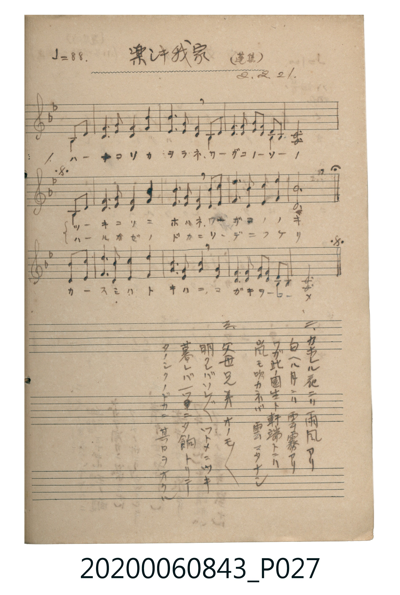

# 樂シキ我家（快樂的我家）

> Re:Shōka 使用 AI 協助辨識與重建樂譜，可能會有錯誤。歡迎回報。

- **鋼琴伴奏版**：<br><audio controls src="tanoshiki_waga_ie.mp3"></audio>
- **NEUTRINO 歌聲合成版**：<br><audio controls src="tanoshiki_waga_ie_neutrino.mp3"></audio>

- 作詞：里見義（改作）／出處：《蓬萊唱歌集》（昭2.2.21抄）
- 《唱歌帖》第八冊（2020.006.0843）P027.jpg

## 說明


- 出處：《唱歌帖》第八冊（2020.006.0843）P027.jpg
- 調性與拍號：調號 ?= B,，拍號 <4/4>，速度 != 88


## 歌詞

```text
> [!NOTE]
> **原頁資訊與歌詞全文**（對應 `P027.jpg`）：
> - **出處與抄寫日期**：標題「`樂シキ我家 (蓬集)`」，左上記「`♩= 88`」，右上記「`2. 2. 21.`」（昭和 2 年 2 月 21 日），抄自《蓬萊唱歌集》。
> - **曲調考證（非 Bishop〈Home, Sweet Home〉）**：歌詞首段沿用里見義〈楽しき吾家〉（明治 16 年《小學唱歌集》第二編第 28 首「花こそ薫らね」）詞意並改寫二、三段，惟《蓬萊唱歌集》並非採用常見之英國曲〈Home, Sweet Home〉，而係另行譜曲之**降 B 大調 4/4 拍二部合唱曲**。
> - **曲式結構（D.S. al Fine）**：全頁共三行五線譜（每行 4 小節）：
>   - 第一行（第 1–4 小節）：起句 A1，末拍弱起接第二行。
>   - 第二行（第 5–8 小節）：句首標有 Dal Segno 記號（`.S.`），第 8 小節二分音符 `1` 上方標有延音終止記號（Fine）；第一次唱畢末拍弱起 `1 2`（「カー」／「ワー」／「クー」）進入第三行。
>   - 第三行（第 9–12 小節）：中段 B，第 12 小節末拍弱起 `1_ 3_`（「ハー」／「アー」／「ター」）下方標有 `.S.`，返始回第二行重唱第 13–16 小節至 Fine 終止（共 16 小節完整曲式）。第三段第 14 小節末拍「其日（ソノヒ）」二字分唱兩個八分音符 `1 2`。
>
> **一、**
> ハナコソカヲラネ　ワガコノソノ
> ツキコソニホハネ　ワガコノノキ
> カスミハトキハニ　マガキヲコメ
> ハルカゼノドカニ　ソデニフケリ
>
> **二、（頁面下方手抄歌詞）**
> カヲレル花ニハ　雨風アリ
> 匂ヘル月ニハ　雲霧アリ
> ワガ此ノ園生ト　軒端トニハ
> 嵐モ吹カネバ　雲マタナシ
>
> **三、（頁面下方手抄歌詞）**
> 父母兄弟　オノモ〳〵
> 明クレバソレ〲　ツトメニツキ
> 暮レバ一ツニ　夕餉トリテ
> タノシクノドカニ　其日ヲオクル
```

## ABC

<div class="abc-score" data-abc-src="tanoshiki_waga_ie.abc" aria-label="五線譜載入中"></div>

[下載 ABC 原始檔](tanoshiki_waga_ie.abc)

## TMD 檔案連結

- [主旋律 TMD 檔案](tanoshiki_waga_ie.tmd) [[在 TMD Studio 編輯](https://tmdlang.github.io/Tmd-TS/#tmd=s7IKdvYPcrWy4qpTUCpJTLdSSM7PyUlNLsnMz7MqzsjPTkzOyFeCS5bl55TmploBqXgDC4RwcX5pUXJqfEFieqpVgIGROboM3KT4vPyS1KT8_GwMFRn5RYmZ8WB1xRmlCOmCovyy1LzEPKCS3MS80uLkosyCkvjk_IJKhJrUssyUVJCK4uTEvPiy1KLMtMzUFCRXpxYVg_0DcWZJUWIexBygIEJVflFJRn56UWJBRqVVRmZxSX5RZnJiTnx2Yl4iQlFJRirQ_2mJuZk5SA4AKk3PzLMqScwEegDkifLE-NzEzLycxDwkZyBUlQOdmZ-WlpmcmZijxKWlpfBsRdPjpu2Pm9Y-65j4dN2293s6nu5fDRR8PqsFJtKpoKXFpWirYGHBZW-r4KTDZWOib2IHMvzJ3jkvVs57v2fWy_aeF8u6n-9bCdT_bMpOoDhQ2_s9_U_bd72YORWo4HFD14vJa15M6Ho6ZeOztT0vZ7c9bugGKZ6x1kgPCA2fdbUAtYCdDFQLUfV0xzSgqudr1jxtXf20rQuo3MjAyEDPwMBMz8DCxBioHhTlelkF6UpcXPpaCrbUAlwKCgp2CtGKfv4hrrEQjpbW0775Lxc0vtjc_mJF14uOdqD7gH5_2rri2bR2LS1QuG3ofdbeqZAAc1MCOAhmQbTrggwABwZIa1fL0_Wrn01f-mzOfJDWWc9WzHy5sOdxQ08CWnQoaABDDRhYmgmPG3rf7-l5un3Zkx1dL1bMAKl9NHMlKFJgUv2bEVJGegogZKgHkQQF89NJPQpGCk93bgGSz-Z0ACUVgC4Au7EH6KAX7auwxtHjhiaED57N3vRi1f4XDc0v1gK1dbycO0_BCZTwCh43dHjk56bqKASXp6aWKIDYjxuASjoh3gMH1ctl056t2_ps0_7nU1bA0wtQ47Olex83Tn_c2Pt0wj6gl8H6gA7ue7Zpt4KhGcjFoASxof_p2h3IDgMmiye7ep5vXwFkKBhZKACNB_r8RdfGx42THzfOfTFt9eOmzseNa8EB0Am0_1lL_5Mdy4CpExj2QJ2PGxqf7OgEugjk_-b5WD0PVA_047O-hUAnP92xA-jkJzu7X3RvfDqnGxgUuDzd86Kh58n-pqf9y14s7Hmxdg5QKVCbltbLmb0KTgpPlywHhqECMAspPOvuBTrkZfOKpxM6QNbO3qSlhR7eT_f0P9864dlyUGZx0QvWU0jMUXDLzEuFhS0wAQJT5dPWjUDPAK17smvK8-2zgJaCwnB9P1BEwUQBGHjP1zcgJ0cFoPGgANzRAFQBVAoKQ8NHDZNR1b7Yuv1p_1IFR0NQEM1ZDXTu0z0bgYLP-pZCQh-oGe5emJFgUaiRpkAjLVCMBJoHSgcrZj6b06ngAvRLcGp6Xr4CMNm-mDkfqCsB6EVIxukBGQDTDDT1aUfby_mbn69ZppBgmKAATOrPpu2EmPN09zaQzNamZ2sXwQ2ChtH7PbMh_ny2ZiEwiJ9PXYTsEaBRCkZA6zqAKedx0-rHzXvAqaUfxG1ej8JtgnM7XzZsetoKDgFwkGOEAFgUGgKWwBAwBGY7pCB4smMtMNUpOEG9CJdFc1i8gnE8zGnN_ahuWYTK3Q932pMd3fBgUYCGZc-L_VOeLu9-OnsePHpetveCAgNkuzHIgcBcBnbCi_bN4MSlAAlMUKHWuhGcCcHST9f1PJu6BZIogZYBPQ7xLtA7YLNgqQfiE6DTnrZuA5cxHY-b9j5u7nvcPAmsDZTqn66dDoxRoCuetq582tANKuGRIhgYK7BghRW_wDgEZllgTQTmg4Ok63HTZpDJoJjb9Lh55eNmoKUNoJhrWgOSAtoIthempQVYrkK1NHc_bp4NNgRDC0jXWqgWoMlNOx8DSweQSqAv1oIZwEIRqGUeWAtQZBNY40IkhwF1AdEesGmdYOeBtYDsbQdbPfVx08bHzatQPQguk0DF6oLGl3MXQaOysxtYOEMKUHCWRzgM5OU1QLtARR7ITGBaaHg5e8XLRSvACQRiuMLTnqbHzTOAyoBlPpKyTS_nLEdWBgmBZ2uXAN38dM6k51OAXgYmvYYXuyc9Xw1M-lC9UDO3TnjcvOjphJ1gZ_Q-bp4AMRMcJsDECIyX7WhxB4x1Ir32vGPbs_W9T1tbnu4BFsrAQFsFDsZFjxs2P27YClEDrB3AGRLo_QngUF3zuAFYHAMjpQXs1IVg14KiG6p-1jqIYlAiAqkBRcfTJVNfLukEqwda0QYLWKD7gYYDq2Cg-SjRB0nM4OheBZZdDdJCeWMDChS09Lm4QhLz8oszMrMzwxPTEz1TrYLzC4BNxnyHGl3DmmqQdQo2FlrgYFWozk2rBTOwNXwQhTuw9FbQgBYq2vC6QEcB1krRxKIZ6BKQwTUKBsASDYbBBRJQzDQeyNFVMIuHsAyBuAZMIolhKDWPB5EmUHEjiDgEQhWDbfQxrFEAycEwMMWBjQcmKbBaYEYD4r1g1mqozCaITPNKIO4Fs9ZDZJrWIPQ094FZIJ0gPSAeDALTA0gUYr8Rmv0YtqwBYpAYhsuau6FiwFwFlVkItX81EO9BkVmFYn83wn5jdP83QnWAaIitUFvg9q9E2AJmA1Mnii-BWQcqBhEByYDcAbcf4iou_GkJXG0oOBqBmlnAqvT5tskvG_sUNIA1jA6piYqYBARso9YoGIPFQGxdMBumCppuQGrgqQaY1aG-gacQSLgC6dlIYUcghcBCCGoaLITAqQCeQhAmzoCnBnAaQrgCKTVA7YKGOUgFJP5xpQawenhqgOiHpbwJYH2wVAxz_T4oG-6K5g6onoXQUEB3H8xfELsIlCKg1gyw3aqBiGZQ_b5ipgI48omKclwxCYxvEANIgcTIKi6A9TPUs_PhWQPkfeTIAEU8JBjmQWVgQQeKDFDWBiUB5EwLiwxwJkNEPMEiBVizQ-1HT0qgyIPJwBImyHT0bAiPeHDCQon45klQfbDobYH7axlUZirUrE1wu2CFQRuKXfvBdhGX5dUVkPsdCpDWJKSBiJwo6Jn3QfURUhKABRWipIWXdJ0IGUhQwSOsHRqIoJwKCjZgiwwqg5wfwSkTKefDStvt0BwN0QuKZlh09cLzKVrOByY-SMBD6gyQnu3YbQJHPzRBgWwCm4TfTyBZkBwoiYDUAhMApMyHuwLiPmS7ajHbG445JTgaGwWQxgZGmwBkODBDgkyF5FddSDTWgLjIohhqgcqAJDBzA2VqgFkeLZcjx_Bom2AA2wRExi-QADLhWRzChSuGGgGBUKWjlTe1Km9coQ6uWMFRBGaBpcjMgqP1LIhFQT1L_Ww0Wgui-4nMWlDXTgGtIoz2MYxVwCZshF3YGCyszAUA)]
- [鋼琴伴奏 TMD 檔案](tanoshiki_waga_ie_piano.tmd) [[在 TMD Studio 編輯](https://tmdlang.github.io/Tmd-TS/#tmd=s7IKdvYPcrWy4qpTUCpJTLdSSM7PyUlNLsnMz7MqzsjPTkzOyFeCS5bl55TmploBqXgDC4RwcX5pUXJqfEFieqpVgIGROboM3KT4vPyS1KT8_GwMFRn5RYmZ8WB1xRmlCOmCovyy1LzEPKCS3MS80uLkosyCkvjk_IJKhJrUssyUVJCK4uTEvPiy1KLMtMzUFCRXpxYVg_0DcWZJUWIexBygIEJVYhFQPD01NzWvxKogMzEvPz4xOTk_tyAxLxMkpsSlpaXwbEXT46btj5vWPuuY-HTdtvd7Op7uXw0UfD6rBSLyuHn3y-49zydsebJny9Ol_c87O97v6VTQ0uJStFWwsOCyt1Vw0uGyMdE3sQPZ-7R914uZU9_vmfW4oevF5DUvJnQ9nbLx2dqel7PbHjd0A01_NmOtkR4QGj7ragEaBHYsUC1E1dMd04Cqnq9Z87R19dO2LqByIwMjAz0DAzM9AwsTY6B6UFzoZRWkK3FxhQA9VJyRmZ0Znpie6JlqFZafnJjjUKNrWFPNpQAENhZadmBGdW5aLZhRo2CgoAvHhvEKxvFAMdN4IEdXwSwewjIE4howiSSGodQ8HkSaQMWNIOIQCFUMttHHsEYBJAfDj5v7wcY_bu4Cq33ctBmI94JZq6EymyAyzSuBuBfMWg-RaVqD0NPcB2aBdIL0gHgw-Li5BSQKsd8IzX4MW9YAMUgMw2XN3VCxx02LoDILofavBuI9KDKrUOzvRthvjO7_RqgOEA2xFWoL3P6VCFvA7MdNINMRvnzcvAgqBhEByYDcAbcf4iouaJQTE70KRkAxY7AYiK0LZsNUQWMVpAYep8D8ArULHn8QXwPp2Ug-IxB_MPdDTYO5HxxH8PhDmDgDHlfgGEa4AimuoHZBQwSkAhI7uOIKrB4eVxD9sHQxAawPlsZgrt8HZcNd0dwB1bMQGgro7oP5C2IXNF5wBTcwUkAMIAUSIyvHPW7aCXXRfHjqArkROcRAsQNx6zyoDMx_oBAD5Q5QPCGne1iIgdMpInYI5srHzVOh9qPHNyiEYTKw1AMyHT0lw2MHHPsosdM8CaoPFgctcH8tg8pMhZq1CW4XLD-1odi1H2wXdXMNqJxFiheY-xElCDwHdyJkIO6Hh2I71GegNA7yy-OmjVAZ5JQMTi5IeQZWimyH5gWIXlDYw8KwF57C0fIMMEVAQgNSFoL0bMduEzhOoLEMsglsEn4_gWRBcqB4A6kFxgqkLIO7AuI-ZLtqMSu7AFB1HuRBWnVnGK8NzjzG8drQ-DWJ1wZGJ4xvGq8NiWigMCQWUeXxGAHUCsygELZRvDYwm8JUmsfHa6PnVqgcrCQg0zlA2hAkBEqGQLWQlIgQBBsASZJgQYQLkDTCkzs-7Wao9kO5EA7U-KEVGFDDUHMprlTmg5LKTOCprACRyiAQmPXjQd6BYGMgBrkWFBAIUYQa03i4EJhphCIGNZpkA8EERAxuGDYDkRXDjIThgXAjMPRAEaBrp4AWB9E-hrEK2ISNsAsbg4WVuQA)]

## 分析

```text
================================================================================
📊 TMD Song Profile: [ 樂シキ我家（快樂的我家） ]
================================================================================
⏱  Duration:       2:10 (130.9s), 48 measures total
🎼 Key & Tempo:    首調基準 B,, != 88.0 BPM, <4/4>
   - 分析範圍：      由實際發聲的音符與和弦推測調性；播放脈絡另行呈現
🎤 人聲音域:    A3 (MIDI 57) – G4 (MIDI 67) [跨度: 10 個半音 / 0.8 個八度, 難度: easy]
   - 最低音:  A3 in [TanoshikiWagaIe[L1] #1 @ m.5, 0:10]
   - 最高音: G4 in [TanoshikiWagaIe[L1] #1 @ m.11, 0:27]
   - 適合: soprano, mezzo-soprano, contralto, tenor, baritone, bass
🏛  結構:      TanoshikiWagaIe[L1] (43.6s) -> TanoshikiWagaIe[L2] (43.6s) -> TanoshikiWagaIe[L3] (43.6s)
⚡ 編曲密度:        Peak 2 軌道同時演奏
🗝  調性診斷：       A# 大調（純淨自然大調，未偵測到可信轉調）
   - 風格氣質:    純淨自然大調（陽光明朗、易唱易記，無明顯調外色彩）
   - 轉調歷程:    全曲維持單一推測調性（未偵測到可信轉調）
   - 核心骨幹音:  D, A#, F, D#, C
   - 調性數值:    A# 大調 [相關度: 0.89, 穩定度: High, 自然音純度: 100.0%]
   - 候選調性 (K-S): A# 大調 (0.89), D 小調 (0.76), G 小調 (0.59)
   - 五度圈歷程:   -2 -> -2 -> -2
   - 各段落調性細節:
     • [TanoshikiWagaIe[L1] #1]: A# 大調 (r: 0.89, 自然音純度: 100.0%)
     • [TanoshikiWagaIe[L2] #1]: A# 大調 (r: 0.89, 自然音純度: 100.0%)
     • [TanoshikiWagaIe[L3] #1]: A# 大調 (r: 0.89, 自然音純度: 100.0%)

  [ 五度圈游移軌跡 ]
               C  
         F            G  
     [Bb]*              D  
      Eb               A  
         Ab           E  
            Db       B  
               F# 
     (* = active key center)

  [ 十二半音累積音高分佈 ]
     C  : ████████                   9.0%
     C# :                            0.0%
     D  : ████████████████████████  25.8%
     D# : ████████████              12.9%
     E  :                            0.0%
     F  : ██████████████████        19.5%
     F# :                            0.0%
     G  : ███████                    7.0%
     G# :                            0.0%
     A  : █████                      5.5%
     A# : ███████████████████       20.3%
     B  :                            0.0%
--------------------------------------------------------------------------------
Assignment 軌道音域：
  - Alto          : A3 – G4 (10 個半音 / 0.8 個八度, 189 個音符)
  - Soprano       : A#3 – D5 (16 個半音 / 1.3 個八度, 201 個音符)
================================================================================
```


## 原書掃描頁




