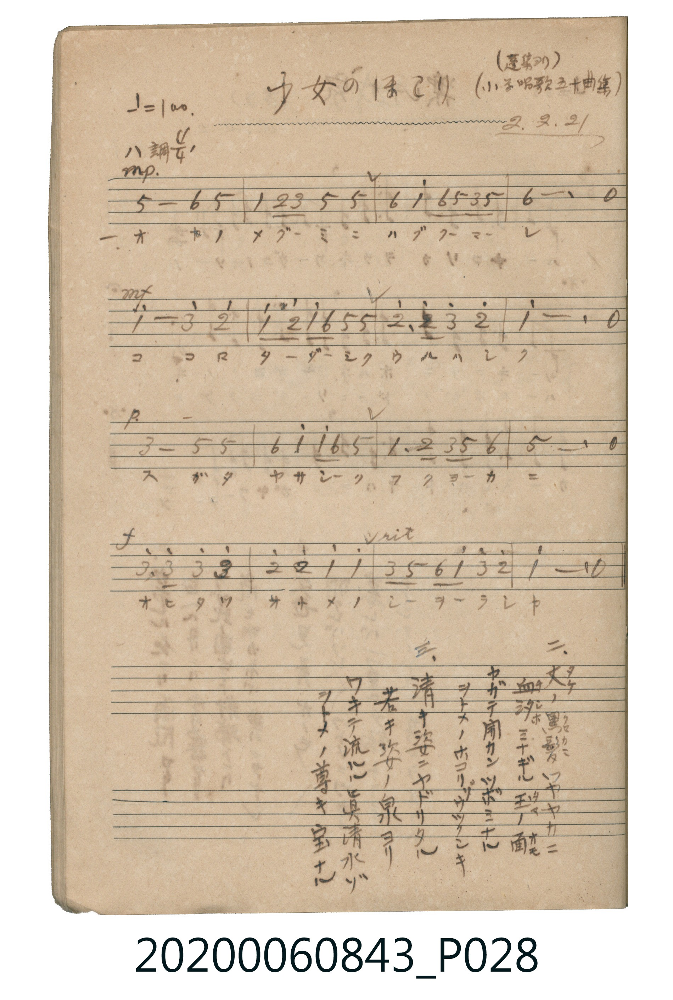

# 少女のほこり（少女的驕傲）

<audio controls src="shojo_no_hokori.mp3"></audio>

- 出處：蓬集ヨリ / 小学唱歌五十曲集（昭2.2.21）
- 《唱歌帖》（2020.006.0843）P028.jpg

## 說明

原書資訊與歌詞全文（對應 P028.jpg）：
調性與拍號：ハ調 4/4 拍（C 大調 4/4 拍），♩=100
註記：(蓬集ヨリ) / (小学唱歌五十曲集) / 2.2.21

## 歌詞

```text
一、
ハナ ニ ハヂザル マゴコロ ノ
キヨキ ニホヒ ヲ ムネ ニ モチ
タマ ニ オトラヌ ミサヲ ヲバ
マモル ヲトメ ノ タフトサ ヨ

二、
つき に くらべん すずしさ の
たかき のぞみ を こころ とし
まなび の みち に いそしめる
わかき をとめ の うるはし さ
```

## ABC

```abc
X:1
T:少女のほこり（少女的驕傲）
M:4/4
L:1/16
Q:1/4=100
K:C
V:V1 name="Piano" snm="Pia"
[V:V1]
!mp! G8 A4 G4 | c4 d2 e2 G4 G4 | A4 c4 A2 G2 E2 G2 | A12 z4 |
!mf! c8 e4 d4 | c4 d2 c2 A4 G2 G2 | d6 d2 e4 d4 | c12 z4 |
!p! E8 G4 G4 | A4 c4 c2 A2 G4 | C6 D2 E4 G2 A2 | G12 z4 |
!f! e6 e2 e4 e4 | d4 d4 c4 c4 | E4 G4 A2 c2 e2 d2 | c12 z4 |
!mp! G8 A4 G4 | c4 d2 e2 G4 G4 | A4 c4 A2 G2 E2 G2 | A12 z4 |
!mf! c8 e4 d4 | c4 d2 c2 A4 G2 G2 | d6 d2 e4 d4 | c12 z4 |
!p! E8 G4 G4 | A4 c4 c2 A2 G4 | C6 D2 E4 G2 A2 | G12 z4 |
!f! e6 e2 e4 e4 | d4 d4 c4 c4 | E4 G4 A2 c2 e2 d2 | c12 z4 |
```

## TMD 檔案連結

- [主旋律 TMD 檔案](shojo_no_hokori.tmd) [[在 TMD Studio 編輯](https://tmdlang.github.io/Tmd-TS/#tmd=s7IKdvYPcrWy4tLSUni6YeLTpZsfN6573Lj7cePkx01d7_d0QASfz2p5uXLq06ZN7_d0KmhpcSnaKhgaGHDZ2yo4c9mY6JvYcdUpKD1t3_Vi5tT3e2a9mLzm5ey2x80rHjevUtAHmtv_dO2yp1M2Plvb82TXlKe9jc9mbwIqAJr-bMZaIz0gNASaqwQy43FDF0Th0x3THjd0A5UYGRgZ6BkYmOkZWJgYA5UFGBhZ6GUVpCtxcelrKdhSC3ApKCg87Zv_bPaOF5vbX6zoetHRDnTFi5XznraueDatHRwSvc_aOxVg9gOdAvQqSNuLVfufNSwHaejufTFzPlD0cXM_UFABGDAKQDGgXmeFp0uWowgBNfc8mrnSFhSMIDNW7H6xYgZQqwZy4GkCQ08DV_CBJCGBxwUy4cmOhscNjSAW0PbHzV1AqhvCbHrctO1x82ogZ97jpi2PmzY_bl4L5PSB1TatBVnVBBLoftw8-3HzJCBrExAveNzcCzVj0eNmiMFN-4FmQASbVj1u7njcvPJxcw9QYP7jpq0QbZseN0-AOGIeWCPIWqAYUOlCkJ0QM6aCBJq2AgVWQNy-qwfm9sYljxuB9jYC9TX2P27qfNy483HTZCBn5uPGWY8bpz9unArkrIOonf-4sRuiHJhm5z1u3A80Huh-YNoFJV-Q-AqgFojafY8bVz1u3AxSC8T7HzcC3QO2peVx41yQwU2Nj5u6Id7sh5nbNAlkRFMjVFcbUMXjxvVA1UDOVJBayhMeFCho6XNxBWfkZ-X75XvkZ-cXZVoFZCbm5TvUGNQoVIOsUrCx0LIDM6pzC2rBjBoFUwVdMDQDYhC7RsEwDkgZxSkYx4EFIIIgabCEGVDAGIghQjBoAFIENToNZjRYPQgCTQKbiGw6kIZYCTIKLAezFFUpFhvgbjeGymFxJth4qH8gZoNVmwJFEX5GMxfucLAjwM4Gs8AE1JFgAmYDSBRiKihcgAJAlUAFWF1ey8Wla6eAEj8K2ASUuQA)]
- [鋼琴伴奏 TMD 檔案](shojo_no_hokori_piano.tmd) [[在 TMD Studio 編輯](https://tmdlang.github.io/Tmd-TS/#tmd=s7IKdvYPcrWy4tLSUni6YeLTpZsfN6573Lj7cePkx01d7_d0QASfz2p5uXLq06ZNj5t3v-ze83zClid7tjxd2v-8s-P9nk4FLS0uRVsFQwMDLntbBWcuGxN9EzuuOgWlp-27Xsyc-n7PrBeT17yc3fa4ecXj5lUK-kCb-p-uXfZ0ysZna3ue7JrytLfx2exNQAVA-57NWGukB4SGQHOVQGY8buiCKHy6Y9rjhm6gEiMDIwM9AwMzPQMLE2OgsgADIwu9rIJ0JS6u4Iz8rHy_fI_87PyiTKuAzMS8_CAPhxqDGoVqLgUgsLHQsgMzqnMLasGMGgVDbVMFXTA01DYDkyB-jYKxtmEckGEUp2AcBxWESECUQaXNgILGQAwSNgFLwKABSDHUsjSYZVBdIGiqDTQXRAFtQLUPSEPsMAUbDFUBlsLUZIowEc1WJB8aw30I8gLMhygeARJmCBmIfVCdpkCZGgXzeG0jeFChWQX3H9R9QFOR3Aqm4P6AUlBroRTQJ9DwBToCqhWsEKcXa7HGtg_22EYERTzIGhBhAiLAXGRRMMsYIgpWYYZVFCxgEg8ikaMZizUIFlQUbAyy5WBJI7gyU7CpGEYgxyu6NbgdjsWTSM7HsB7dP_BoxR5ASO5FFkbzJrLnkRTDY1HXTgElIhWwCShzAQA)]

## 分析

```text
================================================================================
📊 TMD Song Profile: [ 少女のほこり（少女的驕傲） ]
================================================================================
⏱  Duration:       1:16 (76.8s), 32 measures total
🎼 Key & Tempo:    首調基準 C, != 100.0 BPM, <4/4>
   - 分析範圍：      由實際發聲的音符與和弦推測調性；播放脈絡另行呈現
🎤 人聲音域:    C4 (MIDI 60) – E5 (MIDI 76) [跨度: 16 個半音 / 1.3 個八度, 難度: moderate]
   - 最低音:  C4 in [ShojoNoHokori #1 @ m.11, 0:24]
   - 最高音: E5 in [ShojoNoHokori #1 @ m.2, 0:03]
   - 適合: soprano, mezzo-soprano, contralto, tenor, baritone, bass
🏛  結構:      ShojoNoHokori (38.4s) -> ShojoNoHokori (38.4s)
⚡ 編曲密度:        Peak 1 軌道同時演奏
🗝  調性診斷：       C 大調（純淨自然大調，未偵測到可信轉調）
   - 風格氣質:    純淨自然大調（陽光明朗、易唱易記，無明顯調外色彩）
   - 轉調歷程:    全曲維持單一推測調性（未偵測到可信轉調）
   - 核心骨幹音:  C, G, E, A, D
   - 調性數值:    C 大調 [相關度: 0.89, 穩定度: High, 自然音純度: 100.0%]
   - 候選調性 (K-S): C 大調 (0.89), G 大調 (0.71), A 小調 (0.65)
   - 五度圈歷程:   +0 -> +0
   - 各段落調性細節:
     • [ShojoNoHokori #1]: C 大調 (r: 0.89, 自然音純度: 100.0%)
     • [ShojoNoHokori #2]: C 大調 (r: 0.89, 自然音純度: 100.0%)

  [ 五度圈游移軌跡 ]
              [C ]*
         F            G  
      Bb               D  
      Eb               A  
         Ab           E  
            Db       B  
               F# 
     (* = active key center)

  [ 十二半音累積音高分佈 ]
     C  : ████████████████████████  28.3%
     C# :                            0.0%
     D  : ███████████               13.3%
     D# :                            0.0%
     E  : ████████████████          19.2%
     F  :                            0.0%
     F# :                            0.0%
     G  : ████████████████████      24.2%
     G# :                            0.0%
     A  : █████████████             15.0%
     A# :                            0.0%
     B  :                            0.0%
--------------------------------------------------------------------------------
Assignment 軌道音域：
  - Piano         : C4 – E5 (16 個半音 / 1.3 個八度, 116 個音符)
================================================================================
```


## 原書掃描頁




