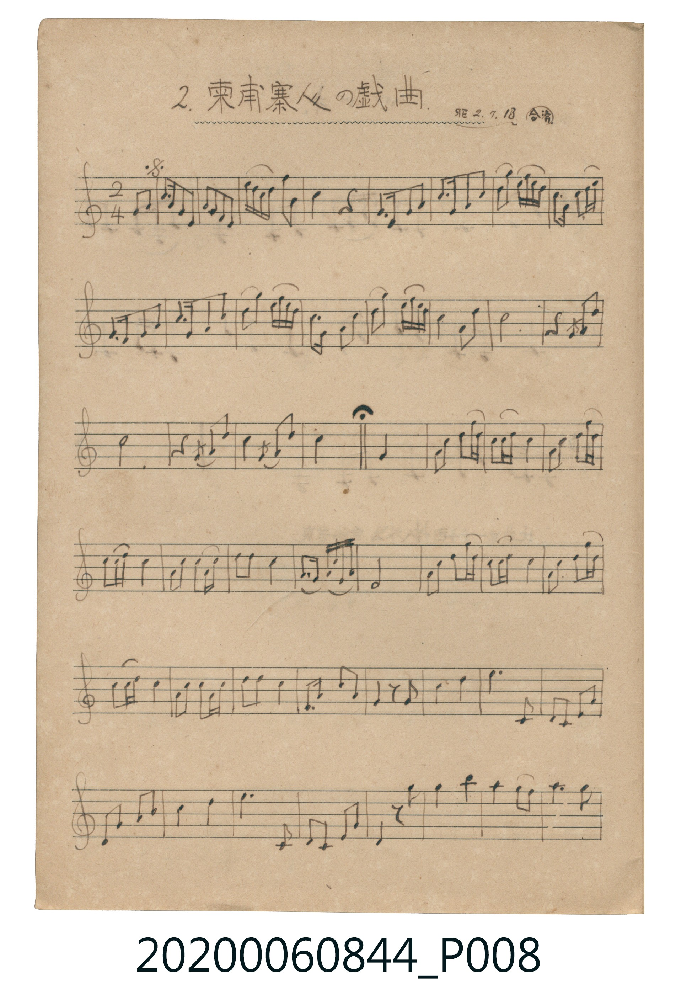
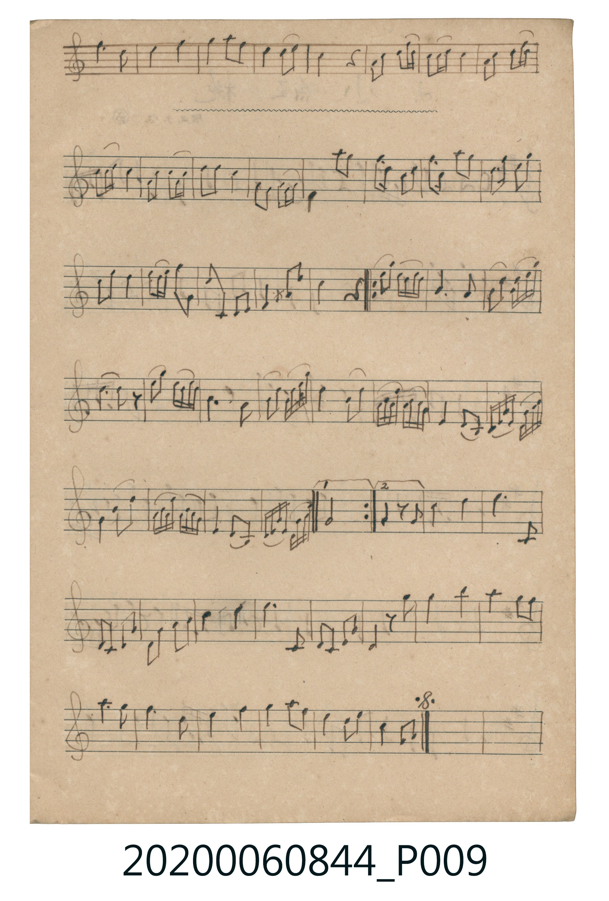

# 柬甫寨人の戲曲

> Re:Shōka 使用 AI 協助辨識與重建樂譜，可能會有錯誤。歡迎回報。

- **鋼琴伴奏版**：<br><audio controls src="kanbojiya_no_gikyoku.mp3"></audio>

- 曲：伝統曲 (合調・昭2.7.13抄)

## 說明

2. 柬甫寨人の戲曲 (Kanbojiya no Gikyoku)
Source: 唱歌帖 支那曲 (NMTH 2020.006.0844, Vol. IX) — P008.jpg–P009.jpg
Annotation: 昭2.7.13・合調
Notation: Handwritten 5-line staff (C major, 2/4 time, 94 bars)


## 歌詞

```text
（TMD 檔案未包含歌詞註解）
```

## ABC

<div class="abc-score" data-abc-src="kanbojiya_no_gikyoku.abc" aria-label="五線譜載入中"></div>

[下載 ABC 原始檔](kanbojiya_no_gikyoku.abc)

## TMD 檔案連結

- [主旋律 TMD 檔案](kanbojiya_no_gikyoku.tmd) [[在 TMD Studio 編輯](https://tmdlang.github.io/Tmd-TS/#tmd=s7IKdvYPcrWy4qpTUCpJTLdSSM7PyUlNLsnMz7MqzsjPTkzOyFeCS5bl55TmploBqXgDS4RwcX5pUXIqXH18Xn5JalJ-fjZCRUFRfllqXmIeUFVuYl5pcXJRZkFJfHJ-QSVCTWpZZkoqSEVqSmZJflFmYg6SxalFxWAngW2KLylKzIOYARREqAJqSs_MswLKAk0AyiTmxKcmFpfEJxZnJqIoK8nITy9KLMiotMrILAbZlQxUmp2Yl4jup_iCxPRUqwADAwuETElGKjAMUlNKkxMh1mtpKTybv-b5lNVP1694smvX48Z1zzo2PZu9SUFLi0vRVsHSjMveVsGZy8ZI38QOZApQ6v2eWU_2zH2-dSNImcbTCR0vVu1_3Lz72Yy1RnrmeobGz7paNJW4uPS1FGypBbgUFBSM9HC4VMM7MS8pPyuzMlEhL1_BPTO7Mj-7VBOkJRgStwpPp2x8trbn6Y5pCs-mrH_ZtBisy883xEPByMDIQM_AwEzPwMLEREchLD9HT8EzQlPhUcMUBVDI6WUVpD9qmAxkWoKYIEMd84BJBBx6VgpwPwP9DwkIkAo_uLxHYl5KeVFmSUlqnoKpbk5mXqpCcUliWpqChrNCbmJWfpGOAjBgFUoyc1N1FCxNFJISi4rBLqc8yKBAQUufiwseQH750OCxCgCmqnyHGoOaapB1CjaGZlp2YFaNQnVuWq2CqYIuGBoDMYhdo2AYp2AGZBqDsZGCIVDIOE7BKA4mAVQbB1YIFILoNYDSNVCDYWaZATFQE0gtnAnWhGwAktlAAsisQdULVkSuyUDVcQgbYOJIhsAMRpiAqgGkBgSNYF6EBxgM1sC9D5KBOApqKDFKwTbAuRDPgl0IU4YcsCC1iIhAuBHMhngIQxBsLtirMEXAeEWEOUoAoAUtOK6hnjeEmIDhI6xOgjuXVIfBVUPF4GrASRMpEaBKgIVAYQuXQkqd4GQAcSycCfIN2Ecwl8ZDBUAehBgJYqGkFHhaAFsAMRBuCZEGwnILLJ5h2s0QRgLTH9TNSAkaairCOjQnwBwJEYLLwtVDrUKEKUqugumE52MKExqya_HGKih8YcnMCJ7qMcIAJVOh-QGsFN1caPDC-YigQfIUTAyWAUD6kIISkqjguQERLqghhV6GoQQsLP_C8zFyDgOqhJZWZJqKWiZhmAp3NkrCQC1rUYoA5KwOTr-gQAFFCyiwQCRQKUqWoJqhmMUKcobGKKexJW1YJoTGExH5mSomwjMzSj6FZ2dC-RoiChZAsh5P_QdP8giTkNI5rMCu4arl4tK1U8BsDygARZW5AA)]
- [鋼琴伴奏 TMD 檔案](kanbojiya_no_gikyoku_piano.tmd) [[在 TMD Studio 編輯](https://tmdlang.github.io/Tmd-TS/#tmd=s7IKdvYPcrWy4qpTUCpJTLdSyC8qychPL0osyKi0ysgsLskvykxOzInPTsxLVIIrKs4vLUpOjS9ITE-1CjAwsEDIlGSk5qZapaaUJieWZObnKXFpaSk8m7_m-ZTVT9eveLJr1-PGdc86Nj2bvUlB43HzlMdNix439z3Zs-Xp0v4nu2doKmhpcSnaKliacdnbKjhz2Rjpm9iBjAaqf79n1pM9c59v3QjW-3RCx4tV-x837342Y62RnrmeofGzrhZNJS4ufS0FW2oBLgUFBSM9XM73TsxLys_KrExUyMtXcM_MrszPLtVUeNQwRSEgMxEo5JicnJ9bkJiXmZuaVwIyKhgcaFYKT6dsfLa25-mOaQrPpqx_2bQYbJqfb4iHgpGBkYGegYGZnoGFiYmOQlh-jp6CZwTUUGAw62UVpD9qmAxkWoKYIEMd8_LyS8BBbaUADwtguEACCKSC8nCAAgUtfS4uuK_98qF-tgJ716HGoKYaZJ2CjaGZlh2YVaNQnZtWq2CqoAuGxkAMYtcoGMYpmAGZxmBspGAIFDKOUzCKg0kA1caBFQKFIHoNoHQN1GCYWWZADNQEUgtngjUhG4BkNpAAMmtQ9YIVkWsyUHUcwgaYOJIhMIMRJqBqAKkBQSOYF-EBBoM1cO-DZCCOghpKjFKwDXAuxLNgF8KUIQcsSC0iIhBuBLMhHsIQBJsL9ipMETBeEWGOEgBoQQuOa6jnDSEmYPgIq5PgziXVYXDVUDG4GnDSREoEqBJgIVDYwqWQUic4GUAcC2eCfAP2Ecyl8VABkAchRoJYKCkFnhbAFkAMhFtCpIGw3AKLZ5h2M4SRwPQHdTNSgoaairAOzQkwR0KE4LJw9VCrEGGKkqtgOuH5mMKEhuxavLEKCl9YMjOCp3qMMEDJVGh-ACtFNxcavHA-ImiQPAUTg2UAkD6koIQkKnhuQIQLakihl2EoAQvLv_B8jJzDgCqhpRWZpqKWSRimwp2NkjBQy1qUIgA5q4PTLyhQQNECCiwQCVSKkiWoZihmsYKcoTHKaWxJG5YJofFERH6mionwzIyST-HZmVC-hoiCBZCsx1P_wZM8wiSkdA4rsGu4anE3BoI8cDQHCmoVDLWNtWHJC5kNtIMMGfN4bSM4F72RgK4NKUEh8YD6tc3hMsg8VD0oVqFIUdE6HD4jxjrk4DKBq0YxBp8mWOChiBK0CqsuFOcSGZNwmxBOx-0pZDamHqpFGRFJDiN4cTgfq_fI8gSyJgz_ER9xRPqP1NhDOBwtZHBHBZ7UQpT_iLEQby5AjQaEDKomqI14QoeAF4lwC1YbkU1CVN9UzSjY_YY3pRGTU0gLTPwJBj2SiMgrOEOTHH9gxgBuB1KQ-ahgFdElPv6gwJdQiAtEAg6hsXXE53_8FpIUnCQXfvSwEEc-wF1KUCVM8WU8LFqx15p42pg-yG1ME3gT0zBewTQ-HsIAIgQNEjVAuCYe2NwGCYNIiAYQCRGDs_ArhhuLphYsbgJXCneRAVgG3Z0QUbAZMPeCJaDqQObADQRhCIuAQ5E9DbEGZg6SsdhMg4jBfIfmJ2RTkQXgAxKYQQn3FpqRqGrhAQWxHi0IMMMaJZaRlYJkgZGMN9SQTEX4FjXYsDgA4ViIJpAGRLAhq8aIBJij4JpxJVWiFaIkSFwJAK6FWKUoMYGmFNOhaDFNnFL0lI0a36guwJZZYMkJVDDo2ilglg0KQFFlLgA)]

## 分析

```text
================================================================================
📊 TMD Song Profile: [ 柬甫寨人の戲曲 ]
================================================================================
⏱  Duration:       1:57 (117.5s), 94 measures total
🎼 Key & Tempo:    首調基準 C, != 96.0 BPM, <2/4>
   - 分析範圍：      由實際發聲的音符與和弦推測調性；播放脈絡另行呈現
🎤 人聲音域:    A3 (MIDI 57) – A5 (MIDI 81) [跨度: 24 個半音 / 2.0 個八度, 難度: difficult]
   - 最低音:  A3 in [KanbojiyaNoGikyoku #1 @ m.37, 0:45]
   - 最高音: A5 in [KanbojiyaNoGikyoku #1 @ m.43, 0:53]
   - 適合: soprano, mezzo-soprano, tenor, baritone
🏛  結構:      KanbojiyaNoGikyoku (117.5s)
⚡ 編曲密度:        Peak 1 軌道同時演奏
🗝  調性診斷：       G 大調（純淨自然大調，未偵測到可信轉調）
   - 風格氣質:    純淨自然大調（陽光明朗、易唱易記，無明顯調外色彩）
   - 轉調歷程:    全曲維持單一推測調性（未偵測到可信轉調）
   - 核心骨幹音:  D, A, C, G, E
   - 調性數值:    G 大調 [相關度: 0.71, 穩定度: Moderate, 自然音純度: 100.0%]
   - 候選調性 (K-S): G 大調 (0.71), C 大調 (0.66), A 小調 (0.65)
   - 五度圈歷程:   +1
   - 各段落調性細節:
     • [KanbojiyaNoGikyoku #1]: G 大調 (r: 0.71, 自然音純度: 100.0%)

  [ 五度圈游移軌跡 ]
               C  
         F           [G ]*
      Bb               D  
      Eb               A  
         Ab           E  
            Db       B  
               F# 
     (* = active key center)

  [ 十二半音累積音高分佈 ]
     C  : █████████████████         19.7%
     C# :                            0.0%
     D  : ████████████████████████  27.2%
     D# :                            0.0%
     E  : █████████████             15.0%
     F  :                            0.0%
     F# :                            0.0%
     G  : ███████████████           17.1%
     G# :                            0.0%
     A  : ██████████████████        21.0%
     A# :                            0.0%
     B  :                            0.0%
--------------------------------------------------------------------------------
Assignment 軌道音域：
  - Piano         : A3 – A5 (24 個半音 / 2.0 個八度, 364 個音符)
================================================================================
```


## 原書掃描頁






