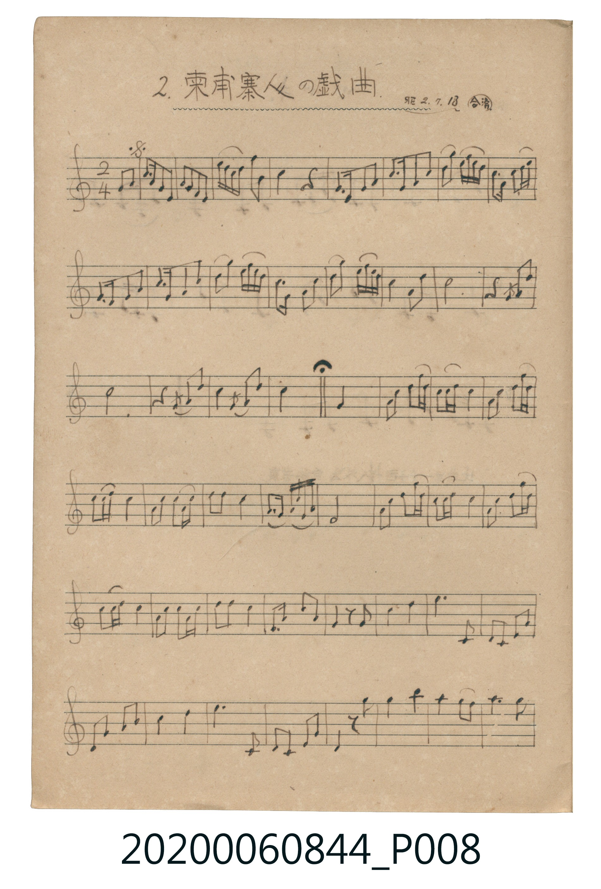
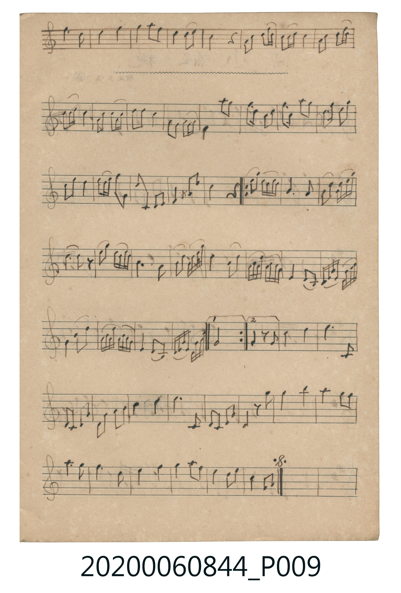

# 柬甫寨人の戲曲

<audio controls src="kanbojiya_no_gikyoku.mp3"></audio>

- 曲：伝統曲 (合調・昭2.7.13抄)

## 說明

2. 柬甫寨人の戲曲 (Kanbojiya no Gikyoku)
Source: 唱歌帖 支那曲 (NMTH 2020.006.0844, Vol. IX) — P008.jpg–P009.jpg
Annotation: 昭2.7.13・合調
Notation: Handwritten 5-line staff (C major, 2/4 time, 94 bars)

## 歌詞

```text
（TMD 檔案未包含歌詞註解）
```

## ABC

```abc
X:1
T:柬甫寨人の戲曲
C:曲：伝統曲 (合調・昭2.7.13抄)
M:2/4
L:1/16
Q:1/4=96
K:C
V:V1 name="Melody" snm="Mel"
[V:V1]
!mf! G4 E2 G2 | c A G E G E D C | e d c A G2 e2 | d4 z4 |
E2 G2 A2 c2 | A2 c2 d2 e2 | d2 e d c A c d | G2 A2 c2 d2 |
E2 G2 A2 c2 | A2 c2 d2 e2 | d2 e2 g e d c | d2 E2 G2 A2 |
c2 d2 g e d c | A4 D4 | G8 | z4 G2 c2 |
G8 | z4 G2 c2 | A2 G2 c2 d2 | E4 G4 |
A2 d c A G d c | A G d2 A2 d c | A G d2 c2 A2 | d2 A G e d c A |
c2 G2 A2 c2 | G2 E2 D2 C2 | D8 | A2 d c A G d c |
A G d2 A2 d c | A G d2 c2 A2 | d2 A G d2 A2 | d2 c2 A2 G2 |
E2 c2 A2 G2 | E2 z2 E2 c2 | d4 e4 | e4 C2 C2 |
A,2 C2 D2 G2 | D2 E2 G2 A2 | A4 c4 | d4 C2 C2 |
A,2 C2 D2 G2 | D4 z2 d2 | e4 a4 | g2 e2 d2 e2 |
d4 c4 | d2 G2 A4 | c4 d4 | e2 d2 c2 d2 |
A4 z4 | A2 d c A G d c | A G d2 A2 d c | A G d2 c2 A2 |
d2 A G d2 A2 | d2 c2 A2 E2 | G2 E D E4 | g2 e2 d2 c2 |
d2 c2 d2 g2 | d2 c2 A2 d2 | c2 A2 A4 | d c A G D4 |
C2 D2 G2 A2 | E2 A2 c4 | A4 z4 | d2 e d c A d2 |
G4 G4 | G2 A2 c d e2 | A4 z4 | d2 e d c A d2 |
G4 D4 | G2 A2 c d e2 | c4 A4 | c d c A c d c A |
E2 D2 C2 A,2 | C D E G D E G A | E2 G2 A4 | c d c A c d c A |
E2 D2 C2 A,2 | C D E G D E G A | D8 | E2 z2 E2 A2 |
c4 d4 | e4 C4 | A,2 C2 D2 G2 | D2 E2 G2 A2 |
c4 d4 | e4 C4 | A,2 C2 D2 G2 | D2 z2 d2 e2 |
a4 a4 | g2 e2 d2 e2 | g2 d2 d4 | G2 A2 c2 d2 |
e2 g2 e2 d2 | c2 A2 G2 E2 |
```

## TMD 檔案連結

- [主旋律 TMD 檔案](kanbojiya_no_gikyoku.tmd) [[在 TMD Studio 編輯](https://tmdlang.github.io/Tmd-TS/#tmd=s7IKdvYPcrWy4tLSUng2f83zKaufrl_xZNeux43rnnVsejZ7k4KWFpeirYKlGZe9rYIzl42RvokdV52CElDq_Z5ZT_bMfb51I0iZxtMJHS9W7X_cvPvZjLVGeuZ6hsbPulo0lbi49LUUbKkFuBQUFIz0cLhUwzsxLyk_K7MyUSEvX8E9M7syP7tUE6QlOL-0KDnVSuHplI3P1vY83TFN4dmU9S-bFoN1-fmGeCgYGRgZ6BkYmOkZWJiY6CiE5efoKXhGaCo8apiiEGBgYKGXVZD-qGEykGkJYoIMdczLyy9JLMnMz7NSgPsZ6H9IQIBU-MHlPRLzUsqLMktKUvMUTHVzMvNSFYpLEtPSFDScFXITs_KLdBSAAatQkpmbqqNgaaKQlFhUDHY55UEGBQpa-lxc8ADyy4cGj5Vvak5-SqVDjUGNQjXIQgUbQzMtOzALKJKbVqtgqqALhsZADGLXKBjGKZgBmcZgbKRgCBQyjlMwioNJANXGgRUChSB6DaB0DdRgmFlmQAzUBFILZ4I1IRuAZDaQADJrUPWCFZFrMlB1HMIGmDiSITCDESagagCpAUEjmBfhAQaDNXDvg2QgjoIaSoxSsA1wLsSzYBfClCEHLEgtIiIQbgSzIR7CEASbC_YqTBEwXhFhjhIAaEELjmuo5w0hJmD4CKuT4M4l1WFw1VAxuBpw0kRKBKgSYCFQ2MKlkFInOBlAHAtngnwD9hHMpfFQAZAHIUaCWCgpBZ4WwBZADIRbQqSBsNwCi2eYdjOEkcD0B3UzUoKGmoqwDs0JMEdChOCycPVQqxBhipKrYDrh-ZjChIbsWryxCgpfWDIzgqd6jDBAyVRofgArRTcXGrxwPiJokDwFE4NlAJA-pKCEJCp4bkCEC2pIoZdhKAELy7_wfIycw4AqoaUVmaailkkYpsKdjZIwUMtalCIAOauD0y8oUEDRAgosEAlUipIlqGYoZrGCnKExymlsSRuWCaHxRER-poqJ8MyMkk_h2ZlQvoaIggWQrMdT_8GTPMIkpHQOK7BruGq5uHTtFDBbBApAUWUuAA)]
- [鋼琴伴奏 TMD 檔案](kanbojiya_no_gikyoku_piano.tmd) [[在 TMD Studio 編輯](https://tmdlang.github.io/Tmd-TS/#tmd=s7IKdvYPcrWy4tLSUng2f83zKaufrl_xZNeux43rnnVsejZ7k4LG4-Ypj5sWPW7ue7Jny9Ol_U92z9BU0NLiUrRVsDTjsrdVcOayMdI3seOqU1ACqn-_Z9aTPXOfb90I1vt0QseLVfsfN-9-NmOtkZ65nqHxs64WTSUuLn0tBVtqAS4FBQUjPVzO907MS8rPyqxMVMjLV3DPzK7Mzy7VVHjUMEUhIDMRKOSYnJyfW5CYl5mbmlcCMio4v7QoOdVK4emUjc_W9jzdMU3h2ZT1L5sWg03z8w3xUDAyMDLQMzAw0zOwMDHRUQjLz9FT8IyAGmpgYKGXVZD-qGEykGkJYoIMdczLyy9JLMnMz7NSgIcFMFwgAQRSQXk4QIGClj4XF9zXfvlQP1v5pubkp1Q61BjUKFSDLFSwMTTTsgOzgCK5abUKpgq6YGgMxCB2jYJhnIIZkGkMxkYKhkAh4zgFoziYBFBtHFghUAii1wBK10ANhpllBsRATSC1cCZYE7IBSGYDCSCzBlUvWBG5JgNVxyFsgIkjGQIzGGECqgaQGhA0gnkRHmAwWAP3PkgG4iioocQoBdsA50I8C3YhTBlywILUIiIC4UYwG-IhDEGwuWCvwhQB4xUR5igBgBa04LiGet4QYgKGj7A6Ce5cUh0GVw0Vg6sBJ02kRIAqARYChS1cCil1gpMBxLFwJsg3YB_BXBoPFQB5EGIkiIWSUuBpAWwBxEC4JUQaCMstsHiGaTdDGAlMf1A3IyVoqKkI69CcAHMkRAguC1cPtQoRpii5CqYTno8pTGjIrsUbq6DwhSUzI3iqxwgDlEyF5gewUnRzocEL5yOCBslTMDFYBgDpQwpKSKKC5wZEuKCGFHoZhhKwsPwLz8fIOQyoElpakWkqapmEYSrc2SgJA7WsRSkCkLM6OP2CAgUULaDAApFApShZgmqGYhYryBkao5zGlrRhmRAaT0TkZ6qYCM_MKPkUnp0J5WuIKFgAyXo89R88ySNMQkrnsAK7hqsWa3MA3PoJ8sDVHiioVTDUNtaGpS9kNtASMmTM47WN4Fz0VgK6NqQUhcQD6tc2h8sg81D1oFiFIkVF63D4jBjrkIPLBK4axRh8mmCBhyJK0CqsulCcS2RMwm1COB23p5DZmHqoFmVEJDmM4MXhfKzeI8sTyJow_Ed8xBHpP1JjD-FwtJDBHRV4UgtR_iPGQry5ADUaEDKomqA24gkdAl4kwi1YbUQ2CVF_UzWjYPcb3pRGTE4hLTDxJxj0SCIir-AMTXL8gRkDuB1IQeajglVEl_j4gwJfQiEuEAk4hMbWEZ__8VtIUnCSXPjRw0Ic-QB3KUGVMMWX8bBoxV5r4mlk-uBqZBqC2tEgaBoPYyEJwhnYxRB6MBqTMAkzJGMRbGTLEGxktVhFKTEcq7PxmI2k3gSr0VhDDt7Cw2kuftVILsIW9kiaoeYi3IbVwQgWsihFAY0_ISB7D5vbMJxNiguR1WKLWTxxiN_V-BXCx5CIT75YoxGPkwmZjTXhIQcHniRCfB4gUBpgGo3Qi6h-KU2RGK7GHuuEkiRRAYI9sJEtRFiDPUlimk50psEWeFgdQWpRTTODCRS8pBYgWK2jvtEEchEeo4kPaIIlArWNxlcTECoXCIUIcZUXtiIO1ATRtVPAbIUoAEWVuQA)]

## 分析

```text
================================================================================
📊 TMD Song Profile: [ 柬甫寨人の戲曲 ]
================================================================================
⏱  Duration:       1:57 (117.5s), 94 measures total
🎼 Key & Tempo:    首調基準 C, != 96.0 BPM, <2/4>
   - 分析範圍：      由實際發聲的音符與和弦推測調性；播放脈絡另行呈現
🎤 人聲音域:    A3 (MIDI 57) – A5 (MIDI 81) [跨度: 24 個半音 / 2.0 個八度, 難度: difficult]
   - 最低音:  A3 in [KanbojiyaNoGikyoku #1 @ m.37, 0:45]
   - 最高音: A5 in [KanbojiyaNoGikyoku #1 @ m.43, 0:53]
   - 適合: soprano, mezzo-soprano, tenor, baritone
🏛  結構:      KanbojiyaNoGikyoku (117.5s)
⚡ 編曲密度:        Peak 1 軌道同時演奏
🗝  調性診斷：       G 大調（純淨自然大調，未偵測到可信轉調）
   - 風格氣質:    純淨自然大調（陽光明朗、易唱易記，無明顯調外色彩）
   - 轉調歷程:    全曲維持單一推測調性（未偵測到可信轉調）
   - 核心骨幹音:  D, A, C, G, E
   - 調性數值:    G 大調 [相關度: 0.71, 穩定度: Moderate, 自然音純度: 100.0%]
   - 候選調性 (K-S): G 大調 (0.71), C 大調 (0.66), A 小調 (0.65)
   - 五度圈歷程:   +1
   - 各段落調性細節:
     • [KanbojiyaNoGikyoku #1]: G 大調 (r: 0.71, 自然音純度: 100.0%)

  [ 五度圈游移軌跡 ]
               C  
         F           [G ]*
      Bb               D  
      Eb               A  
         Ab           E  
            Db       B  
               F# 
     (* = active key center)

  [ 十二半音累積音高分佈 ]
     C  : █████████████████         19.7%
     C# :                            0.0%
     D  : ████████████████████████  27.2%
     D# :                            0.0%
     E  : █████████████             15.0%
     F  :                            0.0%
     F# :                            0.0%
     G  : ███████████████           17.1%
     G# :                            0.0%
     A  : ██████████████████        21.0%
     A# :                            0.0%
     B  :                            0.0%
--------------------------------------------------------------------------------
Assignment 軌道音域：
  - Melody        : A3 – A5 (24 個半音 / 2.0 個八度, 364 個音符)
================================================================================
```


## 原書掃描頁






