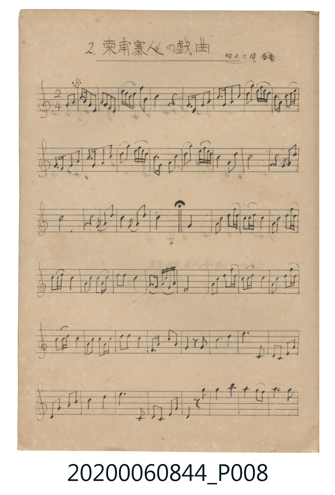
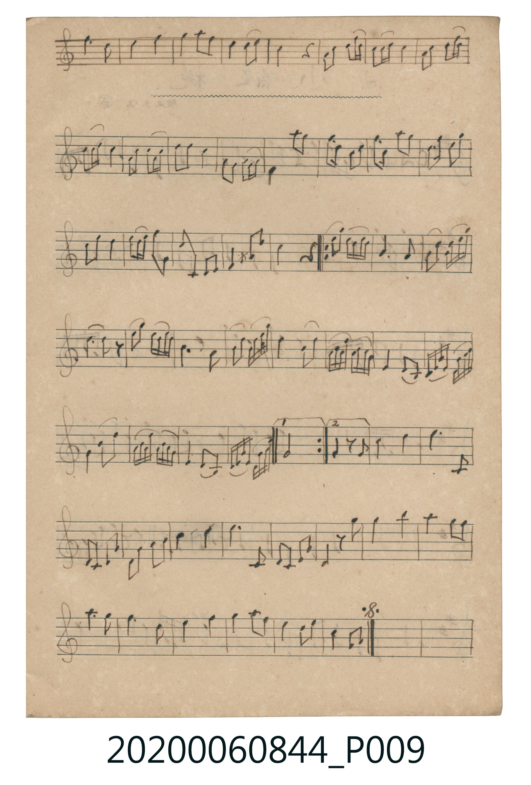

# 柬甫寨人の戲曲

> Re:Shōka 使用 AI 協助辨識與重建樂譜，可能會有錯誤。歡迎回報。

- **鋼琴伴奏版**：<br><audio controls src="kanbojiya_no_gikyoku.mp3"></audio>

- 曲：伝統曲 (合調・昭2.7.13抄)

## 說明

2. 柬甫寨人の戲曲 (Kanbojiya no Gikyoku)
Source: 唱歌帖 支那曲 (NMTH 2020.006.0844, Vol. IX) — P008.jpg–P009.jpg
Annotation: 昭2.7.13・合調
Notation: Handwritten 5-line staff (C major, 2/4 time, 94 bars)


## 歌詞

```text
（TMD 檔案未包含歌詞註解）
```

## ABC

<div class="abc-score" data-abc-src="kanbojiya_no_gikyoku.abc" aria-label="五線譜載入中"></div>

[下載 ABC 原始檔](kanbojiya_no_gikyoku.abc)

## TMD 檔案連結

- [主旋律 TMD 檔案](kanbojiya_no_gikyoku.tmd) [[在 TMD Studio 編輯](https://tmdlang.github.io/Tmd-TS/#tmd=s7IKdvYPcrWy4qpTUCpJTLdSSM7PyUlNLsnMz7MqzsjPTkzOyFeCS5bl55TmploBqXgDS4RwcX5pUXIqXH18Xn5JalJ-fjZCRUFRfllqXmIeUFVuYl5pcXJRZkFJfHJ-QSVCTWpZZkoqSEVqSmZJflFmYg6SxalFxWAngW2KLylKzIOYARREqAJqSs_MswLKAk0AyiTmxKcmFpfEJxZnJgKVaWkpPJu_5vmU1U_Xr3iya9fjxnXPOjY9m71JQUuLS9FWwdKMy95WwZnLxkjfxA5kJlDq_Z5ZT_bMfb51I0iZxtMJHS9W7X_cvPvZjLVGeuZ6hsbPulo0lbi49LUUbKkFuBQUFIz0cLhUwzsxLyk_K7MyUSEvX8E9M7syP7tUE6QlGBIHCk-nbHy2tufpjmkKz6asf9m0GKzLzzfEQ8HIwMhAz8DATM_AwsRERyEsP0dPwTNCU-FRwxSFAAMDC72sgvRHDZOBTEsQE2SoYx4wKhPBiUEB7meg_yEBAVLhB5f3SMxLKS_KLClJzVMw1c3JzEtVKC5JTEtT0HBWyE3Myi_SUQAGrEJJZm6qjoKliUJSYlEx2OWUBxkUKGjpc3HBA8gvHxo8Vr6pOfkplQ41BjXVIPsUbAzNtOzArBqF6ty0WgVTBV0wNAZiELtGwTBOwQzINAZjIwVDoJBxnIJRHEwCqDYOrBAoBNFrAKVroAbDzDIDYqAmkFo4E6wJ2QAks4EEkFmDqhesiFyTgarjEDbAxJEMgRmMMAFVA0gNCBrBvAgPMBisgXsfJANxFNRQYpSCbYBzIZ4FuxCmDDlgQWoREYFwI5gN8RCGINhcsFdhioDxighzlABAC1pwXEM9bwgxAcNHWJ0Edy6pDoOrhorB1YCTJlIiQJUAC4HCFi6FlDrByQDiWDgT5Buwj2AujYcKgDwIMRLEQkkp8LQAtgBiINwSIg2E5RZYPMO0myGMBKY_qJuREjTUVIR1aE6AORIiBJeFq4dahQhTlFwF0wnPxxQmNGTX4o1VUPjCkpkRPNVjhAFKpkLzA1gpurnQ4IXzEUGD5CmYGCwDgPQhBSUkUcFzAyJcUEMKvQxDCVhY_oXnY-QcBlQJLa3INBW1TMIwFe5slISBWtaiFAHIWR2cfkGBAooWUGCBSKBSlCxBNUMxixXkDI1RTmNL2rBMCI0nIvIzVUyEZ2aUfArPzoTyNUQULIBkPZ76D57kESYhpXNYgV3DVcvFpWungNkgUACKKnMBAA)]
- [鋼琴伴奏 TMD 檔案](kanbojiya_no_gikyoku_piano.tmd) [[在 TMD Studio 編輯](https://tmdlang.github.io/Tmd-TS/#tmd=s7IKdvYPcrWy4tLSUng2f83zKaufrl_xZNeux43rnnVsejZ7k4LG4-Ypj5sWPW7ue7Jny9Ol_U92z9BU0NLiUrRVsDTjsrdVcOayMdI3seOqU1ACqn-_Z9aTPXOfb90I1vt0QseLVfsfN-9-NmOtkZ65nqHxs64WTSUuLn0tBVtqAS4FBQUjPVzO907MS8rPyqxMVMjLV3DPzK7Mzy7VVHjUMEUhIDMRKOSYnJyfW5CYl5mbmlcCMio4v7QoOdVK4emUjc_W9jzdMU3h2ZT1L5sWg03z8w3xUDAyMDLQMzAw0zOwMDHRUQjLz9FT8IyAGmpgYKGXVZD-qGEykGkJYoIMdczLyy9JLMnMz7NSgIcFMFwgAQRSQXk4QIGClj4XF9zXfvlQP1v5pubkp1Q61BjUVIPsU7AxNNOyA7NqFKpz02oVTBV0wdAYiEHsGgXDOAUzINMYjI0UDIFCxnEKRnEwCaDaOLBCoBBErwGUroEaDDPLDIiBmkBq4UywJmQDkMwGEkBmDapesCJyTQaqjkPYABNHMgRmMMIEVA0gNSBoBPMiPMBgsAbufZAMxFFQQ4lRCrYBzoV4FuxCmDLkgAWpRUQEwo1gNsRDGIJgc8FehSkCxisizFECAC1owXEN9bwhxAQMH2F1Ety5pDoMrhoqBlcDTppIiQBVAiwEClu4FFLqBCcDiGPhTJBvwD6CuTQeKgDyIMRIEAslpcDTAtgCiIFwS4g0EJZbYPEM026GMBKY_qBuRkrQUFMR1qE5AeZIiBBcFq4eahUiTFFyFUwnPB9TmNCQXYs3VkHhC0tmRvBUjxEGKJkKzQ9gpejmQoMXzkcEDZKnYGKwDADShxSUkEQFzw2IcEENKfQyDCVgYfkXno-RcxhQJbS0ItNU1DIJw1S4s1ESBmpZi1IEIGd1cPoFBQooWkCBBSKBSlGyBNUMxSxWkDM0RjmNLWnDMiE0nojIz1QxEZ6ZUfIpPDsTytcQUbAAkvV46j94kkeYhJTOYQV2DVct1tYAuPET5IGjOVBQq2CobawNS17IbKAdZMiYx2sbwbnojQR0bUgJCokH1K9tDpdB5qHqQbEKRYqK1uHwGTHWIQeXCVw1ijH4NMECD0WUoFVYdaE4l8iYhNuEcDpuTyGzMfVQLcqISHIYwYvD-Vi9R5YnkDVh-I_4iCPSf6TGHsLhaCGDOyrwpBai_EeMhXhzAWo0IGRQNUFtxBM6BLxIhFuw2ohsEqL6pmpGwe43vCmNmJxCWmDiTzDokUREXsEZmuT4AzMGcDuQgsxHBauILvHxBwW-hEJcIBJwCI2tIz7_47eQpOAkufCjh4U48gHuUoIqYYov42HRir3WxNPG9EFuY5rAm5iG8Qqm8fEQBhAhaJCoAcI18cDmNkgYREI0gEiIGJyFXzHcWDS1YHETuFK4iwzAMujuhIiCzYC5FywBVQcyB24gCENYBByK7GmINTBzkIzFZhpEDOY7ND8hm4osAB-QwAxKuLfQjERVCw8oiPVoQYAZ1iixjKwUJAuMZLyhhmQqwreowYbFAQjHQjSBNCCCDVk1RiTAHAXXjCupEq0QJUHiSgBwLcQqRYkJNKWYDkWLaeKUoqds1PhGdQG2zAJLTqCCQddOAbNsUACKKnMBAA)]

## 分析

```text
================================================================================
📊 TMD Song Profile: [ 柬甫寨人の戲曲 ]
================================================================================
⏱  Duration:       1:57 (117.5s), 94 measures total
🎼 Key & Tempo:    首調基準 C, != 96.0 BPM, <2/4>
   - 分析範圍：      由實際發聲的音符與和弦推測調性；播放脈絡另行呈現
🎤 人聲音域:    A3 (MIDI 57) – A5 (MIDI 81) [跨度: 24 個半音 / 2.0 個八度, 難度: difficult]
   - 最低音:  A3 in [KanbojiyaNoGikyoku #1 @ m.37, 0:45]
   - 最高音: A5 in [KanbojiyaNoGikyoku #1 @ m.43, 0:53]
   - 適合: soprano, mezzo-soprano, tenor, baritone
🏛  結構:      KanbojiyaNoGikyoku (117.5s)
⚡ 編曲密度:        Peak 1 軌道同時演奏
🗝  調性診斷：       G 大調（純淨自然大調，未偵測到可信轉調）
   - 風格氣質:    純淨自然大調（陽光明朗、易唱易記，無明顯調外色彩）
   - 轉調歷程:    全曲維持單一推測調性（未偵測到可信轉調）
   - 核心骨幹音:  D, A, C, G, E
   - 調性數值:    G 大調 [相關度: 0.71, 穩定度: Moderate, 自然音純度: 100.0%]
   - 候選調性 (K-S): G 大調 (0.71), C 大調 (0.66), A 小調 (0.65)
   - 五度圈歷程:   +1
   - 各段落調性細節:
     • [KanbojiyaNoGikyoku #1]: G 大調 (r: 0.71, 自然音純度: 100.0%)

  [ 五度圈游移軌跡 ]
               C  
         F           [G ]*
      Bb               D  
      Eb               A  
         Ab           E  
            Db       B  
               F# 
     (* = active key center)

  [ 十二半音累積音高分佈 ]
     C  : █████████████████         19.7%
     C# :                            0.0%
     D  : ████████████████████████  27.2%
     D# :                            0.0%
     E  : █████████████             15.0%
     F  :                            0.0%
     F# :                            0.0%
     G  : ███████████████           17.1%
     G# :                            0.0%
     A  : ██████████████████        21.0%
     A# :                            0.0%
     B  :                            0.0%
--------------------------------------------------------------------------------
Assignment 軌道音域：
  - Melody        : A3 – A5 (24 個半音 / 2.0 個八度, 364 個音符)
================================================================================
```


## 原書掃描頁






