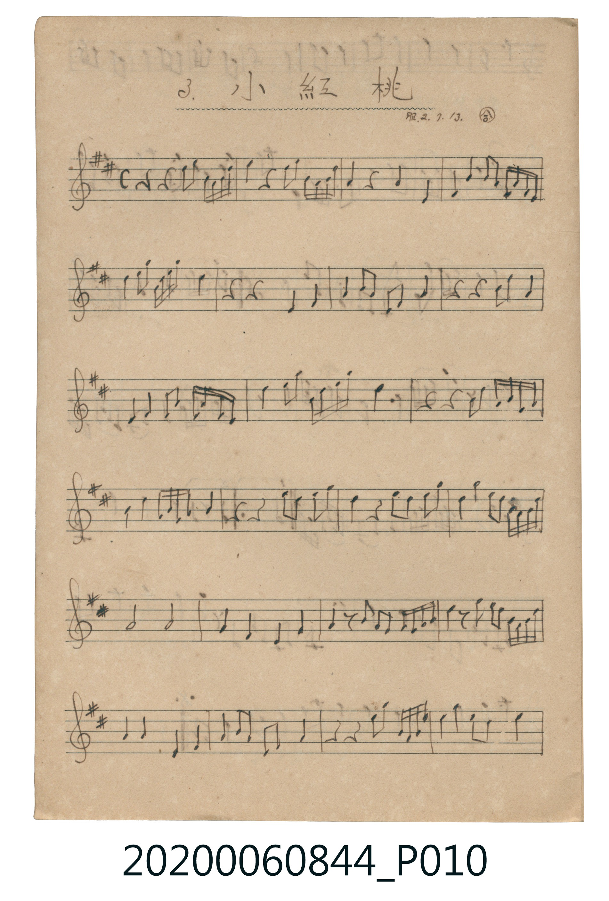
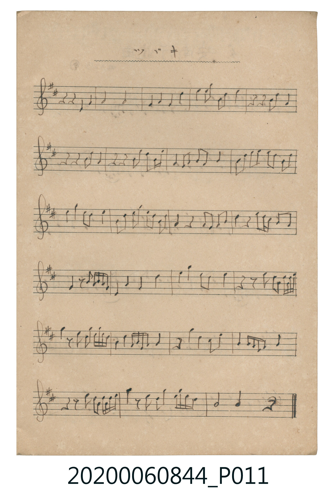

# 小紅桃

<audio controls src="xiaohongtao.mp3"></audio>

- 曲：伝統曲 (合調・昭2.7.13.抄)

## 說明

3. 小紅桃 (Xiaohongtao)
Source: 唱歌帖 支那曲 (NMTH 2020.006.0844, Vol. IX) — P010.jpg–P011.jpg
Annotation: 昭2.7.13.・合
Notation: Handwritten 5-line staff (2 sharps = D major, 4/4 time, 47 bars)

## 歌詞

```text
（TMD 檔案未包含歌詞註解）
```

## ABC

```abc
X:1
T:小紅桃
C:曲：伝統曲 (合調・昭2.7.13.抄)
M:4/4
L:1/16
Q:1/4=92
K:D
V:V1 name="Melody" snm="Mel"
[V:V1]
!mp! z4 z4 d2 e2 B A B d | e4 z4 d2 e2 B A B d | A4 z4 A4 D4 | E2 B2 A4 B A F E D4 |
B2 d2 B d e f d8 | z4 z4 D4 E4 | F2 A2 F4 D2 E2 A4 | z4 z4 F4 A4 |
E4 F4 A2 B2 A F E D | B4 d2 e2 B d e f d4 | e4 z4 B4 d B A F | B2 d2 B A F A B8 |
F4 z4 d2 B2 d2 e2 | d4 z4 d2 B2 d2 e2 | d4 e4 d2 B A F A B d | A8 A8 |
F4 D4 B,4 E4 | F2 z2 A2 F E D E F A B4 | d2 z2 d2 e2 d2 B A F A B d | F4 F4 B,4 E4 |
F2 A2 F2 D2 E4 F4 | z4 z4 B2 d2 B d e f | e4 d2 B2 d8 | z4 z4 F4 A4 |
A8 A8 | F4 A4 F4 B4 | d2 e2 d4 B2 d2 e4 | z4 z4 B4 A4 |
z4 z4 A4 B2 A2 | z4 z4 B2 e2 d2 B2 | F4 F2 A2 B2 A2 B4 | A2 d2 e2 f2 d2 B2 A2 B2 |
d2 f2 e2 B2 d8 | A2 B2 d2 e2 d2 B2 A2 B2 | F4 z4 F2 A2 F2 A2 | B2 z2 d B A F A2 B6 |
E2 z2 F A F E D8 | E4 F4 B8 | d2 e2 d2 B2 d8 | z2 z2 d2 e2 B A B d e4 |
e2 z2 d2 e2 B A B d A4 | A2 B2 A B A F A8 | z4 d2 e2 d2 A2 d4 | A2 F E D E F A B8 |
z2 z2 d2 e2 B A B d e4 | f2 z2 d2 e2 B2 e2 d B A B | A8 A4 z4 |
```

## TMD 檔案連結

- [主旋律 TMD 檔案](xiaohongtao.tmd) [[在 TMD Studio 編輯](https://tmdlang.github.io/Tmd-TS/#tmd=s7IKdvYPcrWy4qpTUCpJTLdSSM7PyUlNLsnMz7MqzsjPTkzOyFeCS5bl55TmploBqXgDS4RwcX5pUXIqXH18Xn5JalJ-fjZCRUFRfllqXmIeUFVuYl5pcXJRZkFJfHJ-QSVCTWpZZkoqSEVqSmZJflFmYg6SxalFxWAngW2KLylKzIOYARRU4tLSUni6of_5ltZnC5sVtLS4FG0VLI247G0VXLhsTPRN7EDGPJu96f2eWU_2zH2-dSOQraDxdELHi1X7HzfvfjZjrZGeuZ6hsd6zrhZNJS4ufS0FW2oBLgUFBWM9JOdpRGQm5mfk56WXJOZrgmSDIYGn8HTKxmdre57umKbwbMr6l02LwY708w3xUDAyMDLQMzAw0zOwMDHRUQjLz9FT8IzQVHjUMEUhwMDQQC-rIP1Rw2Qg0xDEBBnqmAeMg0RwLCog_Af0LNDXIHk_uKxHYl5KeVFmSUlqnoKpbk5mXqpCcUliWpqChpFCcUZiUUGxAjAcFXITs_KLdBSAoalQkpmbCmSZKyQlFhWDvUB5MEGBgpY-FxdSAFn5pubkp1Q61BjUKFSDbFKwMTTTsgOzgCK5BbUKBgq6YAijDeOAhBGIMFMwBWIgvwbCJ6jKFE0RjG8IpYHmgDUgZECajYGicBVQl4HUgK0Amwy0xzgOwkeGNZhuh9IgayAqjKGWgWiYCpAszAGYZsBUwlVAnQQzE1ke4hWIByCORg8bTNdjCUwkjZAAQQkAkAAoiNE8D3UWzDkoEQPXDbaqBmE5cargDkRzAUokwyA6H91hsDgxi4eZDlMIVgJyESSCQIFohOJXqJNAShDuxOYmmF0wGtMuJEfBkgMsKSBrxEwO2FIiUhSiBiRKOBCdsgiGKIZOuD_hKtDCB8XlcMdi9x02J6GrQ-RXCBu7Scjxg-xsWKjDdCOcDeIh3AgMWiT9MJUwN4ElwEqgeQtroMN0YSQYJAMxMg1ysoB4D6QOmu5gaQ3hbuSQAqUgkEKQCuSSDOEi9DSGkZOxuRVHckLNCvCiFxHDMFdh5hu4YkTRh4gThB8x7QRBNBfCow1hDrb8ix5WRPkAEsXoyhC2Q7TgzjUwJ9dw1XJx6dopINWGCkCuMhcA)]
- [鋼琴伴奏 TMD 檔案](xiaohongtao_piano.tmd) [[在 TMD Studio 編輯](https://tmdlang.github.io/Tmd-TS/#tmd=s7IKdvYPcrWy4tLSUni6of_5ltZnC5sVNB43T3nctOhxc9-TPVueLu1_snuGpoKWFpeirYKlEZe9rYILl42JvokdV52C0rPZm97vmfVkz9znWzcC2QoaTyd0vFi1_3Hz7mcz1hrpmesZGus962rRVOLi0tdSsKUW4FJQUDDWQ3ZzRGZifkZ-XnpJYr6mwqOGKQoBmYl5-QqOycn5uQWJeZm5qXklIF3B-aVFyalWCk-nbHy2tufpjmkKz6asf9m0GOx4P98QDwUjAyMDPQMDMz0DCxMTHYWw_Bw9Bc8IqKEGhgZ6WQXpjxomA5mGICbIUMe8vPySxJLM_DwrBYS_gYEADA2QPOUehgIFLX0uLiSvWvmm5uSnVDrUGNQoVINsUrAxNNOyA7OAIrkFtQoGCrpgCKMN44CEEYgwUzAFYiC_BsInqMoUTRGMbwilgeaANSBkQJqNgaJwFVCXgdSArQCbDLTHOA7CR4Y1mG6H0iBrICqMoZaBaJgKkCzMAZhmwFTCVUCdBDMTWR7iFYgHII5GDxtM12MJTCSNkABBCQCQACiI0TwPdRbMOSgRA9cNtqoGYTlxquAORHMBSiTDIDof3WGwODGLh5kOUwhWAnIRJIJAgWiE4leok0BKEO7E5iaYXTAa0y4kR8GSAywpIGvETA7YUiJSFKIGJEo4EJ2yCIYohk64P-Eq0MIHxeVwx2L3HTYnoatD5FcIG7tJyPGD7GxYqMN0I5wN4iHcCAxaJP0wlTA3gSXASqB5C2ugw3RhJBgkAzEyDXKygHgPpA6a7mBpDeFu5JACpSCQQpAK5JIM4SL0NIaRk7G5FUdyQs0K8KIXEcMwV2HmG7hiRNGHiBOEHzHtBEE0F8KjDWEOtvyLHlZE-QASxejKELZDtODONTAn13DVolaF4Ao_yANXXYitKtQ21obXYUA2It2ax2sbwaUIK0eWwaUaES0ohuMyFEULLIegyWNTi2oVPh-jOAPVD8Sw8RuOzfl4_Y3dCny-xBpSuGMOu3JiLYDHNVJU4LMFT-CSqBwj1HB7hKSwxeIRXAFAZkrBnj-o4B_s7iLgIZypD3tCxhr5xDmeslxCej6kLD6IjHRCYYTuDeLLWnSVOMOYOHeTmfLwZXCiCi5y7MJZLlBWGqL7hYyCl-g6CnfkEJ81SMrfpNeeZGQpQnFBvPn44oU0_-O0hswMg57usDeofHA1qDAyOKxPZhYPYwEbcXA2XmVwQXh_BC4Jl0I2DIshCHWwIQa4FBZFCKPweARZERZBsg2DdQvxmYTkbSzOx-ZtLGGNVRle45AiBVYO4jYUa_gQqQwhiNWRRAY3uhux-IjYSMSaHIl1JX57cboSa3RjdLyxRQ5-l5GZIIlN41QJRnxuxJOriSp1MEY3sAYhXueRo5DyYCRgP94SisR8jcVxWI3FG8dYXUlkgiQqzxBZ5JNcPOPPgiRGOHE-whvOBJIbRgoA19W6dgpI1bUCkKvMBQA)]

## 分析

```text
================================================================================
📊 TMD Song Profile: [ 小紅桃 ]
================================================================================
⏱  Duration:       2:02 (122.6s), 47 measures total
🎼 Key & Tempo:    首調基準 D, != 92.0 BPM, <4/4>
   - 分析範圍：      由實際發聲的音符與和弦推測調性；播放脈絡另行呈現
🎤 人聲音域:    B3 (MIDI 59) – F#5 (MIDI 78) [跨度: 19 個半音 / 1.6 個八度, 難度: challenging]
   - 最低音:  B3 in [Xiaohongtao #1 @ m.17, 0:43]
   - 最高音: F#5 in [Xiaohongtao #1 @ m.5, 0:11]
   - 適合: soprano, mezzo-soprano, tenor, baritone
🏛  結構:      Xiaohongtao (122.6s)
⚡ 編曲密度:        Peak 1 軌道同時演奏
🗝  調性診斷：       D 大調（純淨自然大調，未偵測到可信轉調）
   - 風格氣質:    純淨自然大調（陽光明朗、易唱易記，無明顯調外色彩）
   - 轉調歷程:    全曲維持單一推測調性（未偵測到可信轉調）
   - 核心骨幹音:  D, A, B, E, F#
   - 調性數值:    D 大調 [相關度: 0.83, 穩定度: Moderate, 自然音純度: 100.0%]
   - 候選調性 (K-S): D 大調 (0.83), A 大調 (0.73), B 小調 (0.71)
   - 五度圈歷程:   +2
   - 各段落調性細節:
     • [Xiaohongtao #1]: D 大調 (r: 0.83, 自然音純度: 100.0%)

  [ 五度圈游移軌跡 ]
               C  
         F            G  
      Bb              [D ]*
      Eb               A  
         Ab           E  
            Db       B  
               F# 
     (* = active key center)

  [ 十二半音累積音高分佈 ]
     C  :                            0.0%
     C# :                            0.0%
     D  : ████████████████████████  24.8%
     D# :                            0.0%
     E  : ████████████████          16.7%
     F  :                            0.0%
     F# : ██████████████            14.6%
     G  :                            0.0%
     G# :                            0.0%
     A  : ██████████████████████    23.1%
     A# :                            0.0%
     B  : ████████████████████      20.8%
--------------------------------------------------------------------------------
Assignment 軌道音域：
  - Melody        : B3 – F#5 (19 個半音 / 1.6 個八度, 263 個音符)
================================================================================
```


## 原書掃描頁






